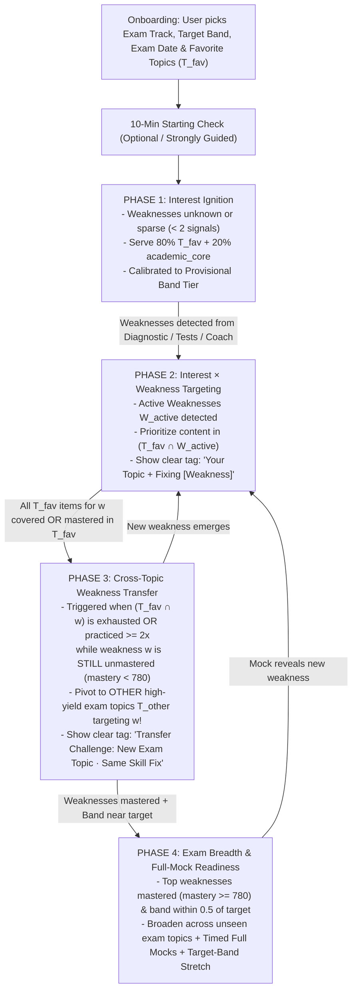
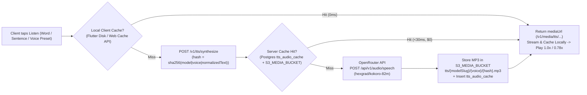
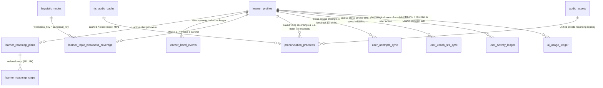

# Adaptive Personalization, Dynamic Band Evolution & Step-by-Step Roadmap Architecture (Mockza GLB + Sanjia IRN)

> **Status:** Architecture, UX & Implementation Master Plan  
> **Scope:** Full-stack (`backend/`, `app/` Flutter Mobile/Tablet, `web/` Desktop/Responsive SPA) across both editions (**Mockza GLB** English/LTR & **Sanjia IRN** Persian/RTL + Jalali).  
> **Core Goal:** Replace static "show everything at once" catalogs and disconnected scores with a **continuous band-estimation engine**, a **3-phase Interest → Weakness → Cross-Topic Transfer personalization loop**, and a **Durnama (دورنما) + Step-by-Step Progressive Roadmap** that makes every single screen feel calm, clear, and unmistakably tailored to the learner.

---

## Table of Contents

1. [Codebase Audit: What Exists Today vs. What Is Missing](#1-codebase-audit-what-exists-today-vs-what-is-missing)
2. [Core Adaptive Intelligence Engine (The Brain)](#2-core-adaptive-intelligence-engine-the-brain)
   - [2.1 Continuous Band Estimation & Confidence Model](#21-continuous-band-estimation--confidence-model)
   - [2.2 Unified 4-Skill Weakness Graph (Closing the Receptive Gap)](#22-unified-4-skill-weakness-graph-closing-the-receptive-gap)
   - [2.3 Canonical Topic Taxonomy & Content Metadata Tagging](#23-canonical-topic-taxonomy--content-metadata-tagging)
   - [2.4 The 3-Phase Topic × Weakness Adaptive Rotation Engine](#24-the-3-phase-topic--weakness-adaptive-rotation-engine)
   - [2.5 The "Durnama + Step-by-Step" Roadmap Generator](#25-the-durnama--step-by-step-roadmap-generator)
3. [Complete Page-by-Page Audit Matrix (All 26 Screens)](#3-complete-page-by-page-audit-matrix-all-26-screens)
4. [Flutter Mobile/Tablet UX & Architecture Blueprint (`app/`)](#4-flutter-mobiletablet-ux--architecture-blueprint-app)
5. [Web Desktop/Responsive SPA UX & Architecture Blueprint (`web/`)](#5-web-desktopresponsive-spa-ux--architecture-blueprint-web)
6. [Unified OpenRouter TTS (`hexgrad/kokoro-82m`) & AI Pronunciation Practice Studio (`google/gemini-3.1-flash-lite`)](#6-unified-openrouter-tts-hexgradkokoro-82m--ai-pronunciation-practice-studio-googlegemini-31-flash-lite)
   - [6.1 Codebase Audit: Current TTS & Speaking Practice Gaps](#61-codebase-audit-current-tts--speaking-practice-gaps)
   - [6.2 Configurable OpenRouter Model Architecture & 2-Tier Audio Caching](#62-configurable-openrouter-model-architecture--2-tier-audio-caching)
   - [6.3 Where Listen + Practice Lives Across Every Screen (Flutter & Web)](#63-where-listen--practice-lives-across-every-screen-flutter--web)
   - [6.4 Effortless 4-Step Shadow Practice Studio UX & Deep 3.1-Flash-Lite Analysis](#64-effortless-4-step-shadow-practice-studio-ux--deep-31-flash-lite-analysis)
7. [Backend Schema, Cross-Device Sync, Full Tracing & Cost Accounting](#7-backend-schema-cross-device-sync-full-tracing--cost-accounting)
   - [7.1 Full Database Structure (PostgreSQL + Flutter Drift + Web Dexie)](#71-full-database-structure-postgresql--flutter-drift--web-dexie)
   - [7.2 New & Enhanced API Endpoints (Learner, Sync, TTS, Pronunciation & Admin Trace/Cost)](#72-new--enhanced-api-endpoints-learner-sync-tts-pronunciation--admin-tracecost)
   - [7.3 Backend Hook Upgrades, Exact Token/Cost Instrumentation & Privacy Rules](#73-backend-hook-upgrades-exact-tokencost-instrumentation--privacy-rules)
8. [GLB vs. IRN (Sanjia) Edition & Low-Bandwidth Considerations](#8-glb-vs-irn-sanjia-edition--low-bandwidth-considerations)
9. [Edge Cases & Safety Guardrails](#9-edge-cases--safety-guardrails)
10. [Detailed Task-by-Task Implementation Plan & Low-RAM Verification](#10-detailed-task-by-task-implementation-plan--low-ram-verification)

---

## 1. Codebase Audit: What Exists Today vs. What Is Missing

A full inspection of `backend/`, `app/`, and `web/` confirms that **the core adaptive roadmap and personalization layer does NOT yet exist**. Key building blocks exist in isolation, but they are disconnected and every major surface dumps its entire content library at once.

| Capability | Current Codebase Reality (Verified) | Critical Gap to Solve |
| :--- | :--- | :--- |
| **10-Min Starting Check → Band Score** | `backend/apps/api/src/routes/diagnostic.ts` produces per-skill `suggestedTier` (`A1..C2`) & `weaknessFocus`. Neither Flutter (`diagnostic_notifier.dart`) nor Web (`DiagnosticSessionScreen.tsx`) updates band score. | Completing the 10-min check leaves Home & Progress showing **"Not yet estimated"** (`overallBand == null`) because `StudyMetricsCalculator.calculateEstimatedOverallBand()` only reads `exam_attempts` / `completedAttempts`. |
| **10-Min Starting Check → Weaknesses** | `worker/src/jobs/grade-writing.ts` & `grade-speaking.ts` call `recordPostEvaluationLinguisticSignals()` for diagnostic Writing/Speaking. | Diagnostic **Reading** and **Listening** `weaknessFocus` outputs are discarded — never written to `linguistic_nodes`. |
| **Ongoing Band Score Evolution** | `backend/packages/domain/src/exams/study-metrics-calculator.ts` (and Dart mirror) computes a **flat unweighted average** across all attempts forever, stored only locally in Drift/Dexie. | Old attempts from 2 months ago drag down recent progress equally; no provisional-to-calibrated Bayesian blend; no confidence badge; no server-side sync across Mobile ↔ Web; no band-up milestone trigger. |
| **Objective Tests → Weakness Tracking** | Reading/Listening sims & Micro-Drills grade locally (`ObjectiveResultScreen.tsx`, `EvaluationReviewScreen.dart`) and save `questionCorrectness`. | Zero extraction of objective weakness patterns (e.g., `TFNG`, `Matching Headings`, `Listening Distractors`, `Paraphrase Traps`) into the learner's weakness profile. |
| **Step-by-Step Roadmap + Panorama (دورنما)** | Does not exist anywhere in DB (`schema.ts`), API, Flutter, or Web. | No `learner_roadmap_plans` or `learner_roadmap_steps`. Home dumps 8+ competing actions at once (2 pillars, Recommendation, Daily Mission, Register Shifter, Drop Anything, Metric Hero, 4 Skill cards, Quick Drills, Full Mock, Study Week). |
| **Topic × Weakness Adaptive Rotation** | Onboarding asks for 8 interest topics (`onboarding_screen.dart:414`, `useOnboardingController.ts:27`) and pins them in `linguistic_nodes`. `graph-and-missions.ts:336-339` always picks `pinnedInterest ?? activeInterests[0]`. | Stuck permanently on topic #1 for Daily Mission; **zero** effect on Practice Packs, Micro-Drills, or Vocabulary; **zero** transition from favorite topics → interest∩weakness → other exam topics covering remaining weaknesses. |
| **Practice Catalog / Hub Personalization** | `routes/catalog.ts` returns packs sorted alphabetically by `packId`. `catalog_packs` has **no** `topicTags`, `cefrRange`, or `weaknessTags`. `PracticeHubScreen.dart` & `PracticeCatalogScreen.tsx` dump all 36+ packs & 7 drills flat. | A Band 5.5 user interested in Technology sees *"The Evolutionary Biomechanics of Deep-Sea Cephalopods"* mixed identically with every other pack; no "Recommended for Your Current Step" vs "Full Library" separation. |
| **Vocabulary Progressive Disclosure** | `starter-vocab.ts` seeds **320 cards** across 7 snake_case `topicTag` values (`environment`, `technology`, `education`, `society_economics`, `urbanization`, `academic_linking`, `reading_synonyms`), with **no** `cefrTier` or `bandRange`. All 320 become due on Day 1! | Opening Vocabulary on Day 1 shows **"320 words due for review"** — instant cognitive overload. Topic tags do not map to the 8 onboarding interest topics. |
| **Cross-Device Learner Profile** | `user_profiles` exists only locally in Flutter Drift (`core_tables.dart`) and Web Dexie (`mockza-db.ts` `localPreferences`). No Postgres `learner_profiles` table exists in `schema.ts`. | Signing in on Web after using Flutter Mobile loses target band, exam date, study focus, estimated band baseline, and roadmap progress. |

---

## 2. Core Adaptive Intelligence Engine (The Brain)

All deterministic math lives in a **single shared pure package** (`backend/packages/domain/src/personalization/`) with a **1:1 Dart mirror** (`app/lib/core/personalization/`) verified by golden-vector parity tests (extending `cross-codebase-parity.test.ts`), so **offline Flutter, offline Web, and online Backend always compute identical scores, priorities, and roadmap states**.

### 2.1 Continuous Band Estimation & Confidence Model

Instead of an all-or-nothing flat mean, every learner has a **Live Band Profile** per active `examId` (`ielts_academic`, `ielts_general`, `toefl_ibt`, `pte_academic`, `det`):

```text
LiveBandProfile {
  examId: SupportedExamId
  overallScore: number | null          // Quantized to exam scale (0.5 IELTS/TOEFL, 1 PTE, 5 DET)
  overallConfidence: 'none' | 'provisional' | 'developing' | 'calibrated'
  skills: Record<'reading'|'listening'|'writing'|'speaking', {
    score: number | null
    cefrEstimate: 'A1'|'A2'|'B1'|'B2'|'C1'|'C2' | null
    confidence: 'none' | 'provisional' | 'developing' | 'calibrated'
    sampleCount: number
    trendDelta: number | null          // Recent 3 attempts vs prior baseline
    lastUpdatedAtMs: number | null
  }>
  previousOverallScore: number | null  // Enables "+0.5 Band Up!" milestone banner
  lastBandShiftAtMs: number | null
}
```

#### Step 1 — Provisional Seeding from the 10-Min Starting Check
When a diagnostic skill completes with `status === 'provisional'` and `suggestedTier` (`A1..C2`), map cleanly to an **honest provisional numeric prior** (labeled clearly in UI as *"Provisional Baseline · From 10-min Check"*, never pretending to be an official score):

| CEFR Tier | IELTS (0–9) | TOEFL 2026 (1–6) | PTE (10–90) | DET (10–160) |
| :--- | :---: | :---: | :---: | :---: |
| `A1` | `3.5` | `1.5` | `24` | `45` |
| `A2` | `4.5` | `2.5` | `36` | `65` |
| `B1` | `5.5` | `3.5` | `50` | `85` |
| `B2` | `6.5` | `4.5` | `65` | `110` |
| `C1` | `7.5` | `5.5` | `79` | `135` |
| `C2` | `8.5` | `6.0` | `86` | `150` |

#### Step 2 — Continuous Recency- & Evidence-Weighted Updating
As the user completes real practice tests, each evidence point $i$ for skill $s$ carries weight:

$$w_i = w_{\text{source}}(i) \times \exp\!\left(-\frac{\ln 2 \cdot \text{ageDays}_i}{21}\right)$$

Where source reliability weights $w_{\text{source}}$ are:
- **Calibrated Full Mock section:** `1.00`
- **Timed Single-Skill Simulation (Exam Mode):** `0.85`
- **Untimed Single-Skill Simulation (Study Mode):** `0.45`
- **Daily Coach / Micro-Drill composite signal (only nudges ±0.25 max inside tier):** `0.20`
- **10-Min Diagnostic Prior:** `0.40` initially, **decaying automatically** as real attempts accumulate: $w_{\text{diag,eff}} = 0.40 \times 0.5^{n_{\text{real}}}$ (after 3 real tests in that skill, diagnostic contributes $< 5\%$, so real performance completely takes over!).

Per-skill score:
$$\hat{S}_s = \text{quantize}_{\text{exam}}\!\left(\frac{\sum_i w_i \cdot \text{score}_i}{\sum_i w_i}\right)$$

Confidence progression per skill (and overall):
- `none`: 0 diagnostic + 0 attempts.
- `provisional`: diagnostic only, OR 1 study-mode attempt.
- `developing`: 1–2 timed attempts (or 2–3 skills sampled).
- `calibrated`: $\ge 3$ timed attempts across all 4 skills (or $\ge 1$ Full Mock + recent skill tests).

**Trigger on Every Band Shift:** Whenever $\hat{S}_{\text{overall}}$ or any $\hat{S}_s$ moves by $\ge 1$ exam step (e.g., `+0.5` IELTS band), the engine emits a `BandShiftEvent` that:
1. Displays a celebratory, grounded update card (*"Estimated Reading moved 6.0 → 6.5 based on your last 2 timed passages"*).
2. Automatically recalibrates upcoming (not yet completed) roadmap steps to the new difficulty tier.

---

### 2.2 Unified 4-Skill Weakness Graph (Closing the Receptive Gap)

Extend the existing `linguistic_nodes` concept so **every skill** feeds one unified Weakness & Mastery model (without breaking existing `bottleneck` / `target_structure` / `interest_topic` nodes):

| Source Event | Extracted Weakness Keys (Canonical) | Polarity Rule |
| :--- | :--- | :--- |
| **10-Min Diagnostic (Reading & Listening)** | `reading:paraphrase_matching`, `reading:inference_detail`, `listening:distractor_traps`, `listening:detail_capture` | `gap_observed` if `weaknessFocus` present or tier below target; `target_used` if mastered at target tier. |
| **10-Min Diagnostic (Writing & Speaking)** | Existing System-1 AI bottlenecks + rubric-aligned keys (`writing:cohesion_linkers`, `writing:task_response`, `speaking:fluency_fillers`, `speaking:lexical_precision`, `grammar:*`) | Already wired via `recordPostEvaluationLinguisticSignals`; enrich with `diagnostic.weaknessFocus`. |
| **Reading Simulation & Objective Review** | Grouped by `questionType` error rate: `reading:tfng_trap` (`true_false_not_given` / `yes_no_not_given`), `reading:matching_headings`, `reading:summary_completion`, `reading:multiple_choice_inference` | Accuracy $< 65\%$ on $\ge 2$ questions of a type → `gap_observed`; accuracy $\ge 85\%$ → `target_used`. |
| **Listening Simulation & Objective Review** | `listening:distractor_traps`, `listening:form_note_completion`, `listening:multiple_choice_attitude`, `listening:map_diagram_labeling` | Accuracy $< 65\%$ → `gap_observed`; $\ge 85\%$ → `target_used`. |
| **Micro-Drills** | Maps directly from `drillType` (`speed_tfng` → `reading:tfng_trap`, `distractor_spotter` → `listening:distractor_traps`, `collocation_matcher` → `vocab:academic_collocation`, `paraphrase_matcher` → `reading:paraphrase_matching`, etc.) | Score $< 70\%$ → `gap_observed`; $\ge 85\%$ → `target_used`. |
| **Writing / Speaking AI Evaluation** | Criterion lowest sub-band (`TR/TA`, `CC`, `LR`, `GRA`, `FC`, `PR`) + inline AI bottlenecks | Lowest criterion $< \text{targetBand} - 0.5$ → `gap_observed`; $\ge \text{targetBand}$ → `target_used`. |
| **Vocabulary SRS Reviews** | Cards rated `Again (1)` twice within 7 days → `vocab:topic:<topicKey>` or `vocab:academic_linking` | Repeated lapse → `gap_observed`; graduation (`repetitions >= 3`) → `target_used`. |
| **Smart Coach (Daily Mission / Shifter / Drop)** | Existing System-1 linguistic signals | Already wired! |

**Weakness Lifecycle States (User-Facing Clarity):**
- **Active Weakness (`mastery < 600`):** Highlighted in Roadmap & Practice recommendations.
- **Improving (`600 <= mastery < 780`):** Moved to cross-topic verification / spaced check.
- **Covered / Mastered (`mastery >= 780` with $\ge 2$ positive evidence events across $\ge 2$ different sessions):** Moves to "Mastered Habits" and stops dominating the roadmap (periodic retention check every 14 days).

---

### 2.3 Canonical Topic Taxonomy & Content Metadata Tagging

Today onboarding uses 8 labels, vocab uses 7 snake_case tags, and exam packs have almost no topic metadata. We unify all of them under **10 Canonical Topic Keys** with bilingual labels (EN / FA):

| Canonical `topicKey` | Onboarding Chip (EN / FA) | Maps Existing Vocab `topicTag` | Maps Existing Seeded Packs (Examples) |
| :--- | :--- | :--- | :--- |
| `technology_ai` | Technology & AI / فناوری و هوش مصنوعی | `technology` | `ielts-acad-reading-pack-02` (Silicon Photonics), `ielts-writing-pack-01` (Workplace Automation), `ielts-speaking-pack-03` (Digital Media) |
| `career_workplace` | Career & Workplace / کار و حرفه | `society_economics` | `ielts-writing-pack-01`, `toefl-writing-pack-01` |
| `travel_culture` | Travel & Culture / سفر و فرهنگ | `society_economics` | `ielts-speaking-pack-02` (Travel & Cultural Traditions), `ielts-writing-pack-04` (Cultural Preservation) |
| `health_sports` | Health & Sports / سلامت و ورزش | `education`, `environment` | `ielts-speaking-pack-04` (Sports, Wellness & Public Health), `ielts-acad-reading-pack-06` (Neurological Plasticity) |
| `science_climate` | Science & Climate / علم و محیط زیست | `environment` | `ielts-acad-reading-pack-01` (Deep-Sea Cephalopods), `pack-03` (Halophyte Farming), `pack-04` (Avian Ecology), `listening-pack-02-au` (Barrier Reef), `pack-03-us` (Micro-Grid) |
| `arts_media` | Cinema & Arts / سینما و هنر | `reading_synonyms` | `ielts-speaking-pack-01` (Science Fiction), `ielts-speaking-pack-03` (Digital Media) |
| `business_finance` | Business & Finance / کسب‌وکار و مالی | `society_economics` | `ielts-writing-pack-02` (Household Energy Expenditure), `writing-pack-03` (University Tuition) |
| `education_campus` | Education & Research / آموزش و دانشگاه | `education` | `ielts-listening-pack-01-uk` (Campus Library), `toefl-reading/listening/speaking-pack-01` |
| `urban_society` | Cities & Infrastructure / شهرسازی و جامعه | `urbanization` | `ielts-acad-reading-seed-01` (Urban Microclimates), `pack-05` (Subterranean Transit), `ielts-gt-reading-seed-01` (Civic Library) |
| `academic_core` | Core Exam Language / ساختارهای کلیدی آزمون | `academic_linking`, `reading_synonyms` | Universal high-yield linkers, paraphrases & distractors (always blended as a 20–30% backbone!) |

Every content item (`catalog_packs`, `micro_drills`, `vocab_deck_cards`) receives lightweight, explicit metadata:
- `topicKeys: string[]` (1–2 canonical keys)
- `cefrMin: 'A2'|'B1'|'B2'|'C1'`, `cefrMax: 'B1'|'B2'|'C1'|'C2'` (or `bandMin`..`bandMax`)
- `weaknessTags: string[]` (which canonical weakness keys this item trains)
- `estimatedMinutes: number`

---

### 2.4 The 3-Phase Topic × Weakness Adaptive Rotation Engine

This directly implements your exact pedagogical strategy: **start with topics the user loves → discover their real weaknesses → fix those weaknesses inside their favorite topics → once covered (or exhausted), transfer those same weaknesses to OTHER exam topics!**



#### Exact Deterministic Ranking Formula (Used Across Roadmap, Practice, Drills, Vocab & Daily Coach)

For any candidate item $x$ (an Exam Pack, Micro-Drill, Vocab Wave, or Daily Coach Topic-Prompt):

$$\text{Score}(x) = 0.38 \cdot \text{WeaknessMatch}(x) + 0.27 \cdot \text{TopicPhaseFit}(x) + 0.20 \cdot \text{BandFit}(x) + 0.15 \cdot \text{Novelty}(x)$$

Where:
1. **`WeaknessMatch(x)` (`0..1`):** Highest priority weight among `x.weaknessTags ∩ W_active` (using `computeNodePriorityScore` from `linguistic-graph-math.ts`).
2. **`TopicPhaseFit(x)` (`0..1`):** Depends cleanly on the active phase for the target weakness $w$:
   - **Phase 1 (Interest Ignition):** `1.0` if `x.topicKeys ∩ T_fav ≠ ∅`, `0.55` if `academic_core`, `0.15` otherwise.
   - **Phase 2 (Interest × Weakness):** `1.0` if `x.topicKeys ∩ T_fav ≠ ∅` AND `w ∈ x.weaknessTags`; `0.65` if `x.topicKeys ∩ T_fav ≠ ∅` (not yet exhausted); `0.30` otherwise.
   - **Phase 3 (Cross-Topic Transfer for weakness $w$):** Triggered per weakness $w$ when `coverageCount(T_fav, w) >= 2` OR zero unseen items remain in `(T_fav ∩ w)`. Now **inverts** the topic bonus: `1.0` for unseen high-yield exam topics `T_other` that target $w$, `0.40` for `T_fav` (already practiced), preventing tunnel-vision on only one subject!
   - **Phase 4 (Breadth & Full Mock):** `1.0` for least-visited exam domains + Full Mock packs.
3. **`BandFit(x)` (`0..1`):** Gaussian/triangular closeness to learner's `currentBand + 0.5` ("Zone of Proximal Development" — slightly challenging, never crushing). For a Band `5.5` user, `B1–B2` content scores `1.0`, `C2` scores `0.25`.
4. **`Novelty(x)` (`0..1`):** `1.0` if never attempted, `0.45` if attempted $> 14$ days ago with low score (retry candidate), `0.05` if completed within last 7 days.

> **Why this is non-naive:** Phase transitions happen **per weakness**, not as a blunt global switch! A learner can be in **Phase 3 (Cross-Topic Transfer)** for `reading:tfng_trap` (already practiced in Tech & Sports, now testing it in Environment/Marine Biology) while simultaneously in **Phase 2 (Interest × Weakness)** for a newly discovered `speaking:cohesion_linkers` gap (drilled first in their favorite Tech topic)!

---

### 2.5 The "Durnama + Step-by-Step" Roadmap Generator

Users get overwhelmed when an app shows 5 tabs, 36 tests, 320 vocabulary words, and 4 AI tools at once. Conversely, users feel trapped if they cannot see **where they are heading (دورنما / big-picture vision)**.

#### The 4-Milestone Panorama ("دورنما")
Generated deterministically from `(examId, currentBand, targetBand, targetDateSerial, studyFocus, favoriteTopics, activeWeaknesses)`:

| Milestone | Name (EN / FA) | What It Covers | Unlocking & Pacing |
| :--- | :--- | :--- | :--- |
| **M1** | **Baseline & Interest Warmup** / *شروع و شناخت سطح* | 1. 10-Min Starting Check *(auto-checked if done)*<br>2. Vocab Wave 1 (15–20 words in Favorite Topics + Core)<br>3. First Favorite-Topic Practice/Coach Session | Active immediately on Day 1. Takes 1–3 days. |
| **M2** | **Fix Your Top Weaknesses (In Topics You Love)** / *رفع نقاط ضعف با موضوعات دلخواه* | 4–6 targeted steps mixing:<br>- Micro-Drills for top Reading/Listening weaknesses<br>- Daily 10-Min Coach & Upgrade Speaking for Writing/Speaking gaps<br>- Vocab Wave 2 (15–20 words matched to band + interests)<br>- 1–2 Focused Skill Tests in favorite topics | Adapts dynamically after M1 & after every test. |
| **M3** | **Cross-Topic Transfer & Band Push** / *تسلط در موضوعات متنوع آزمون* | 4–6 steps pivoting to **new exam topics** (`T_other`) carrying the remaining uncovered weaknesses + Vocab Wave 3 (Band-target academic collocations) + Timed Section Mocks (Exam Mode). | Auto-recalibrates when band shifts up or Phase 3 triggers. |
| **M4** | **Full-Exam Stamina & Target Lock** / *شبیه‌سازی کامل و تثبیت نمره هدف* | Full Mock Orchestrator + Mistake-to-Deck Mastery Sweep + Final Weak-Spot Polish + Exam-Day Pacing Check. | Scales step count to remaining days before `targetDateSerial`. |

#### Step-by-Step Disclosure Rules (Anti-Overload Guarantee)
1. **Default View = ONE Current Active Step ("Do This Next"):** Shows exact title, estimated time (`~10 min`), **WHY it's here** (*"Selected because: your favorite topic Tech & AI + fixes TFNG traps + fits Band 6.0"*), and ONE clear primary CTA button.
2. **Next 1–2 Steps = Visible as Compact "Up Next" Preview:** So the learner feels momentum without decision fatigue.
3. **Full Panorama (دورنما) = Always 1 Tap/Click Away (Never Cluttering the Active Task):**
   - On **Flutter**: Compact progress rail at top of Home (`Milestone 2 of 4 · Step 5/14 · View Roadmap →`) opening the dedicated full-screen vertical **Roadmap Journey View**.
   - On **Web**: Clean collapsible horizontal **Milestone Panorama Bar** at top of Home + dedicated `/roadmap` page with side-by-side Milestone Timeline & Step Inspector.
4. **Soft Guidance, Never Hard Prison:**
   - Future steps show a gentle `"Up next"` indicator (not an aggressive lock) and can be previewed or jumped to via `"Jump to this step anyway"`.
   - Every section (Practice, Vocabulary, Smart Coach) defaults to **"Your Path (Recommended)"** mode, with a clean secondary toggle/tab to **"Browse All Library"** for power users who want free exploration!
5. **`studyFocus` Awareness (`exams` vs `coach` vs `both`):**
   - `exams`: Roadmap steps prioritize Timed Skill Packs, Micro-Drills, Vocab Waves, and Full Mocks (Smart Coach appears gently as optional polish).
   - `coach`: Roadmap steps prioritize Daily 10-Min Coach, Register Shifter, Drop Anything, Vocab Waves, and short Micro-Drills (Full Mocks stay optional).
   - `both` (Recommended): Balanced closed-loop cadence interleaving Practice Tests (diagnose & verify band) with Smart Coach + Vocab Waves (fix weaknesses rapidly).

---

## 3. Complete Page-by-Page Audit Matrix (All 26 Screens)

Every screen in both Flutter (`app/lib/features/*`) and Web (`web/src/spa/features/*`) has been audited for personalization need:

| # | Screen / Feature | Flutter File | Web File | Priority Tier | Personalization Needed? | Exact Role in the Adaptive System |
| :-: | :--- | :--- | :--- | :---: | :---: | :--- |
| 1 | **Onboarding & Screening** | `onboarding_screen.dart` | `WelcomeScreen.tsx`, `GoalSetupScreen.tsx` | **Tier 1** | **YES (Critical)** | Elevate Favorite Topics + Daily Study Pace (`15 / 30 / 60 min`); show instant live preview of the user's personalized 4-Milestone Roadmap before finishing. |
| 2 | **10-Min Check Intro** | `diagnostic_intro_screen.dart` | `DiagnosticIntroScreen.tsx` | **Tier 1** | **YES (High)** | Clearly frame why this 10-min check matters: *"Sets your starting band estimate & builds your step-by-step roadmap."* |
| 3 | **10-Min Check Session** | `diagnostic_session_screen.dart` | `DiagnosticSessionScreen.tsx` | **Tier 2** | **Partial** | Keep calibrated adaptive A1–C2 routing intact; on submit, capture Reading/Listening weaknesses & seed provisional band. |
| 4 | **10-Min Check Results** | `diagnostic_results_screen.dart` | `DiagnosticResultScreen.tsx` | **Tier 1** | **YES (Critical)** | Upgrade from static 4 cards to: **Provisional Band Estimate Hero + Top Detected Weaknesses + Instant "Your Personalized Roadmap (دورنما)" Reveal + Step 1 Launch CTA**. |
| 5 | **Home Dashboard** | `home_screen.dart` | `HomeScreen.tsx` | **Tier 1** | **YES (Critical)** | Replace cluttered multi-card wall with: **(1) Live Band + Confidence + Gap Pill, (2) Compact Roadmap Panorama Strip, (3) Single Active Step Hero Card with "Why this step?", (4) Compact Quick-Resume / Today's Vocab Wave**. |
| 6 | **Roadmap Journey Page (NEW)** | `roadmap_screen.dart` *(new)* | `RoadmapScreen.tsx` *(new)* | **Tier 1** | **YES (Critical)** | Full interactive **دورنما (Panorama)** showing Milestones M1–M4, completed steps, active step, upcoming preview, current Topic×Weakness phase badge, and recalibration history. |
| 7 | **Practice Hub / Catalog** | `practice_hub_screen.dart`, `practice_setup_screen.dart` | `PracticeCatalogScreen.tsx` | **Tier 1** | **YES (Critical)** | Default to **"Recommended For You"** (top 3 packs ranked by Phase × Weakness × Band Fit with transparent reason chips) + collapsible/tabbed **"All Packs"** with Topic & Band filters. |
| 8 | **Micro-Drills** | `micro_drills_screen.dart` | `MicroDrillsScreen.tsx` | **Tier 1** | **YES (Critical)** | Put a single **"Best Next 3-Min Drill"** hero matched to active weakness at top; hide mismatched exam-track drills by default; feed drill results back into Weakness Graph & Roadmap! |
| 9 | **Vocabulary Hub** | `vocabulary_screen.dart` | `VocabHubScreen.tsx` | **Tier 1** | **YES (Critical)** | **Eliminate the 320-word Day-1 dump!** Introduce **Progressive Vocab Waves** (15–20 words unlocked per roadmap step: Favorite Topics + Current Band first → Academic Core → Exam Breadth), daily new-word cap (`10/day`), Mistake-to-Deck priority lane, and "Current Wave / All Unlocked / Full Library" tabs. |
| 10 | **Vocabulary Review & Detail** | `vocab_review_screen.dart`, `vocab_word_detail_screen.dart` | `VocabReviewScreen.tsx`, `VocabWordDetailScreen.tsx` | **Tier 1** | **YES (High)** | Order review queue: (1) Saved Mistakes due, (2) Current Wave due, (3) Active-topic new cards up to daily cap. Show *"Why this word?"* badge (Topic + Band Target). Feed repeated lapses into Weakness Graph. |
| 11 | **Smart Coach Hub** | `coach_hub_screen.dart` | `CoachHubScreen.tsx` | **Tier 1** | **YES (Critical)** | Show active Roadmap coaching step & current **Topic × Weakness Phase** (*"Phase 2: Fixing Cohesion using Technology & AI"* or *"Phase 3: Transferring Cohesion to Environment"*). Highlight which of the 3 tools is best right now. |
| 12 | **Today's 10-Min Coach** | `daily_mission_screen.dart` | `DailyMissionScreen.tsx` | **Tier 1** | **YES (Critical)** | Wire backend mission synthesis to **3-Phase Topic × Weakness Rotation** + **Band-calibrated complexity** + **Current Vocab Wave due words**. Show reason banner ("Topic chosen because...") & mark linked Roadmap step complete on submit. |
| 13 | **Weak Spots & Topics Graph** | `linguistic_graph_screen.dart` | `LinguisticGraphScreen.tsx` | **Tier 1** | **YES (High)** | Upgrade to show **all 4 skills' weaknesses** (Reading/Listening traps + Writing/Speaking habits), **Topic × Weakness Coverage Matrix**, and favorite-topic editor that immediately refreshes the Roadmap. |
| 14 | **Upgrade My Speaking (Register Shifter)** | `register_shifter_screen.dart` | `RegisterShifterScreen.tsx` | **Tier 2** | **YES (Medium)** | Calibrate the target ladder highlight to the learner's band (e.g., Band 5.5 user focuses on `Casual → Clear B2 / Band 6.5` first, Band 7.0 user focuses on `Band 8.0+ Precision`); prefill optional starter prompts from favorite topics / active weaknesses. |
| 15 | **Learn From Anything (Drop Hub & Drill)** | `drop_hub_screen.dart`, `drop_drill_screen.dart` | `DropHubScreen.tsx`, `DropDrillScreen.tsx` | **Tier 2** | **YES (Medium)** | Auto-detect dropped content topic → reinforce/discover interest topics; match generated drill difficulty to learner's band; highlight phrases targeting active weaknesses; allow counting as an optional Coach step. |
| 16 | **Reading / Listening / Writing / Speaking Simulators** | `reading_sim`, `listening_sim`, `writing_sim`, `speaking_sim` | `Reading/Listening/Writing/SpeakingSimulatorScreen.tsx` | **Tier 2** | **YES (Medium)** | Display subtle pre-test **Step Context Strip** (*"Roadmap Step 4 · Focus: Paraphrase & TFNG · Target Band 6.5"*); tune Study-Mode scaffolding hints to current band; emit structured signals on completion. |
| 17 | **Full Mock Orchestrator** | `full_mock_screen.dart` | `FullMockOrchestratorScreen.tsx` | **Tier 2** | **YES (Medium)** | Show **Mock Readiness Indicator** (e.g., *"Recommended in Milestone 4 — or try anytime for a full calibrated score"*); on completion, trigger high-weight (`1.0`) band recalibration & full roadmap refresh. |
| 18 | **Objective Result & AI Evaluation Review** | `evaluation_review_screen.dart` | `ObjectiveResultScreen.tsx`, `EvaluationResultScreen.tsx` | **Tier 1** | **YES (Critical)** | Add **"Roadmap & Band Impact" Card** right inside results: shows Band change (`6.0 → 6.5`), newly detected/fixed weaknesses, completed roadmap step checkmark, and 1-tap **"Start Next Roadmap Step"** CTA! |
| 19 | **Progress & Analytics** | `progress_screen.dart`, `progress_skill_screen.dart`, `progress_attempts_screen.dart` | `ProgressScreen.tsx`, `CompareAttemptsScreen.tsx` | **Tier 1** | **YES (High)** | Display **Confidence-Aware Band Trajectory** (distinguishing Provisional Baseline vs Calibrated Tests), **Roadmap Milestone Progress**, **Skill-level Weakness Drill-Down**, and **Topic Coverage Radar/Chips**. |
| 20 | **Settings** | `settings_screen.dart` | `SettingsScreen.tsx` | **Tier 2** | **YES (High)** | Add **Personalization & Roadmap Controls**: Edit Favorite Topics, Daily Study Pace (`15 / 30 / 60 min`), Guided Path vs Free Explore default, and "Recalibrate / Retake 10-Min Check". |
| 21 | **Auth / Paywall / Billing Callback** | `auth_screen.dart`, `paywall_screen.dart`, `billing_callback_screen.dart` | `AuthScreen.tsx`, `PaywallScreen.tsx` | **Tier 3** | **Light** | On Auth sign-in, merge local guest roadmap & band baseline into account seamlessly. On Paywall, show personalized value (*"Unlock full AI coaching for your Band 6.0 → 7.5 roadmap"*). |

---

## 4. Flutter Mobile/Tablet UX & Architecture Blueprint (`app/`)

Mobile learners study in **short 5–15 minute bursts on small screens** (360dp–430dp). Clutter kills mobile retention immediately. Every Flutter screen below is designed for **thumb-friendly progressive disclosure**, **strict RTL/LTR parity (`EdgeInsetsDirectional`, Jalali milestone dates on Sanjia)**, and **offline-first Drift reactivity**.

### 4.1 Mobile Navigation Shell (`app_router.dart` & `app_scaffold_shell.dart`)
Keep the **5 clean bottom tabs** (never add a 6th tab on mobile!):
1. **Home** (`/home`) — *"Today's Step + Band + Compact Roadmap Strip"* (becomes the calm daily launchpad).
2. **Practice** (`/practice`) — *"For Your Step"* (default segment) | *"All Tests"* (secondary segment).
3. **Smart Coach** (`/coach`) — *"Today's Coach Step + 3 Guided Tools"*.
4. **Vocab** (`/vocabulary`) — *"Today's Wave"* (default) | *"My Mistakes"* | *"Full Deck"*.
5. **Progress** (`/progress`) — *"Band Evolution + Roadmap Panorama + Skill Analytics"*.

Plus **1 dedicated push route** for the full-screen **Roadmap Panorama**:
- `AppRoutes.roadmap` (`/roadmap`) — reachable in 1 tap from the Home Roadmap Strip, Diagnostic Results, Post-Test Results, and Progress!

### 4.2 Flutter Screen-by-Screen Design

#### A. Onboarding (`onboarding_screen.dart` + `onboarding_notifier.dart`)
- **Current issue:** Step 1 (`_GoalSetupStep`) packs Study Focus + 8 Topics + Target Score + Exam Date + Diagnostic Toggle into one very long scroll, and topics feel "optional/Coach-only".
- **Redesign (Clean 3-Step Mobile Wizard — Fast, 30 Seconds Total):**
  - **Step 0 — Target Exam:** Existing clean exam cards (`IELTS Academic`, `IELTS General`, `TOEFL iBT`, `PTE`, `DET`).
  - **Step 1 — Goal, Date & Study Mode:** Target Score slider, Exam Date (Jalali picker on IRN / Gregorian on GLB), Study Focus (`Both` / `Mock Exams` / `Smart Coach`), plus a **3-pill Daily Pace chip** (`15 min · Light`, `30 min · Steady`, `60 min · Intensive`).
  - **Step 2 — Your Interests & Instant Roadmap Preview:**
    - Reword heading from *"optional for Smart Coach"* to **"What topics do you enjoy? We'll start your roadmap here"** (tap 2–4 chips from the 8 canonical topics with crisp icons).
    - Below the chips, render a live **mini 4-node Roadmap Preview Card** (*"Step 1: 10-Min Level Check → Step 2: Tech & AI Warmup + 15 Words → Step 3: Fix Your Weaknesses → Step 4: Full Exam Readiness"*).
    - Sticky bottom CTA: **"Start 10-Min Level Check (Builds Your Exact Plan)"** + quiet text link *"Skip check — start with default plan"*.

#### B. 10-Min Starting Check Results (`diagnostic_results_screen.dart`)
- **Top Hero — Provisional Band Reveal:**
  - Animated score ring showing **Provisional Estimated Band** (e.g., `Band 6.0` with a calm badge: *"Provisional · Refines as you practice"*), side-by-side with `Target 7.5`.
  - 4 compact horizontal skill bars (`R: 6.5`, `L: 6.0`, `W: 5.5`, `S: 6.0`) — expandable on tap to inspect observations & retake single skill.
- **Section 2 — "Your First 2 Focus Weaknesses":**
  - Clean chips extracted from all 4 skills (e.g., *Listening Distractor Traps*, *Writing Complex Sentences*).
- **Section 3 — "Your Personalized Roadmap (دورنما)":**
  - Compact 4-milestone vertical preview showing how their favorite topics (`Tech & AI`, `Sports`) kick off Milestone 1–2 and expand to exam breadth in Milestone 3–4.
- **Sticky Bottom Bar:** Primary CTA: **"Begin Step 1 of Your Roadmap"** (deep-links directly to Step 1 — never dumps to a generic catalog!) + secondary text button **"View Full Roadmap"**.

#### C. Home Dashboard (`home_screen.dart` + `home_notifier.dart`) — *Calm Single-Focus Launchpad*
Eliminate the 8-widget scroll wall. Organize vertically into **4 crisp, breathing sections**:
1. **Compact Header + Live Band Pill:**
   - Brand header + Track selector + compact **Band Meter Card** (`Current 6.0 → Target 7.5`, confidence chip: *Provisional / Developing / Calibrated*, countdown chip: *28 days left*). Tapping opens `/progress`.
   - If a **Band Shift** happened recently, show a dismissible mint celebratory banner (*"Band Updated: 6.0 → 6.5! Roadmap adjusted."*).
2. **Roadmap Panorama Strip (دورنما):**
   - Clean 4-dot horizontal milestone bar (`M1 ✓ — [M2 Active] — M3 — M4`) with subtitle: *"Milestone 2: Fixing Weak Spots in Tech & AI · Step 4 of 14"* and a `View Map →` button pushing `/roadmap`.
3. **THE Hero Card — "Your Next Step Right Now":**
   - Shows ONLY the single active roadmap step (or resumable in-progress attempt if one exists!):
     - Step number badge (`Step 4 · ~12 min`) + Phase tag (`Your Interest + Weakness Fix` or `Cross-Topic Transfer`)
     - Step title (e.g., *"Reading Practice: Silicon Photonics"* or *"10-Min Coach: Balancing Trade-Offs in Tech"* or *"Vocab Wave 2: 15 Tech & Core Words"*)
     - 1-line transparent **Why this step?**: *"Targets your TFNG mistakes using your favorite topic (Tech & AI) at Band 6.5 difficulty."*
     - Big `PrimaryButton`: **"Start Step 4"**
     - Subtle secondary link beneath: *"Switch / Pick another step"* (opens bottom sheet with Step 5 preview or jumps to `/roadmap`).
4. **Compact "Daily Quick Check" Row (2 Mini Tiles only — no giant cards):**
   - Mini Tile A: **Today's Vocab Wave** (`10 words ready · Wave 1`) → pushes `/vocabulary/review`.
   - Mini Tile B: **Study Week Streak** (`3/7 days`) + quick `10-Min Coach` status dot.
   - *(Notice: The 4 giant Skill Metric Cards, duplicate Recommendation + Mission cards, and unguided buttons are REMOVED from Home and live cleanly in Practice/Progress/Coach!)*

#### D. Dedicated Roadmap Screen (`app/lib/features/roadmap/presentation/roadmap_screen.dart` — NEW)
- **Top Sticky Summary Card:** Current Band → Target Band progress bar + Exam Date (Jalali on IRN) + Active Phase pill (`Phase 2: Interest × Weakness`).
- **Interactive Vertical Milestone Timeline (Stepper):**
  - **Completed Milestones/Steps:** Collapsed by default into clean green summary rows (`Milestone 1 · 3/3 completed — Tap to review`) so the user isn't scrolling past history.
  - **Active Milestone (Expanded):**
    - Active Step highlighted with primary border, pulsing accent dot, duration, **Topic Badge**, **Weakness Badge**, and inline **"Start Now"** button.
    - Next 2 steps visible cleanly below as *"Up next"* cards (tappable to preview or *"Jump ahead"*).
    - Remaining steps in future milestones shown as **High-Level Milestone Outlook Cards (دورنما)** — e.g., *"Milestone 3: Cross-Topic Transfer (4 steps · Unlocks after Milestone 2) — Will apply your cohesion & TFNG fixes to Environment, Urbanization & Education."*
- **AppBar Action:** `Personalize` icon opening a bottom sheet to edit Favorite Topics / Daily Pace / Recalibrate Plan.

#### E. Practice Hub (`practice_hub_screen.dart`)
- **Top Segmented Control (`For Your Path` [default] | `All Tests`):**
  - **`For Your Path` (Default — Calm & Focused):**
    - Shows **at most 3–4 curated cards** for the active track:
      1. **Current Roadmap Practice Step** (if applicable, highlighted hero card).
      2. **Top Weakness-Targeted Pack** (with tags: `Band 6.5 Fit` · `Topic: Tech & AI` · `Fixes: TFNG`).
      3. **Best 3-Min Micro-Drill** (matched to active objective weakness).
      4. **Cross-Topic Transfer Challenge** (shown when Phase 3 is active for a skill).
    - Clean button at bottom: *"Browse all 24 packs →"* (switches to `All Tests`).
  - **`All Tests` (Full Library Mode):**
    - Keeps existing Exam/Study mode switch + Skill filter + Track filter, AND adds **Topic Filter Chips** + **Difficulty Band Badge** (`B2 · Band 6.0–7.0`) + subtle *"Matches your weakness"* star icon on matching packs.

#### F. Vocabulary (`vocabulary_screen.dart` & `vocab_review_screen.dart`)
- **Fixes the 320-Word Overload Completely:**
  - Introduces **Progressive Vocab Waves** (each Wave = 15–20 cards unlocked step-by-step):
    - **Wave 1 (Unlocked on Day 1):** 15 high-frequency cards filtered by `(Favorite Topics + Academic Core)` at `currentBand` tier.
    - **Wave 2 (Unlocks when >= 60% of Wave 1 reaches `learning/mastered` OR Milestone 2 starts):** Next 15–20 cards targeting active weaknesses + remaining favorite topics.
    - **Wave 3+:** Expands progressively to Cross-Topic Exam Domains (`environment`, `urbanization`, `education`, `society_economics`) and Band-target C1 upgrades!
  - **Daily New-Card Cap:** Default `10 new cards/day` (configurable `5 / 10 / 20`) + due reviews. So a new user sees **"10 words for today (Wave 1 · Tech & Core)"** instead of **"320 words due"**!
  - **3 Clean Tabs inside `VocabularyScreen`:**
    1. **Today's Wave (Default):** Hero card with Today's Batch (`10 due · Wave 1 of 12`) + Wave Progress bar (`8/15 learned → unlocks Wave 2`) + compact list of ONLY current wave words.
    2. **My Saved Mistakes:** Words saved from Writing/Speaking evaluations, Micro-Drills, and Drop Anything (always prioritized first in SRS review!).
    3. **Full Deck Explorer:** Search & topic-filter all 320+ cards, with 1-tap *"Add to Active Wave"* for power users.

#### G. Smart Coach (`coach_hub_screen.dart`, `daily_mission_screen.dart`, `linguistic_graph_screen.dart`, `register_shifter_screen.dart`)
- **`CoachHubScreen`:** Shows a top **"Coach Focus Banner"** explaining the active Topic × Weakness phase (*"Currently drilling: Complex Sentences in Technology & AI · Next transfer: Environment"*). Badges the recommended tool right now (`Recommended Today`).
- **`DailyMissionScreen`:** Displays a concise **Personalization Context Chip Row** at top (`Topic: Tech & AI` · `Target Fix: Cohesion Linkers` · `Band 6.5 Target`), plus a *"Why this topic?"* tooltip explaining Interest vs Cross-Topic Transfer. Completing the mission updates mastery AND marks any matching roadmap step complete.
- **`LinguisticGraphScreen`:** Adds a clean **2-Section Tabs/Segmented View**:
  1. **Weak Spots (All 4 Skills):** Separates **Active Weaknesses** (with Reading/Listening traps + Writing/Speaking habits) from **Mastered Habits**.
  2. **My Topics & Coverage:** Shows Favorite Topics (add/remove/reorder) + a compact visual badge on each topic showing *"3/3 weaknesses practiced here → expanding to new exam topics"*!
- **`RegisterShifterScreen`:** Automatically pre-selects/highlights the target gear closest to `currentBand + 1.0` (e.g., a Band 5.5 learner sees `"Your Next Level: Clear Workplace / Band 6.5–7.0"` emphasized, while Band 8+ stays visible as stretch).

#### H. Evaluation Review (`evaluation_review_screen.dart`) & Progress (`progress_screen.dart`)
- **`EvaluationReviewScreen` (Overview Tab):** Adds a high-impact **"How This Updated Your Plan"** card immediately below the score meter:
  - Band delta (`Estimated Writing: 5.5 → 6.0`, Confidence: `Provisional → Developing`)
  - Weaknesses updated (`+1 fixed: Article Usage`, `New focus: Paragraph Cohesion`)
  - Roadmap progress (`Step 5 completed!`) + Primary CTA: **"Continue to Step 6 →"**.
- **`ProgressScreen`:**
  - Score Hero displays the **Confidence Badge** (*Provisional / Developing / Calibrated*) and clearly distinguishes the 10-Min Baseline dot from Timed Test dots on `TrendChart`.
  - Adds a **Roadmap Milestone Card** (`Milestone 2 of 4 · 42% complete · View Full Roadmap →`) and a **Top Active Weaknesses** preview card linking to `/progress/graph`.

#### I. Flutter Local Storage (Drift `core_tables.dart` Migration)
Add 3 lightweight tables + columns to `AppDatabase`:
1. Extend `UserProfiles`: `dailyMinutesGoal` (int, default `30`), `preferredMode` (`guided` | `explore`, default `'guided'`), `estimatedOverallBand` (real nullable), `bandConfidence` (text default `'none'`), `activeRoadmapId` (text nullable).
2. Extend `ExamPacks` & `VocabCards`: `topicKeysJson` (text), `cefrMin` (text), `cefrMax` (text), `weaknessTagsJson` (text), `waveNumber` (int nullable on `VocabCards`), `isUnlockedInWave` (bool default `false` on `VocabCards`).
3. New `RoadmapPlans` & `RoadmapSteps` Drift tables mirroring server JSON so the entire Roadmap renders at 0ms offline!

---

## 5. Web Desktop/Responsive SPA UX & Architecture Blueprint (`web/`)

Desktop Web learners have **wide viewports (1280px–1920px)**, mouse/keyboard speed, and longer focused sessions (20–60 min). Rather than stretching a mobile stack into giant wide cards, Web uses **two-column focus layouts, persistent Panorama rails, and side-by-side "Why This Step?" inspectors** while keeping the interface strictly calm and clutter-free.

### 5.1 Web Navigation Shell (`web/src/spa/router.tsx`)
Keep the left sidebar crisp and scannable (add **My Roadmap** right below Home, so the learner always sees their journey anchor!):
1. **Home** (`/home`) — *"Today's Focus + Compact Panorama"*
2. **My Roadmap** (`/roadmap`) *(NEW)* — *"Full Journey Panorama (دورنما) & Milestone Map"*
3. **Mock Exams** (`/practice`) — *"Recommended For Step"* (default) | *"Full Catalog"*
4. **Smart Coach** (`/coach`) — *"Adaptive Daily Coach & Weak-Spot Tools"*
5. **Vocabulary** (`/vocabulary`) — *"Active Wave"* (default) | *"Saved Mistakes"* | *"Full Deck"*
6. **Progress** (`/progress`) — *"Band Evolution, Topic×Weakness Matrix & Compare"*
7. **Settings** (`/settings`) — *"Goals, Topics, Pace & Devices"*

*(On narrow mobile-web viewports `< 768px`, collapse `/roadmap` into the Home header pill so the mobile bottom bar stays at 5 clean icons!)*

### 5.2 Web Screen-by-Screen Design

#### A. Onboarding (`WelcomeScreen.tsx` & `GoalSetupScreen.tsx`)
- **`GoalSetupScreen.tsx`:** Keep the desktop grid clean by splitting into a **2-column Guided Setup Studio**:
  - **Left Column (7 cols):** Study Focus (3 cards) → Favorite Topics (8 visual pill cards with icons + *"Pick 2–4 to start your roadmap"*) → Target Score + Exam Date (Gregorian GLB / Jalali IRN) + Daily Study Pace (`15 / 30 / 60 min`).
  - **Right Column (5 cols, sticky):** **Live Interactive "Your Roadmap Preview (دورنما)" Card** that updates in real time as the user toggles Exam Track, Target Score, Date, and Topics! Shows exact milestone timeline (`Week 1: Calibration & Tech/Sports Warmup → Week 2–3: Weakness Repair → Week 4: Cross-Topic Transfer & Full Mocks`).
  - **Bottom Action:** Primary CTA **"Start 10-Min Level Check (Personalizes Every Step)"** + ghost link *"Skip check for now"*.

#### B. 10-Min Starting Check Results (`DiagnosticResultScreen.tsx`)
- **2-Column Reveal Layout (`max-w-6xl`):**
  - **Top Hero Banner:** Provisional Band Estimate (`6.0 / Target 7.5`) + Confidence pill (*"Provisional Baseline"*) + 4 compact skill score pills + `"Start Step 1 of Your Roadmap →"` primary CTA.
  - **Left Column (7 cols):** **Your Generated 4-Milestone Roadmap (دورنما)** — clean horizontal/vertical milestone cards showing M1 (unlocked), M2 (Interest × Weakness), M3 (Cross-Topic Transfer), M4 (Full Mock Readiness), with exact Step 1 highlighted.
  - **Right Column (5 cols):** **4-Skill Diagnostic Breakdown** (collapsible cards with observations, detected weaknesses, and single-skill Retake buttons).

#### C. Home Dashboard (`HomeScreen.tsx` + `useHomeController.ts`)
Replace the current 643-line multi-card wall with a **refined Editorial Focus Layout**:
1. **Top Bar:** Greeting + Active Track switcher + Target Date badge + Compact **Live Band & Confidence Pill** (`Est. Band 6.0 · Provisional → Target 7.5`).
2. **Horizontal Roadmap Panorama Bar (دورنما Strip):**
   - Full-width sleek 4-milestone stepper (`[✓ M1 Baseline] —— [● M2 Fixing Weak Spots · 2/5] —— [○ M3 New Topics] —— [○ M4 Full Mocks]`) with right-aligned link **`Open Full Roadmap →`**.
   - Shows subtle **Band-Up / Plan-Updated toast strip** whenever a recent test recalibrated the roadmap.
3. **Primary Focus Grid (`12-col` asymmetric layout):**
   - **Left (`8 cols`) — Single Active Step Hero Card:**
     - Eyebrow: `STEP 4 OF 14 · PHASE 2: YOUR INTEREST + WEAKNESS FIX · ~15 MIN`
     - Large editorial title (`font-editorial text-3xl`): e.g., *"Reading Passage: Silicon Photonics & Telecommunications"*
     - Transparent rationale box (2 concise bullets):
       - **Topic Match:** Uses your favorite topic **Technology & AI**
       - **Weakness Target:** Drills **True / False / Not Given** traps detected in your last check
       - **Difficulty Fit:** Calibrated for **Band 6.0 → 6.5**
     - Primary CTA: **`Start Step 4 →`** + quiet secondary action: *`Preview Step 5`* / *`See all steps`*.
   - **Right (`4 cols`) — Today's Sidecar (Calm & Bounded):**
     - **Card 1: Today's Vocab Wave** — `Wave 1 (Tech & Core) · 10 cards today` + thin progress bar + `Review 10 Words →` button.
     - **Card 2: Daily 10-Min Coach Status** — Shows `Ready` or `Done ✓` + current weak-spot focus pill + `Open Coach →`.
     - **Card 3: Compact 7-Day Streak Strip** (mini dots).
4. **Collapsible "Quick Skill Jump" Footer Row:** Single muted row of 4 small skill pills (`R 6.5`, `L 6.0`, `W 5.5`, `S 6.0`) linking to `/progress` or `/practice` — zero visual competition with the Active Step Hero!

#### D. Dedicated Roadmap Page (`web/src/spa/features/roadmap/RoadmapScreen.tsx` — NEW)
- **Top Panoramic Header:** Interactive 4-Milestone horizontal rail showing time horizon (e.g., `Weeks 1–2`, `Weeks 3–4`, formatted in Jalali months for Sanjia IRN!), Band Goal progression (`6.0 → 6.5 → 7.0 → 7.5`), and **Current Adaptation Phase Badge** (`Phase 1` / `Phase 2` / `Phase 3` / `Phase 4`).
- **Master-Detail Split View (`12-col`):**
  - **Left (`7 cols`) — Step-by-Step Timeline for Selected Milestone:**
    - Completed steps (checked, score badge, clickable to review result).
    - **Active Step** (elevated card with Start CTA).
    - Upcoming steps (clean preview cards with topic + weakness tags; *"Jump to this step"* secondary action).
  - **Right (`5 cols`, sticky) — "How Your Plan Adapts" Live Inspector:**
    - **Active Weaknesses Being Targeted** (top 3 with mastery bars).
    - **Topic Rotation Status:** Shows favorite topics (`Tech & AI: 2/2 covered ✓`, `Sports: 1/2`) and explains when/why Phase 3 cross-topic transfer activates (*"Next step transfers TFNG traps to Environment & Urbanization"*).
    - Quick inline controls: **Adjust Topics** | **Change Daily Pace** | **Recalibrate Now**.

#### E. Practice Catalog (`PracticeCatalogScreen.tsx`) & Micro-Drills (`MicroDrillsScreen.tsx`)
- **`PracticeCatalogScreen.tsx`:**
  - Top mode toggle: **`Recommended For Your Step` (Default)** vs **`Full Exam Library`**.
  - **Recommended View:** Displays **3 curated packs** in a clean 3-column row — each with explicit personalization pills (`Your Topic: Tech & AI`, `Fixes: TFNG`, `Band 6.5 Fit`) + 1 **"Recommended 3-Min Drill"** card + 1 **"Full Mock Readiness"** banner (shows whether user is ready or suggests finishing Milestone 2 first).
  - **Full Library View:** Keeps search, offline-cache meter, track/skill filters, AND adds **Topic filter pills**, **Difficulty tier pill (`B1 / B2 / C1`)**, and **"Sort by: Best Match for Me (default) | Skill | Title"**.
- **`MicroDrillsScreen.tsx`:**
  - Filters by active exam track by default (with *"Show other exam tracks"* toggle).
  - Highlights ONE **"Top Priority Drill for Your Weaknesses"** hero card above the compact grid; records weakness mastery deltas upon completion!

#### F. Vocabulary Hub (`VocabHubScreen.tsx`) & Review (`VocabReviewScreen.tsx`)
- **Fixes the 320-Word Dump:**
  - Replaces the flat `320 / 320` wall with a **3-Tab Segmented Header**:
    1. **`Current Wave` (Default):** Shows active wave hero (`Wave 1: Technology & Academic Core · 15 words`), daily cap selector (`5 / 10 / 15 new/day`), Wave Mastery progress bar (`9/15 learned → Wave 2 unlocks automatically`), and ONLY the 15–20 words in the active wave!
    2. **`My Saved Mistakes`:** Always-prioritized mistakes from Writing/Speaking/Drills/Drop.
    3. **`Full Library (320)`:** Keeps the high-performance `@tanstack/react-virtual` viewport for browsing/searching all words by Topic & Band Tier, with an *"Unlock into Active Wave"* button.
  - **`VocabReviewScreen.tsx`:** Shows a subtle tag on each flashcard (`Wave 1 · Your Topic: Technology & AI · Band 6.5`) and enforces the daily new-card cap while offering an optional *"Study 5 extra words"* button at the end of the session.

#### G. Smart Coach (`CoachHubScreen.tsx`, `DailyMissionScreen.tsx`, `LinguisticGraphScreen.tsx`, `RegisterShifterScreen.tsx`, `DropHubScreen.tsx`)
- **`CoachHubScreen.tsx`:** Displays a **"Current Adaptive Phase Strip"** (*"Phase 2: Practicing Cohesion in Technology & AI"* or *"Phase 3: Cross-Topic Transfer → Environment"*), tags the #1 recommended tool for today's roadmap step, and keeps the 3-tool grid crisp.
- **`DailyMissionScreen.tsx`:** Shows **"Why Today's Prompt Was Chosen"** pill bar (`Topic` + `Weakness Target` + `Band Calibration` + `Phase 1/2/3 badge`) + automatically completes matching roadmap step and shows updated mastery delta on submission.
- **`LinguisticGraphScreen.tsx`:** Two-column desktop layout:
  - Left: **All-4-Skill Weak Spots & Mastered Habits** (grouped cleanly into `Reading & Listening Traps` + `Writing & Speaking Habits`).
  - Right: **Favorite Topics & Cross-Topic Coverage Grid** — shows coverage progress per favorite topic and lets users pin/mute topics with an instant *"Roadmap will update on save"* note.

#### H. Post-Test Results (`ObjectiveResultScreen.tsx` & `EvaluationResultScreen.tsx`) & Progress (`ProgressScreen.tsx`)
- **`ObjectiveResultScreen.tsx` & `EvaluationResultScreen.tsx`:**
  - Add a compact, scannable **"Band & Roadmap Impact Strip"** right below the score hero:
    - `Estimated Band: 6.0 → 6.5 (+0.5)` (or `Confidence strengthened: Provisional → Developing`)
    - `Weakness Signal: TFNG accuracy 40% → added to Milestone 2` (or `Paraphrase 90% → mastery +18%`)
    - `Roadmap: Step 4 Completed ✓` + primary button **`Next Step: Step 5 →`**!
- **`ProgressScreen.tsx`:**
  - Adds **Roadmap Milestone Progress Bar** (`Milestone 2/4`), **Confidence-Aware Band Chart** (hollow dot for 10-min provisional baseline, solid dots for timed tests), and a **Topic × Weakness Coverage Card** showing which favorite topics have been mastered and which new exam domains are next!

#### I. Web Local Storage (`web/src/adapters/dexie/mockza-db.ts` v4)
Upgrade Dexie schema cleanly (`version(4)`):
- Extend `UserProfileRecord` (`localPreferences`) with `dailyMinutesGoal`, `preferredMode`, `liveBandProfile`, `activeRoadmapId`.
- Add `roadmapPlans` (`planId, examId, edition, updatedAtMs`) and `roadmapSteps` (`stepId, planId, milestoneIndex, stepOrder, status`).
- Extend `CatalogPackRecord` & `VocabCardRecord` with `topicKeys`, `cefrMin`, `cefrMax`, `weaknessTags`, and `vocabSrsStates` with `waveNumber` & `unlockedAtSerialDay`.

---

---

## 6. Unified OpenRouter TTS (`hexgrad/kokoro-82m`) & AI Pronunciation Practice Studio (`google/gemini-3.1-flash-lite`)

Every place a learner encounters an English word, collocation, model rewrite, listening transcript line, or selected reading sentence should let them **hear studio-quality speech via OpenRouter API** and immediately **record, save, replay, and receive deep pronunciation feedback** — without ever relying on robotic/inconsistent local device speech synthesis.

### 6.1 Codebase Audit: Current TTS & Speaking Practice Gaps

| Surface | Current Codebase State (Verified) | Required Upgrade |
| :--- | :--- | :--- |
| **Web Smart Coach TTS** | `web/src/components/speech-tts.ts` uses browser-local `window.speechSynthesis` across `DailyMissionScreen.tsx`, `RegisterShifterScreen.tsx`, `DropDrillScreen.tsx`, and `RegisterGearLadderCard.tsx`. | **Remove `window.speechSynthesis` completely.** Route 100% of TTS through our OpenRouter API endpoint (`/v1/tts/synthesize` → `hexgrad/kokoro-82m`) with S3 + browser Cache API caching. |
| **Flutter TTS** | **Zero TTS anywhere in `app/`!** `VocabFlipCard` (`vocab_flip_card.dart:92`) has an unwired `onTapSpeaker` prop; `RegisterGearLadderCard` (`register_gear_ladder_card.dart`) only has a `Copy line` chip. Flutter already ships `just_audio: ^0.10.6` and `record: ^7.2.0`. | Build a unified `TtsAudioService` using `just_audio` + local disk cache backed by `/v1/tts/synthesize` — works identically across Android, iOS, and Flutter Web without any local TTS plugin. |
| **Vocabulary (Web & Flutter)** | `VocabReviewScreen`, `VocabWordDetailScreen`, `VocabHubScreen` have **no audio playback** and **no pronunciation practice**. | Add 1-tap Kokoro playback for **headword** AND **context sentence** + 1-tap **"Practice Saying It"** Shadow Studio + **"My Past Recordings"** playback list on Word Detail! |
| **Reading Passages & Review** | `PassageAnnotatorPane.tsx` (Web) and `reading_sim_screen.dart` (`SelectableText` in Flutter) support text selection for Highlight + Save to Vocab, but **cannot play or practice selected words/sentences**. | In **Study Mode** and **Post-Test Review** (strictly disabled during Timed Exam Mode to preserve exam authenticity!), add **`Listen`** and **`Practice Pronunciation`** directly inside the floating selection toolbar! |
| **Listening Feedback & Transcripts** | `ListeningEvidenceSheet` (Flutter) and `ObjectiveResultScreen.tsx` (Web) replay the exam recording cue, but cannot isolate/pronounce individual transcript lines, difficult words, or AI explanation phrases, nor let the learner shadow-practice them. | Add **`Listen (Model Voice)`** + **`Shadow & Check Pronunciation`** on every transcript line, missed-answer cue, and AI explanation sentence! |
| **Writing & Speaking Evaluation Review** | `EvaluationReviewScreen.dart` & `EvaluationResultScreen.tsx` show Model Rewrites, Inline Edits, and Upgraded Vocab as silent text. | Add **`Listen`** + **`Practice Saying It`** on every upgraded phrase, corrected sentence, and model rewrite paragraph! |
| **Model Configurability** | `backend/packages/ai/src/models/registry.ts` hardcodes `MODEL_REGISTRY` strings; `backend/packages/config/src/env.ts` does not expose model overrides for TTS or pronunciation. | Make TTS model, TTS default voice, and pronunciation analysis model **env/config-driven** in `env.ts` + `registry.ts` so swapping models later is a single config line! |

---

### 6.2 Configurable OpenRouter Model Architecture & 2-Tier Audio Caching

#### A. Config-Driven Model Roster (`backend/packages/config/src/env.ts` & `backend/packages/ai/src/models/registry.ts`)
All speech & pronunciation models are configurable via environment variables with safe pinned defaults:

```ts
// backend/packages/config/src/env.ts
OPENROUTER_TTS_MODEL: z.string().min(1).default('hexgrad/kokoro-82m'),
OPENROUTER_TTS_DEFAULT_VOICE: z.string().min(1).default('af_bella'),
OPENROUTER_PRONUNCIATION_MODEL: z.string().min(1).default('google/gemini-3.1-flash-lite'),
TTS_MAX_CHARS: z.coerce.number().int().min(50).max(1000).default(500),
```

And in `backend/packages/ai/src/models/registry.ts`:
- `ttsPrimary`: resolved from `env.OPENROUTER_TTS_MODEL` (default `'hexgrad/kokoro-82m'`)
- `pronunciationPrimary`: resolved from `env.OPENROUTER_PRONUNCIATION_MODEL` (default `'google/gemini-3.1-flash-lite'`)
- **Supported Kokoro Voice Presets** (exposed cleanly in UI as **Accent Picker** — US/UK — while remaining model-agnostic if swapped later!):
  - `us_female` → `'af_bella'` (default — warm, crisp American English)
  - `us_male` → `'am_adam'` (clear American male)
  - `uk_female` → `'bf_emma'` (clear British IELTS accent)
  - `uk_male` → `'bm_george'` (clear British male IELTS accent)

#### B. OpenRouter TTS Wire Contract (`OpenRouterClient.createSpeech`)
Uses OpenRouter's OpenAI-compatible speech endpoint:
- **Endpoint:** `POST https://openrouter.ai/api/v1/audio/speech`
- **Headers:** `Authorization: Bearer <OPENROUTER_API_KEY>`, `Content-Type: application/json`, `HTTP-Referer`, `X-Title`
- **Payload:**
  ```json
  {
    "model": "hexgrad/kokoro-82m",
    "input": "Preserving rainforest biodiversity is essential for stabilizing planetary ecological equilibrium.",
    "voice": "af_bella",
    "response_format": "mp3"
  }
  ```
- **Response:** Raw `audio/mpeg` byte stream (`16–48 KB` for a word/sentence — ultra-fast even on Iranian mobile data!).
- **Zero-Cost Slow Playback (`0.78x`):** Instead of doubling OpenRouter TTS calls for "Slow" mode, clients play the **same cached MP3** at `playbackRate = 0.78` with pitch preservation (`just_audio` `setSpeed(0.78)` on Flutter, `audio.preservesPitch = true; audio.playbackRate = 0.78` on Web) — instant slow playback with **0ms latency and $0 extra API cost**!

#### C. 2-Tier Content-Addressed Caching (Saves 95%+ TTS Cost & Survives Slow Internet)


- **De-duplication:** Normalized text (trimmed, collapsed whitespace, normalized smart quotes) + `modelId` + `voiceId` produces one deterministic `cacheKey`. All users tapping `"biodiversity"` share the same single MP3 on S3!
- **Optional Seed Pre-Warming CLI (`pnpm --filter @mockza/db prewarm-tts`):** Can optionally pre-synthesize all 320 starter vocabulary headwords once at deploy time so Day-1 vocab listening is 100% cache-hit from the very first user.

---

### 6.3 Where Listen + Practice Lives Across Every Screen (Flutter & Web)

| Screen / Context | What Can Be Listened To (Kokoro-82M) | What Can Be Practiced & Analyzed (3.1-Flash-Lite) | Exam Integrity Guard |
| :--- | :--- | :--- | :--- |
| **Vocabulary Hub, Review & Word Detail** | 1. Headword (`Listen` + `Slow 0.78x` + `US/UK` toggle)<br>2. Full Context Sentence<br>3. Collocations & Paraphrases | Tap **Mic ("Say It")** right on flashcard or Word Detail → opens compact **Pronunciation Practice Studio**; past attempts stay playable on Word Detail! | Always enabled |
| **Reading Simulator (Study Mode) & Reading Review (`ObjectiveResultScreen` / `EvaluationReviewScreen`)** | Highlight/select **any word or sentence** in the passage → floating toolbar shows **`Listen`** right alongside `Highlight` and `Save to Vocab`. Also 1-tap `Listen` on Evidence Sentence & AI Explanation! | Floating selection toolbar includes **`Practice Saying It`** → opens Shadow Studio preloaded with the exact selected word/sentence! | **Strictly disabled in Timed Exam Mode** (`isExamMode === true`); enabled in Study Mode & Post-Test Review. |
| **Listening Simulator (Study Mode) & Listening Feedback (`ListeningEvidenceSheet` / `ObjectiveResultScreen`)** | Original exam audio cue **PLUS** Kokoro **`Listen Clearly`** on any transcript line, missed keyword, or AI "Why?" explanation (huge help when learners can't decode fast/accented exam speech!). | **`Shadow This Line`** button on every transcript line & missed cue → record yourself echoing the speaker's phrasing & intonation! | **Strictly disabled in Timed Exam Mode**; enabled in Study Mode & Post-Test Review. |
| **Writing & Speaking Evaluation Review** | 1-tap `Listen` on **Model Rewrite** sentences, **Upgraded Vocab** chips, and **Corrected Inline Edits** (turning writing feedback into speaking fluency!). | 1-tap **`Practice Saying It`** on every upgraded phrase & corrected sentence so writing fixes transfer into spoken English. | Always enabled |
| **Smart Coach (`DailyMissionScreen`, `RegisterShifterScreen`, `DropDrillScreen`, `RegisterGearLadderCard`)** | Replaces ALL `window.speechSynthesis` calls with Kokoro API playback (`1.0x` / `0.78x` + `US/UK`) on target phrases, 3-gear ladder sentences, extracted Drop phrases, and shadowing prompts. | Adds 1-tap **`Check Pronunciation`** directly beside `Listen` on every target phrase, register gear sentence, and shadowing card! | Always enabled |
| **Progress & My Voice History** | Replay any previously practiced target model audio side-by-side with your own uploaded recordings. | Dedicated **"Voice & Pronunciation Lab"** history list showing score progression (e.g., `"biodiversity": 62 → 81 → 94`), replayable Attempt #1 vs Latest! | Always enabled |

---

### 6.4 Effortless 4-Step Shadow Practice Studio UX & Deep 3.1-Flash-Lite Analysis

To make this **genuinely productive, memorable, and effortless** (zero cognitive overload, 15–30 seconds per loop), both Flutter (Modal Bottom Sheet `SpeechPracticeSheet`) and Web (Slide-Over Drawer / Inline Popover `SpeechPracticeDrawer`) share the exact same **4-Step Loop**:

#### The 4-Step User Flow
1. **STEP 1 — HEAR IT CLEARLY (Kokoro-82M):**
   - Large, clear target text inside `LtrExamBoundary` with **Syllable & Primary Stress visual guide** (e.g., `bi · o · di · `**`VER`**` · si · ty`) and IPA (`/ˌbaɪ.oʊ.daɪˈvɜːr.sə.ti/`).
   - 3 crisp pill controls: **`▶ Listen`**, **`🐢 Slow (0.78x)`**, and **`US / UK`** accent switch.
2. **STEP 2 — SAY IT (1-Tap Record):**
   - One prominent **Tap to Record** button (using existing `WaveformMicRecorder` on Web and `AudioRecorderGateway` + `AudioLevelMeter` on Flutter).
   - Live audio level waveform + timer (`max 25s`, clear hint: *"Speak clearly at natural pace — tap Stop when done"*).
   - Auto-previews local waveform immediately; optional 1-tap `Re-record` before submitting, or **1-tap auto-submit** mode for fast vocab drilling!
3. **STEP 3 — UPLOAD, SAVE & COMPARE ("Model vs. You"):**
   - Uploads securely via existing `/v1/uploads/presign` (proxied `/v1/uploads/signed-put`) into private `S3_BUCKET` (`users/{deviceId}/pronunciation/{practiceId}/recording.{m4a|webm}`) — **preserved for 30 days (`AUDIO_TTL_DAYS`) so the learner can always listen back later!**
   - Immediately unlocks an **A/B Side-by-Side Audio Player**:
     - Button A: **`▶ Model (Kokoro)`**
     - Button B: **`▶ Your Recording`** (persisted & playable on any device via authenticated `/v1/pronunciation/{practiceId}/audio`!)
4. **STEP 4 — DEEP, CAREFUL FEEDBACK FROM `google/gemini-3.1-flash-lite`:**
   - **Fast UX:** Synchronous fast-path (`1.5–4s` direct response for short `< 25s` clips with graceful async `pg-boss` polling fallback if slow, so the user never stares at a spinner or hits a timeout!).
   - **What `analyzePronunciationGraph` (`google/gemini-3.1-flash-lite`) Checks VERY Carefully:**
     Because `google/gemini-3.1-flash-lite` processes the **raw audio waveform natively** (not just text transcription!), its structured rubric prompt evaluates **6 acoustic & linguistic dimensions**:
     1. **Phoneme & Segmental Accuracy:** Exact vowel length/quality (`/ɪ/` vs `/iː/`, `/æ/` vs `/e/`), consonant clarity (`/θ, ð/`, `/w/` vs `/v/`, final consonant drops like `-ed`/`-s`, consonant clusters).
     2. **Word Stress & Syllable Structure:** Detects misplaced primary stress (`DE-ve-lop` vs `de-VE-lop`) and inserted extra vowels (epenthesis — e.g., Persian L1 *"es-peak"* → *"speak"* on `irn` edition!).
     3. **Word-by-Word Alignment & Diff:** Compares target text vs what was actually spoken (`accurate`, `slightly_off`, `mispronounced`, `omitted`, `inserted`) with clickable word chips!
     4. **Intonation, Sentence Stress & Chunking** *(for phrases & sentences)*: Content-word prominence, rising/falling pitch contour, robotic/monotone delivery, and natural phrasing pauses.
     5. **Connected Speech, Linking & Pacing:** Linking across word boundaries, hesitation/filler pauses, speaking rate (`too_slow | natural | too_fast`).
     6. **Actionable Mouth/Tongue Coaching (EN + Persian FA on Sanjia):** Concrete, plain-language articulation cues (*"Lightly touch your top teeth to your lower lip for 'v', but round both lips for 'w'"*) — never academic linguistics jargon!

   - **Clean, Non-Overwhelming Feedback Card Layout (Progressive Disclosure!):**
     - **Top Score Ring + Verdict:** e.g., **`78 / 100 · Good — 1 Sound to Polish`** (plus delta vs previous attempt on this same word/sentence: **`+16 ↑`**!).
     - **Color-Coded Word Chips:** Every word in the sentence colored Mint (Accurate), Amber (Polish), or Coral (Missed/Wrong) — **tap any Amber/Coral word** to see its exact phoneme/stress fix and hear just that word via Kokoro!
     - **THE #1 Thing to Fix Next Try (Hero Callout):** One crystal-clear instruction (*"Stress the 4th syllable: bi-o-di-**VER**-si-ty, and soften the final 't'."*) so the learner knows *exactly* what to change!
     - **Expandable Deep Breakdown Accordion** *(keeps UI calm by default!)*:
       - `Phonemes & Articulation Tips`
       - `Stress & Rhythm` (`score/100`)
       - `Fluency & Pacing` (`score/100`)
       - `What the AI Heard` (honest phonetic/text transcript)
       - `Previous Attempts` (playable timeline of earlier recordings on this word/sentence!)
     - **Bottom Sticky Actions:**
       - Primary CTA: **`Try Again & Beat 78`** (1 tap straight back to Record, keeping the #1 tip pinned on screen!)
       - Secondary CTA: **`Save & Done`** (if opened from Vocab Review and score $\ge 80$, offers 1-tap *"Mark Card Good"*!).

   - **Closed-Loop Integration with Personalization & Roadmap:**
     - If `analyzePronunciationGraph` detects a recurring sound/stress pattern (e.g., `pronunciation:th_dental_fricative`, `pronunciation:word_stress`, `pronunciation:final_consonants`), it automatically upserts into `linguistic_nodes` (`skill_scope = 'speaking'`) so the learner's **Weak Spots Graph** and **Roadmap** track pronunciation progress alongside grammar & vocabulary!

---

## 7. Backend Schema, Cross-Device Sync, Full Tracing & Cost Accounting

> **Audit Finding on Current Observability & Sync:** Although `evaluation_jobs` already defines `token_usage_json` and `estimated_cost_usd_micros` (`schema.ts:227-228`) and `langfuse.ts` exists, **zero routes or workers currently populate token counts or USD costs anywhere**, and **Reading, Listening, Micro-Drill, and Vocabulary attempts/feedbacks are never synced to PostgreSQL** — breaking cross-device history and leaving AI/TTS spend completely untracked. The architecture below fixes every gap uniformly.

### 7.1 Full Database Structure (PostgreSQL + Flutter Drift + Web Dexie)

#### Entity Relationship Overview (PostgreSQL `0010_adaptive_personalization_and_roadmap.sql`)



> **Identity & Isolation Convention:** Matching existing `linguistic_nodes` and `daily_missions` (`0009_closed_loop_linguistic_engine.sql`), every learner table is scoped strictly by `(account_key, edition)` where `edition ∈ {'glb', 'irn'}` and `account_key` resolves to `user:<uuid>` (signed-in) or device UUID (guest). All new learner tables are wired into `DELETE /v1/account/data` (`account.ts`) for complete GDPR/erasure compliance and monotonic guest→user merge on sign-in.

---

#### A. New PostgreSQL Tables (`backend/packages/db/src/schema.ts`)

##### 1. `learner_profiles` — Per-Exam Goal, Live Band & Adaptation State
- **Primary Key:** `(account_key, edition, exam_id)`
- **Why composite with `exam_id`?** Switching from IELTS Academic (0–9 scale) to TOEFL iBT (1–6 scale) or PTE (10–90) preserves each exam's calibrated band, confidence, and roadmap independently while carrying over shared interests and weaknesses.

| Column | SQL Type | Nullable / Default | Purpose |
| :--- | :--- | :--- | :--- |
| `account_key` | `TEXT` | `NOT NULL` | Account or guest device key |
| `edition` | `TEXT` | `NOT NULL` | `'glb'` or `'irn'` |
| `exam_id` | `TEXT` | `NOT NULL` | `'ielts_academic' \| 'ielts_general' \| 'toefl_ibt' \| 'pte_academic' \| 'det'` |
| `target_band` | `REAL` | `NOT NULL DEFAULT 7.0` | User target score on `exam_id` scale |
| `target_date_serial` | `INTEGER` | `NULL` | UTC serial day of target exam date |
| `study_focus` | `TEXT` | `NOT NULL DEFAULT 'both'` | `'exams' \| 'coach' \| 'both'` |
| `daily_minutes_goal` | `INTEGER` | `NOT NULL DEFAULT 30` | `15 \| 30 \| 60` (paces roadmap density) |
| `preferred_mode` | `TEXT` | `NOT NULL DEFAULT 'guided'` | `'guided'` (step-by-step default) \| `'explore'` |
| `estimated_overall_band` | `REAL` | `NULL` | Current live quantized overall score |
| `previous_overall_band` | `REAL` | `NULL` | Prior overall score (triggers `+0.5` band-up UI) |
| `overall_confidence` | `TEXT` | `NOT NULL DEFAULT 'none'` | `'none' \| 'provisional' \| 'developing' \| 'calibrated'` |
| `last_band_shift_at` | `TIMESTAMPTZ` | `NULL` | Timestamp of last band change |
| `skill_scores_json` | `JSONB` | `NOT NULL DEFAULT '{}'` | Per-skill `{ reading, listening, writing, speaking }` breakdown (see shape below) |
| `current_phase` | `TEXT` | `NOT NULL DEFAULT 'ignition'` | `'ignition' \| 'interest_weakness' \| 'cross_topic_transfer' \| 'exam_breadth'` |
| `vocab_unlocked_wave` | `INTEGER` | `NOT NULL DEFAULT 1` | Current highest unlocked Vocabulary Wave (`1..N`) |
| `vocab_daily_new_cap` | `INTEGER` | `NOT NULL DEFAULT 10` | Max new vocab cards introduced per day (`5 \| 10 \| 15 \| 20`) |
| `created_at` | `TIMESTAMPTZ` | `NOT NULL DEFAULT NOW()` | Row creation |
| `updated_at` | `TIMESTAMPTZ` | `NOT NULL DEFAULT NOW()` | Last update |

- **Indexes:** `idx_learner_profiles_account_updated (account_key, edition, updated_at DESC)`
- **`skill_scores_json` Shape:**
```json
{
  "reading":   { "score": 6.5, "cefrEstimate": "B2", "confidence": "developing", "sampleCount": 2, "trendDelta": 0.5, "lastUpdatedAtMs": 1795270000000 },
  "listening": { "score": 6.0, "cefrEstimate": "B2", "confidence": "provisional", "sampleCount": 1, "trendDelta": null, "lastUpdatedAtMs": 1795260000000 },
  "writing":   { "score": 5.5, "cefrEstimate": "B1", "confidence": "provisional", "sampleCount": 1, "trendDelta": null, "lastUpdatedAtMs": 1795260000000 },
  "speaking":  { "score": 6.0, "cefrEstimate": "B2", "confidence": "provisional", "sampleCount": 1, "trendDelta": null, "lastUpdatedAtMs": 1795260000000 }
}
```

##### 2. `learner_band_events` — Idempotent Score Evidence Ledger (Cross-Device Band History)
- **Why needed?** Currently, Reading, Listening, and Micro-Drill scores live ONLY in local Drift/Dexie (`evaluation_jobs` only stores AI Writing/Speaking). This lightweight ledger lets the server compute recency-weighted bands accurately across Mobile ↔ Web AND sync the user's Band Trend Chart seamlessly.

| Column | SQL Type | Nullable / Default | Purpose |
| :--- | :--- | :--- | :--- |
| `event_id` | `UUID` | `PRIMARY KEY` | Unique event ID |
| `account_key` | `TEXT` | `NOT NULL` | Account/device scope |
| `edition` | `TEXT` | `NOT NULL` | `'glb' \| 'irn'` |
| `exam_id` | `TEXT` | `NOT NULL` | Exam track |
| `source_kind` | `TEXT` | `NOT NULL` | `'diagnostic' \| 'full_mock' \| 'timed_exam' \| 'study_mode' \| 'micro_drill'` |
| `source_ref_id` | `TEXT` | `NOT NULL` | `attemptId`, `diagId`, or `drillId:timestamp` |
| `pack_id` | `TEXT` | `NULL` | Source exam pack or drill ID |
| `skill` | `TEXT` | `NOT NULL` | `'reading' \| 'listening' \| 'writing' \| 'speaking'` |
| `topic_key` | `TEXT` | `NULL` | Canonical topic of the completed content |
| `raw_score` | `REAL` | `NOT NULL` | Numeric score on `exam_id` scale |
| `cefr_estimate` | `TEXT` | `NULL` | `'A1'..'C2'` |
| `source_weight` | `REAL` | `NOT NULL` | `1.00` (full mock) / `0.85` (timed) / `0.45` (study) / `0.40` (diag) / `0.20` (drill) |
| `question_type_stats_json` | `JSONB` | `NULL` | Optional array `[{ questionType, correct, total }]` for R/L analytics |
| `recorded_at` | `TIMESTAMPTZ` | `NOT NULL DEFAULT NOW()` | Event timestamp (used for 21-day half-life decay) |

- **Unique Index:** `uq_learner_band_events_idempotent (account_key, edition, source_kind, source_ref_id, skill)` — prevents duplicate scoring on offline outbox retries.
- **Query Index:** `idx_learner_band_events_lookup (account_key, edition, exam_id, skill, recorded_at DESC)`

##### 3. `learner_topic_weakness_coverage` — Relational Matrix Driving Phase 2 → Phase 3 Transfer
- **Why a dedicated table (instead of JSONB)?** Enables atomic SQL upserts under concurrent worker jobs, fast indexed lookup for *"Have all favorite topics practiced weakness W?"*, and clean analytics for the Progress Coverage view.

| Column | SQL Type | Nullable / Default | Purpose |
| :--- | :--- | :--- | :--- |
| `account_key` | `TEXT` | `NOT NULL` | Account/device scope |
| `edition` | `TEXT` | `NOT NULL` | `'glb' \| 'irn'` |
| `weakness_key` | `TEXT` | `NOT NULL` | Canonical weakness key (matches `linguistic_nodes.canonical_key`) |
| `topic_key` | `TEXT` | `NOT NULL` | Canonical topic key (`technology_ai`, `science_climate`, etc.) |
| `is_favorite_topic_at_practice` | `BOOLEAN` | `NOT NULL DEFAULT FALSE` | Snapshot of whether topic was a user favorite when practiced |
| `practice_count` | `INTEGER` | `NOT NULL DEFAULT 0` | Total completed practices for `(weakness, topic)` |
| `pass_count` | `INTEGER` | `NOT NULL DEFAULT 0` | Practices passing mastery threshold ($\ge 80\%$ / `target_used`) |
| `last_mastery_milli` | `INTEGER` | `NOT NULL DEFAULT 400` | Latest mastery (`0..1000`) observed in this topic |
| `last_practiced_day_serial` | `INTEGER` | `NOT NULL` | UTC serial day (powers anti-repetition cooldown) |
| `updated_at` | `TIMESTAMPTZ` | `NOT NULL DEFAULT NOW()` | Last update |

- **Primary Key:** `(account_key, edition, weakness_key, topic_key)`
- **Index:** `idx_topic_weakness_coverage_lookup (account_key, edition, weakness_key)`

##### 4. `learner_roadmap_plans` — The "Durnama / دورنما" Container
- **Invariant:** Strictly ONE `'active'` plan per `(account_key, edition, exam_id)`.

| Column | SQL Type | Nullable / Default | Purpose |
| :--- | :--- | :--- | :--- |
| `plan_id` | `UUID` | `PRIMARY KEY` | Plan UUID |
| `account_key` | `TEXT` | `NOT NULL` | Account/device scope |
| `edition` | `TEXT` | `NOT NULL` | `'glb' \| 'irn'` |
| `exam_id` | `TEXT` | `NOT NULL` | Exam track |
| `status` | `TEXT` | `NOT NULL DEFAULT 'active'` | `'active' \| 'archived'` |
| `revision` | `INTEGER` | `NOT NULL DEFAULT 1` | Increments on every recalibration |
| `baseline_band` | `REAL` | `NULL` | Band when plan was created |
| `target_band` | `REAL` | `NOT NULL` | Target band |
| `target_date_serial` | `INTEGER` | `NULL` | Target exam date |
| `is_sprint_mode` | `BOOLEAN` | `NOT NULL DEFAULT FALSE` | `true` when exam date $< 7$ days away |
| `milestones_json` | `JSONB` | `NOT NULL` | 4-element array of Panorama milestone definitions (see shape below) |
| `last_recalibration_reason_en` | `TEXT` | `NULL` | Human-readable diff note (EN) |
| `last_recalibration_reason_fa` | `TEXT` | `NULL` | Human-readable diff note (FA) |
| `created_at` | `TIMESTAMPTZ` | `NOT NULL DEFAULT NOW()` | Creation time |
| `updated_at` | `TIMESTAMPTZ` | `NOT NULL DEFAULT NOW()` | Last recalibration |

- **Partial Unique Index:** `uq_active_roadmap_plan (account_key, edition, exam_id) WHERE status = 'active'`
- **`milestones_json` Item Shape:**
```json
{
  "index": 2,
  "key": "interest_weakness_repair",
  "titleEn": "Fix Your Top Weaknesses (In Topics You Love)",
  "titleFa": "رفع نقاط ضعف کلیدی با موضوعات مورد علاقه شما",
  "goalEn": "Raise Reading TFNG & Writing Cohesion using Technology & Sports",
  "goalFa": "تقویت ریدینگ (TFNG) و انسجام رایتینگ با موضوعات فناوری و ورزش",
  "phase": "interest_weakness",
  "startDaySerial": 20782,
  "endDaySerial": 20792,
  "targetBandMarker": 6.5,
  "status": "active"
}
```

##### 5. `learner_roadmap_steps` — Ordered Step-by-Step Action Queue

| Column | SQL Type | Nullable / Default | Purpose |
| :--- | :--- | :--- | :--- |
| `step_id` | `UUID` | `PRIMARY KEY` | Step UUID |
| `plan_id` | `UUID` | `NOT NULL FK → learner_roadmap_plans(plan_id) ON DELETE CASCADE` | Owning plan |
| `milestone_index` | `INTEGER` | `NOT NULL` | `1..4` |
| `step_order` | `INTEGER` | `NOT NULL` | Global sequential index (`1..N`) |
| `step_kind` | `TEXT` | `NOT NULL` | `'diagnostic' \| 'practice_pack' \| 'micro_drill' \| 'vocab_wave' \| 'daily_mission' \| 'register_shifter' \| 'drop_anything' \| 'full_mock'` |
| `target_ref_id` | `TEXT` | `NOT NULL` | Route target (`packId`, `drillId`, `wave:1`, `mission:today`, `diagnostic:intro`) |
| `skill` | `TEXT` | `NOT NULL` | `'reading' \| 'listening' \| 'writing' \| 'speaking' \| 'vocabulary' \| 'all'` |
| `topic_key` | `TEXT` | `NOT NULL` | Canonical topic key |
| `weakness_key` | `TEXT` | `NULL` | Canonical weakness targeted (if any) |
| `phase_tag` | `TEXT` | `NOT NULL` | `'ignition' \| 'interest_weakness' \| 'cross_topic_transfer' \| 'exam_breadth'` |
| `difficulty_cefr` | `TEXT` | `NOT NULL DEFAULT 'B2'` | `'A2' \| 'B1' \| 'B2' \| 'C1' \| 'C2'` |
| `title_en` | `TEXT` | `NOT NULL` | Display title (EN) |
| `title_fa` | `TEXT` | `NOT NULL` | Display title (FA) |
| `reason_en` | `TEXT` | `NOT NULL` | Transparent *"Why this step?"* (EN) |
| `reason_fa` | `TEXT` | `NOT NULL` | Transparent *"Why this step?"* (FA) |
| `estimated_minutes` | `INTEGER` | `NOT NULL DEFAULT 15` | Estimated session length |
| `status` | `TEXT` | `NOT NULL DEFAULT 'locked_preview'` | `'locked_preview' \| 'active' \| 'completed' \| 'skipped'` |
| `completed_ref_id` | `TEXT` | `NULL` | Linked `attemptId` / `missionId` / `diagId` |
| `completed_at` | `TIMESTAMPTZ` | `NULL` | Completion timestamp |
| `created_at` | `TIMESTAMPTZ` | `NOT NULL DEFAULT NOW()` | Creation timestamp |

- **Indexes:**
  - `idx_roadmap_steps_plan_order (plan_id, milestone_index, step_order)`
  - `idx_roadmap_steps_plan_status (plan_id, status)`

##### 6. `tts_audio_cache` — Global Content-Addressed OpenRouter TTS Cache (`hexgrad/kokoro-82m`)
- **Why global (not per-user)?** Every learner playing `"biodiversity"` or a shared Reading/Listening sentence shares the exact same cached MP3 in `S3_MEDIA_BUCKET`, cutting OpenRouter TTS API cost by 95%+ and delivering `< 30ms` playback.

| Column | SQL Type | Nullable / Default | Purpose |
| :--- | :--- | :--- | :--- |
| `cache_key` | `TEXT` | `PRIMARY KEY` | `sha256(model_id \| voice_id \| speed \| normalized_text)` |
| `model_id` | `TEXT` | `NOT NULL` | e.g. `'hexgrad/kokoro-82m'` (from `OPENROUTER_TTS_MODEL`) |
| `voice_id` | `TEXT` | `NOT NULL` | e.g. `'af_bella'`, `'bf_emma'`, `'am_adam'`, `'bm_george'` |
| `speed` | `REAL` | `NOT NULL DEFAULT 1.0` | Synthesis speed (`1.0` standard; slow mode uses client pitch-preserved `0.78x`) |
| `text_preview` | `TEXT` | `NOT NULL` | First 160 chars of normalized text (for ops inspection) |
| `char_count` | `INTEGER` | `NOT NULL` | Character count for cost accounting |
| `object_key` | `TEXT` | `NOT NULL` | S3 key in `S3_MEDIA_BUCKET`: `tts/{modelSlug}/{voice}/{cacheKey}.mp3` |
| `content_type` | `TEXT` | `NOT NULL DEFAULT 'audio/mpeg'` | MIME type |
| `byte_length` | `INTEGER` | `NOT NULL` | File size in bytes |
| `duration_ms` | `INTEGER` | `NULL` | Audio duration if probed |
| `hit_count` | `INTEGER` | `NOT NULL DEFAULT 1` | Cache hit counter |
| `last_accessed_at` | `TIMESTAMPTZ` | `NOT NULL DEFAULT NOW()` | Enables LRU eviction if bucket grows large |
| `created_at` | `TIMESTAMPTZ` | `NOT NULL DEFAULT NOW()` | First synthesis timestamp |

- **Index:** `idx_tts_audio_cache_accessed (last_accessed_at)`

##### 7. `pronunciation_practices` — Saved User Recordings & `google/gemini-3.1-flash-lite` Analysis History
- **Privacy & Ownership:** User recordings live strictly in the **private** `S3_BUCKET` (registered in `audio_assets` for `AUDIO_TTL_DAYS` = 30-day automatic lifecycle purge), streamed only via authenticated owner-checked `GET /v1/pronunciation/{practiceId}/audio`, and wiped immediately on `DELETE /v1/account/data`.

| Column | SQL Type | Nullable / Default | Purpose |
| :--- | :--- | :--- | :--- |
| `practice_id` | `UUID` | `PRIMARY KEY` | Unique practice attempt ID |
| `account_key` | `TEXT` | `NOT NULL` | Account/device owner |
| `edition` | `TEXT` | `NOT NULL` | `'glb' \| 'irn'` |
| `source_kind` | `TEXT` | `NOT NULL` | `'vocab_word' \| 'vocab_sentence' \| 'reading_selection' \| 'listening_feedback' \| 'writing_rewrite' \| 'speaking_feedback' \| 'coach_mission' \| 'register_shifter' \| 'drop_drill'` |
| `source_ref_id` | `TEXT` | `NULL` | Linked `cardId`, `packId`, `attemptId`, `missionId`, etc. |
| `target_text` | `TEXT` | `NOT NULL` | Exact word or sentence practiced (`<= 500` chars) |
| `target_ipa` | `TEXT` | `NULL` | Reference IPA if available |
| `model_tts_cache_key` | `TEXT` | `NULL FK → tts_audio_cache(cache_key) ON DELETE SET NULL` | Links to cached Kokoro model MP3 for instant A/B comparison later |
| `user_audio_object_key` | `TEXT` | `NOT NULL` | Private S3 key: `users/{deviceId}/pronunciation/{practiceId}/recording.{m4a\|webm}` |
| `user_audio_duration_ms` | `INTEGER` | `NOT NULL` | Recording length in ms |
| `status` | `TEXT` | `NOT NULL DEFAULT 'queued'` | `'queued' \| 'analyzing' \| 'completed' \| 'failed'` |
| `overall_score` | `INTEGER` | `NULL` | `0..100` holistic pronunciation score |
| `accuracy_score` | `INTEGER` | `NULL` | `0..100` phoneme & segmental accuracy |
| `stress_rhythm_score` | `INTEGER` | `NULL` | `0..100` word stress, syllable structure & intonation |
| `fluency_pacing_score` | `INTEGER` | `NULL` | `0..100` natural linking, hesitation & pacing |
| `heard_transcript` | `TEXT` | `NULL` | Honest transcript of what the learner actually spoke |
| `feedback_json` | `JSONB` | `NULL` | Full structured 3.1-Flash-Lite report (see JSON shape below) |
| `analysis_model_id` | `TEXT` | `NOT NULL DEFAULT 'google/gemini-3.1-flash-lite'` | Exact model used (from `OPENROUTER_PRONUNCIATION_MODEL`) |
| `error_code` | `TEXT` | `NULL` | Non-secret error code if analysis failed |
| `created_at` | `TIMESTAMPTZ` | `NOT NULL DEFAULT NOW()` | Attempt timestamp |
| `updated_at` | `TIMESTAMPTZ` | `NOT NULL DEFAULT NOW()` | Last status update |

- **Indexes:**
  - `idx_pronunciation_account_created (account_key, edition, created_at DESC)` (powers "My Voice Practice History")
  - `idx_pronunciation_account_source (account_key, edition, source_kind, source_ref_id, created_at DESC)` (powers *"Previous Attempts on This Word/Sentence"* comparison!)
- **`feedback_json` Structured Contract:**
```json
{
  "verdict": "good_polish",
  "syllableStressGuide": "bi · o · di · VER · si · ty",
  "topPriorityFixEn": "Put stronger stress on the 4th syllable 'VER' and keep the final 'y' light.",
  "topPriorityFixFa": "تاکید (استرس) اصلی را روی هجای چهارم «VER» بگذارید و هجای پایانی را کوتاه و روان ادا کنید.",
  "wordBreakdown": [
    { "word": "biodiversity", "status": "slightly_off", "heardAs": "bio-DI-versity", "issue": "Primary stress shifted to 3rd syllable instead of 4th", "tipEn": "Emphasize VER: bi-o-di-VER-si-ty", "tipFa": "بخش VER را بلندتر و کشیده‌تر بگویید" }
  ],
  "phonemeIssues": [
    { "sound": "/ɜːr/", "exampleWord": "biodiversity", "mouthTipEn": "Curl tongue slightly back without touching roof of mouth.", "mouthTipFa": "نوک زبان را کمی به عقب بکشید بدون اینکه به سقف دهان بخورد.", "canonicalWeaknessKey": "pronunciation:word_stress" }
  ],
  "intonationAndPacing": {
    "pacingLabel": "natural",
    "estimatedWpm": 124,
    "linkingNoteEn": "Clean pause-free delivery.",
    "linkingNoteFa": "ریتم و پیوستگی جمله طبیعی و بدون مکث اضافه است."
  }
}
```

##### 8. `ai_usage_ledger` — Unified Exact Token, Audio, TTS Char & USD Cost Ledger (Every Call Everywhere)
- **Why one central append-only ledger?** Every single OpenRouter call across the entire platform (Writing/Speaking grading, Diagnostic grading, Question Explain, Daily Mission planning & evaluation, Register Shifter, Drop Anything ingestion, Linguistic Graph extraction, Kokoro TTS synthesis, Pronunciation 3.1-Flash-Lite analysis — including retries, repairs, fallbacks, AND `$0` cache hits!) writes 1 row through a single centralized instrumentation wrapper.

| Column | SQL Type | Nullable / Default | Purpose |
| :--- | :--- | :--- | :--- |
| `usage_id` | `UUID` | `PRIMARY KEY` | Unique ledger entry |
| `request_id` | `TEXT` | `NULL` | Correlates with HTTP `x-request-id` or worker `jobId` |
| `account_key` | `TEXT` | `NOT NULL` | User/device who triggered the call |
| `device_id` | `UUID` | `NULL` | Originating device |
| `edition` | `TEXT` | `NOT NULL` | `'glb' \| 'irn'` |
| `feature_kind` | `TEXT` | `NOT NULL` | `'writing_grade' \| 'speaking_grade' \| 'diagnostic_writing' \| 'diagnostic_speaking' \| 'explain_question' \| 'daily_mission_plan' \| 'daily_mission_eval' \| 'register_shifter' \| 'drop_ingest' \| 'linguistic_signals' \| 'tts_synthesize' \| 'pronunciation_analyze'` |
| `source_ref_id` | `TEXT` | `NULL` | Links exact cost to `attemptId`, `jobId`, `missionId`, `dropId`, `practiceId`, or `cacheKey` |
| `provider` | `TEXT` | `NOT NULL DEFAULT 'openrouter'` | Upstream provider |
| `model_id` | `TEXT` | `NOT NULL` | Exact model invoked (`hexgrad/kokoro-82m`, `google/gemini-3.1-flash-lite`, `deepseek/...`) |
| `openrouter_generation_id` | `TEXT` | `NULL` | OpenRouter response `id` for 1:1 invoice reconciliation |
| `routing_tier` | `TEXT` | `NOT NULL DEFAULT 'standard'` | `'standard' \| 'flex' \| 'alpha' \| 'fallback' \| 'cache_hit'` |
| `status` | `TEXT` | `NOT NULL` | `'success' \| 'cache_hit' \| 'failed' \| 'repaired'` |
| `prompt_tokens` | `INTEGER` | `NOT NULL DEFAULT 0` | Input tokens (text + multimodal) |
| `completion_tokens` | `INTEGER` | `NOT NULL DEFAULT 0` | Output tokens |
| `cached_tokens` | `INTEGER` | `NOT NULL DEFAULT 0` | Prompt-cache hit tokens (when reported by OpenRouter) |
| `audio_input_seconds` | `REAL` | `NULL` | Spoken audio length sent to multimodal model |
| `tts_chars` | `INTEGER` | `NOT NULL DEFAULT 0` | Synthesized TTS characters (0 on cache hit) |
| `cost_usd_micros` | `INTEGER` | `NOT NULL DEFAULT 0` | Exact cost in USD micro-dollars ($1 = 1,000,000 micros; `$0` on cache hit) |
| `cost_source` | `TEXT` | `NOT NULL DEFAULT 'estimated'` | `'openrouter_actual' \| 'estimated' \| 'cache_zero'` |
| `latency_ms` | `INTEGER` | `NOT NULL DEFAULT 0` | End-to-end call latency |
| `error_code` | `TEXT` | `NULL` | Error code if failed |
| `created_at` | `TIMESTAMPTZ` | `NOT NULL DEFAULT NOW()` | Event timestamp |

- **Indexes:**
  - `idx_ai_usage_account_created (account_key, edition, created_at DESC)` — per-user spend & token history
  - `idx_ai_usage_feature_created (edition, feature_kind, created_at DESC)` — spend per feature / day
  - `idx_ai_usage_model_created (edition, model_id, created_at DESC)` — spend per model
  - `idx_ai_usage_source_ref (source_ref_id)` — total cost of any single attempt/job/practice including retries

##### 9. `user_attempts_sync` — Complete Cross-Device Attempts, Answers & Feedback Store (All 4 Skills + Micro-Drills)
- **Why needed?** Brings Reading, Listening, Micro-Drills, Writing, Speaking, and Full Mocks into ONE server-persisted, cross-device-synced store so signing in on Web after Mobile (or vice versa) restores **every past test, every answer key, and every AI/objective feedback report** AND gives us complete server-side traceability.

| Column | SQL Type | Nullable / Default | Purpose |
| :--- | :--- | :--- | :--- |
| `attempt_id` | `UUID` | `PRIMARY KEY` | Client-generated UUIDv4 (idempotency key) |
| `account_key` | `TEXT` | `NOT NULL` | Account/device owner |
| `device_id` | `UUID` | `NULL` | Device where attempt was performed |
| `edition` | `TEXT` | `NOT NULL` | `'glb' \| 'irn'` |
| `exam_id` | `TEXT` | `NOT NULL` | Exam track |
| `pack_id` | `TEXT` | `NOT NULL` | Pack ID or Micro-Drill ID |
| `attempt_kind` | `TEXT` | `NOT NULL` | `'exam_pack' \| 'micro_drill' \| 'full_mock_stage' \| 'diagnostic_stage'` |
| `skill` | `TEXT` | `NOT NULL` | `'reading' \| 'listening' \| 'writing' \| 'speaking'` |
| `status` | `TEXT` | `NOT NULL` | `'in_progress' \| 'submitted' \| 'completed' \| 'failed'` |
| `used_study_mode` | `BOOLEAN` | `NOT NULL DEFAULT FALSE` | Study mode vs timed Exam mode |
| `is_calibrated_full_pack` | `BOOLEAN` | `NOT NULL DEFAULT TRUE` | Calibration eligibility flag |
| `content_version` | `TEXT` | `NULL` | Pack version at attempt time |
| `mock_session_id` | `UUID` | `NULL` | Links Full Mock stages together |
| `mock_stage_key` | `TEXT` | `NULL` | Stage identifier inside a Full Mock |
| `overall_band` | `REAL` | `NULL` | Quantized score |
| `accuracy_percent` | `REAL` | `NULL` | Objective accuracy (`0..100`) |
| `duration_seconds` | `INTEGER` | `NOT NULL DEFAULT 0` | Active study time |
| `submission_json` | `JSONB` | `NOT NULL` | User answers, essay text, audio object keys, flags |
| `feedback_json` | `JSONB` | `NULL` | Complete objective review breakdown OR AI rubric feedback JSON |
| `evaluation_job_id` | `UUID` | `NULL FK → evaluation_jobs(job_id) ON DELETE SET NULL` | Link to AI worker job if productive skill |
| `started_at` | `TIMESTAMPTZ` | `NULL` | Start timestamp |
| `completed_at` | `TIMESTAMPTZ` | `NULL` | Completion timestamp |
| `updated_at` | `TIMESTAMPTZ` | `NOT NULL DEFAULT NOW()` | Monotonic sync watermark |

- **Indexes:**
  - `idx_user_attempts_sync_account (account_key, edition, exam_id, completed_at DESC)`
  - `idx_user_attempts_sync_delta (account_key, edition, updated_at DESC)` — powers fast incremental `sinceMs` cross-device sync!

##### 10. `user_vocab_srs_sync` — Sparse Cross-Device Vocabulary Progress & Saved Mistakes Sync
- **Why sparse?** Only stores rows for cards the user has **actually reviewed, saved as mistakes, or extracted from Drops/Evaluations** (never creates 320 untouched rows per user!), enabling 100% Mobile ↔ Web vocab sync & word-mastery tracing at minimal DB footprint.

| Column | SQL Type | Nullable / Default | Purpose |
| :--- | :--- | :--- | :--- |
| `account_key` | `TEXT` | `NOT NULL` | Account/device owner |
| `edition` | `TEXT` | `NOT NULL` | `'glb' \| 'irn'` |
| `card_id` | `TEXT` | `NOT NULL` | Seeded `cardId` or UUID for custom saved mistake |
| `source_kind` | `TEXT` | `NOT NULL DEFAULT 'seeded'` | `'seeded' \| 'mistake_to_deck' \| 'evaluation_upgrade' \| 'drop_extract'` |
| `custom_card_json` | `JSONB` | `NULL` | Card payload ONLY for user-created cards (`NULL` for seeded cards) |
| `repetitions` | `INTEGER` | `NOT NULL DEFAULT 0` | SM-2 repetition streak |
| `interval_days` | `INTEGER` | `NOT NULL DEFAULT 0` | Current SM-2 interval |
| `ease_factor_milli` | `INTEGER` | `NOT NULL DEFAULT 2500` | SM-2 ease factor (`>= 1300`) |
| `due_day_serial` | `INTEGER` | `NOT NULL` | Next due UTC serial day |
| `srs_state` | `TEXT` | `NOT NULL DEFAULT 'new'` | `'new' \| 'learning' \| 'mastered'` |
| `review_count` | `INTEGER` | `NOT NULL DEFAULT 0` | Lifetime reviews on this card |
| `lapse_count` | `INTEGER` | `NOT NULL DEFAULT 0` | Lifetime `Again` lapses |
| `last_reviewed_at` | `TIMESTAMPTZ` | `NULL` | Last review timestamp |
| `updated_at` | `TIMESTAMPTZ` | `NOT NULL DEFAULT NOW()` | Sync watermark |

- **Primary Key:** `(account_key, edition, card_id)`
- **Index:** `idx_user_vocab_srs_delta (account_key, edition, updated_at DESC)`

##### 11. `user_activity_ledger` — Chronological User Action Trace & Cross-Device Study Streak Sync
- **Why needed?** Single audit & analytics timeline showing **everything each user has done** across all features + syncing daily study minutes and 7-day streaks accurately across Mobile ↔ Web.

| Column | SQL Type | Nullable / Default | Purpose |
| :--- | :--- | :--- | :--- |
| `activity_id` | `UUID` | `PRIMARY KEY` | Unique event ID |
| `account_key` | `TEXT` | `NOT NULL` | Account/device owner |
| `device_id` | `UUID` | `NULL` | Originating device |
| `edition` | `TEXT` | `NOT NULL` | `'glb' \| 'irn'` |
| `event_type` | `TEXT` | `NOT NULL` | `'onboarding_completed' \| 'diagnostic_completed' \| 'attempt_completed' \| 'micro_drill_completed' \| 'vocab_review_batch' \| 'daily_mission_completed' \| 'register_shifted' \| 'content_dropped' \| 'pronunciation_practiced' \| 'roadmap_step_completed' \| 'band_shifted'` |
| `exam_id` | `TEXT` | `NULL` | Exam context |
| `skill` | `TEXT` | `NULL` | Skill context |
| `topic_key` | `TEXT` | `NULL` | Canonical topic context |
| `source_ref_id` | `TEXT` | `NULL` | Foreign reference (`attempt_id`, `practice_id`, `mission_id`, `drop_id`, `step_id`, `diag_id`) |
| `duration_seconds` | `INTEGER` | `NOT NULL DEFAULT 0` | Time spent (feeds cross-device streak & study log) |
| `study_day_serial` | `INTEGER` | `NOT NULL` | UTC serial day |
| `summary_json` | `JSONB` | `NOT NULL DEFAULT '{}'` | Compact metadata (`score`, `bandDelta`, `cardsReviewed`, `accuracy`, `costUsdMicros`) |
| `created_at` | `TIMESTAMPTZ` | `NOT NULL DEFAULT NOW()` | Event time |

- **Partial Unique Index (Idempotency):** `uq_user_activity_idempotent (account_key, edition, event_type, source_ref_id) WHERE source_ref_id IS NOT NULL`
- **Indexes:**
  - `idx_user_activity_account_time (account_key, edition, created_at DESC)`
  - `idx_user_activity_account_day (account_key, edition, study_day_serial DESC)`

---

#### B. Additive Columns on Existing PostgreSQL Tables (100% Backward-Compatible)

| Existing Table | Added Columns | Purpose |
| :--- | :--- | :--- |
| `catalog_packs` | `topic_keys_json JSONB NOT NULL DEFAULT '["academic_core"]'`<br>`cefr_min TEXT NOT NULL DEFAULT 'B1'`<br>`cefr_max TEXT NOT NULL DEFAULT 'C1'`<br>`weakness_tags_json JSONB NOT NULL DEFAULT '[]'` | Allows deterministic Topic × Weakness × Band ranking for every exam pack |
| `micro_drills` | `exam_id TEXT NOT NULL DEFAULT 'ielts_academic'`<br>`topic_keys_json JSONB NOT NULL DEFAULT '["academic_core"]'`<br>`cefr_min TEXT NOT NULL DEFAULT 'B1'`<br>`cefr_max TEXT NOT NULL DEFAULT 'C1'`<br>`weakness_tags_json JSONB NOT NULL DEFAULT '[]'` | Filters drills cleanly by exam track and matches exact objective weaknesses |
| `vocab_deck_cards` | `canonical_topic_key TEXT NOT NULL DEFAULT 'academic_core'`<br>`cefr_level TEXT NOT NULL DEFAULT 'B2'`<br>`band_target REAL NOT NULL DEFAULT 6.5`<br>`weakness_tags_json JSONB NOT NULL DEFAULT '[]'`<br>`wave_order INTEGER NOT NULL DEFAULT 100`<br>Index: `idx_vocab_deck_wave_selector (canonical_topic_key, cefr_level, wave_order)` | Powers Progressive Vocab Waves (15–20 words/wave instead of 320-word dump) |
| `linguistic_nodes` | `skill_scope TEXT NULL` (`'reading' \| 'listening' \| 'writing' \| 'speaking' \| 'vocabulary' \| 'general'`) | Cleanly groups Receptive Traps vs Productive Habits in UI without fragile key parsing |
| `audio_assets` | `account_key TEXT NULL`<br>`edition TEXT NOT NULL DEFAULT 'glb'`<br>`source_kind TEXT NOT NULL DEFAULT 'speaking_exam'` (`'speaking_exam' \| 'diagnostic_speaking' \| 'daily_mission' \| 'register_shifter' \| 'drop_audio' \| 'pronunciation_practice'`)<br>`source_ref_id TEXT NULL`<br>`duration_ms INTEGER NULL`<br>`content_type TEXT NOT NULL DEFAULT 'audio/mp4'`<br>Index: `idx_audio_assets_account_created (account_key, edition, created_at DESC)` | Turns `audio_assets` into the **unified registry of EVERY user recording** across all features — enabling cross-device replay, admin trace inspection, storage accounting, and guaranteed erasure! |

---

#### C. Local Offline Mirror Schemas (Flutter Drift v10 & Web Dexie v4)

| Layer | Migration | Exact Additions |
| :--- | :--- | :--- |
| **Flutter Drift** (`app/lib/data/db/app_database.dart` + `core_tables.dart`) | `schemaVersion: 9 → 10` | - **`UserProfiles` (+9 cols):** `dailyMinutesGoal`, `preferredMode`, `estimatedOverallBand`, `previousOverallBand`, `bandConfidence`, `skillScoresJson`, `currentPhase`, `vocabUnlockedWave`, `vocabDailyNewCap`, plus `preferredTtsVoice` (`'us_female' \| 'uk_female' \| 'us_male' \| 'uk_male'`).<br>- **`ExamPacks` (+4 cols):** `topicKeysJson`, `cefrMin`, `cefrMax`, `weaknessTagsJson`.<br>- **`VocabCards` (+5 cols):** `canonicalTopicKey`, `cefrLevel`, `bandTarget`, `waveNumber` (nullable int), `isUnlockedInWave` (bool default `false`).<br>- **New Drift Tables:** `RoadmapPlans` (PK `planId`), `RoadmapSteps` (PK `stepId`, index on `planId, stepOrder`), `TopicWeaknessCoverage` (PK `weaknessKey, topicKey`), `BandEvents` (PK `eventId`), `PronunciationPractices` (PK `practiceId`, index on `sourceKind, sourceRefId, createdAtMs`), `TtsLocalCache` (PK `cacheKey`, stores local file path + `mediaUrl` + `lastUsedAtMs`). |
| **Web Dexie** (`web/src/adapters/dexie/mockza-db.ts`) | `version(3) → version(4)` | - **`localPreferences` (`userProfile`):** adds `dailyMinutesGoal`, `preferredMode`, `liveBandProfile`, `currentPhase`, `vocabUnlockedWave`, `vocabDailyNewCap`, `preferredTtsVoice`.<br>- **`catalogPacks` & `vocabCards`:** stores `topicKeys`, `cefrMin`, `cefrMax`, `weaknessTags`, `canonicalTopicKey`, `cefrLevel`, `bandTarget`, `waveOrder`; **`vocabSrsStates`:** adds `waveNumber`, `unlockedAtSerialDay`.<br>- **New Dexie Stores:**<br>`roadmapPlans: 'planId, [edition+examId], status, updatedAtMs'`<br>`roadmapSteps: 'stepId, planId, [planId+stepOrder], status'`<br>`topicWeaknessCoverage: '[edition+weaknessKey+topicKey], [edition+weaknessKey]'`<br>`bandEvents: 'eventId, [edition+examId+skill], recordedAtMs'`<br>`pronunciationPractices: 'practiceId, [edition+sourceKind+sourceRefId], createdAtMs'`<br>`ttsCacheIndex: 'cacheKey, lastAccessedMs'` *(audio blobs stored cleanly in Browser Cache API / OPFS)* |

### 7.2 New & Enhanced API Endpoints (Learner, Sync, TTS, Pronunciation & Admin Trace/Cost)

| Method & Path | Purpose | Latency / Caching Design |
| :--- | :--- | :--- |
| `GET /v1/learner/personalization` | **Single batched bootstrap endpoint** returning `learnerProfile` + `liveBandProfile` + `activeRoadmap` (Panorama + active/next steps) + `currentVocabWave` + `topWeaknesses`. | **Critical for Iranian internet:** 1 single HTTP round-trip on boot/resume instead of 5 waterfall requests! Supports `ETag` / `304 Not Modified`. |
| `PUT /v1/learner/profile` | Syncs onboarding / settings changes (`examId`, `targetBand`, `targetDateSerial`, `studyFocus`, `dailyMinutesGoal`, `favoriteTopics`, `preferredTtsVoice`) and returns updated roadmap immediately. | Idempotent; also queued in local outbox when offline. |
| `POST /v1/learner/signals/objective` | Receives complete Reading, Listening, or Micro-Drill submission + score + objective feedback (`attemptId`, `packId`/`drillId`, `examId`, `skill`, `score`, `isExamMode`, `submissionJson`, `feedbackJson`, `questionTypeBreakdown[]`). Persists into `user_attempts_sync`, `learner_band_events`, `user_activity_ledger`, updates `linguistic_nodes` & `learner_topic_weakness_coverage`, and recalibrates Roadmap! | Deterministic, `< 45ms` (zero LLM call!). Queued in outbox when offline. |
| `GET /v1/learner/sync/pull?sinceMs=...` *(NEW)* | **Unified incremental cross-device delta sync** returning updated `user_attempts_sync` (with full feedbacks!), `user_vocab_srs_sync`, `pronunciation_practices`, `daily_missions`, `dropped_contents`, `studyDays`, and `audio_assets` URLs changed since `sinceMs`. | Powers instant Mobile ↔ Web state parity on sign-in or resume! |
| `POST /v1/learner/sync/vocab-batch` *(NEW)* | Pushes local Vocab SRS reviews & newly saved mistake cards in one batch into `user_vocab_srs_sync` + records `vocab_review_batch` in `user_activity_ledger`. | Outbox-backed; idempotent upsert. |
| `GET /v1/recordings/{objectKeyOrId}` *(NEW)* | Authenticated owner-checked audio streaming endpoint (`Accept-Ranges: bytes`) for replaying ANY of the user's own uploaded recordings (Speaking Exam, Diagnostic, Daily Mission, Register Shifter, Pronunciation Practice) across devices! | Verifies `audio_assets.account_key === caller.accountKey`; rejects others with `403`. |
| `POST /v1/roadmap/steps/:stepId/complete` | Marks step complete (or auto-completed server-side when linked attempt/mission finishes), writes `roadmap_step_completed` to `user_activity_ledger`, and promotes the next step cleanly. | Idempotent. |
| `POST /v1/roadmap/recalibrate` | Explicit user-triggered recalibration (e.g., after changing topics/pace/date) preserving all completed steps. | Deterministic `< 30ms`. |
| `POST /v1/tts/synthesize` *(NEW)* | Accepts `{ text (1..500 chars), voicePreset?: 'us_female'\|'us_male'\|'uk_female'\|'uk_male' }`. Checks `tts_audio_cache` first; on miss calls OpenRouter `POST /api/v1/audio/speech` with `env.OPENROUTER_TTS_MODEL` (`hexgrad/kokoro-82m`), logs `ai_usage_ledger` (`tts_chars` + exact/estimated `cost_usd_micros` OR `$0` `cache_hit`), writes MP3 to `S3_MEDIA_BUCKET`, and returns `{ cacheKey, mediaUrl, modelId, voiceId, cached }`. | Cache hit `< 25ms` (`$0`); miss ~`400–900ms`; MP3 served via `/v1/media/*` with `Cache-Control: public, max-age=604800` & `Accept-Ranges: bytes`. |
| `POST /v1/pronunciation/presign` *(NEW)* | Issues signed upload URL (`users/{deviceId}/pronunciation/{practiceId}/recording.{m4a\|webm}`) reusing `signUploadProxyParams` / `/v1/uploads/signed-put` (with max 3 MB / 30s ceiling). | Reuses exact hardened upload proxy path (`uploads.ts` — zero CORS/S3-endpoint failures!). |
| `POST /v1/pronunciation/analyze` *(NEW)* | Verifies uploaded recording in private `S3_BUCKET`, registers in `audio_assets` (30-day TTL, `source_kind='pronunciation_practice'`) + `pronunciation_practices`, runs `analyzePronunciationGraph` via `env.OPENROUTER_PRONUNCIATION_MODEL` (`google/gemini-3.1-flash-lite`) with 12s sync fast-path (+ `pg-boss` fallback), logs exact tokens & cost in `ai_usage_ledger` + `user_activity_ledger`, feeds recurring phoneme/stress issues into `linguistic_nodes`, and returns complete structured feedback + `userAudioUrl`. | Fast-path `1.5–4s` inline JSON; async polling via `GET /v1/pronunciation/{practiceId}` if `202`. |
| `GET /v1/pronunciation/history` *(NEW)* | Lists learner's saved pronunciation practices (filterable by `sourceKind` + `sourceRefId`) with scores, feedback, `modelAudioUrl`, and `userAudioUrl`. | Indexed lookup `< 20ms`. |
| `GET /v1/pronunciation/{practiceId}/audio` *(NEW)* | Authenticated owner-checked streaming proxy (`Accept-Ranges: bytes`) for replaying the learner's own uploaded voice recording from private `S3_BUCKET` on any device. | Strictly rejects non-owner with `403`. |
| `GET /v1/admin/usage/summary` *(NEW, Admin Key)* | Aggregates `ai_usage_ledger` by date range, `edition` (`glb`/`irn`), `feature_kind`, and `model_id`: total USD cost, total prompt/completion/cached tokens, total TTS chars, TTS cache hit-rate & estimated dollars saved, error/retry counts, and top accounts by spend. | Protected by `x-admin-api-key` (`admin.ts`). |
| `GET /v1/admin/users/{accountKey}/trace` *(NEW, Admin Key)* | Returns the **complete end-to-end trace** for any user: `learner_profiles`, active roadmap, chronological `user_activity_ledger`, all `user_attempts_sync` + feedbacks, all `pronunciation_practices`, all `audio_assets` recordings (with admin-authorized stream URLs), and itemized `ai_usage_ledger` token & USD cost totals! | Protected by `x-admin-api-key` (`admin.ts`); supports pagination (`limit`, `before`). |
| `GET /v1/admin/recordings/{objectKey}` *(NEW, Admin Key)* | Admin-authorized Range audio stream for QA/debugging of any user recording stored in `S3_BUCKET`. | Protected by `x-admin-api-key`. |
| `GET /v1/catalog/manifest` *(enhanced)* | Returns `topicKeys`, `cefrMin`, `cefrMax`, `weaknessTags` per pack (backward-compatible additive fields). | Public cacheable `ETag` + `max-age=60`. |
| `GET /v1/drills` *(enhanced)* | Returns `examId`, `topicKeys`, `cefrMin`, `cefrMax`, `weaknessTags`. | Public cacheable. |
| `GET /v1/vocab/deck` *(enhanced)* | Returns `canonicalTopicKey`, `cefrLevel`, `bandTarget`, `waveOrder` so clients unlock Progressive Waves cleanly offline. | Public cacheable. |

### 7.3 Backend Hook Upgrades, Exact Token/Cost Instrumentation & Privacy Rules

1. **Centralized OpenRouter Token & Exact Cost Capture (`OpenRouterClient` + `OpenRouterAlphaClient`):**
   - Pass `usage: { include: true }` in every `OpenRouterClient.createChatCompletion()` request so OpenRouter returns **exact billed USD cost (`usage.cost`)** alongside `prompt_tokens`, `completion_tokens`, `cached_tokens`, and `id` (`openrouter_generation_id`).
   - Add a mandatory `UsageTrackerContext` (`{ db, accountKey, deviceId, edition, featureKind, sourceRefId, requestId }`) accepted by `OpenRouterClient.createChatCompletion()`, `OpenRouterClient.createSpeech()`, and `OpenRouterAlphaClient` so **no AI or TTS call can ever bypass `ai_usage_ledger`**!
   - When OpenRouter returns `usage.cost` (USD float), store `Math.round(cost * 1_000_000)` with `cost_source = 'openrouter_actual'`. When absent (e.g. TTS or alpha route), compute deterministically from `MODEL_METADATA` (`inputCostPer1M`, `outputCostPer1M`, `ttsCostPer1MChars`) with `cost_source = 'estimated'`. On cache hit, write `cost_usd_micros = 0, cost_source = 'cache_zero'` so cache savings are directly measurable!
   - Also populate `evaluation_jobs.token_usage_json` and `evaluation_jobs.estimated_cost_usd_micros` on every completed Writing/Speaking/Register-Shifter/Drop job, and forward scrubbed metadata to `langfuse.ts` (`createTelemetryTracer`) when `LANGFUSE_SECRET_KEY` is configured.
2. **Diagnostic & Worker Closed-Loop Hooks (`diagnostic.ts`, `grade-writing.ts`, `grade-speaking.ts`):**
   - On diagnostic submit/retake: write R/L `weaknessFocus` into `linguistic_nodes`, record provisional `learner_band_events`, sync into `user_attempts_sync` + `user_activity_ledger`, and generate/recalibrate the Roadmap.
   - On worker completion for Writing & Speaking (both diagnostic and regular tests): sync full `feedback_json` into `user_attempts_sync`, log `attempt_completed` in `user_activity_ledger`, record `learner_band_events`, update `learner_topic_weakness_coverage`, and run `recomputeLearnerBandAndRoadmap()`.
3. **Smart Coach 3-Phase Hook (`graph-and-missions.ts`, `plan-daily-mission.ts`):**
   - Replace `pinnedInterest ?? activeInterests[0]` with `selectNextCoachTopic()` (3-Phase Rotator), expand `STARTER_TOPIC_TEMPLATES` to all 10 canonical topics, log `daily_mission_plan` & `daily_mission_eval` costs in `ai_usage_ledger`, log `daily_mission_completed` in `user_activity_ledger`, and auto-complete matching roadmap steps.
4. **Unified Erasure & Guest→User Merge (`account.ts`, `auth.ts`, `purge-audio.ts`):**
   - On guest→user account sign-in/link: migrate `account_key` monotonically across `learner_profiles`, `learner_band_events`, `learner_topic_weakness_coverage`, `learner_roadmap_plans`, `pronunciation_practices`, `user_attempts_sync`, `user_vocab_srs_sync`, `user_activity_ledger`, `audio_assets`, and `ai_usage_ledger`.
   - On `DELETE /v1/account/data`: delete all personal rows & S3 recordings (`audio_assets` + `pronunciation_practices` + `user_attempts_sync` + `user_vocab_srs_sync` + `user_activity_ledger` + `learner_*`) while anonymizing `ai_usage_ledger.account_key = 'erased:<sha256_prefix>'` (preserving financial cost totals without retaining PII!).

---

## 8. GLB vs. IRN (Sanjia) Edition & Low-Bandwidth Considerations

1. **Strict GLB / IRN Isolation:**
   - All `learner_profiles`, `learner_roadmap_plans`, and `learner_roadmap_steps` are strictly partitioned by `(accountKey, edition)`.
   - All user-facing Roadmap titles, `"Why this step?"` explanations, Phase badges, and Band-Shift banners have dedicated natural **English (Mockza GLB)** and **Persian (Sanjia IRN)** copy — never machine-translated fragments.
   - Milestone target date windows use **Gregorian dates** on Mockza GLB (`Nov 24 – Dec 2`) and **Jalali dates with Persian numerals** on Sanjia IRN (`۳ آذر تا ۱۱ آذر ۱۴۰۵`) using existing `JalaliEdgeFormatter` / `jalali-edge.ts`.
   - RTL directional layout (`EdgeInsetsDirectional`, Tailwind logical `ms-/me-/ps-/pe-`, mirrored progress arrows) everywhere; English exam scores & pack titles stay inside `LtrExamBoundary`.
2. **Iranian Internet / Offline-First Resilience:**
   - **Zero extra network round-trips on boot:** `GET /v1/learner/personalization` bundles profile + band + roadmap + wave state in one compressed JSON payload (`< 8 KB` gzipped).
   - **Offline deterministic parity:** Because the Band Engine, 3-Phase Rotator, Vocab Wave Unlocker, and Roadmap Generator run identically in local Dart (`app/lib/core/personalization/`) and local TS (`@mockza/domain`), a learner on slow or disconnected Iranian internet still gets **instant local band updates, instant step progression, and instant Vocab Wave unlocking** — syncing cleanly via the existing outbox when online!

---

## 9. Edge Cases & Safety Guardrails

| Edge Case | Deterministic Safe Behavior |
| :--- | :--- |
| **User skips the 10-min Starting Check** | Starts in **Phase 1 (Interest Ignition)** at conservative default tier (`targetBand - 1.0`, clamped to exam mid-band e.g. `6.0`). Step 1 remains a gentle optional *"Take 10-Min Check to sharpen your plan"* card alongside an immediately usable favorite-topic practice step. |
| **User selects 0 favorite topics in onboarding** | Uses balanced exam-core starter topics (`technology_ai`, `education_campus`, `science_climate`) and subtly learns interests from the first packs/drops they choose (with a 1-tap *"Pick your favorite topics"* prompt inside Roadmap & Coach). |
| **User selects all 8 favorite topics** | Ranks topics by recency + active weakness overlap and rotates cleanly across the top 3 active topics first so variety never feels chaotic. |
| **Small pack count for non-IELTS tracks (TOEFL / PTE / DET have 4 packs + 1 drill each today)** | Roadmap generator checks available inventory for `examId`: smoothly weaves **Daily 10-Min Coach** (infinite AI-synthesized prompts across all 10 topics!), **Register Shifter**, **Drop Anything**, **Vocab Waves**, and **repeatable Skill Pack / Study→Exam Mode passes** so TOEFL/PTE/DET roadmaps are never empty or broken! |
| **User switches Exam Track (e.g., IELTS Academic → TOEFL iBT)** | Profiles, band estimates, and roadmaps are scoped **per `examId`**, while **Favorite Topics** and **Language Weaknesses** carry over automatically! Switching back restores the exact IELTS roadmap intact. |
| **User's exam date is very close (< 7 days)** | Roadmap automatically switches to **Sprint Mode**: compresses Milestones 1–4 into a 5–7 step high-impact crash plan prioritizing highest-leverage weaknesses + 1 Full Mock. |
| **Existing user with 10+ attempts upgrades to this version** | First launch runs deterministic local backfill: computes `LiveBandProfile` from existing attempts, extracts objective weaknesses from stored `submissionJson`, marks Milestone 1 auto-completed, unlocks Wave 1–2 proportional to already-mastered words, and drops them right into Milestone 2/3! |
| **Guest user signs in / links Mobile + Web** | `POST /v1/learner/profile` merges guest local attempts & diagnostic baseline using monotonic union (never overwrites completed steps or higher-confidence scores). |
| **Power user wants to ignore the roadmap** | Every catalog (Practice, Vocab, Coach) keeps a 1-tap **"Full Library / Explore All"** tab, and Settings includes a `Guided Path (Default)` vs `Free Explore` toggle. Completing any free-explored test STILL updates band score, weaknesses, and checks off matching roadmap goals! |
| **User selects a long reading paragraph for TTS / Practice** | Selection toolbar cleanly caps TTS/Practice at `500` chars (auto-snapping to the nearest sentence boundary with a friendly hint *"Select 1–3 sentences at a time for crisp pronunciation feedback"*). |
| **User records silence, mic muted, or background noise in Pronunciation Studio** | Client duration/RMS check warns immediately before upload (`< 0.4s` or near-zero amplitude); server `google/gemini-3.1-flash-lite` prompt detects `unscorable_silence` cleanly and refunds daily pronunciation quota with a helpful retry tip. |
| **User clicks Listen while offline** | Checks local device cache first (plays instantly if previously heard); if never cached offline, displays a calm non-blocking toast (*"Connect to download audio once — saved offline afterwards"*), never falling back to robotic local OS TTS. |

---

## 10. Detailed Task-by-Task Implementation Plan & Low-RAM Verification

Every task below has an explicit ID, exact target file(s), concrete implementation details, and verifiable acceptance criteria.

---

### Phase 1 — Shared Pure Domain Brain, Taxonomy & Content Metadata (TS + Dart 1:1 Parity)

| Task ID | Target Files | Exact Work to Implement | Acceptance Criteria |
| :--- | :--- | :--- | :--- |
| **T1.1** | `backend/packages/domain/src/personalization/topic-taxonomy.ts`<br>`app/lib/core/personalization/topic_taxonomy.dart` | Define the 10 canonical `CanonicalTopicKey` values, bilingual EN/FA labels, icons metadata, mapping from onboarding labels → canonical keys, and mapping from legacy vocab `topicTag` (`environment`, `society_economics`, etc.) → canonical keys. | Every onboarding chip and all 7 legacy vocab tags resolve deterministically to a canonical key in both TS and Dart. |
| **T1.2** | `backend/packages/domain/src/personalization/live-band-engine.ts`<br>`app/lib/core/personalization/live_band_engine.dart` | Implement `mapCefrTierToExamScore(tier, examId)` (A1..C2 → IELTS/TOEFL/PTE/DET) and `computeLiveBandProfile(events, examId, targetBand, nowUtcMs)` with 21-day half-life decay, source weights (`1.0 / 0.85 / 0.45 / 0.40×0.5^n / 0.20`), confidence state (`none/provisional/developing/calibrated`), and `BandShiftEvent` detection. | Diagnostic-only produces `provisional` band; 3+ real attempts decay diagnostic weight `< 5%`; `+0.5` band gain emits `BandShiftEvent`. |
| **T1.3** | `backend/packages/domain/src/personalization/objective-weakness-extractor.ts`<br>`app/lib/core/personalization/objective_weakness_extractor.dart` | Implement deterministic extractor mapping Reading/Listening `questionType` error breakdowns & Micro-Drill scores into canonical weakness deltas (`reading:tfng_trap`, `reading:matching_headings`, `listening:distractor_traps`, `vocab:academic_collocation`, etc.) with `< 65% → gap_observed`, `>= 85% → target_used`. | Pure function with 100% unit test coverage across all question types and drill types. |
| **T1.4** | `backend/packages/domain/src/personalization/topic-weakness-rotator.ts`<br>`app/lib/core/personalization/topic_weakness_rotator.dart` | Implement the 3-Phase Topic × Weakness Adaptive Rotation Engine (`resolveWeaknessPhase`, `scoreCandidateItem`, `selectNextCoachTopic`). Evaluates per-weakness `coverageCount(T_fav, w)` to transition cleanly from Phase 1 (Interest Ignition) → Phase 2 (`T_fav ∩ W_active`) → Phase 3 (`T_other` covering unmastered `w`) → Phase 4 (Exam Breadth) with bilingual reason strings. | Unit tests prove: (a) cold start picks favorite topic, (b) weakness detected stays in favorite topic, (c) once favorite topics covered/exhausted for `w`, automatically pivots to non-favorite exam topic for `w`. |
| **T1.5** | `backend/packages/domain/src/personalization/vocab-wave-scheduler.ts`<br>`app/lib/core/personalization/vocab_wave_scheduler.dart` | Implement `assignVocabWaves(cards, favoriteTopics, currentBand, activeWeaknesses)` partitioning 320+ cards into ordered 15–20 card Waves (`Wave 1`: Favorite Topics + Core at current band; `Wave 2`: Weaknesses + remaining interests; `Wave 3+`: Cross-topic exam breadth & target-band stretch), plus `selectDailyReviewQueue(unlockedCards, dueCards, mistakes, dailyNewCap)` and `shouldUnlockNextWave(waveStats)`. | Day-1 queue is capped at `dailyNewCap` (default `10`) from Wave 1 (never 320); Wave 2 unlocks when `>= 60%` of Wave 1 reaches learning/mastered. |
| **T1.6** | `backend/packages/domain/src/personalization/roadmap-generator.ts`<br>`app/lib/core/personalization/roadmap_generator.dart` | Implement `generateOrRecalibrateRoadmap(...)` producing the 4-Milestone Panorama (`milestones[]` with date windows & Sprint Mode when `< 7` days left) and ordered `steps[]` tailored to `studyFocus` (`exams/coach/both`), `dailyMinutesGoal`, `examId` inventory, band tier, and active phase. Preserves all `completed` steps on recalibration. | Works across all 5 exams (including smaller TOEFL/PTE/DET catalogs), never duplicates completed steps, produces EN & FA titles + `"Why this step?"` reasons. |
| **T1.7** | `backend/packages/db/src/seed-data/starter-exams.ts`<br>`multi-exam-bundles.ts`, `starter-drills.ts`, `starter-vocab.ts` | Annotate all 36 exam packs (`topicKeys`, `cefrMin`, `cefrMax`, `weaknessTags`), all 7 micro-drills (`examId`, `topicKeys`, `cefrMin/Max`, `weaknessTags`), and all 320 vocab cards (`canonicalTopicKey`, `cefrLevel`, `bandTarget`, `waveOrder`). | Seed validation test confirms 100% of packs, drills, and vocab cards have valid canonical topic keys and CEFR metadata. |
| **T1.8** | `backend/packages/domain/src/__tests__/cross-codebase-parity.test.ts`<br>`app/test/core/personalization/personalization_parity_test.dart` | Add shared golden JSON test vectors verifying TS and Dart produce byte-identical outputs for `LiveBandProfile`, `TopicWeaknessRotator`, `VocabWaveScheduler`, and `RoadmapGenerator`. | Both TS Vitest and Flutter `dart/flutter test` pass 100% on identical vectors. |

---

### Phase 2 — Backend Database Migration, Contracts, API Routes & Closed-Loop Hooks

| Task ID | Target Files | Exact Work to Implement | Acceptance Criteria |
| :--- | :--- | :--- | :--- |
| **T2.1** | `backend/packages/db/src/schema.ts`<br>`backend/packages/db/src/migrations/0010_adaptive_personalization_and_roadmap.sql`<br>`backend/packages/db/src/seed.ts` | Create Drizzle table definitions & idempotent SQL migration for `learner_profiles`, `learner_band_events`, `learner_topic_weakness_coverage`, `learner_roadmap_plans`, `learner_roadmap_steps`, plus additive columns on `catalog_packs`, `micro_drills`, `vocab_deck_cards`, `linguistic_nodes`. Update `seed.ts` upserts to populate new content metadata. | Migration applies cleanly on fresh and existing GLB/IRN DBs without data loss; `schema.test.ts` passes. |
| **T2.2** | `backend/packages/db/src/personalization-store.ts` *(new)* | Implement transactional DB repository: `getOrCreateLearnerProfile`, `upsertBandEventAndRecompute`, `upsertTopicWeaknessCoverage`, `saveRecalibratedRoadmap` (preserving completed steps), `markStepCompleted`, `mergeGuestPersonalizationToUser`, and `eraseLearnerPersonalizationData`. | Atomic transactions; idempotent band event inserts; passes concurrency/race unit tests. |
| **T2.3** | `backend/packages/contracts/src/schemas.ts`<br>`backend/packages/contracts/openapi.json` | Add Zod OpenAPI schemas for `LearnerPersonalizationResponseSchema`, `PutLearnerProfileRequestSchema`, `PostObjectiveSignalsRequestSchema`, `CompleteRoadmapStepResponseSchema`, plus additive metadata fields on `CatalogManifestResponseSchema`, `MicroDrillsResponseSchema`, `VocabDeckResponseSchema`, `DailyMissionResponseSchema` (`topicSelectionReasonEn/Fa`, `activePhase`). Regenerate `openapi.json`. | OpenAPI parity test passes with 0 drift. |
| **T2.4** | `backend/apps/api/src/routes/personalization.ts` *(new)*<br>`backend/apps/api/src/app.ts` | Register `/v1/learner/personalization` (single-call ETag bootstrap), `PUT /v1/learner/profile`, `POST /v1/learner/signals/objective`, `POST /v1/roadmap/steps/{stepId}/complete`, `POST /v1/roadmap/recalibrate`. | All routes auth-protected, edition-scoped, return `< 8 KB` gzipped bootstrap, full API test coverage. |
| **T2.5** | `backend/apps/api/src/routes/catalog.ts`<br>`backend/apps/api/src/routes/exams.ts`<br>`backend/apps/api/src/routes/account.ts`<br>`backend/apps/api/src/routes/auth.ts` | Expose additive metadata in `/v1/catalog/manifest`, `/v1/drills`, `/v1/vocab/deck`. Wire `eraseLearnerPersonalizationData` into `DELETE /v1/account/data` and `mergeGuestPersonalizationToUser` into account sign-in/link flows. | Existing clients remain 100% compatible; account erasure wipes all 5 new tables cleanly. |
| **T2.6** | `backend/apps/api/src/routes/diagnostic.ts`<br>`backend/apps/worker/src/jobs/grade-writing.ts`<br>`backend/apps/worker/src/jobs/grade-speaking.ts` | On diagnostic submit/retake: seed Reading & Listening `weaknessFocus` into `linguistic_nodes`, record provisional `learner_band_events` for R/L, generate/recalibrate Roadmap. On worker completion for Writing & Speaking (both diagnostic and regular tests): record `learner_band_events`, update `learner_topic_weakness_coverage`, and run `recomputeLearnerBandAndRoadmap()`. | Completing 10-min check immediately yields non-null Provisional Band + 4-skill weaknesses + active Roadmap. |
| **T2.7** | `backend/apps/api/src/routes/graph-and-missions.ts`<br>`backend/packages/ai/src/graphs/plan-daily-mission.ts` | Replace `pinnedInterest ?? activeInterests[0]` with `selectNextCoachTopic()` (3-Phase Rotator). Expand `STARTER_TOPIC_TEMPLATES` from 4 → all 10 canonical topics. Pass `currentBand`, `targetBand`, `activePhase`, `dueWaveWords` into mission prompt; on mission completion, update `learner_topic_weakness_coverage` & auto-complete matching roadmap step. | Missions rotate across favorite topics and cleanly trigger Phase 3 cross-topic transfer once favorite topics are covered. |
| **T2.8** | `backend/packages/config/src/env.ts`<br>`backend/packages/ai/src/models/registry.ts`<br>`backend/packages/ai/src/models/openrouter.ts`<br>`backend/packages/ai/src/graphs/analyze-pronunciation.ts` *(new)*<br>`backend/packages/ai/src/prompts/pronunciation_analysis.yaml` *(new)* | Add config-driven `OPENROUTER_TTS_MODEL` (default `'hexgrad/kokoro-82m'`), `OPENROUTER_TTS_DEFAULT_VOICE` (`'af_bella'`), `OPENROUTER_PRONUNCIATION_MODEL` (default `'google/gemini-3.1-flash-lite'`), `TTS_MAX_CHARS` (`500`). Add `OpenRouterClient.createSpeech()` (`POST /api/v1/audio/speech`). Build `analyzePronunciationGraph` sending user audio + target text + L1 overlay (`irn` Persian L1 interference checks) to `google/gemini-3.1-flash-lite` returning strict Zod-validated word-by-word diff, syllable stress, phoneme/mouth tips (EN+FA), pacing, and `#1` fix. | Changing `OPENROUTER_TTS_MODEL` or `OPENROUTER_PRONUNCIATION_MODEL` in env switches models with zero code changes; unit tests verify strict schema & silence/unscorable handling. |
| **T2.9** | `backend/apps/api/src/routes/tts.ts` *(new)*<br>`backend/apps/api/src/routes/pronunciation.ts` *(new)*<br>`backend/apps/api/src/routes/uploads.ts`<br>`backend/apps/worker/src/jobs/analyze-pronunciation.ts` *(new)* | Register `POST /v1/tts/synthesize` with S3 `S3_MEDIA_BUCKET` + `tts_audio_cache` content-addressed dedupe; extend `uploads.ts` `parseClipObjectKey` to accept `pronunciation` folder; register `POST /v1/pronunciation/presign`, `POST /v1/pronunciation/analyze` (12s sync fast-path + `pg-boss` fallback), `GET /v1/pronunciation/history`, `GET /v1/pronunciation/{practiceId}/audio` (owner-checked Range stream), and wire `pronunciation_practices` into `account.ts` erasure & `purge-audio.ts` TTL cleanup + `linguistic_nodes` phoneme weakness upsert. | Repeat TTS calls hit S3 cache (`cached: true`, `< 30ms`); private user recordings reject non-owners with `403`; audio & DB rows purge cleanly on erasure. |
| **T2.10** | `backend/packages/db/src/prewarm-tts.ts` *(new optional CLI)*<br>`backend/packages/domain/src/quota.ts` | Add fair pronunciation analysis quota rules (Free: e.g. 5/day; Pro: 50/day; TTS rate-limited per account) and optional CLI helper to pre-warm cached Kokoro MP3s for starter vocab words. | Quota race-safe & configurable; prewarm CLI idempotent (skips existing cache keys). |
| **T2.11** | `backend/packages/ai/src/models/openrouter.ts`<br>`backend/packages/ai/src/models/openrouter-alpha.ts`<br>`backend/packages/ai/src/models/registry.ts`<br>`backend/packages/db/src/usage-ledger-store.ts` *(new)* | Pass `usage: { include: true }` on all OpenRouter chat calls; extract `prompt_tokens`, `completion_tokens`, `cached_tokens`, `usage.cost` (actual USD), and `openrouter_generation_id`; add `ttsCostPer1MChars` to `MODEL_METADATA`; wire centralized `recordAiUsageEvent()` across EVERY AI graph & worker (`grade-writing`, `grade-speaking`, `grade-diagnostic`, `explain-question`, `plan-daily-mission`, `shift-register`, `ingest-dropped-content`, `update-linguistic-graph`, `analyze-pronunciation`, `tts/synthesize`) AND populate `evaluation_jobs.token_usage_json` + `estimated_cost_usd_micros` + Langfuse tracer. | 100% of AI & TTS calls (including retries, fallbacks & `$0` cache hits) write an accurate row in `ai_usage_ledger` with exact/estimated `cost_usd_micros`. |
| **T2.12** | `backend/apps/api/src/routes/sync.ts` *(new)*<br>`backend/apps/api/src/routes/uploads.ts`<br>`backend/apps/api/src/routes/account.ts`, `auth.ts` | Implement `GET /v1/learner/sync/pull?sinceMs=...`, `POST /v1/learner/sync/vocab-batch`, and authenticated `GET /v1/recordings/{objectKeyOrId}` (owner-checked Range stream for all user recordings). Populate new `audio_assets` columns (`account_key`, `edition`, `source_kind`, `source_ref_id`, `duration_ms`, `content_type`) across every upload path. Wire full guest→user merge and GDPR erasure (anonymizing `ai_usage_ledger.account_key` to preserve financial accounting without PII). | Cross-device pull restores all attempts, feedbacks, vocab SRS, study streaks, and playable recordings cleanly. |
| **T2.13** | `backend/apps/api/src/routes/admin.ts` | Add `GET /v1/admin/usage/summary` (total spend, tokens, TTS chars, cache hit-rate & savings grouped by edition/feature/model/day), `GET /v1/admin/users/{accountKey}/trace` (complete chronological user activity, attempts, feedbacks, recordings & total user spend), and `GET /v1/admin/recordings/{objectKey}` (admin-authorized QA audio playback). | Protected strictly by `x-admin-api-key`; unit tests verify cost rollups and user trace completeness. |

---

### Phase 3 — Web SPA Personalization & Step-by-Step UX (`web/`)

| Task ID | Target Files | Exact Work to Implement | Acceptance Criteria |
| :--- | :--- | :--- | :--- |
| **T3.1** | `web/src/adapters/dexie/mockza-db.ts`<br>`web/src/gateways/storage.gateway.ts`<br>`web/src/adapters/dexie/dexie-storage.adapter.ts` | Upgrade Dexie `v3 → v4` adding `roadmapPlans`, `roadmapSteps`, `topicWeaknessCoverage`, `bandEvents`, and new metadata fields on `catalogPacks`, `vocabCards`, `vocabSrsStates`, `userProfile`. Add local backfill helper for existing users upgrading with prior attempts. | Dexie v3→v4 migration preserves all existing user attempts & vocab SRS progress with 0 data loss. |
| **T3.2** | `web/src/gateways/personalization.gateway.ts` *(new)*<br>`web/src/adapters/http/http-personalization.adapter.ts` *(new)*<br>`web/src/adapters/fakes/fake-personalization.adapter.ts` *(new)*<br>`web/src/composition/container.ts`, `bootstrap-shared.ts`, `bootstrap-test.ts` | Wire `PersonalizationGateway` into DI container + SWR cache (`swr-cache.ts`) + offline outbox sync for `learner.update_profile`, `learner.objective_signals`, and `roadmap.complete_step`. Local fallback computes live band & roadmap immediately offline using `@mockza/domain`. | Single `GET /v1/learner/personalization` call hydrates Home/Roadmap/Vocab/Practice; works 100% offline. |
| **T3.3** | `web/src/spa/router.tsx`<br>`web/src/spa/features/roadmap/RoadmapScreen.tsx` *(new)*<br>`web/src/i18n/*` | Add `/roadmap` route & sidebar item ("My Roadmap" / «نقشه راه من»). Build `RoadmapScreen`: 4-Milestone Panoramic Rail (`M1..M4` with Gregorian GLB / Jalali IRN dates), Master-Detail step timeline (completed collapsed, active elevated, upcoming previewable with *"Jump ahead"*), and right-side sticky *"How Your Plan Adapts"* inspector (active weaknesses + topic rotation progress + inline pace/topic edit). | Full EN/FA i18n, RTL/LTR verified, zero layout shift, accessible keyboard navigation. |
| **T3.4** | `web/src/spa/features/onboarding/GoalSetupScreen.tsx`<br>`useOnboardingController.ts` | Upgrade to 2-column desktop studio: Left = Study Focus + 8 canonical Favorite Topics (*"We'll start your roadmap here"*) + Target Band + Exam Date + Daily Study Pace (`15/30/60 min`); Right sticky = Live interactive 4-Milestone Roadmap Preview. Persist via `PUT /v1/learner/profile`. | Toggling topics/date/band updates preview in real time; saving seeds server & Dexie profile + initial roadmap. |
| **T3.5** | `web/src/spa/features/diagnostic/DiagnosticResultScreen.tsx` | Redesign to 2-column reveal: Top Provisional Band Hero (`Est. 6.0 · Provisional → Target 7.5`) + `"Start Step 1 →"` CTA; Left = Generated 4-Milestone Roadmap (دورنما); Right = 4-Skill breakdown cards with single-skill Retake. | Completing 10-min check immediately displays Provisional Band & launches directly into Step 1. |
| **T3.6** | `web/src/spa/features/home/HomeScreen.tsx`<br>`useHomeController.ts` | Redesign into calm Editorial Focus layout: Top Live Band + Confidence pill + optional Band-Shift banner; Full-width compact 4-Milestone Panorama Strip (`Open Full Roadmap →`); 8-col Single Active Step Hero with *"Why this step?"* rationale box; 4-col quiet Sidecar (Today's Vocab Wave + Daily Coach status + 7-day strip); compact 4-skill footer pills. | New users see ONE unmistakable primary action instead of 8 competing CTAs. |
| **T3.7** | `web/src/spa/features/practice/PracticeCatalogScreen.tsx`<br>`MicroDrillsScreen.tsx` | Add `"Recommended For Your Step" (default) | "Full Library"` mode toggle to Practice Catalog. Recommended shows top 3 personalized packs with reason pills (`Your Topic`, `Fixes: TFNG`, `Band 6.5 Fit`) + best 3-min drill + Full Mock Readiness note. Full Library adds Topic & Band filters + `"Best Match"` sort. In `MicroDrillsScreen`, filter to active track by default, highlight #1 weakness drill, and dispatch `POST /v1/learner/signals/objective` on finish. | Users no longer hit a 36-pack wall; completing a drill updates weaknesses & roadmap. |
| **T3.8** | `web/src/spa/features/vocabulary/VocabHubScreen.tsx`<br>`VocabReviewScreen.tsx`<br>`web/src/spa/vocab-sync.ts` | Replace 320-word Day-1 dump with 3-tab Vocab Hub: `Current Wave` (default: 15–20 cards in Favorite Topics + Band + daily cap `10/day`), `My Saved Mistakes`, and `Full Library (320)` (virtualized, with *"Unlock into Wave"*). Order review queue: Mistakes → Current Wave due → capped new cards; show `"Why this word?"` badge; auto-unlock Wave `N+1` at `60%` wave progress. | Day-1 user sees `10 words today (Wave 1)` instead of `320 due`; zero regression to SM-2 scheduler. |
| **T3.9** | `web/src/spa/features/mission/CoachHubScreen.tsx`<br>`DailyMissionScreen.tsx`, `LinguisticGraphScreen.tsx`<br>`RegisterShifterScreen.tsx`, `DropHubScreen.tsx` | Show active Topic × Weakness Phase strip on `CoachHubScreen`; show *"Why this topic?"* banner (Interest vs Cross-Topic Transfer) on `DailyMissionScreen`; upgrade `LinguisticGraphScreen` to 2-column All-4-Skill Weaknesses + Topic Coverage Grid; highlight band-calibrated target gear in `RegisterShifterScreen`. | Coach clearly reflects Phase 1/2/3 rotation and links back to roadmap step completion. |
| **T3.10** | `web/src/spa/features/results/ObjectiveResultScreen.tsx`<br>`EvaluationResultScreen.tsx`<br>`ProgressScreen.tsx`, `SettingsScreen.tsx` | On Objective & AI Results: dispatch objective signals on save, display **"Band & Roadmap Impact Strip"** (band delta, weakness updates, completed step ✓, `"Next Step →"` button). On `ProgressScreen`: Confidence-aware Band Trend chart + Roadmap Progress bar + Topic × Weakness Coverage Card. On `SettingsScreen`: add Favorite Topics editor, Daily Study Pace, Guided vs Explore default, Preferred TTS Accent (`US/UK`), and Recalibrate button. | Every completed test visibly updates band score, weaknesses, and advances the roadmap. |
| **T3.11** | `web/src/gateways/speech-practice.gateway.ts` *(new)*<br>`web/src/adapters/http/http-speech-practice.adapter.ts` *(new)*<br>`web/src/adapters/fakes/fake-speech-practice.adapter.ts` *(new)*<br>`web/src/components/speech-tts.ts` *(refactor)* | **Eliminate `window.speechSynthesis` completely.** Refactor `speech-tts.ts` into an API-backed Kokoro audio controller with Browser Cache API local caching, pitch-preserved `1.0x / 0.78x` playback, and US/UK voice selection. Wire `SpeechPracticeGateway` (TTS synthesize, pronunciation presign+upload, analyze, history, authenticated audio playback). | Zero references to `window.speechSynthesis` remain anywhere in `web/src`; all existing Smart Coach speaker buttons play cached Kokoro MP3s seamlessly. |
| **T3.12** | `web/src/components/exam-kit/SpeechPracticeDrawer.tsx` *(new)*<br>`web/src/components/exam-kit/InlineListenButton.tsx` *(new)* | Build the reusable 4-Step Shadow Practice Studio drawer: (1) Kokoro Model Audio (`1.0x / 0.78x / US-UK`) + syllable stress guide, (2) 1-Tap `WaveformMicRecorder`, (3) Side-by-side **Model vs. Your Voice** A/B playback player, (4) `google/gemini-3.1-flash-lite` structured feedback (score ring + delta, tappable word-diff chips, `#1 Fix` callout, expandable phoneme/stress/pacing accordion, playable past attempts list, and `"Try Again"` loop). | Effortless 15–30s flow; keyboard-accessible; RTL/LTR Persian+English tips verified. |
| **T3.13** | `web/src/spa/features/vocabulary/VocabReviewScreen.tsx`, `VocabWordDetailScreen.tsx`, `VocabHubScreen.tsx`<br>`web/src/components/exam-kit/PassageAnnotatorPane.tsx`<br>`web/src/spa/features/practice/ReadingSimulatorScreen.tsx`, `ListeningSimulatorScreen.tsx`<br>`web/src/spa/features/results/ObjectiveResultScreen.tsx`, `EvaluationResultScreen.tsx`<br>`web/src/spa/features/mission/DailyMissionScreen.tsx`, `RegisterShifterScreen.tsx`, `DropDrillScreen.tsx`, `ProgressScreen.tsx` | Wire `InlineListenButton` + `SpeechPracticeDrawer` into: (a) Vocab headwords, context sentences & Word Detail past-recordings section; (b) Reading selection toolbar (`PassageAnnotatorPane`) in Study Mode & Post-Test Review ONLY (disabled in Timed Exam Mode!); (c) Listening transcript lines & AI explanations; (d) Writing/Speaking model rewrites & upgraded vocab chips; (e) Smart Coach target phrases & register gears; (f) Progress `"Voice & Pronunciation Lab"` history list. | Every required surface supports 1-tap Kokoro listening & pronunciation practice without violating Timed Exam Mode integrity. |
| **T3.14** | `web/src/adapters/dexie/dexie-outbox.adapter.ts`<br>`web/src/spa/DesktopSimulatorApp.tsx` | Wire automatic cross-device sync on boot, sign-in, and reconnect: pull `GET /v1/learner/sync/pull?sinceMs=...` into Dexie (`completedAttempts`, `evaluationResults`, `vocabCards/Srs`, `pronunciationPractices`, `dailyStudyLogs`) and push local objective attempts, vocab batches, and study logs via outbox; enable cross-device playback of Speaking/Diagnostic/Mission/Pronunciation recordings via `/v1/recordings/*`. | Signing in on Web immediately displays attempts, feedbacks, vocab progress, and playable recordings created on Flutter Mobile. |

---

### Phase 4 — Flutter Mobile/Tablet Personalization & Step-by-Step UX (`app/`)

| Task ID | Target Files | Exact Work to Implement | Acceptance Criteria |
| :--- | :--- | :--- | :--- |
| **T4.1** | `app/lib/data/db/tables/core_tables.dart`<br>`app/lib/data/db/app_database.dart`<br>`app/lib/data/daos/roadmap_dao.dart` *(new)*<br>`app/lib/core/models/user_profile.dart` | Bump Drift `schemaVersion: 9 → 10`; add `RoadmapPlans`, `RoadmapSteps`, `TopicWeaknessCoverage`, `BandEvents` tables and additive columns on `UserProfiles`, `ExamPacks`, `VocabCards`. Run `dart run build_runner build` safely (RAM-checked) and write v9→v10 migration test + existing-user backfill. | Drift migration test passes cleanly from v9→v10 with existing rows preserved. |
| **T4.2** | `app/lib/services/personalization_gateway.dart` *(new)*<br>`app/lib/data/repositories/personalization_repository.dart` *(new)*<br>`app/lib/services/outbox_sync_service.dart`<br>`app/lib/providers.dart` | Implement single-call `/v1/learner/personalization` sync, local offline deterministic recalculation (via `app/lib/core/personalization/`), and outbox handlers for profile sync, objective signals, and step completion. | Offline completion updates local Drift band & roadmap instantly and syncs cleanly when online. |
| **T4.3** | `app/lib/routing/routes.dart`, `app_router.dart`<br>`app/lib/features/roadmap/presentation/roadmap_screen.dart` *(new)*<br>`roadmap_notifier.dart`, `roadmap_providers.dart`<br>`app/lib/l10n/app_en.arb`, `app_fa.arb` | Add `/roadmap` push route (keeping bottom nav at 5 clean tabs). Build vertical mobile Milestone Stepper: collapsed completed milestones, expanded active milestone with elevated active step card, upcoming previewable steps with *"Jump ahead"*, future Milestone Outlook cards (دورنما), Jalali milestone dates on IRN, and AppBar Personalize sheet. | Zero overflow on 320dp–430dp phones & 2.0x font scale; full EN + FA localization. |
| **T4.4** | `app/lib/features/onboarding/presentation/onboarding_screen.dart`<br>`onboarding_notifier.dart` | Refine into clean 3-step mobile wizard: Step 0 Exam → Step 1 Goal, Date, Study Focus & Daily Pace (`15/30/60m`) → Step 2 Favorite Topics + Live Mini 4-Node Roadmap Preview. Sync via `PersonalizationRepository`. | Fast, thumb-friendly 30-second flow; seeds profile & initial roadmap immediately. |
| **T4.5** | `app/lib/features/diagnostic/presentation/diagnostic_results_screen.dart`<br>`diagnostic_notifier.dart` | Update results screen with Provisional Band Hero ring, top 2 detected weaknesses across all 4 skills, compact 4-Milestone Roadmap (دورنما) reveal, and sticky `"Begin Step 1"` CTA + `"View Full Roadmap"` button. | Diagnostic completion immediately replaces `"Not yet estimated"` with Provisional Band. |
| **T4.6** | `app/lib/features/home/presentation/home_screen.dart`<br>`home_notifier.dart` | Streamline into 4 calm sections: (1) Compact Live Band + Confidence + Band-Shift banner, (2) 4-dot Roadmap Panorama Strip (`View Map →`), (3) Single Active Step Hero Card with *"Why this step?"* chips & `"Start Step N"` CTA, (4) 2-tile compact row (Today's Vocab Wave + Study Week/Coach status). | Eliminates Home scroll clutter; works offline and online; handles guest/new/returning users cleanly. |
| **T4.7** | `app/lib/features/practice_hub/presentation/practice_hub_screen.dart`<br>`practice_setup_screen.dart`<br>`app/lib/features/micro_drills/presentation/micro_drills_screen.dart`, `micro_drills_notifier.dart` | Add `"For Your Path" (default) | "All Tests"` segmented toggle to Practice Hub; show top 3 personalized packs + best micro-drill with reason chips in `"For Your Path"` and Topic/Band filters in `"All Tests"`. Wire `MicroDrillsNotifier` & Reading/Listening sim notifiers to record `BandEvents` + objective weakness signals on completion. | Practice Hub feels curated and calm; drills & objective tests dynamically refine weaknesses & band. |
| **T4.8** | `app/lib/features/vocabulary/presentation/vocabulary_screen.dart`<br>`vocab_review_screen.dart`, `vocabulary_notifier.dart`, `vocabulary_providers.dart` | Implement 3-segment Vocabulary screen (`Today's Wave` default | `Saved Mistakes` | `Full Deck`) enforcing Wave unlocking (15–20 words/wave) and `10/day` new-card cap with wave progress bar and `"Why this word?"` tag during flip review. | New mobile user sees `10 words ready (Wave 1)` instead of `320 words due`. |
| **T4.9** | `app/lib/features/linguistic_mission/presentation/coach_hub_screen.dart`<br>`daily_mission_screen.dart`, `linguistic_graph_screen.dart`<br>`app/lib/features/register_shifter/presentation/register_shifter_screen.dart` | Add Coach Focus & Phase banner on `CoachHubScreen`, Topic/Weakness/Phase reason chips on `DailyMissionScreen`, 2-tab All-4-Skill Weaknesses + Topic Coverage view on `LinguisticGraphScreen`, and band-calibrated target gear emphasis on `RegisterShifterScreen`. | Seamless closed loop between Smart Coach, Weak Spots, and Roadmap steps. |
| **T4.10** | `app/lib/features/evaluation_review/presentation/evaluation_review_screen.dart`<br>`app/lib/features/progress/presentation/progress_screen.dart`<br>`app/lib/features/settings/presentation/settings_screen.dart` | Add **"How This Updated Your Plan"** impact card + `"Continue to Next Step →"` CTA inside `EvaluationReviewScreen`. Add Confidence badge, Roadmap Progress Card, and Top Weaknesses card to `ProgressScreen`. Add Favorite Topics, Daily Study Pace, Preferred TTS Accent (`US/UK`), Guided vs Explore toggle, and Recalibrate action to `SettingsScreen`. | Complete parity with Web across all evaluation, progress, and settings flows. |
| **T4.11** | `app/lib/services/speech_practice_gateway.dart` *(new)*<br>`app/lib/services/tts_audio_service.dart` *(new)*<br>`app/lib/data/repositories/speech_practice_repository.dart` *(new)* | Implement Flutter API-backed `TtsAudioService` (`POST /v1/tts/synthesize` → local disk cache in app support dir → `JustAudioPlayerGateway` with pitch-preserved `1.0x / 0.78x` speed). Implement `SpeechPracticeRepository` (upload via `/v1/pronunciation/presign` + `Dio`, call `/v1/pronunciation/analyze`, cache recordings & feedback in Drift `PronunciationPractices`). | Zero local OS TTS used; repeat plays load from local disk cache in `< 20ms`; recordings replayable offline & online. |
| **T4.12** | `app/lib/theme/components/speech_practice_sheet.dart` *(new)*<br>`app/lib/theme/components/inline_listen_button.dart` *(new)* | Build thumb-friendly mobile 4-Step `SpeechPracticeSheet` bottom sheet: (1) Kokoro playback (`1.0x / 0.78x / US-UK`) + stress visual guide, (2) 1-Tap Mic (`AudioRecorderGateway` + `AudioLevelMeter`), (3) **Model vs. Your Voice** A/B playback bar, (4) `google/gemini-3.1-flash-lite` structured feedback (score ring, tappable color-coded word chips, `#1 Fix` callout, expandable phoneme/stress/pacing details, past attempts list, `"Try Again"` CTA). | Smooth 60fps on mobile, overflow-safe at 320dp + 2.0x text scale, full EN + FA RTL support. |
| **T4.13** | `app/lib/theme/components/vocab_flip_card.dart`, `register_gear_ladder_card.dart`<br>`app/lib/features/vocabulary/presentation/vocab_review_screen.dart`, `vocab_word_detail_screen.dart`<br>`app/lib/features/reading_sim/presentation/reading_sim_screen.dart`<br>`app/lib/features/evaluation_review/presentation/evaluation_review_screen.dart`, `widgets/listening_evidence_sheet.dart`<br>`app/lib/features/linguistic_mission/presentation/daily_mission_screen.dart`, `register_shifter_screen.dart`, `drop_drill_screen.dart`<br>`app/lib/features/progress/presentation/progress_screen.dart` | Wire `InlineListenButton` + `SpeechPracticeSheet` into: (a) `VocabFlipCard` (`onTapSpeaker` + Practice button) & `VocabWordDetailScreen` (headword + sentence + past recordings); (b) `reading_sim_screen.dart` selection action bar (Study Mode ONLY) & Reading Review; (c) `ListeningEvidenceSheet` & transcript lines; (d) `EvaluationReviewScreen` model rewrites & vocab upgrades; (e) `RegisterGearLadderCard`, `DailyMissionScreen`, `DropDrillScreen`; (f) `ProgressScreen` `"Voice Practice History"`. | Full Web ↔ Flutter feature parity for Kokoro TTS + 3.1-Flash-Lite pronunciation practice. |
| **T4.14** | `app/lib/services/outbox_sync_service.dart`<br>`app/lib/data/repositories/personalization_repository.dart`<br>`app/lib/app.dart` | Wire incremental `GET /v1/learner/sync/pull?sinceMs=...` on app bootstrap, resume, and sign-in to hydrate Drift (`ExamAttempts`, `VocabCards`, `PronunciationPractices`, `DailyStudyLogs`) and push objective attempts + vocab review batches via outbox; enable authenticated replay of remote recordings via `/v1/recordings/*` when local file is absent (e.g., recorded on Web). | Full Mobile ↔ Web cross-device sync for all attempts, feedbacks, vocab progress, streaks, and voice recordings. |

---

### Phase 5 — Full Regression, Live Migration & Dual-Edition Verification (RAM-Safe)

| Task ID | Scope | Exact Commands & Verification Gates (Always Check `free -m` First; Never Run Node + Flutter Concurrently) |
| :--- | :--- | :--- |
| **T5.1** | Backend & Domain | `free -m && NODE_OPTIONS="--max-old-space-size=768" pnpm --filter @mockza/domain test && pnpm --filter @mockza/db test && pnpm --filter @mockza/contracts build && pnpm --filter @mockza/api test && pnpm --filter @mockza/worker test` |
| **T5.2** | Web Static + Unit + E2E | `free -m && NODE_OPTIONS="--max-old-space-size=768" PUBLIC_API_BASE_URL="" ./scripts/check_all.sh --web-only` followed by targeted Playwright `--workers=1` E2E test covering: Onboarding (topics + pace) → 10-Min Check → Provisional Band + Roadmap Reveal → Step 1 → Vocab Wave (10-word cap) → Phase 2 Interest×Weakness → Phase 3 Cross-Topic Transfer. |
| **T5.3** | Flutter Static + Unit + Widget + E2E | `free -m && DART_VM_OPTIONS="--old_gen_heap_size=768" flutter analyze --no-pub --fatal-infos && flutter test --no-pub --concurrency=1` (including Drift v9→v10 migration test, parity test, and full adaptive roadmap widget E2E test). |
| **T5.4** | Full Repo Gate | `free -m && NODE_OPTIONS="--max-old-space-size=768" DART_VM_OPTIONS="--old_gen_heap_size=768" ./scripts/check_all.sh all` (GLB/IRN isolation, OpenAPI parity, ESLint boundaries, Flutter analyze). |
| **T5.5** | Live DB Migration & Container Rollout | Apply `0010_adaptive_personalization_and_roadmap.sql` + idempotent content metadata seed on both Mockza GLB & Sanjia IRN Postgres databases; rebuild backend & web; restart all 6 containers. |
| **T5.6** | Live HTTPS Smoke Suite | Run guest & admin smoke checks against `https://mockza.mehtea.ir` (GLB) and `https://sanjia.mehtea.ir` (IRN): `GET /v1/learner/personalization` (200, `< 8KB`), `PUT /v1/learner/profile` (200), `POST /v1/learner/signals/objective` (200 + band/roadmap update + persisted in `user_attempts_sync`), `GET /v1/learner/sync/pull` (200 returning synced attempts/feedbacks/vocab), `GET /v1/missions/today` (topic rotation verified), `POST /v1/tts/synthesize` (`hexgrad/kokoro-82m` -> 200 MP3 + 2nd call `cached: true`), `POST /v1/pronunciation/presign` + `PUT` + `POST /v1/pronunciation/analyze` (`google/gemini-3.1-flash-lite` -> structured feedback + `GET /v1/pronunciation/{id}/audio` 200), AND `GET /v1/admin/usage/summary` + `GET /v1/admin/users/{accountKey}/trace` verifying exact token counts, TTS chars, recordings, feedbacks, and USD micros recorded! |
