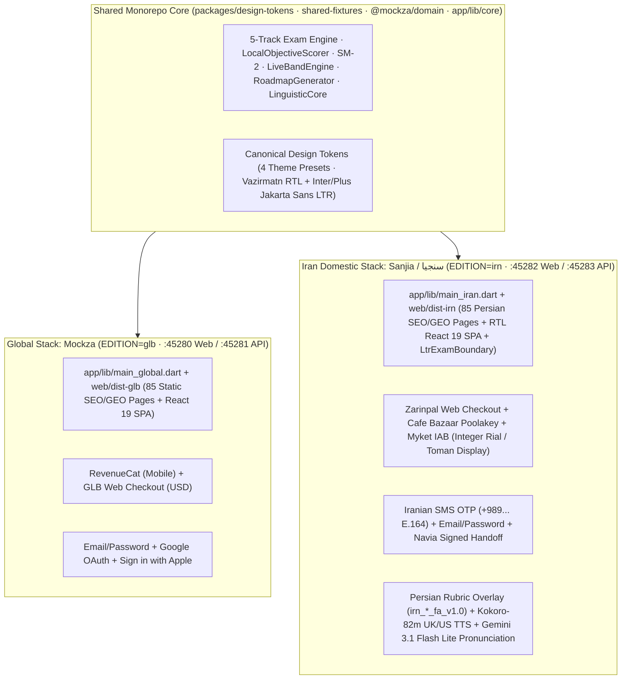

# Sanjia (Iran Edition) — Architecture Decision Records (ADR-Iran v4.0)

> **Architectural Summary:** `ADR-Iran.md` specifies the **live, production-verified Persian-first Iran Domestic Edition (`IRN` — `Sanjia` / `سنجیا`, `1.0.0+20001.irn`)** across both the **Flutter Mobile/Web Client (`app/lib/main_iran.dart`)** and the **Standalone Astro 5 + React 19 Desktop Web Studio (`web/dist-irn`, served on `:45282` -> `:45283` API)**. Built on the shared 12-workspace monorepo in [ADR.md](file:///home/mahdi/projects/ideas/mockza/docs/ADR.md), it enforces **compile-time & bundle-level isolation** from Global `Mockza` (`GLB`), **Persian RTL outer chrome (`Vazirmatn`) with `LtrExamBoundary` English stimulus isolation**, **edge-only Jalali (`شمسی`) calendar formatting**, **Iranian SMS OTP cross-device authentication**, **Zarinpal / Cafe Bazaar / Myket integer-Rial billing**, **bilingual Persian AI examiner rubrics (`irn_*_fa_v1.0`)**, **Persian-localized Adaptive Roadmap (*دورنما*), Smart Coach, OpenRouter `hexgrad/kokoro-82m` Neural TTS, and `google/gemini-3.1-flash-lite` Pronunciation Studio**, plus **`Navia` (`ناویا`) admissions score handoff**.

---

## 1. Edition Isolation & Dual-Stack Topology

---

## 2. Canonical 3-Layer Versioning & Flavor Contract (Live & CI-Enforced)

Implemented via `EditionConfig` (`app/lib/core/config/edition_config.dart`, `web/src/edition/index.ts`, `backend/packages/domain/src/edition.ts`) and enforced by `scripts/check_all.sh`:

| Layer | Global Clean-Room (`glb`) | Iran Domestic (`irn`) | Enforcement Mechanism |
| :--- | :--- | :--- | :--- |
| **Flutter Entrypoint** | `app/lib/main_global.dart` (`1.0.0+10001.glb`) | `app/lib/main_iran.dart` (`1.0.0+20001.irn`) | Separate flavor composition roots injecting `EditionConfig` & edition-specific gateways |
| **Desktop Web Build** | `PUBLIC_EDITION=glb pnpm --filter @mockza/web build:glb` -> `web/dist-glb/` | `PUBLIC_EDITION=irn pnpm --filter @mockza/web build:irn` -> `web/dist-irn/` | `check_all.sh` runs post-build regex greps ensuring zero `sanjia`/`zarinpal`/`navia`/`تومان` strings in `dist-glb` and zero `stripe`/`revenuecat`/`firebase` strings in `dist-irn` |
| **HTTP Identity Headers** | `X-Edition: glb` `X-App-Version: 1.0.0+10001.glb` | `X-Edition: irn` `X-App-Version: 1.0.0+20001.irn` | API `editionGuardMiddleware` enforces `403 EDITION_FORBIDDEN` on any cross-edition request |
| **Content Catalog Prefix** | `GLB-*` | `IRN-*` (plus shared multi-exam starter packs) | Scoped by `edition` column (`glb`, `irn`, `all`) in `catalog_packs` & `micro_drills` |
| **AI Rubric & Coaching Language** | English rubric commentary & coaching tips | Bilingual Persian (`overallSummaryFa`, `whyFa`, `meaningFa`, `coachingTipFa`) + English model rewrites | `packages/ai/src/prompts/persian-overlay.ts` & pronunciation prompt localization |

---

## 3. Iran Edition Architecture Decisions (`ADR-IRN-001` .. `ADR-IRN-008`) — All Implemented & Live

### `ADR-IRN-001`: Compile-Time Flavors & Automated Bundle Isolation Gates
* **Status:** Accepted (Live)
* **Implementation:**
  * Flutter `app/lib/main_iran.dart` binds `ZarinpalBillingGateway`, `SmsOtpAuthGateway`, Persian locale (`Locale('fa', 'IR')`), and `EditionConfig.iran`.
  * Web `web/src/composition/irn.ts` and `web/src/edition/` compile static Persian SEO/GEO pages and the RTL React 19 SPA into `web/dist-irn` with edition-specific security headers (`web/security-headers.irn.caddy` & `web/nginx_security_headers.irn.conf`).
  * `scripts/check_all.sh` verifies both `dist-glb` and `dist-irn` builds on every check run and fails if any IRN-only identifier leaks into `dist-glb` or any GLB-only tracker/billing SDK leaks into `dist-irn`.

---

### `ADR-IRN-002`: Bidirectional (BiDi) UI Engine (`LtrExamBoundary`) & Edge Jalali Calendar
* **Status:** Accepted (Live)
* **Implementation:**
  1. **Outer Persian RTL + `LtrExamBoundary` Isolation:** Both Flutter (`app/lib/theme/ltr_exam_boundary.dart`) and Web (`web/src/edition/bidi/LtrExamBoundary.tsx`) render outer navigation, **Durnama (`دورنما`)** roadmap cards, Smart Coach commentary, and settings in Persian RTL (`Vazirmatn`), while wrapping all English Reading passages, Writing editors, Speaking cue cards, pronunciation word heatmaps, timers, and band chips inside `LtrExamBoundary` (`dir="ltr"`). `scripts/check_all.sh` bans physical LTR-only padding/CSS classes across both Flutter (`app/lib/features/`) and Web (`web/src/spa/`, `web/src/components/`).
  2. **Jalali (`شمسی`) Display at UI Edge Only:** `app/lib/core/formatting/jalali_formatter.dart` and `web/src/edition/calendar/jalali.ts` convert canonical UTC epoch timestamps / integer `SerialDay` values to Jalali dates (`۱۴۰۵/...`) strictly at the presentation edge—keeping `drift` SQLite, `Dexie` IndexedDB, and PostgreSQL 100% calendar-agnostic.

---

### `ADR-IRN-003`: TOEFL (`TPO` / `NEO` / `2026`) & DET Integrated Task Schemas
* **Status:** Accepted (Live)
* **Implementation:**
  * `app/lib/core/exams/toefl_integrated_flow.dart` and `app/lib/core/exams/det_micro_scorer.dart` (mirrored in `@mockza/domain`) support chained TOEFL integrated tasks, *Writing for an Academic Discussion*, PTE *Re-order Paragraphs* / *Summarize Written Text*, and DET *Read & Select*, *Read & Complete*, *Listen & Type*, and *Write About the Photo*.

---

### `ADR-IRN-004`: Iranian Billing Adapters (`Zarinpal`, `Cafe Bazaar`, `Myket`) & Integer Rial Accounting
* **Status:** Accepted (Live)
* **Implementation:**
  * Backend `backend/apps/api/src/routes/billing.ts` implements `POST /v1/billing/zarinpal/request`, `POST /v1/billing/zarinpal/verify`, `POST /v1/billing/bazaar/verify`, and `POST /v1/billing/myket/verify` backed by the `billing_orders` table in PostgreSQL.
  * Flutter (`app/lib/services/zarinpal_billing_gateway.dart`, `bazaar_billing_gateway.dart`, `myket_billing_gateway.dart`) and Web (`web/src/adapters/irn/`) process integer-Rial amounts (`amountRial`), format Toman display strings (`formatTomanFromRial`), handle `/billing/callback` server verification, and update `user_entitlements` atomically.

---

### `ADR-IRN-005` & `ADR-IRN-006`: Iranian SMS OTP Auth, `Navia` Handoff & Bilingual Persian AI Rubrics
* **Status:** Accepted (Live)
* **Implementation:**
  1. **SMS OTP (`+989...` E.164):** `POST /v1/auth/otp/request` and `POST /v1/auth/otp/verify` (`otp_challenges` table) authenticate Iranian mobile numbers across Android and Desktop/iOS Web, enforcing the same strict **`1 Phone + 1 Desktop Web`** device-slot policy (`user_device_sessions`) and supporting lossless guest data merge (`POST /v1/personalization/merge-guest`).
  2. **`Navia` (`ناویا`) Cross-App Score Handoff:** `POST /v1/account/navia-handoff` signs a verified score summary token for 1-tap export from Sanjia Progress (`ProgressScreen`) to `Navia`.
  3. **Bilingual Persian AI Rubric Overlay (`packages/ai/src/prompts/persian-overlay.ts`):** When `edition === 'irn'`, Writing, Speaking, Smart Coach, and Pronunciation Studio evaluations return structured Persian commentary (`overallSummaryFa`, `whyFa`, `meaningFa`, Persian coaching tips) alongside English academic rewrites and Persian-glossed SM-2 flashcards.

---

### `ADR-IRN-007` & `ADR-IRN-008`: Full Feature Parity on Adaptive Roadmap (*دورنما*), Smart Coach, Kokoro TTS, Pronunciation Studio & Tracing
* **Status:** Accepted (Live)
* **Implementation:**
  * Every capability in `ADR-020`, `ADR-021`, and `ADR-022` runs identically in Sanjia (`IRN`) with full Persian localization (`app/lib/l10n/app_fa.arb` and `web/src/i18n/fa.ts`):
    * **Durnama (`دورنما` — `/roadmap` / `/app/roadmap`):** Step-by-step personalized roadmap, live band evolution chart (calibrated solid vs. practice hollow indicators), topic weakness rotation, and `PlanImpactCard`.
    * **OpenRouter `hexgrad/kokoro-82m` Neural TTS & `google/gemini-3.1-flash-lite` Pronunciation Studio:** Global UK (`bf_emma`) / US (`af_bella`) accent preference in Settings, `InlineListenButton` on vocabulary cards, Study-Mode Reading paragraph listen strips (`passage-paragraph-listen-bar`), Evaluation Review model rewrites, and interactive pronunciation recording & phoneme grading with Persian feedback tips.
    * **Closed-Loop Smart Coach (`/coach`):** Error DNA Linguistic Graph, 10-Minute Daily Mission, 3-Gear Register Shifter, and Drop Anything drills.
    * **Admin Trace Console (`/app/admin/trace`):** Tracks all `irn` user activities, audio recordings, AI tokens, and USD inference costs in `ai_usage_ledger` and `user_activity_ledger`.

---

## 4. `PDR-Iran.md` to `ADR-Iran.md` Traceability Matrix

| `PDR-Iran.md` Requirement / Risk | Owner ADR | Concrete Technical Mechanism |
| :--- | :--- | :--- |
| **Hard Global vs. Iran Store & Bundle Isolation** | `ADR-014`, `ADR-IRN-001` | `main_global.dart` vs `main_iran.dart`, `dist-glb` vs `dist-irn` post-build isolation greps in `check_all.sh`, `403 EDITION_FORBIDDEN` |
| **Persian RTL Chrome + Unbroken English Exam Text** | `ADR-IRN-002` | `Locale('fa','IR')` + `Vazirmatn` outer shell + `LtrExamBoundary` wrapper + edge-only `jalali_formatter.dart` / `jalali.ts` |
| **Iranian Payments (`Zarinpal` / `Bazaar` / `Myket`)** | `ADR-IRN-004` | `/v1/billing/zarinpal/*`, `/v1/billing/bazaar/verify`, `/v1/billing/myket/verify`, `billing_orders`, integer Rial accounting |
| **SMS OTP Cross-Device Auth & `Navia` Funnel** | `ADR-IRN-005`, `ADR-IRN-006` | `/v1/auth/otp/request` & `/verify` (`otp_challenges`), `1 Phone + 1 Desktop Web` slots, `POST /v1/account/navia-handoff` |
| **Persian Examiner Feedback & Mistake Vocab** | `ADR-IRN-006` | `persian-overlay.ts` (`overallSummaryFa`, `whyFa`, `meaningFa`) feeding SM-2 flashcards with Persian glosses |
| **Persian Adaptive Roadmap (*دورنما*), Smart Coach & Speech Studio** | `ADR-IRN-007`, `ADR-IRN-008` | `LiveBandEngine`, `RoadmapGenerator`, Kokoro-82m TTS (`bf_emma`/`af_bella`), Gemini 3.1 Flash Lite Pronunciation Studio, `app_fa.arb` & `fa.ts` |
