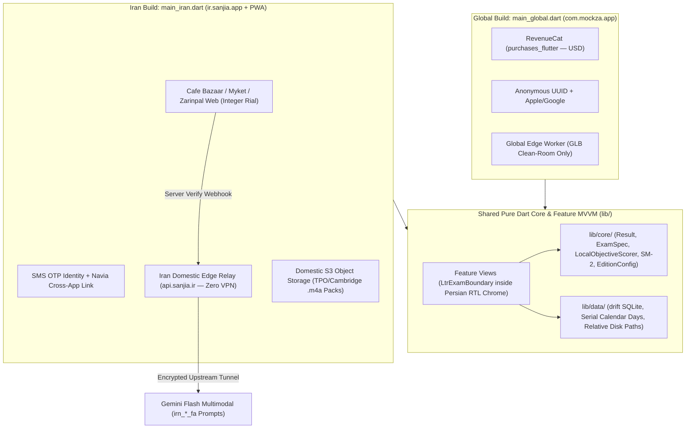

# Sanjia (Iran Edition) — Architecture Decision Records (ADR-Iran)

> **Architectural Summary:** `ADR-Iran.md` extends the shared Flutter architecture in [ADR.md](file:///home/mahdi/projects/ideas/mockza/ADR.md) to deliver the **Persian-first Iran Domestic Edition (`IRN` — `1.0.0+20001.irn`)** targeting **Android (Cafe Bazaar, Myket, Direct APK)** and **iOS/Desktop (Flutter Web/PWA)**. It locks down **hard compile-time isolation** from Global `Mockza` (`GLB`), **BiDi RTL+LTR exam isolation**, **TOEFL (`TPO`/`NEO`) & DET schemas**, **Zarinpal/Bazaar/Myket billing in integer Rials**, **SMS OTP cross-device entitlements**, and a **Zero-VPN domestic edge relay**.

---

## 1. Edition Isolation & Zero-VPN Domestic Topology



---

## 2. Canonical 3-Layer Versioning & Flavor Contract

Implemented via an immutable `EditionConfig` provided at compile time in `main_global.dart` vs. `main_iran.dart`:

| Layer | Global Clean-Room (`glb`) | Iran Domestic (`irn`) | Enforcement Mechanism |
| :--- | :--- | :--- | :--- |
| **Compile Entrypoint** | `flutter build --flavor global -t lib/main_global.dart --build-name=1.0.0 --build-number=10001` | `flutter build --flavor iran -t lib/main_iran.dart --build-name=1.0.0 --build-number=20001` | Separate Android `productFlavors`, separate iOS/Web build steps, zero `irn` imports reachable from `main_global.dart` |
| **Canonical Telemetry / UI String** | `1.0.0+10001.glb` | `1.0.0+20001.irn` | Computed cleanly inside `EditionConfig`; rendered in Settings footer & CrashLog header |
| **HTTP Identity Headers** | `X-Edition: glb`<br>`X-App-Version: 1.0.0+10001.glb` | `X-Edition: irn`<br>`X-App-Version: 1.0.0+20001.irn` | BFF middleware enforces `403 EDITION_FORBIDDEN` on any catalog/edition mismatch |
| **Content Catalog ID** | `GLB-IELTS_AC-MOCKZA_ORIG-v1.0.0` | `IRN-TOEFL-TPO_074-v1.0.0`<br>`IRN-TOEFL-NEO_012-v1.2.0`<br>`IRN-IELTS-CAM_19_T1-v1.0.0`<br>`IRN-DET-MOCK_05-v1.0.0` | Manifest sync & `cached_content_packs` DB key scoped strictly by `edition` prefix |
| **AI Rubric Schema** | `glb_ielts_en_v1.0` | `irn_toefl_fa_v1.0`<br>`irn_ielts_fa_v1.0`<br>`irn_det_fa_v1.0` | BFF prompt registry locks commentary language (`en` vs `fa`) + exam rubric scale (`0–9` vs `0–30`/`0–120` vs `10–160`) |

---

## 3. Iran Edition Architecture Decisions (`ADR-IRN-001` .. `ADR-IRN-006`)

### `ADR-IRN-001`: Compile-Time Flavors & Hard Developer-Account Isolation
* **Status:** Accepted
* **Context:** Shipping domestic Cambridge/TOEFL TPO/NEO content or Zarinpal/Cafe Bazaar payment flows inside any binary uploaded to Apple App Store or Google Play threatens termination of the global `Mockza` developer account ([PDR-Iran Sec. 4 Q1](file:///home/mahdi/projects/ideas/mockza/PDR-Iran.md)).
* **Decision:**
  * Separate flavor composition roots (`lib/main_global.dart` vs `lib/main_iran.dart`) overriding the identical provider interface list (`billingGatewayProvider`, `catalogEndpointProvider`, `telemetryGatewayProvider`, `authGatewayProvider`) over a flavor-blind `App`.
  * Run **Android APK/AAB** (`applicationId: ir.sanjia.app`) exclusively for Cafe Bazaar, Myket, and direct download, and **Flutter Web / Responsive PWA** (`app.sanjia.ir`) for Iranian iOS Safari users + Desktop TPO/NEO test-takers.
  * **Separate Infrastructure:** Distinct keystore certificates, distinct git release branches/artifacts, distinct CDN storage buckets, and CI banned-symbol/URL grep gates guaranteeing zero `.ir`, Zarinpal, Poolakey, or `IRN-*` references exist inside compiled `global` bundles.

---

### `ADR-IRN-002`: Bidirectional (BiDi) UI Engine & Jalali Calendar Presentation
* **Status:** Accepted
* **Context:** Making `fa-IR` (`RTL`) the app's primary language causes Flutter to mirror layouts, decimal numbers, bullet lists, and English trailing punctuation (`?`, `.`, parentheses) if English exam text is rendered inside raw RTL contexts—breaking TOEFL/IELTS readability. Meanwhile, Iranian learners schedule test countdowns using the **Jalali (`شمسی`)** calendar.
* **Decision:**
  1. **Outer Persian RTL + `LtrExamBoundary` Isolation:** Set `Locale('fa', 'IR')` at `MaterialApp.router` with `Vazirmatn` for crisp Persian typography and tabular numerals. Wrap **every** English Reading passage, Speaking cue card, Writing editor, TOEFL/DET question stem, timer countdown (`19:45`), and band/score chip (`7.5`, `26/30`) inside a dedicated `LtrExamBoundary` (`Directionality(textDirection: TextDirection.ltr, ...)` + `Inter`/`Roboto` Latin font stack).
  2. **Jalali Display at UI Edge Only (`shamsi_date`):** Following `ADR-006`'s canonical storage rule, `drift` SQLite and `sm2_scheduler.dart` still store **only UTC epoch millis and canonical integer serial calendar days** (`clockProvider`). Conversion to Jalali (`۱۴۰۵/۰۹/۲۵`) runs strictly at the presentation formatter edge—keeping all business logic DST-safe and shareable with Global `Mockza`.

---

### `ADR-IRN-003`: TOEFL (`TPO` / `NEO` / `Academic Discussion`) & Duolingo (`DET`) Schemas
* **Status:** Accepted
* **Context:** Unlike IELTS's separated skills, TOEFL features chained multi-step **Integrated Tasks** (timed Reading -> hidden Reading -> audio Lecture -> Speaking/Writing), **NEO / Modern Shorter TOEFL** structure including *Writing for an Academic Discussion*, and **Duolingo English Test (`DET`)** uses rapid micro-tasks (*Read & Complete* C-test tiles, *Listen & Type*).
* **Decision:** Extend `lib/core/exams/` with three modular schemas scored cleanly between `LocalObjectiveScorer` and `GradingGateway`:
  1. **`IntegratedSequenceSpec` (TOEFL Speaking Tasks 2–4 & Writing Task 1):** A pure finite state machine orchestrating chained phases (`readPassagePhase(45s)` -> `playAudioPhase(singlePlay)` -> `prepPhase(15s|30s)` -> `captureResponsePhase(45s|60s|20m)`), retaining context notes locally across transitions with zero manual reload flash.
  2. **`AcademicDiscussionSpec` (Modern TOEFL Task 2):** Split view presenting the professor's prompt + 2 student forum replies alongside a `10-minute` (`≥ 100 words` guidance) response editor graded on `0–5` / `0–30` ETS-style rubric descriptors.
  3. **`DetMicroTaskSpec` (Duolingo English Test):**
     * *Read & Complete (C-Test):* Letter-slot input controller evaluated deterministically offline against target words (`case-insensitive`, prefix stem lock).
     * *Listen & Type:* Audio track (up to `3` replays matching DET cadence) scored via normalized word/spelling edit distance + highlighted missed function words.
     * *Write About Photo / Speak About Topic:* Timed `1-min` / `1–3 min` capture routed to `GradingGateway` (`irn_det_fa_v1.0` returning `10–160` estimate + Persian critique).

---

### `ADR-IRN-004`: Iranian Billing Adapters (`BillingGateway`) & Integer Rial Accounting
* **Status:** Accepted
* **Context:** Iranian users pay via Shetab bank cards in Toman/Rial across Cafe Bazaar, Myket, and Web Checkout (`Zarinpal`/`Zibal`), whereas `purchases_flutter` (RevenueCat) depends on Stripe/Apple/Google Play Billing unavailable inside Iran.
* **Decision:** Implement three Iran-flavor concrete classes behind the identical `BillingGateway` interface (`ADR-010`) and single derived `isEntitledProvider`:
  * **`BazaarBillingGateway` (Android Cafe Bazaar):** Wraps Bazaar Poolakey in-app billing; forwards purchase token to Iranian BFF for server verification before committing entitlement.
  * **`MyketBillingGateway` (Android Myket):** Wraps Myket IAB; server-verifies purchase token.
  * **`ZarinpalWebBillingGateway` (PWA / Web & Direct APK):** Calls BFF `POST /v1/billing/zarinpal/request` -> opens Zarinpal gateway -> returns via deep link / redirect (`https://app.sanjia.ir/billing/callback?Authority=...&Status=OK`) -> **strictly confirms payment via server-side `POST /v1/billing/zarinpal/verify`** before updating entitlement state (never trusting client URL query parameters!).
  * **Canonical Money Rule:** Represent all prices in **integer Rial minor units** (`int amountRial = toman * 10`, never `double`) formatted cleanly to Persian Toman numerals (`تومان`) only in presentation widgets.

---

### `ADR-IRN-005`: Zero-VPN Domestic Edge Relay, Media CDN & Non-Google Telemetry
* **Status:** Accepted
* **Context:** Direct calls to foreign AI/telemetry/storage endpoints frequently fail or drop for Iranian users without active VPNs, wrecking mid-Speaking upload UX (`PDR-Iran Sec. 4 Q3`) and inflating support refunds.
* **Decision:**
  * **Domestic Reverse Edge (`api.sanjia.ir`):** All `irn` client network calls terminate on a clean Iranian-accessible TLS edge server/VPS which relays requests over persistent encrypted tunnels to upstream Gemini Flash / LLM providers—giving Iranian users fast **VPN-free AI grading**.
  * **Domestic S3 Audio CDN:** Store encrypted/verified TPO, NEO, Cambridge, and DET `.m4a` files on Iranian object storage CDN (e.g., ArvanCloud S3 / local edge) so multi-speaker TOEFL lectures buffer instantaneously offline on 4G/metro connections using the same atomic `.tmp -> SHA-256 -> rename` downloader (`ADR-009`).
  * **Sanctions-Resilient Telemetry (`TelemetryGateway`):** `irn` swaps out Google/Firebase telemetry targets completely for self-hosted/BFF `/v1/events` ingestion so crash logs, KPI funnels, and FX-margin alerts operate cleanly without Google Play Services or VPNs.

---

### `ADR-IRN-006`: SMS OTP Cross-Device Auth & Bilingual Persian AI Rubrics
* **Status:** Accepted
* **Context:** Iranian students routinely split usage between Android APK on commutes and Desktop/iOS Web PWA at home—requiring seamless Toman subscription sharing—while also funneling to sister admissions platform **`Navia`**.
* **Decision:**
  1. **Guest-First + SMS OTP Account Linking:** Start immediately with a local anonymous UUID; trigger SMS OTP (`Kavenegar` / `Ghasedak` via BFF `/v1/auth/otp/request` & `/verify`) when purchasing a Zarinpal plan or tapping "Sync Across Devices". Binds Zarinpal/Bazaar/Myket entitlements cleanly to normalized `E.164` `+989...` identity across Android and Safari PWA.
  2. **`Navia` Cross-App Deep Link Contract:** Expose a lightweight `navia_handoff` JWT link (e.g., `https://app.navia.ir/import-score?token=...` with verified best IELTS/TOEFL mock score summary) with **zero hard database coupling** between apps.
  3. **Bilingual Persian AI Evaluation Contract (`irn_*_fa_v1.0`):** `GradingGateway` response model adds optional localized explanation fields (`overallSummaryFa`, `spanFeedback[].whyFa`, `vocabUpgrades[].meaningFa`) alongside English model rewrites, feeding **Persian-glossed Mistake-to-Deck SM-2 cards** cleanly through `VocabRepository`.

---

## 4. Iran-Flavor Repository Additions

Extending `lib/` and `bff/` from [ADR.md](file:///home/mahdi/projects/ideas/mockza/ADR.md) cleanly:

```text
mockza/
├── lib/
│   ├── main_iran.dart                         # IRN Composition Root (Persian RTL, Zarinpal/Bazaar/Myket, Iran BFF)
│   ├── core/
│   │   ├── config/edition_config.dart         # Sealed EditionConfig (glb vs irn, build ranges, endpoints)
│   │   ├── exams/
│   │   │   ├── toefl_integrated_flow.dart     # TPO/NEO Read -> Listen -> Prep -> Record FSM + Academic Discussion
│   │   │   └── det_micro_scorer.dart          # C-test gap-fill + Listen & Type edit-distance scorer
│   │   └── formatting/jalali_formatter.dart   # Pure edge helper wrapping shamsi_date (DB remains UTC/serial day)
│   ├── services/
│   │   ├── billing_bazaar_gateway.dart        # Android Cafe Bazaar Poolakey adapter
│   │   ├── billing_myket_gateway.dart         # Android Myket IAB adapter
│   │   ├── billing_zarinpal_gateway.dart      # Web/PWA & Direct APK Zarinpal checkout + server verify
│   │   └── auth_sms_otp_gateway.dart          # Iranian phone OTP login for cross-device PWA+APK restore
│   └── theme/
│       └── ltr_exam_boundary.dart             # Mandatory Directionality.ltr + Latin font wrapper inside fa RTL shell
└── bff-iran/                                  # SEPARATE deployment / repo recommended for total isolation
    ├── relay/                                 # Zero-VPN Iranian reverse edge -> upstream LLM tunnel
    ├── billing/                               # Zarinpal/Bazaar/Myket verify webhooks + FX margin alert job
    ├── packager/                              # Founder-supplied TPO/NEO/Cambridge/DET JSON + .m4a manifest builder
    └── prompts/                               # irn_toefl_fa_v1.0, irn_ielts_fa_v1.0, irn_det_fa_v1.0
```

---

## 5. `PDR-Iran.md` to `ADR-Iran.md` Traceability Matrix

| `PDR-Iran.md` Requirement / Risk | Owner ADR | Concrete Technical Mechanism |
| :--- | :--- | :--- |
| **Hard Global vs. Iran Store Isolation** | `ADR-014`, `ADR-IRN-001` | Separate flavor mains, separate keystores/bundle IDs, disjoint build codes (`10000+` vs `20000+`), CI banned-import gate |
| **3-Layer Versioning Schema** | `ADR-014`, Sec. 2 | `1.0.0+20001.irn`, `IRN-<EXAM>-<SERIES>-vX.Y`, `irn_*_fa_v1.0`, BFF `403 EDITION_FORBIDDEN` guard |
| **Persian RTL + Unbroken English Exam Text** | `ADR-IRN-002` | `Locale('fa','IR')` outer chrome + `LtrExamBoundary` LTR island + edge-only `shamsi_date` Jalali display |
| **TOEFL (`TPO`/`NEO`/Discussion) & DET Support** | `ADR-IRN-003` | `IntegratedSequenceSpec` state machine, `AcademicDiscussionSpec`, `DetMicroTaskSpec` deterministic C-test/Listen scorers |
| **Iranian Payments + iOS PWA Access** | `ADR-IRN-001`, `ADR-IRN-004` | Flutter Web/PWA for iOS + `Zarinpal`/`Bazaar`/`Myket` adapters over `BillingGateway` + integer Rial currency |
| **Zero-VPN Fast Audio & Grading in Iran** | `ADR-IRN-005` | `api.sanjia.ir` domestic edge relay + Iranian S3 CDN `.m4a` caching + non-Google telemetry endpoint |
| **SMS OTP Cross-Device Sync & `Navia` Funnel** | `ADR-IRN-006` | `PhoneOtpAuthGateway` uniting Android APK + Safari PWA subscriptions + signed `navia_handoff` deep link |
| **Persian Examiner Feedback & Mistake Vocab** | `ADR-013`, `ADR-IRN-006` | `irn_*_fa` structured JSON (`whyFa`, `meaningFa`) feeding SM-2 flashcards with Persian glosses |
