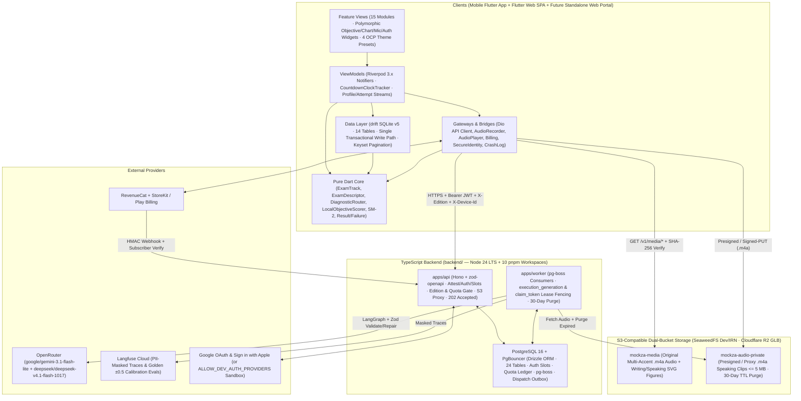
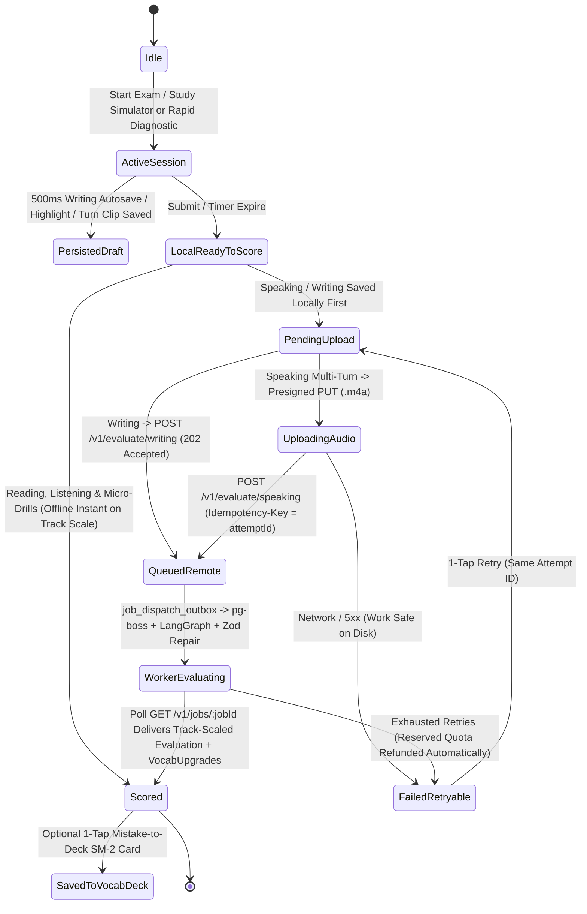

# Mockza — Architecture Decision Records (ADR v3.0)

> **Architectural Summary:** Mockza implements a **Single-Package Feature-First Layered MVVM** Flutter client (`3.47.9`, Dart 3 + Impeller) powered by **Riverpod 3.x**, **`go_router`**, **`drift` SQLite** (`schemaVersion == 5`, 14 tables), hand-rolled **`Result<T, Failure>`**, Open-Closed `ThemeCatalog` presets, and **`purchases_flutter` (RevenueCat)** — paired with a **TypeScript (`Node 24 LTS` + `Hono` + `@hono/zod-openapi` + `PostgreSQL 16` + `Drizzle ORM` + `pg-boss`)** async backend across 10 `pnpm` workspaces, **OpenRouter + LangGraph + Langfuse** rubric evaluation, **`SeaweedFS` / `Cloudflare R2`** dual-bucket S3 storage, strict **`1 Phone + 1 Desktop Web`** device-slot governance, and full support for **5 exam tracks** (`IELTS Academic`, `IELTS General Training`, `TOEFL iBT 2026`, `PTE Academic`, `Duolingo English Test`).

---

## 1. Architectural Drivers, Constraints & Topology

### Engineering Drivers Derived from `PDR.md`
1. **Consolidated 5-Track 4-Skill Hub Without Clone Bloat:** Serve `Listening`, `Reading`, `Writing`, `Speaking`, `Micro-Drills`, and `Mistake-to-Deck Vocabulary` across **IELTS Academic, IELTS General Training, TOEFL iBT (2026), PTE Academic, and DET** through polymorphic domain descriptors (`ExamTrack` / `ExamDescriptor` + `@mockza/domain` `EXAM_SCALES`), satisfying Apple Guideline 4.3 (`PDR Sec. 1`).
2. **Offline-First & Zero Data Loss:** Exam packs, `.m4a` listening tracks, SM-2 vocab cards, reading annotations, and 500ms autosaved essays persist cleanly in `drift` SQLite (with volatile RAM fallback warning if disk storage degrades); dropped networks never lose essays, recorded audio clips, or quota credits (`PDR NFR-004`).
3. **Anti-Account-Sharing Cross-Surface Access:** Support Email/Password + Google + Apple sign-in across 1 mobile device (`mobile`) and 1 desktop web browser (`desktop_web`) via atomic Postgres partial unique slot constraints (`uq_active_user_slot`), preparing cleanly for a future standalone non-Flutter Desktop Web portal (`PDR FR-041..044`).
4. **Zero Client Secrets, Bounded AI COGS & Low-RAM Operations:** Score all objective tasks (`11` canonical question types) offline on-device while routing AI Writing/Speaking/Diagnostic evaluations through `202 Accepted` idempotent jobs with `job_dispatch_outbox`, worker lease fencing, and low-RAM containerized or host deployments (`--no-wasm-dry-run`).

### System Architecture Topology



### Hybrid Attempt Lifecycle (Deterministic Local vs. Async Worker AI Grading)



---

## 2. Architecture Decision Index

| ID | Topic | Chosen Decision | Status |
| :--- | :--- | :--- | :--- |
| **`ADR-001`** | Cross-Platform Framework | Flutter `3.47.9` (Dart 3 + Impeller) for Mobile + Gzipped Web SPA (`standalone web_app` ready) | Accepted (Live) |
| **`ADR-002`** | Project Layering & SOLID/OCP UI | Single-Package Feature-First MVVM + `ThemeCatalog` Presets + Polymorphic Shared Exam Controls | Accepted (Live) |
| **`ADR-003`** | State Management & Clocks | Riverpod 3.x Notifiers, Reactive DB Streams, `CountdownClockTracker`, `clockProvider` | Accepted (Live) |
| **`ADR-004`** | Error Handling & Cold-Start | Sealed `Result<T, Failure>` Spine + `CrashLog` + Unzoned Dual Error Hooks | Accepted (Live) |
| **`ADR-005`** | Navigation & Route Guards | Single `GoRouter` (24 Route Constants, 4-Tab Shell, `ExamExitGuard` `PopScope`) | Accepted (Live) |
| **`ADR-006`** | Local Persistence (`drift`) | `drift` SQLite (`schemaVersion == 5`, 14 Tables), WAL/FK/FULL Pragmas, Keyset Pagination | Accepted (Live) |
| **`ADR-007`** | TypeScript Backend & Postgres | Node 24 + `Hono` (`zod-openapi`) + `PostgreSQL 16`/`Drizzle` (24 Tables) + `pg-boss` + Outbox/Leases | Accepted (Live) |
| **`ADR-008`** | 5-Track Exam & AI Rubric Engine | `ExamTrack`/`ExamDescriptor` + `EXAM_SCALES`, 11 Objective Types, `LangGraph`/OpenRouter + Evals | Accepted (Live) |
| **`ADR-009`** | Audio & Visual Prompt Pipeline | Multi-Turn `.m4a` Upload/Preflight + Exam/Study Audio Locks + `ExamSvgChartCard` SVG Stages | Accepted (Live) |
| **`ADR-010`** | Monetization & Entitlements | `purchases_flutter` (RevenueCat) + Webhook/REST Sync + Mandatory Device Policy Consent | Accepted (Live) |
| **`ADR-011`** | Privacy, Erasure & Telemetry | 30-Day `.m4a` Purge + Idempotent `erasure_requests` (`DELETE /v1/account`) + Masked Langfuse | Accepted (Live) |
| **`ADR-012`** | Static Gates & CI Toolchain | `scripts/check_all.sh` (10 Gates) + `very_good_analysis` + `Biome` + `tsc` + Container CI | Accepted (Live) |
| **`ADR-013`** | SM-2 Vocab & Highlights | Pure Dart SM-2 (`SerialDay`, integer `easeFactorMilli`), 1-Tap Mistake Capture, UTF-16 Highlights | Accepted (Live) |
| **`ADR-014`** | Multi-Edition Flavor Isolation | Strict `glb` (`1.0.0+10001.glb`) vs `irn` (`1.0.0+20001.irn`) Entrypoints & Backend `EDITION` | Accepted (Live) |
| **`ADR-015`** | Container, Hybrid Dev & Low-RAM | `Containerfile`s + `compose.yaml` (`45280–45933`) + `dev_local.sh` + `--no-wasm-dry-run` Static Server | Accepted (Live) |
| **`ADR-016`** | Multi-Surface Auth & Device Slots | Email + Google/Apple OAuth (+ Dev Sandbox) & Strict `1 Phone + 1 Desktop Web` Slot Constraint | Accepted (Live) |
| **`ADR-017`** | Rapid Starting-Level Diagnostic | ~10–15 Min 4-Skill Adaptive Check (`DiagnosticBudget` 900s + `DiagnosticRouter` 2-Stage + Retake) | Accepted (Live) |
| **`ADR-018`** | Hermetic 5-Tier & E2E Testing | `Vitest` (113 Tests) + Flutter Tiers 1–4 (133) + Tier 5 Full-App Page-Object Robot E2E (`E2E 1–7`) | Accepted (Live) |

---

## 3. Detailed Architecture Decision Records

### `ADR-001`: Cross-Platform Client & Multi-Surface Web Path
* **Decision:** Compile native iOS/Android binaries and an optimized Flutter Web SPA (`main.dart.js`, `-O1 --no-wasm-dry-run`) from one Dart codebase (`app/`), while structuring all REST/OpenAPI auth and exam contracts in `backend/` cleanly so a **future standalone non-Flutter Desktop Web application** (`appSurface = 'web_app'`) drops directly onto the same `desktop_web` device slot and `/v1/*` endpoints.

---

### `ADR-002`: Single-Package Feature-First MVVM & SOLID/OCP Visual Architecture
* **Layering DAG (`scripts/check_all.sh` Enforced):**
  * `app/lib/features/<feature>/` (15 isolated modules) import only downwards into `core/`, `data/`, `services/`, `routing/`, `theme/`, and `l10n/` — **zero cross-feature imports**, **zero banned utility folders** (`utils/`, `helpers/`, `common/`, `misc/`), **zero sibling barrel files**, and **zero relative imports** inside hand-authored `lib/`.
  * `app/lib/core/` stays 100% pure Dart (zero `flutter`, `dart:io`, `dart:ui`, or `DateTime.now()`).
  * `app/lib/data/` is the sole owner of `package:drift` / `sqlite3`.
  * Physical `EdgeInsets.only(left:|right:)`, `Alignment.*Left|Right`, and raw visual literals (`Color(0x...)`, `Colors.*`, `BorderRadius.circular`, `fontSize:`, `Duration(...)`) are blocked outside `lib/theme/`.
* **Open-Closed Theme System (`theme_preset.dart`, `theme_catalog.dart`):** Visual styling switches cleanly between `Midnight Indigo`, `Nordic Emerald`, `Editorial Amber`, and `Oceanic Cobalt` (Dark & Light variants) by registering a `ThemePreset` without touching feature widgets (`AppearanceSettings`). Responsive layout breakpoints in `responsive_layout.dart` keep compact `320dp` phones overflow-free.
* **Polymorphic Exam Component Reuse (`DRY`):** Cross-exam simulator UI primitives reside in `lib/theme/components/` (`MzObjectiveAnswerInput`, `MzSequenceOrderControl`, `ExamSvgChartCard`, `MicPreflightCard`, `CollapsiblePromptCard`, `ExamExitGuard`, `ScoreMeter`, `TrendChart`, `CompareAttempts`, `DeviceSessionCard`, `SocialAuthButtons`) rather than duplicating widget trees per exam or screen.

---

### `ADR-003` & `ADR-004`: Riverpod 3.x, Wall-Clock Timers & Result Spine
* **State & Clocks:** All 15 ViewModels extend Riverpod 3.x `Notifier` / `AsyncNotifier` backed by `clockProvider` (`package:clock`) and `CountdownClockTracker` for wall-clock timer reconciliation across tab switches/background resume.
* **Typed Errors:** Sealed `Result<T, Failure>` models `NetworkFailure`, `QuotaExceededFailure`, `DeviceSlotConflictFailure`, `EditionForbiddenFailure`, `AuthFailure`, `StorageFailure`, `DownloadIntegrityFailure`, and `AudioDeviceFailure`.
* **Cold-Start Hooks:** `bootstrap.dart` opens size-bounded `CrashLog`, initializes `FlutterError.onError` and `PlatformDispatcher.instance.onError`, opens SQLite (`WAL`, `FOREIGN_KEYS`, `FULL`), reads pre-paint appearance settings, and runs background warm-up (`OutboxSyncService`, catalog sync) post-first-frame.

---

### `ADR-005`: Single `GoRouter` Navigation & Route Contract
Defined exclusively in `lib/routing/app_router.dart` using typed `AppRoutes` constants (`lib/routing/routes.dart`):
* **4-Tab Persistent `StatefulShellRoute`:** `/home`, `/practice`, `/vocabulary`, `/progress` (`NavigationBar` on narrow viewports, adaptive wide chrome on tablets).
* **Pushed Auth, Settings, Onboarding & Paywall:** `/onboarding`, `/auth` (with `mode` & `returnTo` query params), `/settings`, `/paywall`.
* **Immersive Simulator, Diagnostic & Analytics Routes:** `/diagnostic/intro`, `/diagnostic/session/:diagId`, `/diagnostic/results/:diagId`, `/practice/setup/:skill`, `/practice/full-mock/:mockId`, `/speaking/:examId`, `/writing/:taskId`, `/reading/:packId`, `/listening/:packId`, `/micro-drill` & `/micro-drill/:drillId`, `/results/:attemptId`, `/vocabulary/review`, `/vocabulary/:wordId`, `/progress/skill/:skill`, `/progress/attempts`.
* **Exit Safety:** Reading, Listening, Writing, Speaking, Micro-Drills, and Diagnostic workspaces wrap active sessions in `ExamExitGuard` (`PopScope`).

---

### `ADR-006`: Local Persistence (`drift` SQLite v5 — 14 Tables)
Confined strictly to `app/lib/data/` (`app_database.dart` `schemaVersion => 5`):

| Table | Primary Key | Key Columns & Purpose |
| :--- | :--- | :--- |
| `UserProfiles` | `deviceId` | `targetBand`, `examModule`, `examId`, `targetDateSerial`, `onboardingCompleted`, `freeDiagnosticUsed`, `themeMode`, `linkedEmail`, `appUserId`, `isPro` |
| `ExamPacks` | `packId` | `track`, `skill`, `title`, `description`, `durationSeconds`, `questionCount`, `accent`, `mediaUrl`, `version`, `sha256`, `localPath` |
| `ExamAttempts` | `attemptId` | `examId`, `packId`, `skill`, `status`, `remoteJobId`, `submissionJson`, `evaluationJson`, `overallBand` (`0.0–160.0`), `errorCode`, timestamps, `usedStudyMode`, `questionCount`, `isCalibratedFullPack`, `mockSessionId`, `mockStageKey` |
| `AudioRecordings` | `recordingId` | `attemptId` (FK cascade), `partIndex`, `localFilePath`, `durationMs`, `remoteObjectKey` |
| `WritingDrafts` | `attemptId` (FK) | `packId`, `taskType`, `draftText`, `wordCount`, `timerRemainingSec`, `updatedAtUtcMs` (`isStrict => true`) |
| `ReadingAnnotations` | `annotationId` | `packId`, `passageIndex`, UTF-16 `startOffset`/`endOffset`, `colorCode`, `noteText`, `isDeleted` (`isStrict => true`) |
| `VocabCards` | `cardId` | `headword`, `ipa`, `definition`, `topicTag`, `repetitions`, `intervalDays`, `easeFactorMilli` (`2500` init / `1300` floor), `dueDay` / `dueDaySerial`, context & source provenance |
| `VocabReviewLogs` | `logId` | `cardId` (FK cascade), `rating`, `reviewedDaySerial`, `reviewedAtUtcMs` (`isStrict => true`) |
| `DailyStudyLogs` | `serialDay` | `studySeconds`, `completedItems` |
| `OutboxSyncQueue` | auto `id` | `actionType`, `payloadJson`, `retryCount`, `nextAttemptAt` |
| `ExamPayloads` | `packId` | Full offline cached `bundleJson` + `sizeBytes` |
| `CachedDrills` | `drillId` | `title`, `drillType`, `skill`, `durationSeconds`, `itemsJson` |
| `MockSessions` | `mockId` | `track`, `startedAtUtcMs`, `examMode`, `stageAttemptIdsJson` |
| `DiagnosticSessions` | `diagId` | `examId`, `mode`, `policyVersion`, `contentVersion`, `selectionSeed`, deadlines (`900s`/`90s`), `currentStage`, `status`, `stateJson` |

Ephemeral web/sandbox fallback preserves active session drafts cleanly in RAM with an explicit status warning when persistent storage is unavailable (`RR-07`).

---

### `ADR-007`: TypeScript Backend (`Hono` + `pg-boss` + `Drizzle` — 24 Tables)
Built as a strict ESM **`pnpm` monorepo (10 workspaces)**:
`apps/api`, `apps/worker`, `packages/domain`, `packages/contracts`, `packages/db`, `packages/ai`, `packages/storage`, `packages/config`, `content-pipeline`, `evals`.

* **Implemented HTTP Surface (`apps/api/src/routes/`):**
  * **Health & Spec:** `GET /v1/health`, `GET /v1/health/ready`, `GET /openapi.json`
  * **Auth & Device Slots:** `GET /v1/auth/providers`, `POST /v1/auth/anonymous`, `GET /v1/auth/challenge`, `POST /v1/auth/register`, `POST /v1/auth/login`, `POST /v1/auth/oauth`, `POST /v1/auth/link`, `POST /v1/auth/logout`
  * **Account, Devices & Erasure:** `GET /v1/account/me`, `GET /v1/account/devices`, `POST /v1/account/devices/revoke-others`, `DELETE /v1/account/devices/:targetDeviceId`, `POST /v1/account/device-policy-consent`, `DELETE /v1/account`, `GET /v1/erasure/:erasureId`, `POST /v1/erasure/:erasureId/retry`
  * **Catalog, Packs, Drills & Media:** `GET /v1/catalog/manifest`, `GET /v1/exams/:packId`, `GET /v1/drills`, `GET /v1/vocab/deck`, `GET /v1/media/*`
  * **Uploads & Evaluation:** `POST /v1/uploads/presign`, `PUT /v1/uploads/signed-put`, `POST /v1/evaluate/writing`, `POST /v1/evaluate/speaking`, `POST /v1/evaluate/retry`, `POST /v1/evaluate/explain-question`, `GET /v1/jobs/:jobId`
  * **Diagnostic & Quota:** `GET /v1/diagnostic/packs`, `POST /v1/diagnostic/sessions`, `POST /v1/diagnostic/sessions/:diagId/submit`, `GET /v1/diagnostic/sessions/:diagId`, `POST /v1/diagnostic/sessions/:diagId/retake-skill`, `GET /v1/quota/me`
  * **Billing, Feedback & Admin:** `POST /v1/webhooks/revenuecat`, `POST /v1/feedback/question-flag`, plus `admin.ts` catalog publishing endpoints protected by `ADMIN_API_KEY`.
* **PostgreSQL Schema (`packages/db/src/schema.ts`, 24 Tables):**
  `users`, `devices`, `auth_challenges`, `account_links`, `user_device_sessions`, `user_entitlements`, `entitlements`, `erasure_requests`, `quota_reservations`, `daily_quota_usage`, `monthly_quota_usage`, `usage_counters`, `evaluation_jobs`, `job_dispatch_outbox`, `audio_assets`, `ai_question_explanations`, `catalog_packs`, `webhook_events`, `question_flags`, `exam_sections`, `exam_questions`, `micro_drills`, `vocab_deck_cards`, `diagnostic_sessions`.
* **Reliability & Concurrency:**
  * `job_dispatch_outbox` decouples DB commit from `pg-boss` enqueue so jobs never vanish on transient broker glitches.
  * `apps/worker` enforces `execution_generation` + `claim_token` + `claim_expires_at` lease renewal/fencing so stale/reclaimed workers can never overwrite newer completions (`TD-20`).
  * `S3_PUBLIC_MODE=proxy` or scoped presigned `S3_PUBLIC_ENDPOINT` (`mockza-audio-private` & `mockza-media` buckets) eliminates Docker hostname mismatches across browsers and phones.

---

### `ADR-008` & `ADR-009`: Unified 5-Track Exam Domain, Scorer & AI Evaluators
* **Canonical Scale Registry (`@mockza/domain/rubrics.ts` & Dart `ExamTrack` / `ExamDescriptor`):**
  * `ielts_academic` (`0.0–9.0` step `0.5`, target `7.5`, calibrated objective threshold `40`)
  * `ielts_general` (`0.0–9.0` step `0.5`, target `7.0`, calibrated objective threshold `40`)
  * `toefl_ibt` (`1.0–6.0` step `0.5`, target `5.0`, calibrated objective threshold `4`, `estimateToeflLegacy120` 0–120 concordance)
  * `pte_academic` (`10–90` step `1`, target `65`, calibrated objective threshold `4`)
  * `det` (`10–160` step `5`, target `125`, calibrated objective threshold `4`, `computeDetSubscores` generating *Literacy*, *Comprehension*, *Conversation*, *Production*)
* **11 Objective Question Types (`ObjectiveQuestionType`) & 11 Writing Task Types:**
  * Objective: `tfng`, `ynng`, `mcq_single`, `mcq_multi`, `matching_headings`, `gap_fill`, `short_answer`, `binary_choice`, `word_completion`, `reorder_sequence`, `dictation`.
  * Writing (`SUPPORTED_WRITING_TASK_TYPES`): `task1Academic`, `task1General`, `task2Essay`, `toeflSentenceBuild`, `toeflEmail`, `toeflAcademicDiscussion`, `pteSummarizeWrittenText` (`5–75w` single sentence), `pteEssay` (`200–300w`), `detWriteAboutPhoto` (`det_photo_scene.svg`), `detInteractiveWriting`, `detWritingSample`.
* **AI Model Routing (`packages/ai/src/models/registry.ts`):**
  * Speaking Multimodal Audio: **`google/gemini-3.1-flash-lite`** (native multi-turn `.m4a` evaluation).
  * Writing, Drills & Question Explanations: **`deepseek/deepseek-v4.1-flash-1017`**.
  * Rubric prompts (`prompts/rubrics.ts`), Zod schema validation/repair graphs (`grade-writing.ts`, `grade-speaking.ts`), and PII-masked Langfuse traces (`observability/langfuse.ts`) adapt criterion codes, score steps, and score ceilings automatically per `examId`.
* **Clean-Room Content Pipeline & Seeded Corpus (`packages/db` + `content-pipeline`):**
  * Verified **`36` seeded Postgres exam bundles** (`32` catalog packs across `academic: 18`, `general: 2`, `toefl: 4`, `pte: 4`, `det: 4`, plus `4` diagnostic packs), **`7` micro-drills**, **`320` vocabulary cards**, and SeaweedFS listening/SVG media assets (`toefl_listening_s01.m4a`, `pte_listening_s01.m4a`, `det_listening_s01.m4a`, `det_photo_scene.svg`).

---

### `ADR-010`, `ADR-011` & `ADR-016`: Auth, Strict `1 Phone + 1 Desktop Web` Device Slots & Monetization
* **Account Authentication (`apps/api/src/routes/auth.ts`, `features/auth/`):**
  * Supports Email + Password (`register` / `login`), Sign in with Google, Sign in with Apple (`/v1/auth/oauth` + `/v1/auth/link`), and guest-to-account upgrade preserving prior local attempts.
  * When `NODE_ENV !== 'production'` and `ALLOW_DEV_AUTH_PROVIDERS=true` (and OIDC client IDs are unset), `/v1/auth/providers` and `/v1/auth/oauth` expose a deterministic **Dev Sandbox Mode** so Google & Apple flows can be tested end-to-end before production OAuth tokens are injected.
* **Strict `1 Mobile + 1 Desktop Web` Slot Enforcement (`user_device_sessions`):**
  * PostgreSQL enforces partial unique index `uq_active_user_slot ON user_device_sessions (user_id, slot_kind) WHERE revoked_at IS NULL` where `slot_kind IN ('mobile', 'desktop_web')` and `app_surface IN ('flutter_app', 'flutter_web', 'web_app')`.
  * Logging into a second phone while another phone session is active returns HTTP **`409 DEVICE_SLOT_OCCUPIED`** with active session metadata (`deviceName`, `platform`, `locationLabel`, `lastSeenAt`), prompting the user cleanly or allowing them to manage/terminate sessions in **Settings -> Active Devices** (`/v1/account/devices`, `DELETE /v1/account/devices/:id`, `POST /v1/account/devices/revoke-others`).
* **Paywall & Device-Policy Consent (`ADR-010`):** Subscribing or linking Pro requires recording `accepted_device_policy_at` (`/v1/account/device-policy-consent`) acknowledging the strict 1-phone + 1-desktop-web policy alongside RevenueCat HMAC webhook + lazy verification.

---

### `ADR-017`: Rapid ~10–15 Min 4-Skill Adaptive Starting-Level Diagnostic
* **Domain Contract (`core/diagnostic/`, `routes/diagnostic.ts`):**
  * Free starter hook providing an honest baseline estimate across **Reading, Listening, Writing, and Speaking** without forcing learners through a multi-hour full test.
  * `DiagnosticBudget`: `60s` unscored intro/mic preflight, `210s` Reading (`DiagnosticRouter` Stage 1 -> adaptive upper/lower Stage 2), `210s` Listening (timer paused during clip playback), `240s` Writing (+ `75s` follow-up), `150s` Speaking (`35s` prep + `60s` main + `35s` follow-up); `900s` (15m) collection ceiling and `90s` results window (`990s` total), with **Extended (`3x` timers)** and **Accessible (replayable audio)** modes plus per-skill retake (`/v1/diagnostic/sessions/:diagId/retake-skill`).

---

### `ADR-013`, `ADR-014` & `ADR-015`: SM-2 Vocab, Flavor Isolation & Low-RAM Operations
* **Contextual SM-2 (`ADR-013`):** Integer `SerialDay` & `easeFactorMilli` schedule reviews immune to DST/timezone drift, fed directly by 1-tap captures from Reading highlights and AI Writing/Speaking `vocabUpgrades[]`.
* **Edition Isolation (`ADR-014`):** `main_global.dart` (`1.0.0+10001.glb`) vs `main_iran.dart` (`1.0.0+20001.irn`) + API `X-Edition` guard (`EDITION_FORBIDDEN`). See [docs/ADR-Iran.md](file:///home/mahdi/projects/ideas/mockza/docs/ADR-Iran.md).
* **Container & Low-RAM Host Operations (`ADR-015`):**
  * Compose binds non-colliding ports `45280`–`45933` with explicit `mem_limit` caps, `PgBouncer` transaction pooling for `api`, and direct Postgres for `worker` + `migrate`.
  * Hybrid Dev (`scripts/dev_local.sh`) keeps total host footprint `< 5 GiB`; Flutter Web builds run with `-O1 --no-source-maps --no-tree-shake-icons --no-wasm-dry-run` (preventing Flutter 3.47's parallel `~1.04 GB` `dart2wasm` dry-run spawn alongside `dart compile js`) and serve gzipped assets via `scripts/serve_web_static.mjs` (`~68 MB` RSS) with SHA cache busting (`scripts/stamp_web_cache_bust.sh`).

---

## 4. Target Repository Blueprint

```text
mockza/
├── compose.yaml                         # Root compose stack (postgres, pgbouncer, seaweedfs, s3-init, migrate, api, worker, web, tools, k6)
├── Makefile                             # Sequential low-RAM build/up/down/dev-*/check/loadtest commands
├── .env.example · .flutter-version      # Non-colliding port defaults (45280-45933) & pinned SDK (3.47.9)
├── scripts/
│   ├── check_all.sh                     # 10 static architectural, import, visual-token, secret & LTR/RTL gates
│   ├── dev_local.sh                     # Option-2 low-RAM local workflow
│   ├── run_e2e.sh                       # Static gates + backend E2E + Flutter concurrency=1 E2E runner
│   ├── serve_web_static.mjs             # Lightweight gzipped release web server (~68 MB RSS)
│   ├── stamp_web_cache_bust.sh          # Content-hash cache-busting stamper for web bundle
│   └── backup_restore.sh                # Postgres + SeaweedFS backup/restore script
├── docs/                                # PDR.md, ADR.md, PDR-Iran.md, ADR-Iran.md, design.md, specs/
├── app/                                 # Single-package Flutter app (app/README.md)
└── backend/                             # 10 pnpm TS workspaces (apps/{api,worker}, packages/{ai,config,contracts,db,domain,storage}, content-pipeline, evals)
```

---

## 5. Verification & E2E Architecture (`ADR-012` & `ADR-018`)

Verification operates across 5 complementary layers designed for rapid extension whenever new features or exam tracks ship:
1. **Static Boundary & Hygiene Gates (`./scripts/check_all.sh all`):** Enforces zero junk utility dirs, zero barrel files, `core/` pure-Dart isolation, `data/`-only Drift isolation, downward-only feature DAG, theme-token discipline, injected clocks, and zero leaked `.env` secrets.
2. **Backend Contract, Unit & Integration Suite (`pnpm test`):** **`113` Vitest tests across `23` files** (`@mockza/domain`, `@mockza/contracts`, `@mockza/ai`, `@mockza/storage`, `@mockza/content-pipeline`, `@mockza/db`, `@mockza/api`, `@mockza/worker`).
3. **Flutter Headless Matrix (`app/test/` — `133` non-E2E tests):**
   * *Tier 1 (`test/core/`):* Exam track scaling, TOEFL 0–120 concordance, DET subscores, `LocalObjectiveScorer`, `StudyMetricsCalculator`, `DiagnosticRouter`, `SM2` calendar math.
   * *Tier 2 (`test/data/`):* In-memory Drift SQLite schema migrations (`v1`→`v5`), STRICT constraints, keyset pagination.
   * *Tier 3 (`test/features/`, `test/services/`, `test/policy/`):* ViewModel notifiers, durable outbox, polling generation guards, offline fallbacks.
   * *Tier 4 (`test/a11y/`, `test/theme/`, `test/app_smoke_test.dart`):* Contrast AA, TalkBack/VoiceOver semantics, RTL/BiDi, `textScaler = 2.0` and `320dp–1024dp` overflow checks.
4. **Tier 5 Hermetic Full-Router E2E (`app/test/e2e/` — `7` End-to-End Journeys via `./scripts/run_e2e.sh`):**
   * Driven against full `MockzaApp` + `GoRouter` + real in-memory SQLite + file-backed audio recorder + offline `Dio` adapter via **7 extensible Page-Object Robots** (`robots/*.dart`):
     * **`E2E 1`:** Onboarding -> Rapid ~10–15 min 4-skill Diagnostic -> Results & Single-Skill Retake.
     * **`E2E 2`:** Practice Setup -> Reading Simulator (Focused & All) -> Evaluation Review -> Mistake Capture -> Vocabulary SRS.
     * **`E2E 3`:** Listening Simulator (Study transcript & Focused Q nav) -> Micro-Drills workout.
     * **`E2E 4`:** Writing Sim (AI Rubric) -> Speaking Sim (Record & AI Rubric) -> Full Mock 5-Stage Planner.
     * **`E2E 5`:** Compact `360×640` sweep, Progress Analytics, 4 OCP Theme Presets & Account Wipe to Onboarding.
     * **`E2E 6`:** Email, Google & Apple Auth (Dev Sandbox), Strict 1-Phone + 1-Desktop-Web Slot Conflict, Settings Device Termination & Paywall Consent.
     * **`E2E 7`:** Cross-Exam Track Switching & Journeys across **TOEFL iBT (2026)**, **PTE Academic**, and **Duolingo English Test** + `320×640` overflow checks.

---

## 6. `PDR.md` to `ADR.md` Traceability Matrix

| `PDR.md` Requirement / Goal / Risk | Owner ADR | Concrete Technical Mechanism |
| :--- | :--- | :--- |
| **Apple Guideline 4.3 Consolidated 5-Track Hub** | `ADR-002`, `ADR-005`, `ADR-008` | Single app + `ExamTrack`/`ExamDescriptor` + `EXAM_SCALES` across IELTS Ac/GT, TOEFL 2026, PTE, DET |
| **Rapid ~10–15 Min Starting-Level Check (`FR-038..040`)** | `ADR-017` | `DiagnosticBudget` (`900s`/`90s`), adaptive `DiagnosticRouter`, Standard/Extended/Accessible modes, `/v1/diagnostic/*` |
| **1-Phone + 1-Desktop-Web Anti-Sharing (`FR-041..044`)** | `ADR-016`, `ADR-010` | Partial unique index `uq_active_user_slot`, `/v1/auth/*` (Email/Google/Apple + Dev Sandbox), `/v1/account/devices*`, Paywall consent |
| **Mobile Ergonomics & OCP Themes (`FR-045..046`)** | `ADR-002` | Focused single-question toggle, collapsible prompts, `320dp` `MzResponsive`, 4 Light/Dark `ThemePreset`s |
| **Clean-Room IP Provenance (Zero Copied Tests)** | `ADR-008`, `ADR-012` | `backend/content-pipeline/` validates `contentOrigin`, `humanQaReviewed`, evidence spans & SHA-256 across 36 bundles |
| **Offline Reading, Listening, Vocab & Essay Safety (`NFR-004`)** | `ADR-004`, `ADR-006`, `ADR-009` | On-device `LocalObjectiveScorer` (11 types), 500ms Drift autosave, SHA-256 `.m4a` cache, `ExamExitGuard` `PopScope` |
| **AI Cost Caps, Zero Secrets & Fencing (`NFR-005`)** | `ADR-007`, `ADR-008`, `ADR-011` | Hono `202 Accepted`, `job_dispatch_outbox`, worker lease `claim_token`, atomic quota reserve/refund, masked Langfuse |
| **Mistake-to-Deck Contextual SM-2 (`FR-034..037`)** | `ADR-006`, `ADR-013` | `VocabRepository` capture + pure Dart integer `SerialDay` SM-2 scheduler (`320` seeded cards) |
| **Global vs. Iran Flavor Isolation (`ADR-014`)** | `ADR-014`, [docs/ADR-Iran.md](file:///home/mahdi/projects/ideas/mockza/docs/ADR-Iran.md) | Compile-time `main_global.dart` / `main_iran.dart`, disjoint build numbers, `EDITION=glb|irn` middleware |
| **Host Port Isolation & <= 8 GiB RAM Builds** | `ADR-015` | Ports `45280–45933`, Compose `mem_limit` caps, `dev_local.sh`, `-O1 --no-wasm-dry-run` + gzipped `serve_web_static.mjs` |
