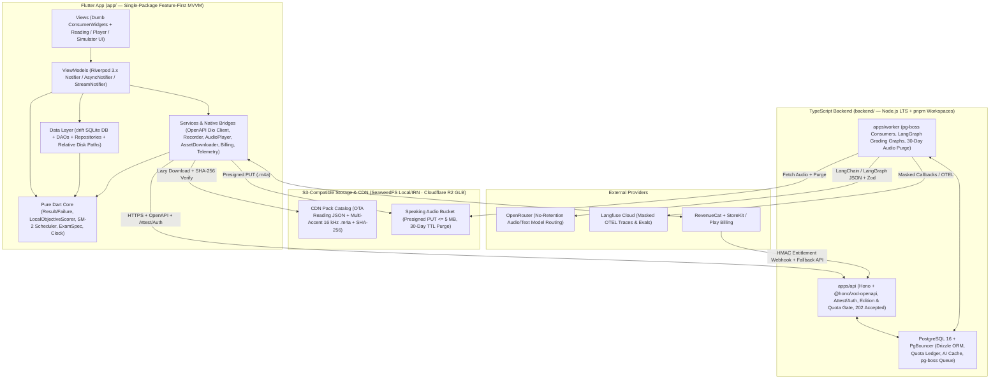
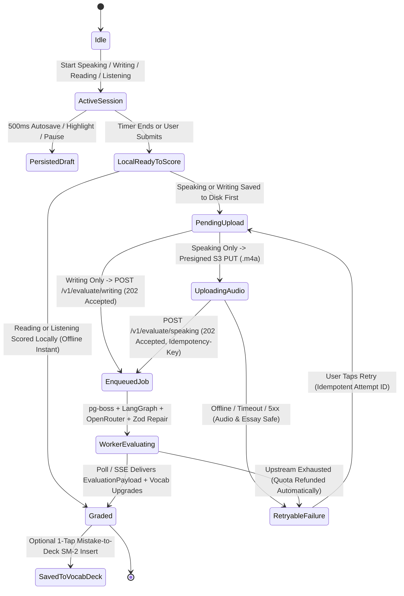
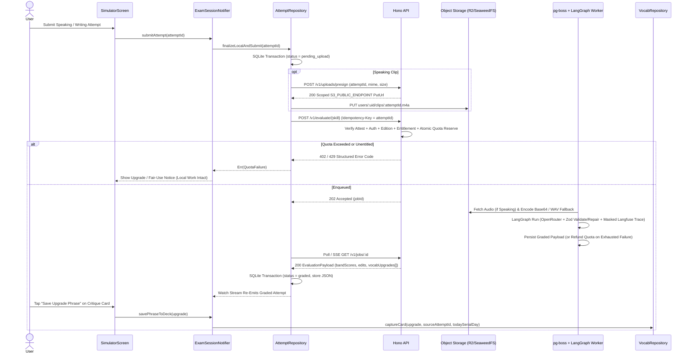

# Mockza — Architecture Decision Records (ADR)

> **Architectural Summary:** Mockza uses a **Single-Package Feature-First Layered MVVM** client in **Flutter (Dart 3 + Impeller)** powered by **Riverpod 3.x** (State + DI), **`go_router`**, **`drift` SQLite** (strict single write path for attempts, drafts, cached packs, highlights, and SRS vocabulary cards), hand-rolled **`Result<T, Failure>`**, and **`purchases_flutter` (RevenueCat)**—paired with a **TypeScript (`Node.js LTS` + `Hono` + `Zod` + `PostgreSQL 16` + `Drizzle ORM` + `pg-boss`)** async backend, **OpenAPI-generated Dart client contracts**, **OpenRouter + LangGraph + Langfuse** AI evaluation, and **S3-compatible Object Storage (`Cloudflare R2` + CDN / `SeaweedFS`)** for clean-room media delivery.

---

## 1. Architectural Drivers, Constraints & Topology

### Engineering Drivers Derived from `PDR.md`
1. **Complete 4-Skill Multi-Exam Hub Without Clone Bloat:** Serve `Listening`, `Reading`, `Writing`, `Speaking`, and `Mistake-to-Deck Vocabulary` across IELTS/PTE/TOEFL/DET using schema-driven engines (`ExamSpec`), satisfying Apple Guideline 4.3 (`PDR Sec. 1`).
2. **Offline-First & Zero Data Loss:** Reading passages, downloaded Listening audio, Vocabulary SM-2/FSRS decks, and Writing drafting work **100% offline**; background kills or dropped Wi-Fi never lose typed essays or recorded audio (`PDR NFR-004`).
3. **Lightweight Binary + Clean-Room IP Governance:** Keep app download ≤ 45 MB (`PDR NFR-010`) by streaming/caching original multi-accent `.m4a` Listening tracks lazily from CDN, and enforce `contentOrigin` provenance schemas before packs ship (`PDR Sec. 8.2`).
4. **Zero Client Secrets, Bounded AI COGS & 1k-User Concurrency:** Keep zero-COGS deterministic Reading/Listening/Vocab on-device while routing Speaking/Writing evaluations through an authenticated `202 Accepted` async queue backend with daily/monthly fair-use quotas (`PDR NFR-005`, `Sec. 10`) and CDN pack offloading.

### System Architecture Topology



### Hybrid Attempt Lifecycle (Deterministic Local vs. Async Worker AI Grading)



### Critical Sequence: Presigned Upload, Quota-Protected Async Job & Vocab Capture



---

## 2. Architecture Decision Index

| ID | Topic | Chosen Decision | Status |
| :--- | :--- | :--- | :--- |
| **`ADR-001`** | Cross-Platform Framework | Flutter (Dart 3 + Impeller) | Accepted |
| **`ADR-002`** | Project Structure & Layering | Single-Package Feature-First Layered MVVM (Strict Downward DAG, `theme/components/`) | Accepted |
| **`ADR-003`** | State Management & DI | Riverpod 3.x (Hand-Written Notifiers) + `bootstrap.dart` Composition Root | Accepted |
| **`ADR-004`** | Error Handling & Cold-Start Net | Hand-Rolled Sealed `Result<T, Failure>` + Dual Error Hooks (No Zones) | Accepted |
| **`ADR-005`** | Navigation & Route Guards | Single `GoRouter` (4-Tab `StatefulShellRoute` + Pushed Settings/Immersive) + Path Params + `PopScope` | Accepted |
| **`ADR-006`** | Local Persistence & Blobs | `drift` SQLite Single Write Path + Relative Disk Paths (Audio + Packs + SRS) | Accepted |
| **`ADR-007`** | Async TypeScript Backend & S3/CDN | Node.js LTS + `Hono` (`zod-openapi`) + `PostgreSQL 16`/`Drizzle` + `pg-boss` + `R2`/`SeaweedFS` | Accepted |
| **`ADR-008`** | 4-Skill Exam & Grading Engine | Pure Local Objective Scorer + Async `LangGraph`/`OpenRouter`/`Zod` + `Langfuse` + Provenance CLI | Accepted |
| **`ADR-009`** | Dual Audio Pipeline (Rec + Play) | `AudioRecorderGateway` (`16 kHz` AAC -> Presigned S3) + `AudioPlayerGateway` (`just_audio` + SHA-256 Cache) | Accepted |
| **`ADR-010`** | Monetization & Entitlements | `purchases_flutter` (RevenueCat) + Webhook Sync & Fallback Check + Derived `isEntitled` Gate | Accepted |
| **`ADR-011`** | Identity, Privacy & A11y | Anonymous Auth Bootstrap + Apple/Google Link + OpenRouter/Langfuse Privacy Controls + ARB/RTL | Accepted |
| **`ADR-012`** | Quality Gates, Testing & CI/CD | Container-First CI (`app/Containerfile`, `backend/Containerfile`) + 4-Tier Flutter Matrix + Backend `Vitest`/`Biome` | Accepted |
| **`ADR-013`** | Contextual Vocabulary & Highlights | On-Device Pure Dart SM-2 Scheduler (`dueDaySerial`) + Zero-Coupling Capture + Reading Highlight Ranges | Accepted |
| **`ADR-014`** | Multi-Edition Flavors & Versioning | Strict `glb` (`1.0.0+10001.glb`) vs `irn` (`1.0.0+20001.irn`) App Flavors & Backend `EDITION` Isolation | Accepted |
| **`ADR-015`** | Container-First Runtime & Ports | Multi-Stage `Containerfile`s (`Dockerfile` symlinks), Root `compose.yaml` (`PgBouncer` + Direct `worker`), Non-Colliding Ports | Accepted |

---

## 3. Detailed Architecture Decision Records

### `ADR-001`: Cross-Platform Framework — Flutter (Dart 3 + Impeller)
* **Status:** Accepted
* **Context:** Mockza requires smooth scrolling over dense 900-word Reading passages with interactive text highlights, responsive essay editors, live audio waveforms, and Listening playback controls across **iOS first** and **Android second**.
* **Decision:** Build natively compiled mobile apps in **Flutter** (Dart 3 + **Impeller** renderer).
* **Alternatives Considered:** Native dual Swift/Kotlin (doubles solo maintenance across 4+ apps); React Native (bridge friction on custom audio + SQLite sync).
* **Consequences:** ~95% shared Dart logic & UI; native differences isolate cleanly in `lib/services/` / `lib/native/`. Requires macOS cloud CI (or Mac hardware) for iOS Store distribution.

---

### `ADR-002`: Project & Code Topology — Single-Package Feature-First Layered MVVM
* **Status:** Accepted
* **Context:** Mockza spans 4 core bottom-tab hubs (`home`, `practice_hub`, `vocabulary`, `progress`), onboarding/settings/paywall surfaces, 4 exam simulators, micro-drills, and AI evaluation reviews without coupling feature directories.
* **Decision:** Use a **single-package Feature-First Layered MVVM** layout under `app/` with strictly downward DAG dependencies (`features/* -> (data, services, core, routing, theme, l10n)` and `data / services -> core`):
  * **Fixed Feature Anatomy (`features/<feature>/presentation/`):** `<feature>_screen.dart` (dumb View), `<feature>_notifier.dart` (1:1 ViewModel), `<feature>_providers.dart` (scoped providers), and `widgets/` (optional `domain/` only for feature-local models; optional `application/` only when orchestrating 2+ repositories).
  * **Zero Sibling Imports & No Junk Drawers:** Features **never import** another feature folder (no `lib/shared/`, `utils/`, `helpers/`, `common/`, or barrels); shared persistence flows through `data/` repositories (`VocabRepository`, `AttemptRepository`), cross-feature UI primitives live inside `theme/components/`, and navigation happens via `routing/`.
  * **Pure Dart `core/`:** `lib/core/` imports zero `package:flutter`, `dart:io`, `drift`, or `DateTime.now()`—housing `Result/Failure`, `ExamSpec`, `LocalObjectiveScorer`, SM-2 calendar math, and immutable domain models.
  * **Pragmatic Abstraction Rule:** Abstract **only** untestable external boundaries (`GradingGateway`, `AudioRecorderGateway`, `AudioPlayerGateway`, `AssetDownloadGateway`, `BillingGateway`, `TelemetryGateway`, `SecureIdentityService`, native channels). Generated OpenAPI Dart client DTOs stay quarantined inside `lib/services/` and map to `core/models/` + `Result<T, Failure>` at the service boundary.
* **Guardrails:** File ≤ 300 lines, `build()` ≤ 80 lines, method ≤ 30 lines, positional params ≤ 3.

---

### `ADR-003`: State Management & Composition Root — Riverpod 3.x + `bootstrap.dart`
* **Status:** Accepted
* **Context:** Complex exam sessions (countdown timers, audio player positions, unsaved essays, SM-2 card queues, and reactive SQLite streams) must stay predictable and deterministically testable without launching simulators.
* **Decision:** Standardize on **Riverpod 3.x** (`flutter_riverpod`) hand-written providers:
  * ViewModels extend `Notifier<T>`, `AsyncNotifier<T>`, or `StreamNotifier<T>` with `.autoDispose` / `.family` keyed only on immutable value IDs.
  * Expose one immutable state value (value equality + `copyWith`), mutated exclusively via **`void` intent methods** (`saveDraft`, `submitReadingAnswers`, `rateVocabCard`).
  * **Derive, Don't Store:** Compute exam averages, daily Listening/Reading completion counts, vocabulary "Due Today" counts, and daily quota meters from `.watch()` stream folds/getters.
  * **Composition Root:** Infrastructure providers in `lib/providers.dart` throw `UnimplementedError('override in bootstrap()')` until overridden once inside `lib/bootstrap.dart` (`ProviderScope(retry: (count, error) => null, overrides: [...])`).
  * **Clock Discipline:** Ban `DateTime.now()` everywhere outside platform clock implementation; read `clockProvider` (`package:clock`) so timers, streak days, and SM-2 intervals test deterministically with `Clock.fixed(...)`.
* **Banned:** `get_it`, `package:provider`, `StateProvider`, `StateNotifierProvider`, `ChangeNotifierProvider`.

---

### `ADR-004`: Typed Error Handling, Cold-Start Sequence & Lifecycle Flushing
* **Status:** Accepted
* **Context:** Listening pack downloads, presigned audio uploads, async `202 Accepted` grading jobs, and SQLite writes can fail independently; none may silently lose student effort.
* **Decision:**
  1. **Typed Result Spine:** Hand-roll Dart 3 `sealed class Result<T, F extends Failure>` (`Ok`/`Err`) + per-boundary sealed `Failure` hierarchies carrying stable `code` + structured params mapped from backend error codes (never localized strings): `NetworkFailure`, `DownloadIntegrityFailure`, `QuotaFailure`, `GradingSchemaFailure`, `AudioDeviceFailure`, `StorageFailure`, `EditionForbiddenFailure`.
  2. **Deterministic Launch Sequence (`main_global.dart` / `main_iran.dart` -> `bootstrap.dart`):**
     ```text
     WidgetsFlutterBinding.ensureInitialized()
       -> CrashLog.open()                                  // First! Synchronous size-bounded sink
       -> FlutterError.onError = ...                       // Build/layout errors inside try/catch (_)
       -> PlatformDispatcher.instance.onError = ...        // Unwraps ProviderException, ALWAYS returns true (NO runZonedGuarded!)
       -> bootstrap()                                      // Open DB (+WAL/FK/FULL pragmas), read pre-paint theme/settings
       -> runApp(ProviderScope(overrides: ..., child: App()))
       -> WidgetsBinding.addPostFrameCallback -> warmUp()  // Deferred SDK/audio warm-up AFTER first frame
     ```
  3. **Lifecycle Observer:** Single `WidgetsBindingObserver` flushes pending Writing drafts / Reading highlights on `inactive`/`paused` and checks calendar-day rollover (updating Vocab Due Queue) on `resumed`.

---

### `ADR-005`: Navigation, Deep Linking & Active-Session Protection (`go_router`)
* **Status:** Accepted
* **Context:** Switching among 4 primary tabs (`Home`, `Practice`, `Vocabulary`, `Progress`) must preserve tab scroll state while guarding live countdown sessions from accidental swipe-back loss and keeping `Settings`, `Paywall`, and timed workspaces distraction-free.
* **Decision:** Single `GoRouter` in `lib/routing/app_router.dart`:
  * **Path Params Only for Identity:** `/home`, `/practice`, `/practice/setup/:skill`, `/speaking/:examId`, `/writing/:taskId`, `/reading/:packId`, `/listening/:packId`, `/micro-drill/:drillId`, `/results/:attemptId`, `/vocabulary`, `/vocabulary/review`, `/vocabulary/:wordId`, `/progress`, `/progress/skill/:skill`, `/progress/attempts`, `/settings`, `/onboarding`, `/paywall`. `state.extra` may never hold mandatory identity.
  * **Persistent 4-Tab Shell:** `StatefulShellRoute.indexedStack` for *Home*, *Practice*, *Vocabulary*, and *Progress* (`NavigationBar` on mobile / adaptive `NavigationRail` on tablet). Top-right `Settings` icon, timed workspaces, `Results`, `Onboarding`, and `Paywall` route via `parentNavigatorKey: rootNavigatorKey` to hide bottom nav.
  * **Back-Navigation Guard:** Active Speaking, Writing, Reading, and Listening timed sessions wrap in `PopScope(canPop: false, onPopInvokedWithResult: ...)` confirming exit before pausing/discarding timers.
  * **Pure Guards & Safety:** Pure `redirect` driven by Riverpod `refreshListenable`; `errorBuilder` 404 screen; `CustomTransitionPage` collapsing transitions under reduced motion.

---

### `ADR-006`: Local Persistence & Offline-First Single Write Path (`drift`)
* **Status:** Accepted
* **Context:** Expanding to Reading passages, downloaded Listening packs, highlights, and SM-2 Vocabulary decks adds relational state that must stay strictly consistent offline and survive iOS app-container UUID updates.
* **Decision:** Confine **`drift` (`NativeDatabase.createInBackground`) + `sqlite3`** strictly to `lib/data/` alongside `flutter_secure_storage` for tokens:
  * **Schema & Invariants (`isStrict => true`):**
    * `attempts` (`id` UUID, `skill` `CHECK IN ('listening','reading','writing','speaking')`, `examId`, `packId`, `status`, `bandTenths` `CHECK BETWEEN 0 AND 90`, `rawScore`, `rubricVersion`, `payloadJson`, `startedAtUtcMs`, `completedAtUtcMs`, `AuditColumns`).
    * `writing_drafts` (`attemptId` FK, `draftText`, `wordCount`, `updatedAtUtcMs`).
    * `speaking_clips` (`attemptId` FK, `partNumber`, **`relativeAudioPath`**, `durationMs`, `uploadStatus`).
    * `cached_content_packs` (`packId` PK, `skill`, `version`, **`relativeJsonPath`**, **`relativeMediaPath`**, `sha256`, `originProvenance`, `downloadedAtUtcMs`).
    * `reading_annotations` (`packId`, `passageIndex`, `startOffset`, `endOffset`, `colorCode`, `noteText`, `isDeleted`).
    * `vocab_cards` & `vocab_review_logs` (`id` UUID, `term`, `contextSentence`, `paraphraseHints`, `sourceSkill`, `sourceRefId`, `easeFactorMilli` int, `intervalDays` int, `repetitions` int, **`dueDaySerial` int**, `AuditColumns`).
  * **Per-Open Pragmas:** Re-assert `PRAGMA foreign_keys = ON;`, `PRAGMA synchronous = FULL;`, `PRAGMA journal_mode = WAL;`, and `PRAGMA busy_timeout = 5000;` on **every** open.
  * **Single Write Path & Relative Blob Paths:** Every cross-table write runs inside `db.transaction` awaiting all queries before `.watch()` streams re-emit UI state. Never store audio/pack binaries as SQLite BLOBs and never persist absolute OS directory paths—store paths **relative** to `getApplicationSupportDirectory()`.
  * **Canonical Units & Pagination:** Store band scores as tenths (`75`), ease factors as integer millis (`2500` = `2.50`), timestamps as UTC epoch ms, and local study/SRS dates as **integer serial calendar days** (eliminating timezone/DST off-by-ones). Paginate attempt/vocab history via **keyset cursor queries**, never `OFFSET`.

---

### `ADR-007`: TypeScript Backend (`Hono` + `pg-boss` + `Drizzle`) & S3/CDN Media Delivery
* **Status:** Accepted
* **Context:** Speaking/Writing AI calls require key hiding, durable job handling across mobile network drops, strict COGS caps, and predictable throughput up to **1,000+ simultaneous users**, while clean-room Listening `.m4a` tracks and Reading packs must deliver at CDN speed with zero API compute overhead (see [proposed_backend.md](file:///home/mahdi/projects/ideas/mockza/proposed_backend.md)).
* **Decision:** Build a **pnpm Workspaces TypeScript (strict) Monorepo (`backend/`)** running **`Node.js LTS` + `Hono` (`@hono/zod-openapi`)**, **`PostgreSQL 16` + `Drizzle ORM`**, **`pg-boss`** Postgres job queue (no separate Redis cluster in v1), and **S3-compatible Object Storage**:
  * **Contract-First Sync (`packages/contracts`):** Zod schemas generate an OpenAPI specification, producing the typed Dart API client (`Dio`, quarantined inside Flutter `app/lib/services/`) and returning machine-readable error codes (`QUOTA_EXCEEDED`, `EDITION_FORBIDDEN`, `ATTEMPT_CONFLICT`, `MODEL_UNAVAILABLE`).
  * **API vs. Worker Process Isolation:**
    * `apps/api` (thin HTTP ingress behind **PgBouncer**): verifies App Attest / Play Integrity, auth tokens, `X-Edition`, RevenueCat entitlement, and atomic Postgres quota reservation; writes jobs to `pg-boss`; returns **`202 Accepted`** + `jobId`. **Never invokes LLMs synchronously.**
    * `apps/worker` (`pg-boss` consumers with `useListenNotify: true`, queue partitioning, and `autovacuum` tuning): executes bounded Speaking/Writing/`explain-question` grading jobs and the 30-day audio purge cron, **refunding reserved quota automatically** if upstream AI exhausts retries.
  * **Backend Endpoints:**
    * `POST /v1/auth/anonymous` & `POST /v1/auth/link` (guest UUID session + Apple/Google linking).
    * `POST /v1/uploads/presign` (signed S3 `PUT` against **`S3_PUBLIC_ENDPOINT`**, locking key prefix `users/<uid>/clips/<attemptId>.m4a`, MIME `audio/mp4`/`audio/m4a`, and max byte cap `<= 5 MB`).
    * `POST /v1/evaluate/speaking`, `POST /v1/evaluate/writing` (`202 Accepted` + `Idempotency-Key = attemptId`).
    * `POST /v1/evaluate/explain-question` (Pro-gated optional *"Ask AI Why?"*; Postgres-cached by `(questionId, packVersion)`).
    * `GET /v1/jobs/:id` (plus optional **SSE stream** or jittered exponential backoff polling to prevent read spikes at 1k concurrency).
    * `GET /v1/catalog/manifest` (cacheable CDN URLs + SHA-256 + provenance tags).
    * `POST /v1/webhooks/revenuecat` & `DELETE /v1/account`.
  * **S3 Storage & CDN Delivery:**
    * **`Cloudflare R2 + CDN` (`glb` prod):** Direct client download of Reading JSON and Listening `.m4a` packs (`AssetDownloadGateway`), creating zero API server load.
    * **`SeaweedFS` (local Docker dev & self-hosted `irn`):** Selected over MinIO because MinIO Community was archived/halted (`Garage` noted as an equivalent alternative). Presigned URLs sign against `S3_PUBLIC_ENDPOINT` so physical mobile devices bypass internal Docker hostnames.

---

### `ADR-008`: Unified 4-Skill Exam Engine, LangGraph/OpenRouter Grading & Content Gate
* **Status:** Accepted
* **Context:** Speaking and Writing need auditable, calibrated AI rubric evaluation (`±0.5` band accuracy), Reading and Listening need instant offline deterministic scoring, and all content packs must enforce strict IP provenance before publishing.
* **Decision:**
  1. **Declarative Exam Catalog (`app/lib/core/exams/`):** Shared immutable schemas (`ListeningSectionSpec`, `ReadingPassageSpec`, `WritingTaskSpec`, `SpeakingSessionSpec`, `BandConversionTable`) parameterized across IELTS, PTE, TOEFL, and DET.
  2. **Deterministic Local Objective Scorer (`LocalObjectiveScorer` in `app/lib/core/exams/`):**
     * Pure Dart engine scoring `TFNG`, `YNNG`, `MCQ`, `Matching`, and `GapFill`.
     * Enforces word-count bounds (`maxWords`), normalizes whitespace/punctuation, matches case-insensitively against schema-defined `acceptedVariants[]` + US/UK spelling normalizer + numeric words (`"2"` <-> `"two"`), and maps raw scores cleanly via band tables.
  3. **Async AI Evaluation Graph (`backend/packages/ai/`):**
     * **Model Registry & Routing (`packages/ai/models/` + OpenRouter):** Routes candidate models via OpenRouter restricted to **no-retention / no-training providers**, recording per-model audio support, structured JSON output support, unit cost, and `calibrated` status (`ChatOpenRouter` / `@langchain/openrouter` or direct OpenRouter client—avoiding `ChatOpenAI` translation quirks for `input_audio`).
       * **Audio / Speaking (Only Model):** **`google/gemini-3.1-flash-lite`** (no fallback model; supports `16 kHz` mono `32 kbps` `.m4a` natively without `ffmpeg` WAV conversion). Multimodal messages must place `input_audio` **before** the text rubric prompt, with leading/trailing silence trimmed to minimize audio duration tokens.
       * **Text-Only Tasks (Writing, `explain-question`, Text Drills — Only Model):** **`deepseek/deepseek-v4.1-flash-1017`** (no fallback model).
       * **Failure & Calibration Policy:** If OpenRouter retries exhaust, the `pg-boss` job fails cleanly and refunds reserved quota (`ADR-007`) rather than substituting another model; prompts must pass golden dataset band benchmarks (`±0.5`) before release.
     * **Explicit LangGraph Steps (`packages/ai/graphs/`):** Runs inside `pg-boss` workers (*prepare input → call model → Zod validate → repair loop → persist*) with `@langchain/langgraph-cli` (`langgraph.json`) for dev-only debugging.
     * **Observability & Benchmarks (`backend/evals/` + Langfuse Cloud):** Connected via `@langfuse/langchain` and `@langfuse/otel` with strict content masking; candidate models must pass golden dataset band benchmarks (`±0.5`) before promotion.
     * **Secondary v1.1 Seam:** Pluggable phoneme/fluency assessment hook for PTE drills.
  4. **Content Provenance & Quality Gate (`backend/content-pipeline/`):** TypeScript pre-publish CLI shares `packages/domain` schemas and rejects any Reading/Listening pack missing valid `contentOrigin` (`['mockza_original_v1', 'public_domain', 'cc_by_4_attributed']`), `humanQaReviewed == true`, passage evidence spans for `TFNG`/`YNNG`, or matching `.m4a` SHA-256.

---

### `ADR-009`: Dual Audio Pipeline — Presigned Capture Upload & Downstream Playback
* **Status:** Accepted
* **Context:** Speaking must reliably capture and upload student recordings at 1k concurrency without buffering MB blobs through API proxy RAM, while Listening needs smooth offline/Exam/Study playback.
* **Decision:** Separate two injected interfaces in `app/lib/services/`:
  1. **Upstream Recording (`AudioRecorderGateway` + S3 Direct PUT):**
     * Captures **`16 kHz` mono AAC (`.m4a`, `32–48 kbps`)** (~240–360 KB/min).
     * Verifies RMS level during pre-flight check, persists file + `pending_upload` DB row first, uploads directly to S3 via `POST /v1/uploads/presign`, and triggers `POST /v1/evaluate/speaking` idempotently.
     * **Backend Audio Handling (`packages/ai/audio/`):** Fetches clip from S3, base64-encodes `.m4a` for OpenRouter (`input_audio` does not accept URLs), transcodes via `ffmpeg` to WAV only if the selected upstream provider lacks `.m4a` support, and caps per-worker job concurrency (10–20 active clips/worker) to keep Node V8 heap bounded.
  2. **Downstream Listening (`AudioPlayerGateway` + `AssetDownloadGateway`):**
     * Wraps `just_audio` inside one concrete live service class (quarantining audio-focus/background rules).
     * **Atomic Pack Caching:** Bundles 1 free starter clip (`<= 1.5 MB`); downloads CDN packs to `.m4a.tmp`, verifies SHA-256 against manifest, and atomically renames into `appSupport/mockza_packs/`.
     * **Mode Policy Enforcement:** UI + Notifier enforce Exam Mode locks (no pause, seek, speed, or replay) vs. Study Mode (`0.85x / 1.0x / 1.25x` speed + interactive synced transcript).

---

### `ADR-010`: Monetization, Entitlements & Store Compliance (`purchases_flutter`)
* **Status:** Accepted
* **Context:** Free users get bounded zero-COGS samples + 1 AI diagnostic; subscribers unlock unlimited 4-skill packs, Mistake-to-Deck capture, and AI Speaking/Writing grading without ads.
* **Decision:** Wrap **RevenueCat (`purchases_flutter`)** behind `BillingGateway` + single derived `isEntitledProvider`:
  * **Unified Gate & Server Verification:** App gating reads `isEntitledProvider`. Backend `apps/api` validates entitlements from PostgreSQL synced via **`POST /v1/webhooks/revenuecat` (HMAC verified)** and performs a **lazy RevenueCat REST subscriber lookup on miss/402** to eliminate store-receipt-to-webhook race conditions.
  * **Commit Before UI Unlock:** Unlocks execute only after verified transaction completion or silent entitlement restore; offline grace bounds read cached entitlement expiry via `clockProvider`.
  * **Zero Ads Policy & Bundle Gate:** Keep v1.0 **100% ad-free** and attach initial subscription SKUs (`mockza_cram_weekly`, `mockza_pro_monthly`, `mockza_quarterly`) directly with v1.0 App Review (**Guideline 2.1(b)** `items == 2`).

---

### `ADR-011`: Identity, Privacy, Telemetry & Accessibility
* **Status:** Accepted
* **Context:** All 4 skills must emit exact funnel telemetry mapped to `PDR.md` KPIs while staying compliant with App Store privacy, AI third-party tracing disclosures, microphone disclosure, and RTL accessibility.
* **Decision:**
  * **Anonymous Bootstrap + Optional Account Link:** App generates/persists an anonymous identity (`POST /v1/auth/anonymous`, stored in `flutter_secure_storage`) mapped to RevenueCat `appUserId`; optional Sign in with Apple / Google (`POST /v1/auth/link` + `Purchases.logIn`) in Settings syncs across devices.
  * **Explicit AI & Tracing Privacy:** Pre-mic consent sheet + App Store Privacy Nutrition Labels / `PrivacyInfo.xcprivacy` explicitly disclose masked audio/essay transmission through **OpenRouter** (restricted to **no-retention/no-training** upstream providers) and **Langfuse Cloud** (EU/US explicit region, essay/transcript/user PII masked in `packages/ai/observability/`). Storage sweep enforces **<= 30-day `.m4a` TTL purge**, and **"Delete All My Data & Audio"** runs `DELETE /v1/account` (purging Postgres rows, S3 clips, and local SQLite/files).
  * **Telemetry Contract:** `TelemetryGateway` emits typed KPI events (`onboarding_completed`, `diagnostic_completed`, `sample_completed`, `listening_pack_downloaded`, `vocab_card_saved`, `vocab_review_completed`, `paywall_viewed`, `purchase_succeeded`, `evaluation_submitted`).
  * **Accessibility & RTL:** Wrap copy in `lib/l10n/` ARB files, use `EdgeInsetsDirectional` across all components, verify VoiceOver/TalkBack semantics on audio waveforms & highlights, and enforce zero overflow at `textScaler = 2.0`.

---

### `ADR-012`: Quality Gates, Testing Strategy & Cross-OS CI/CD
* **Status:** Accepted
* **Context:** Local development runs on Linux without Xcode; correctness of Flutter app layers, Drizzle SQL migrations, quota arithmetic, LangGraph grading flows, and OpenAPI contract parity must all be guaranteed headlessly before mobile store builds.
* **Decision:**
  1. **Flutter Lints & Boundary Gates (`app/`):** `very_good_analysis` (`strict-casts`, `strict-raw-types`, `always_use_package_imports`), `dart format --set-exit-if-changed .`, `dart analyze --fatal-infos --fatal-warnings`, plus boundary checks (no raw aesthetic values outside `lib/theme/`, no `drift` outside `lib/data/`, no sibling feature imports, no `MethodChannel` outside `lib/services/native/`, zero tracked keys).
  2. **Backend Lints, Tests & Contract Gate (`backend/`):** **`Biome`** format + lint, TypeScript `tsc --noEmit`, **`Vitest`** suite covering Zod contracts, atomic Postgres quota reserve/refund transactions, LangGraph pipelines with fake models, and CI verification that generated OpenAPI Dart client matches `packages/contracts`.
  3. **4-Tier Headless Flutter Matrix (Linux-Runnable):**
     * *Tier 1 (`dart test`, `core/`):* `LocalObjectiveScorer`, `BandConversionTable`, SM-2 integer-day invariants with `Clock.fixed(...)`, sealed `Result` switches.
     * *Tier 2 (`NativeDatabase.memory()`, `data/`):* Real SQLite queries, STRICT/CHECK constraints, WAL/FK pragmas, keyset cursor pagination, migrations.
     * *Tier 3 (`ProviderContainer.test`, ViewModels):* Bare-`implements` `FakeX` doubles modeling success + `QuotaFailure`/`Offline`/`DownloadIntegrityFailure`.
     * *Tier 4 (`flutter_test`, Widgets + a11y):* `PopScope` guards, highlighter rendering, contrast AA tests, `textScaler = 2.0` overflow checks.
     * *Hardware Pass:* Real-device mic, background audio, and StoreKit/Play billing round-trips.
  4. **Container-First CI/CD Split:** `.github/workflows/ci.yml` executes PR gates inside the exact multi-stage containers (`backend/Containerfile` `toolchain` -> `api`/`worker`/`migrator`/`cli` images, and `app/Containerfile` `checker` -> `web-runtime` Nginx image), paired with `./scripts/check_all.sh all`; **macOS Cloud CI** builds signed `.ipa` with `--obfuscate --split-debug-info=build/symbols/<x.y.z>+<N>` + symbol archiving.

---

### `ADR-013`: Contextual Vocabulary Spaced Repetition (SM-2) & Reading Highlight Architecture
* **Status:** Accepted
* **Context:** Vocabulary cannot be a generic static flashcard dump (`PDR Q6`)—it must capture words directly from AI Writing/Speaking feedback and Reading passages, schedule daily reviews accurately across timezones, and avoid coupling feature folders together.
* **Decision:**
  1. **Pure Dart SM-2 Scheduler (`lib/core/vocab/sm2_scheduler.dart`):**
     * Deterministic pure function `VocabSchedule nextSchedule(VocabSchedule current, ReviewRating rating, int todaySerialDay)`.
     * Operates strictly on **integer serial calendar days** (`todaySerialDay` derived via `clockProvider` in local date) and **integer-milli ease factors** (`easeFactorMilli`, floor `1300` = `1.30`, initial `2500` = `2.50`) — avoiding floating-point drift and DST off-by-one bugs.
  2. **Decoupled 1-Tap Capture Path:**
     * AI feedback JSON includes optional `vocabUpgrades[]` tokens (`phrase`, `upgrade`, `contextSentence`, `bandRationale`).
     * Reading passage UI supports tap-to-save selected span + passage sentence context.
     * Both `evaluation_review` and `reading_sim` invoke `ref.read(vocabRepositoryProvider).captureCard(...)` — persisting cleanly to SQLite with `dueDaySerial = todaySerialDay` (available in Today's Deck immediately) while keeping zero direct dependency on `features/vocabulary/`.
  3. **Reading Highlight Persistence:**
     * Store highlight spans as canonical UTF-16 character offsets (`startOffset`, `endOffset`, `colorCode`) per `(packId, passageIndex)` inside `drift` (`reading_annotations`), rendered via declarative `TextSpan` range merging without mutating immutable cached passage JSON.

---

### `ADR-014`: Multi-Edition Flavors (`glb` vs. `irn`), Canonical Versioning Schema & Isolation Wall
* **Status:** Accepted
* **Context:** The international edition (**Mockza**, Apple App Store / Google Play) requires clean-room IP assets, USD RevenueCat billing, and English-first UI, whereas the Iranian domestic edition ([PDR-Iran.md](file:///home/mahdi/projects/ideas/mockza/PDR-Iran.md)) requires Persian-first RTL + English LTR BiDi rendering, Iranian Rial/Toman gateways (Cafe Bazaar / Myket / Zarinpal PWA), domestic zero-VPN routing, and separate test catalogs (TOEFL TPO/NEO, Cambridge IELTS, DET). Mixing content packs, SDKs, or signing identities risks global developer account termination under Apple/Google IP and payment policies.
* **Decision:** Enforce **compile-time build flavors** on Flutter (`lib/main_global.dart` vs `lib/main_iran.dart` over one flavor-blind `app.dart`), **single-codebase deployment isolation** on TypeScript (`EDITION=glb|irn`), and a **3-Layer Canonical Versioning Schema**:
  1. **App Binary & Store-Safe Versioning:**
     * Store manifest fields stay strictly numeric (`versionName` / `CFBundleShortVersionString`: `x.y.z`; `versionCode` / `CFBundleVersion`: disjoint positive integers `10000+` for `glb` vs `20000+` for `irn` so release symbols never collide).
     * **Canonical Telemetry & Support Version String:** `<x.y.z>+<build>.<edition>` (e.g., `1.0.0+10001.glb` vs `1.0.0+20001.irn`).
  2. **Content Pack Versioning (`ExamCatalogId`):** `<EDITION>-<EXAM>-<SERIES>-v<SCHEMA>.<REV>` (e.g., `GLB-IELTS_AC-MOCKZA_ORIG-v1.0.0` vs `IRN-TOEFL-NEO_012-v1.0.0`). Backend edition guard rejects cross-edition catalog requests (`403 EDITION_FORBIDDEN`).
  3. **AI Rubric Versioning (`backend/packages/ai/prompts/`):** `glb_ielts_en_v1.0` (English commentary) vs `irn_toefl_fa_v1.0` (Persian commentary + English academic rubric anchors).
  4. **Hard Account & Infrastructure Isolation:** Separate bundle/application IDs (`com.mockza.app` vs `ir.<brand>.app`), separate signing keystores, separate Postgres DBs, separate S3 buckets (**Cloudflare R2** for `glb` vs **self-hosted SeaweedFS** for `irn`), separate OpenRouter/Langfuse keys, separate webhook endpoints (`webhooks-revenuecat` vs `webhooks-iran`), and **zero Iran content or domestic billing dependencies compiled into the `glb` flavor** (detailed in [ADR-Iran.md](file:///home/mahdi/projects/ideas/mockza/ADR-Iran.md)).

---

### `ADR-015`: Container-First Packaging, Compose Runtime Topology & Resource/Port Governance
* **Status:** Accepted
* **Context:** Running host Node/`tsx` or `flutter run` processes directly risks toolchain drift (`.flutter-version` `3.47.9`, `Node 24`, `pnpm@12.8.1`), accidentally omits production dependencies/build steps (e.g., `tsx` devDependency in runtime images or missing `packages/*/node_modules` symlinks), risks colliding with pre-existing Docker services (`5432`, `8000`, `8001`, `59000`–`59432`), and can trigger OOM pressure on 8 GiB hosts when Dart/Flutter Web compiles run concurrently with TypeScript builds.
* **Decision:**
  1. **Dual Docker & Podman Compatibility (`Containerfile` + `compose.yaml`):** Canonical multi-stage recipes live in [backend/Containerfile](file:///home/mahdi/projects/ideas/mockza/backend/Containerfile) and [app/Containerfile](file:///home/mahdi/projects/ideas/mockza/app/Containerfile) (with `Dockerfile` and `.containerignore` symlinks pointing to `Containerfile` and `.dockerignore`), orchestrated by root [compose.yaml](file:///home/mahdi/projects/ideas/mockza/compose.yaml) (`name: mockza`) and [Makefile](file:///home/mahdi/projects/ideas/mockza/Makefile).
  2. **Compiled ESM Runtime (`tsc -> dist/`, zero `tsx` in prod):** All 10 `backend/` workspaces expose `"development": "./src/index.ts"` alongside `"default": "./dist/index.js"`, compile via `pnpm run build` (`tsc -p tsconfig.build.json`), and ship slim non-root `node:24-alpine` targets: `api` (`node /app/apps/api/dist/server.js`), `worker` (+ `ffmpeg`), `migrator` (`node /app/packages/db/dist/migrate.js`), `cli` (`init-buckets.js`, `content-pipeline`, `evals`), and `toolchain` (Biome + `tsc` + Vitest).
  3. **Pooled `api` vs. Direct `worker`/`migrate` DB Routing:**
     * `api` connects to `pgbouncer:6432` (`POOL_MODE=transaction`, `AUTH_TYPE=scram-sha-256`, `PG_PGBOUNCER=true` -> `prepare: false` in `@mockza/db`).
     * `worker` (`pg-boss` `LISTEN/NOTIFY` + advisory locks) and `migrate` (Drizzle DDL) bypass PgBouncer and connect directly to `postgres:5432` (`PG_PGBOUNCER=false`).
     * `api` signs upload URLs via `createPublicSigningS3Client(env)` using `S3_PUBLIC_ENDPOINT` so external browsers/devices reach host-mapped SeaweedFS instead of internal `http://seaweedfs:8333`.
  4. **Flutter Web Nginx Reverse Proxy & Pinned SDK (`3.47.9`):** `app/Containerfile` installs `flutter_linux_3.47.9-stable.tar.xz` (`DART_VM_OPTIONS=--old_gen_heap_size=1280`), runs `checker` (`dart format`, `flutter analyze --fatal-infos`, `flutter test`), compiles Web (`--no-wasm-dry-run -O1 --no-source-maps --dart-define=MOCKZA_API_BASE_URL=`), and serves static artifacts in unprivileged `nginx:1.27-alpine` (`:8080`) via [app/nginx.conf](file:///home/mahdi/projects/ideas/mockza/app/nginx.conf), proxying `/v1/` and `/openapi.json` to `http://api:8787`.
  5. **Non-Colliding Ports & Low-RAM Guardrails:** Default ports live cleanly in the `45280`–`45933` block (`45280` Web, `45281` API, `45432` Postgres, `45433` PgBouncer, `45833`/`45933` SeaweedFS), every Compose service carries explicit `mem_limit` and `cpus` bounds, and `Makefile` `build` builds backend targets before `web` sequentially.

---

## 4. Target Repository Blueprint

```text
mockza/
├── compose.yaml                         # Root container-first stack (postgres, pgbouncer, seaweedfs, s3-init, migrate, api, worker, web, tools, k6)
├── Makefile                             # Sequential low-RAM build/up/down/migrate/check commands
├── .env.example                         # Non-colliding default ports (45280-45933) & env contract
├── .dockerignore · .containerignore     # Shared monorepo context exclusions
├── .flutter-version                     # Pinned Flutter SDK version (3.47.9)
├── scripts/check_all.sh                 # Static architecture & secret hygiene gates
├── .github/workflows/ci.yml             # Container-first CI pipelines (backend & flutter Containerfiles)
├── docs/                                # Specification & Architecture Records
│   ├── PDR.md                           # Global Edition PDR (Clean-Room GLB)
│   ├── PDR-Iran.md                      # Iran Domestic Edition PDR (Persian-First IRN)
│   ├── ADR.md                           # Shared Core Architecture & Backend Contract (this file)
│   ├── ADR-Iran.md                      # Iran Edition Technical Extensions (Bazaar/Zarinpal, BiDi, TPO/NEO)
│   ├── PLAN.md                          # Master Execution Plan (Container-First + Backend + Flutter)
│   └── proposed_backend.md              # Backend TypeScript Design Notes
│
├── app/                                 # Single-Package Flutter App (Mobile + Containerized Web Preview)
│   ├── Containerfile · Dockerfile       # Multi-stage SDK (3.47.9) -> checker -> web-builder -> unprivileged Nginx runtime
│   ├── nginx.conf                       # SPA routing + same-origin /v1/* & /openapi.json reverse proxy to api:8787
│   ├── .dockerignore · .containerignore
│   ├── analysis_options.yaml            # very_good_analysis + strict-casts/raw-types
│   ├── pubspec.yaml · pubspec.lock
│   ├── l10n.yaml
│   ├── lib/
│   │   ├── main_global.dart             # GLB Composition Root (Clean-Room + RevenueCat + Global API)
│   │   ├── main_iran.dart               # IRN Composition Root (Persian RTL + Domestic Payments + IRN API)
│   │   ├── bootstrap.dart               # Shared ordered init taking flavor EditionConfig
│   │   ├── providers.dart               # Throwing placeholder DI providers + clockProvider
│   │   ├── app.dart                     # MaterialApp.router, Theme, ARB l10n, Lifecycle observer
│   │   ├── core/                        # PURE DART ONLY (No Flutter / IO / Drift / DateTime.now())
│   │   │   ├── result/                  # sealed Result<T, Failure>, per-boundary Failure hierarchies
│   │   │   ├── exams/                   # ExamSpec, IELTS/PTE/TOEFL/DET schemas, LocalObjectiveScorer, Band tables
│   │   │   ├── vocab/                   # Pure SM-2 scheduler & canonical serial-day calendar math
│   │   │   └── models/                  # Immutable Attempt, ReadingPack, ListeningPack, VocabCard, EvaluationReport
│   │   ├── data/                        # ONLY directory importing package:drift / sqlite3
│   │   │   ├── db/                      # AppDatabase, connection.dart (WAL/FK/FULL pragmas), STRICT tables, seed/
│   │   │   ├── daos/                    # Single-table DriftAccessors (attempts, packs, annotations, vocab, settings)
│   │   │   └── repositories/            # Single write path, transactions, relative disk paths, keyset pagination
│   │   ├── services/                    # Injected abstract interfaces + live impls (including generated OpenAPI client)
│   │   │   ├── network/                 # Dio + Attest headers + OpenAPI Dart client (mapped to core models)
│   │   │   ├── grading_gateway.dart
│   │   │   ├── audio_recorder_gateway.dart
│   │   │   ├── audio_player_gateway.dart
│   │   │   ├── asset_download_gateway.dart
│   │   │   ├── billing_gateway.dart
│   │   │   ├── telemetry_gateway.dart
│   │   │   ├── secure_identity_service.dart
│   │   │   ├── crash_log.dart
│   │   │   └── native/                  # Quarantined MethodChannels
│   │   ├── routing/                     # Single GoRouter, 4-tab StatefulShellRoute, path-param routes, PopScope guards
│   │   ├── theme/                       # STRICT raw-value boundary + reusable components/
│   │   │   ├── primitives.dart · app_colors.dart · app_typography.dart · app_shapes.dart · app_motion.dart · app_theme.dart
│   │   │   └── components/              # Shared dumb UI primitives (AppScaffoldShell, BrandHeader, ScoreMeter, SkillCard)
│   │   ├── l10n/                        # app_en.arb (+ future localized ARBs)
│   │   └── features/                    # Downward-only deps; zero sibling imports
│   │       ├── onboarding/              # presentation/ (screen, notifier, providers, widgets/)
│   │       ├── home/                    # Tab 1: Dashboard, Estimated Band, Recommended Next, Weekly strip
│   │       ├── practice_hub/            # Tab 2: Study/Exam toggle, 4 skills, Full Mock, Task Types, Test Setup
│   │       ├── speaking_sim/            # Immersive: Prep/Speak timers, waveform, cue-card notes, pending queue
│   │       ├── writing_sim/             # Immersive: Task 1 chart/Task 2 editor, word counter, 500ms autosave
│   │       ├── reading_sim/             # Immersive: Passage|Questions toggle, highlights, 1-tap vocab, offline grader
│   │       ├── listening_sim/           # Immersive: Pack download, Exam/Study player, question paging, offline grader
│   │       ├── micro_drills/            # Focused 3-min targeted drills
│   │       ├── evaluation_review/       # Criterion cards, inline edits, Band+1.5 rewrite, Ask-AI-Why, 1-tap vocab save
│   │       ├── vocabulary/              # Tab 3: Overview, SM-2 Flashcard flip, Saved Words search/filter, Word Details
│   │       ├── progress/                # Tab 4: Overview trends, Skill Analytics, Keyset Attempt History, Activity
│   │       ├── settings/                # Header gear target: exam/goal, Dark/Light theme, account link, quota, delete data
│   │       └── paywall/                 # RevenueCat offerings, restore purchases, diagnostic/quota limit gate
│   ├── test/                            # Mirrors lib/ 1:1 (Tier 1-4 headless) + support/ + policy/
│   └── integration_test/                # Real-device mic, audio focus, StoreKit round-trip smoke tests
│
└── backend/                             # TypeScript Async Backend (Node.js 24 LTS + pnpm Workspaces)
    ├── Containerfile · Dockerfile       # Multi-stage deps-prod -> builder -> toolchain / api / worker / migrator / cli
    ├── .dockerignore · .containerignore
    ├── docker-compose.yml               # Standalone infra compose (non-colliding 45432 Postgres, 45833/45933 SeaweedFS)
    ├── .env.example                     # Local backend env template
    ├── package.json · pnpm-workspace.yaml · tsconfig.base.json · biome.json
    ├── langgraph.json                   # Dev-only config for langgraphjs dev
    ├── apps/
    │   ├── api/src/                     # Hono (@hono/zod-openapi): health, routes (auth, uploads/presign, evaluate, jobs, catalog, webhooks-revenuecat, account), middleware (attest, auth, edition-guard, quota, request-id)
    │   └── worker/src/                  # pg-boss consumers: grade-speaking, grade-writing, explain-question, purge-audio (30-day cron)
    ├── packages/
    │   ├── contracts/                   # Zod schemas -> OpenAPI -> Dart client generation
    │   ├── domain/                      # Rubric schemas, EvaluationPayload, quota & edition rules, error codes
    │   ├── db/                          # Drizzle schema + forward-only migrations (users, entitlements, attempts, quota_ledger, ai_cache, catalog_packs)
    │   ├── ai/                          # models/ (OpenRouter registry), graphs/ (LangGraph flows), prompts/ (versioned rubrics), audio/ (S3 -> base64 + ffmpeg WAV fallback), observability/ (Langfuse masking)
    │   ├── storage/                     # S3 client (S3_ENDPOINT / S3_PUBLIC_ENDPOINT), scoped presign, 30-day delete sweep
    │   └── config/                      # Zod-parsed env + EDITION=glb|irn
    ├── evals/                           # Langfuse golden Speaking/Writing datasets & ±0.5 calibration runner
    └── content-pipeline/                # TypeScript provenance validator, evidence-span & SHA-256 check, TTS packager
```

---

## 5. PDR-to-ADR Traceability Matrix

| `PDR.md` Requirement / Goal / Risk | Owner ADR | Concrete Technical Mechanism |
| :--- | :--- | :--- |
| **Apple Guideline 4.3 Consolidated 4-Skill Hub** | `ADR-002`, `ADR-005`, `ADR-008` | Single app + 4-tab `StatefulShellRoute` + schema-driven `ExamSpec` plugins across IELTS/PTE/TOEFL/DET |
| **Clean-Room IP Provenance (Zero Cambridge/ETS Copies)** | `ADR-008`, `ADR-012` | `backend/content-pipeline/` TypeScript CLI validates `contentOrigin`, `humanQaReviewed`, evidence spans, and SHA-256 in CI |
| **Offline Reading, Listening, Vocab & Essay Safety (`NFR-004`)** | `ADR-004`, `ADR-006`, `ADR-009` | Local deterministic scorer, SHA-256 atomic `.m4a` cache, 500ms SQLite autosave, lifecycle pause flush, `PopScope` guard |
| **Small Binary Budget ≤ 45 MB (`NFR-010`)** | `ADR-007`, `ADR-009` | Bundle 1 starter track locally; fetch full Listening `.m4a` + Reading JSON lazily from Cloudflare R2 / SeaweedFS CDN |
| **AI Cost Caps, Zero Secrets & 1k Concurrency (`NFR-005`, `Sec. 10`)** | `ADR-007`, `ADR-008` | Thin Hono `202 Accepted` API + `pg-boss` worker pool + PgBouncer + atomic Postgres quota reserve/refund (`10+10/day`, `150/mo`) + masked Langfuse/OpenRouter routing |
| **Mistake-to-Deck Contextual Vocabulary (`FR-034..037`)** | `ADR-002`, `ADR-006`, `ADR-013` | Decoupled `VocabRepository` capture from AI/Reading reviews + pure Dart SM-2 integer-day scheduler |
| **4-Angle Conversion Funnel & KPIs (`Sec. 5`)** | `ADR-003`, `ADR-010`, `ADR-011` | `TelemetryGateway` 1-to-1 KPI events (`diagnostic_completed`, `vocab_card_saved`, etc.) + single `isEntitledProvider` + RevenueCat REST fallback |
| **Store Privacy, 2.1(b) & Release Hygiene (`Sec. 11`)** | `ADR-010`, `ADR-011`, `ADR-012` | `PrivacyInfo.xcprivacy`, Data Safety & OpenRouter/Langfuse disclosures, `<= 30-day` S3 clip purge, `DELETE /v1/account`, Guideline 2.1(b) attachment check |
| **Solo Linux Dev Velocity + iOS Store Shipping** | `ADR-002`, `ADR-003`, `ADR-012`, `ADR-015` | Pure Dart `core/`, `NativeDatabase.memory()`, headless `ProviderContainer` on Linux, containerized CI (`Containerfile` + `compose.yaml`), macOS Cloud CI for signed IPAs |
| **Global vs. Iran Store, Payment & Content Isolation** | `ADR-014`, [ADR-Iran.md](file:///home/mahdi/projects/ideas/mockza/docs/ADR-Iran.md) | Compile-time `glb`/`irn` Flutter flavors, disjoint build codes (`10000+` vs `20000+`), isolated `EDITION=glb|irn` backend deployments/buckets/DBs |
| **Zero Host Port Collisions & Bounded 8 GiB Builds** | `ADR-015` | Non-colliding default ports (`45280`–`45933`), Compose `mem_limit`/`cpus` caps, sequential builds (`make build`), `--old_gen_heap_size=1280` & `-O1 --no-wasm-dry-run` |
