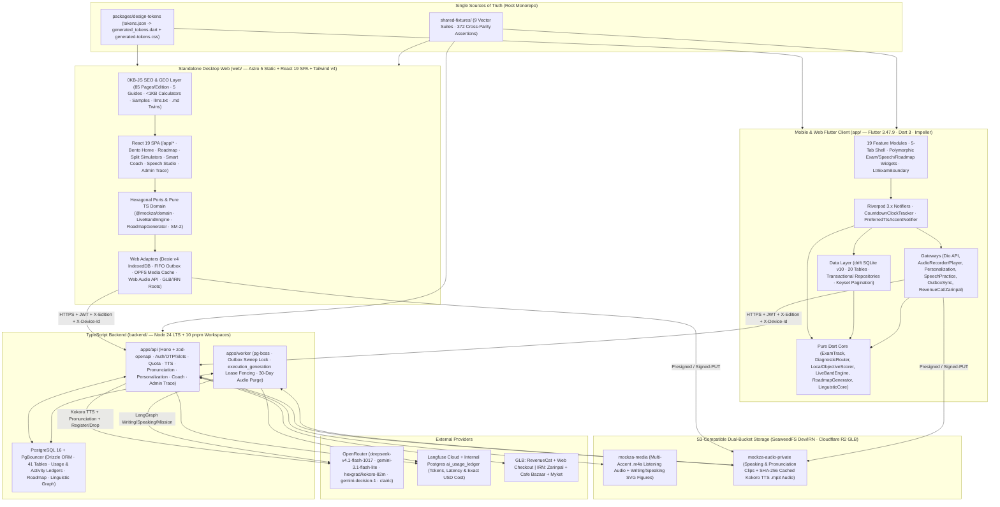
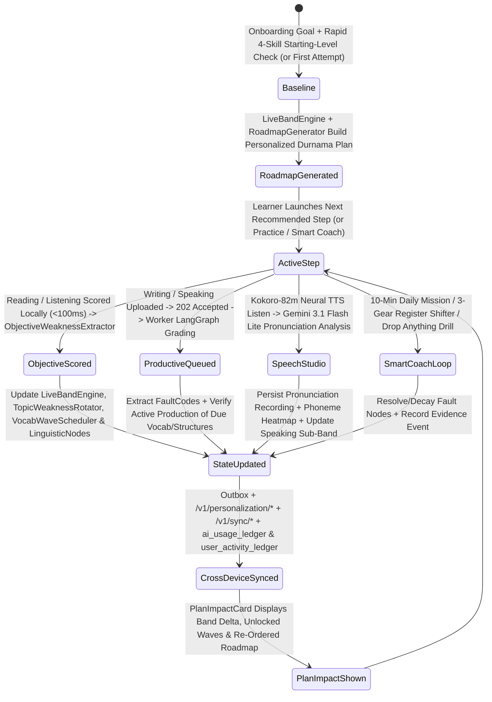

# Mockza & Sanjia — Architecture Decision Records (ADR v4.0)

> **Architectural Summary:** Mockza (`GLB` `1.0.0+10001.glb`) and Sanjia (`IRN` `1.0.0+20001.irn`) implement a **Dual-Client, Dual-Edition, 5-Track AI Exam & Adaptive Learning Platform** structured as a **12-workspace root `pnpm` monorepo** plus a **Single-Package Feature-First Layered MVVM Flutter client** (`app/`, Flutter `3.47.9`, Dart 3 + Impeller, **Riverpod 3.x**, **`go_router`** with 31 routes, **`drift` SQLite `schemaVersion == 10`** with 20 tables). The standalone **Desktop Web client (`web/`)** pairs **Astro 5 Static 0KB-JS SEO/GEO pages** (85 prerendered routes per edition) with a **Hexagonal React 19 + Tailwind v4 SPA** backed by **Dexie v4 IndexedDB**, **OPFS media caching**, and **Web Audio API**. The **TypeScript Backend (`backend/`)** runs on **Node 24 LTS + Hono (`@hono/zod-openapi`) + PostgreSQL 16 + PgBouncer + Drizzle ORM (41 tables) + `pg-boss`**, orchestrating **OpenRouter (`deepseek/deepseek-v4.1-flash-1017`, `google/gemini-3.1-flash-lite`, `hexgrad/kokoro-82m`) + LangGraph + Langfuse**, **SeaweedFS / Cloudflare R2** dual-bucket S3 storage, strict **`1 Phone + 1 Desktop Web`** device-slot governance, **Closed-Loop Smart Coach** (`LinguisticGraph`, `DailyMission`, `RegisterShifter`, `DropAnything`), **Adaptive Personalization & Step-by-Step Roadmap (*Durnama*)**, **Neural TTS & Multimodal Pronunciation Studio**, **Bidirectional Cross-Device Sync**, and **End-to-End Server-Side User, Audio, Token & USD Cost Tracing (`AdminTraceConsole`)**.

---

## 1. Architectural Drivers, Constraints & Topology

### Engineering Drivers Derived from `PDR.md` & `PDR-Iran.md`
1. **Consolidated 5-Track 4-Skill Hub Without Clone Bloat:** Serve `Listening`, `Reading`, `Writing`, `Speaking`, `Micro-Drills`, `Mistake-to-Deck Vocabulary`, `Smart Coach`, and `Adaptive Roadmap` across **IELTS Academic, IELTS General Training, TOEFL iBT (2026), PTE Academic, and DET** through polymorphic domain descriptors (`ExamTrack` / `ExamDescriptor` + `@mockza/domain` `EXAM_SCALES`), satisfying Apple Guideline 4.3 (`PDR Sec. 1`).
2. **100% Mathematical & Visual Parity Across Backend, Desktop Web, and Flutter (`GLB` & `IRN`):** Canonical design tokens (`packages/design-tokens/tokens.json`) and 9 shared cross-codebase vector suites (`shared-fixtures/*.json`, `372` vectors) enforce bit-for-bit parity across TypeScript (`@mockza/domain`, `@mockza/web`) and Dart (`app/lib/core/`).
3. **Closed-Loop Pedagogical Adaptation (Diagnostic -> Roadmap -> Smart Coach -> Active Production):** Every objective mistake, AI rubric fault (`FaultCode`), pronunciation error, and vocabulary review updates the learner's **Live Band Estimate (`LiveBandEngine`)**, **Error DNA Graph (`LinguisticNodes`)**, **Topic Weakness Rotator**, and **Step-by-Step Roadmap (*Durnama*)**, while **Active Production Verification** confirms when learners actively deploy target vocabulary and structures in new Writing/Speaking attempts.
4. **100% API-Driven Neural TTS & Multimodal Pronunciation Studio with Exam Mode Restraint:** Use OpenRouter `hexgrad/kokoro-82m` (`bf_emma` UK / `af_bella` US) for all pronunciation audio synthesis (zero browser `speechSynthesis` or OS TTS dependency) and `google/gemini-3.1-flash-lite` for phoneme/word-level pronunciation grading—strictly hidden during timed Exam Mode (`Exam Mode Restraint`).
5. **Full Server-Side Observability, Token/Cost Ledger & Cross-Device Sync:** Trace every user activity, persisted audio clip, AI model invocation, prompt/completion/audio token count, latency, and exact USD cost (`ai_usage_ledger`, `user_activity_ledger`, `AdminTraceConsole`) while syncing attempts, SM-2 cards, and roadmap progress across devices.
6. **Zero Client Secrets, Strict `1 Phone + 1 Desktop Web` Governance & Low-RAM Operations (`AGENTS.md`):** Score all 11 objective task types offline on-device; enforce partial unique device-slot constraints (`uq_active_user_slot`); and respect strict low-RAM guardrails (`free -m >= 900 MiB`, sequential execution, capped Node/Dart VM heaps) on `<= 8 GiB` hosts.

### System Architecture Topology

### Closed-Loop Adaptive Learning & Tracing Lifecycle

---

## 2. Architecture Decision Index

| ID | Topic | Chosen Decision | Status |
| :--- | :--- | :--- | :--- |
| **`ADR-001`** | Dual-Client Strategy | Flutter `3.47.9` (Mobile + Web SPA) + Standalone Astro 5 / React 19 Desktop Web (`web/`) | Accepted (Live) |
| **`ADR-002`** | Project Layering & SOLID/OCP UI | Single-Package Feature-First MVVM (19 features) + Hexagonal Web SPA + Canonical Design Tokens SSOT | Accepted (Live) |
| **`ADR-003`** | State Management & Clocks | Riverpod 3.x Notifiers (Flutter) & React Stores/Hooks (Web), `CountdownClockTracker`, injected clocks | Accepted (Live) |
| **`ADR-004`** | Error Handling & Cold-Start | Sealed `Result<T, Failure>` Spine across Dart & TS + `CrashLog` + Unzoned Dual Error Hooks | Accepted (Live) |
| **`ADR-005`** | Navigation & Route Guards | Single `GoRouter` (31 Route Constants, 5-Tab Shell, `ExamExitGuard`) + Astro/React SPA Router | Accepted (Live) |
| **`ADR-006`** | Local Persistence (`drift` & `Dexie`) | Flutter `drift` SQLite (`schemaVersion == 10`, 20 Tables) + Web `Dexie` v4 IndexedDB & OPFS Cache | Accepted (Live) |
| **`ADR-007`** | TypeScript Backend & Postgres | Node 24 + `Hono` (`zod-openapi`) + `PostgreSQL 16`/`Drizzle` (41 Tables) + `pg-boss` + Outbox Lock | Accepted (Live) |
| **`ADR-008`** | 5-Track Exam & AI Rubric Engine | `ExamTrack`/`ExamDescriptor` + `EXAM_SCALES`, 11 Objective & 11 Writing Types, `LangGraph`/OpenRouter | Accepted (Live) |
| **`ADR-009`** | Audio & Visual Prompt Pipeline | Multi-Turn `.m4a`/`.webm` Upload (`presign` + `signed-put`) + Exam/Study Audio Locks + `ExamSvgChartCard` | Accepted (Live) |
| **`ADR-010`** | Monetization & Entitlements | GLB RevenueCat & Web Checkout + IRN Zarinpal/Bazaar/Myket + Mandatory Device Policy Consent | Accepted (Live) |
| **`ADR-011`** | Privacy, Erasure & Telemetry | 30-Day Audio TTL Purge + Cascading `DELETE /v1/account` across all 41 tables + Masked Langfuse | Accepted (Live) |
| **`ADR-012`** | Static Gates & Cross-Parity CI | `scripts/check_all.sh` + `sync_design_tokens.mjs` + `check_cross_parity.sh` (372 vectors) + `check_web_budget.mjs` | Accepted (Live) |
| **`ADR-013`** | SM-2 Vocab, Waves & Highlights | Pure `SerialDay` SM-2 + `VocabWaveScheduler` Band Waves + 1-Tap Mistake Capture + UTF-16 Highlights | Accepted (Live) |
| **`ADR-014`** | Multi-Edition Flavor Isolation | Strict `glb` (`1.0.0+10001.glb`) vs `irn` (`1.0.0+20001.irn`) Builds, Bundle Isolation Greps & `X-Edition` | Accepted (Live) |
| **`ADR-015`** | Container, Hybrid Dev & Low-RAM | Dual-Stack Compose (`45280–45933`) + Mandatory `AGENTS.md` Low-RAM Policy (`free -m >= 900 MiB`, heap caps) | Accepted (Live) |
| **`ADR-016`** | Multi-Surface Auth & Device Slots | Email + Google/Apple OAuth + IRN SMS OTP & Strict `1 Phone + 1 Desktop Web` Slot Constraint + 409 Takeover | Accepted (Live) |
| **`ADR-017`** | Rapid Starting-Level Diagnostic | ~10–15 Min 4-Skill Adaptive Check (`DiagnosticBudget` 900s + `DiagnosticRouter` 2-Stage + Single-Skill Retake) | Accepted (Live) |
| **`ADR-018`** | Hermetic Multi-Layer & E2E Testing | Backend Vitest (36 files) + Web Vitest (36 files/229 tests) + Playwright E2E (7) + Flutter Tests (39 files/409 tests, 9 E2E) | Accepted (Live) |
| **`ADR-019`** | Standalone Astro 5 + React 19 Web | 0KB-JS SEO/GEO Static Layer (85 pages/edition, `llms.txt`, `.md` twins) + Hexagonal React 19 SPA + Strict CSP | Accepted (Live) |
| **`ADR-020`** | Closed-Loop Smart Coach Engine | Error DNA `LinguisticGraph`, `ActiveProductionVerifier`, 10-Min `DailyMission`, 3-Gear `RegisterShifter`, `DropAnything` | Accepted (Live) |
| **`ADR-021`** | Adaptive Roadmap (*Durnama*), Live Band, Kokoro TTS & Pronunciation Studio | `LiveBandEngine`, `RoadmapGenerator`, `TopicWeaknessRotator`, OpenRouter `hexgrad/kokoro-82m` TTS & `gemini-3.1-flash-lite` Pronunciation Studio | Accepted (Live) |
| **`ADR-022`** | Cross-Device Sync & End-to-End Server Tracing | `/v1/personalization/*` & `/v1/sync/*` + `ai_usage_ledger`, `user_activity_ledger` & `/app/admin/trace` Console | Accepted (Live) |

---

## 3. Detailed Architecture Decision Records

### `ADR-001` & `ADR-019`: Dual-Client Architecture (Flutter Mobile/Web + Standalone Astro 5 / React 19 Desktop Web)
* **Context:** Mobile learners need a 60–120fps offline-first iOS/Android experience (`app/`), while desktop test-takers and organic search/LLM discovery demand zero-JS static SEO/GEO pages and a desktop-native split-pane exam studio (`web/`).
* **Decision:**
  1. **Flutter Client (`app/`):** Compiles native iOS/Android binaries and a mobile-optimized Web SPA from one Dart 3 codebase (`main_global.dart` & `main_iran.dart`).
  2. **Standalone Desktop Web Application (`web/`):** Built with **Astro 5 (static output) + React 19 + Tailwind CSS v4**:
     * **0KB-JS Static SEO & GEO Discovery Layer:** Compiles 85 static pages per edition (`web/dist-glb` & `web/dist-irn`), including landing pages, 5 exam pillar guides (`/[examSlug]`), `<1KB` vanilla-JS interactive score calculators (`/calculators/*`), annotated writing & speaking sample banks (`/writing-samples/*`, `/speaking-topics/*`), public vocabulary hubs (`/vocabulary/*`, `/vocab`), machine-readable Markdown twins (`/*.md`), `robots.txt`, `llms.txt`, `llms-full.txt`, and SVG/PNG OpenGraph cards (`/og/*`).
     * **Hexagonal React 19 SPA (`/app/[...slug]`):** Lazy-loaded route chunks mounted under a strict Content Security Policy (zero `unsafe-inline` scripts; external `/theme-boot.js` pre-paint loader and DOMPurify SVG sanitization).
     * **Strict Hexagonal Port Isolation (`check_all.sh` enforced):** `web/src/spa/features/`, `web/src/spa/routes/`, and `web/src/components/` communicate exclusively through segregated gateway interfaces (`web/src/gateways/`) and pure `@mockza/domain` engines—never importing `dexie`, `adapters/`, `composition/`, `@mockza/db`, or `@mockza/ai` directly.

---

### `ADR-002` & `ADR-012`: Single-Package Feature-First MVVM, Canonical Design Tokens SSOT & Cross-Codebase Parity
* **Canonical Design Tokens (`packages/design-tokens/`):**
  * `tokens.json` (validated against `tokens.schema.json`) is the single source of truth for all colors, 4 theme presets (*Midnight Indigo*, *Nordic Emerald*, *Editorial Amber*, *Oceanic Cobalt* in Light & Dark modes), typography, spacing, radii, shadows, and motion tokens.
  * `scripts/sync_design_tokens.mjs` deterministically generates `app/lib/theme/generated_tokens.dart`, `web/src/styles/generated-tokens.css`, and `web/src/theme/generated-presets.ts`.
* **Flutter Layering DAG (`scripts/check_all.sh` Enforced across 19 Feature Modules):**
  * `app/lib/features/<feature>/` (`auth`, `diagnostic`, `drop_anything`, `evaluation_review`, `home`, `linguistic_mission`, `listening_sim`, `micro_drills`, `onboarding`, `paywall`, `practice_hub`, `progress`, `reading_sim`, `register_shifter`, `roadmap`, `settings`, `speaking_sim`, `vocabulary`, `writing_sim`) import only downwards into `core/`, `data/`, `services/`, `routing/`, `theme/`, and `l10n/` — **zero cross-feature imports**, **zero junk folders**, **zero barrel files**, and **zero relative imports**.
  * `app/lib/core/` is 100% pure Dart; `app/lib/data/` is the sole owner of `package:drift`; physical LTR-only padding/alignment and raw visual literals outside `lib/theme/` fail CI.
* **Cross-Codebase Mathematical Parity (`shared-fixtures/` & `scripts/check_cross_parity.sh`):**
  * `372` canonical test vectors across 9 JSON fixture files (`band_conversion`, `diagnostic_router`, `drop_bounds`, `exam_specs`, `linguistic_graph`, `objective_scorer`, `personalization`, `sm2_scheduler`, `study_metrics`) run against `@mockza/domain`, `@mockza/web`, and Flutter `app/test/parity/cross_codebase_parity_test.dart` to guarantee zero behavioral drift.

---

### `ADR-005`: Navigation & Route Contracts (Flutter 5-Tab `GoRouter` + Web SPA Router)
Defined in `app/lib/routing/app_router.dart` using **31 typed `AppRoutes` constants** (`app/lib/routing/routes.dart`) and mirrored in `web/src/spa/DesktopSimulatorApp.tsx`:
* **5-Tab Persistent Shell:** `/home`, `/practice`, `/coach` (Smart Coach Hub), `/vocabulary`, `/progress` (plus prominent entry cards and navigation to `/roadmap` — *Durnama / دورنما*).
* **Account, Onboarding & Billing Routes:** `/onboarding`, `/auth` (`mode` & `returnTo`), `/settings`, `/paywall`, `/billing/callback`.
* **Simulators, Diagnostic, Smart Coach & Roadmap Routes:** `/diagnostic/intro`, `/diagnostic/session/:diagId`, `/diagnostic/results/:diagId`, `/practice/setup/:skill`, `/practice/full-mock/:mockId`, `/speaking/:examId`, `/writing/:taskId`, `/reading/:packId`, `/listening/:packId`, `/micro-drill`, `/micro-drill/:drillId`, `/results/:attemptId`, `/vocabulary/review`, `/vocabulary/:wordId`, `/progress/skill/:skill`, `/progress/attempts`, `/progress/graph`, `/mission/:missionId`, `/register-shifter`, `/register-shifter/:runId`, `/drop`, `/drop/drill/:dropId`, `/roadmap`, and Web `/app/admin/trace`.
* **`RoadmapRouteResolver`:** Deterministically resolves any personalized roadmap step (`actionRoute`, skill, topic, drill, or vocab wave) into an executable simulator or coach route across both Flutter and Web.

---

### `ADR-006`: Local Persistence (Flutter `drift` SQLite v10 — 20 Tables & Web `Dexie` v4 IndexedDB)
Confined strictly to `app/lib/data/` (`app_database.dart` `schemaVersion => 10`, with tested step-by-step migrations from `v1` through `v10`):

| Table | Primary Key | Key Columns & Purpose |
| :--- | :--- | :--- |
| `UserProfiles` | `deviceId` | `targetBand`, `examModule`, `examId`, `targetDateSerial`, `onboardingCompleted`, `freeDiagnosticUsed`, `themeMode`, `linkedEmail`, `linkedPhone`, `appUserId`, `isPro`, `dailyStudyMinutes`, `preferredAccent` |
| `ExamPacks` | `packId` | `track`, `skill`, `title`, `description`, `durationSeconds`, `questionCount`, `accent`, `mediaUrl`, `version`, `sha256`, `localPath` |
| `ExamAttempts` | `attemptId` | `examId`, `packId`, `skill`, `status`, `remoteJobId`, `submissionJson`, `evaluationJson`, `overallBand` (`0.0–160.0`), `errorCode`, timestamps, `usedStudyMode`, `questionCount`, `isCalibratedFullPack`, `mockSessionId`, `mockStageKey` |
| `AudioRecordings` | `recordingId` | `attemptId` (FK cascade), `partIndex`, `localFilePath`, `durationMs`, `remoteObjectKey` |
| `WritingDrafts` | `attemptId` (FK) | `packId`, `taskType`, `draftText`, `wordCount`, `timerRemainingSec`, `updatedAtUtcMs` (`isStrict => true`) |
| `ReadingAnnotations` | `annotationId` | `packId`, `passageIndex`, UTF-16 `startOffset`/`endOffset`, `colorCode`, `noteText`, `isDeleted` (`isStrict => true`) |
| `VocabCards` | `cardId` | `headword`, `ipa`, `definition`, `meaningFa`, `topicTag`, `bandTier`, `waveIndex`, `repetitions`, `intervalDays`, `easeFactorMilli`, `dueDaySerial`, context & source provenance |
| `VocabReviewLogs` | `logId` | `cardId` (FK cascade), `rating`, `reviewedDaySerial`, `reviewedAtUtcMs` (`isStrict => true`) |
| `DailyStudyLogs` | `serialDay` | `studySeconds`, `completedItems` |
| `OutboxSyncQueue` | auto `id` | `actionType`, `payloadJson`, `retryCount`, `nextAttemptAt` |
| `ExamPayloads` | `packId` | Full offline cached `bundleJson` + `sizeBytes` |
| `CachedDrills` | `drillId` | `title`, `drillType`, `skill`, `durationSeconds`, `itemsJson` |
| `MockSessions` | `mockId` | `track`, `startedAtUtcMs`, `examMode`, `stageAttemptIdsJson` |
| `DiagnosticSessions` | `diagId` | `examId`, `mode`, `policyVersion`, `contentVersion`, `selectionSeed`, deadlines (`900s`/`90s`), `currentStage`, `status`, `stateJson` |
| `LinguisticNodes` | `nodeId` | `examId`, `skill`, `category`, `faultCode`, `canonicalLabel`, `targetForm`, `severityScore`, `occurrenceCount`, `activeUseVerifiedCount`, `masteryState` |
| `DailyMissions` | `missionId` | `serialDay`, `examId`, `status`, `stepsJson`, `targetNodeIdsJson`, `completedAtUtcMs` |
| `DroppedContents` | `dropId` | `examId`, `sourceKind`, `title`, `rawText`, `extractedTargetsJson`, `drillItemsJson`, `status` |
| `PersonalizationStates` | `stateKey` | `examId`, `profileJson`, `liveBandJson`, `roadmapPlanJson`, `topicCoverageJson`, `vocabWaveStateJson`, `updatedAtUtcMs` |
| `LocalPronunciationPractices` | `practiceId` | `examId`, `targetText`, `sourceType`, `sourceRefId`, `accent`, `localAudioPath`, `remoteAudioKey`, `overallScore`, `bandEquivalent`, `resultJson`, `createdAtUtcMs` |
| `LocalBandEvents` | `eventId` | `examId`, `skill`, `sourceKind`, `sourceId`, `rawScore`, `computedOverallBand`, `skillBandsJson`, `topicTagsJson`, `createdAtUtcMs` |

On Desktop Web (`web/src/adapters/dexie/db.ts`), `Dexie` v4 mirrors these stores in IndexedDB alongside Origin-Private File System (`OPFS`) binary media caching.

---

### `ADR-007`: TypeScript Backend (`Hono` + `pg-boss` + `Drizzle` — 41 Tables)
Built as a strict ESM **`pnpm` monorepo** (`10` backend workspaces + `packages/design-tokens` + `web`):
* **Complete HTTP API Surface (`backend/apps/api/src/routes/` — 22 route modules):**
  * **Health & Spec:** `GET /v1/health`, `GET /v1/health/ready`, `GET /openapi.json`
  * **Auth, SMS OTP & Device Slots (`auth.ts`):** `GET /v1/auth/providers`, `POST /v1/auth/anonymous`, `GET /v1/auth/challenge`, `POST /v1/auth/register`, `POST /v1/auth/login`, `POST /v1/auth/oauth`, `POST /v1/auth/otp/request`, `POST /v1/auth/otp/verify`, `POST /v1/auth/link`, `POST /v1/auth/logout` (supports atomic `replaceSessionId` takeover on `409 DEVICE_SLOT_OCCUPIED`)
  * **Account, Devices, Navia & Erasure (`account.ts`):** `GET /v1/account/me`, `GET /v1/account/devices`, `POST /v1/account/devices/revoke-others`, `DELETE /v1/account/devices/:targetDeviceId`, `POST /v1/account/device-policy-consent`, `POST /v1/account/navia-handoff`, `DELETE /v1/account`, `GET /v1/erasure/:erasureId`, `POST /v1/erasure/:erasureId/retry`
  * **Catalog, Packs, Drills & Media (`catalog.ts`, `exams.ts`, `media.ts`):** `GET /v1/catalog/manifest`, `GET /v1/exams/:packId`, `GET /v1/drills`, `GET /v1/vocab/deck`, `GET /v1/media/*`
  * **Uploads & AI Evaluation (`uploads.ts`, `evaluate.ts`, `jobs.ts`):** `POST /v1/uploads/presign`, `PUT /v1/uploads/signed-put`, `POST /v1/evaluate/writing`, `POST /v1/evaluate/speaking`, `POST /v1/evaluate/retry`, `POST /v1/evaluate/explain-question`, `GET /v1/jobs/:jobId`
  * **Diagnostic & Quota (`diagnostic.ts`, `quota.ts`):** `GET /v1/diagnostic/packs`, `POST /v1/diagnostic/sessions`, `POST /v1/diagnostic/sessions/:diagId/submit`, `GET /v1/diagnostic/sessions/:diagId`, `POST /v1/diagnostic/sessions/:diagId/retake-skill`, `GET /v1/quota/me`
  * **Closed-Loop Smart Coach (`graph-and-missions.ts`, `register-shifter.ts`, `drop.ts`):** `GET /v1/graph/me`, `PATCH /v1/graph/interests`, `GET /v1/missions/today`, `POST /v1/missions/:missionId/complete`, `POST /v1/missions/today/refresh`, `POST /v1/register-shifter/shift`, `POST /v1/register-shifter/:runId/verify-repeat`, `POST /v1/drop/presign-media`, `POST /v1/drop/ingest`, `GET /v1/drop/history`, `GET /v1/drop/:dropId`, `DELETE /v1/drop/:dropId`
  * **Adaptive Personalization, Roadmap & Cross-Device Sync (`personalization.ts`, `sync.ts`):** `GET /v1/personalization/state`, `PUT /v1/personalization/profile`, `POST /v1/personalization/band-event`, `POST /v1/personalization/roadmap/steps/:stepId/action`, `POST /v1/personalization/band-shift/ack`, `POST /v1/personalization/attempts/sync`, `POST /v1/personalization/vocab/sync`, `POST /v1/personalization/merge-guest`, `GET /v1/sync/pull`, `POST /v1/sync/vocab-batch`
  * **Neural TTS & Pronunciation Studio (`tts.ts`, `pronunciation.ts`):** `POST /v1/tts/synthesize` (60 req/min account-keyed rate limit), `GET /v1/tts/audio/:cacheKey`, `POST /v1/pronunciation/presign`, `POST /v1/pronunciation/analyze`, `POST /v1/pronunciation/evaluate`, `GET /v1/pronunciation/history`, `GET /v1/pronunciation/:practiceId`, `GET /v1/pronunciation/audio/:practiceId`
  * **Billing, Telemetry & Admin Trace Console (`billing.ts`, `webhooks-revenuecat.ts`, `feedback.ts`, `admin.ts`):** `POST /v1/webhooks/revenuecat`, `POST /v1/billing/glb/checkout`, `POST /v1/billing/glb/verify`, `POST /v1/billing/glb/portal`, `POST /v1/billing/zarinpal/request`, `POST /v1/billing/zarinpal/verify`, `POST /v1/billing/bazaar/verify`, `POST /v1/billing/myket/verify`, `POST /v1/telemetry/events`, `POST /v1/feedback/question-flag`, `GET /v1/admin/usage/summary`, `GET /v1/admin/usage/users/:userId`, `GET /v1/admin/usage/export`, `GET /v1/admin/recordings/stream`
* **PostgreSQL 16 Schema (`backend/packages/db/src/schema.ts` — 41 Tables):**
  1. *Identity, Auth & Devices (6):* `users`, `devices`, `auth_challenges`, `otp_challenges`, `account_links`, `user_device_sessions`
  2. *Entitlements, Billing & Erasure (4):* `user_entitlements`, `entitlements`, `billing_orders`, `erasure_requests`
  3. *Quotas & Usage Counters (4):* `quota_reservations`, `daily_quota_usage`, `monthly_quota_usage`, `usage_counters`
  4. *Evaluation Jobs, Outbox & Media (4):* `evaluation_jobs`, `job_dispatch_outbox`, `audio_assets`, `ai_question_explanations`
  5. *Catalog, Content & Diagnostics (8):* `catalog_packs`, `webhook_events`, `question_flags`, `exam_sections`, `exam_questions`, `micro_drills`, `vocab_deck_cards`, `diagnostic_sessions`
  6. *Closed-Loop Smart Coach (4):* `linguistic_nodes`, `linguistic_evidence_events`, `daily_missions`, `dropped_contents`
  7. *Adaptive Personalization & Roadmap (5):* `learner_profiles`, `learner_band_events`, `learner_topic_weakness_coverage`, `learner_roadmap_plans`, `learner_roadmap_steps`
  8. *Speech Studio & Full-Stack Observability Ledgers (6):* `tts_audio_cache`, `pronunciation_practices`, `ai_usage_ledger`, `user_attempts_sync`, `user_vocab_srs_sync`, `user_activity_ledger`
* **Worker Concurrency & Outbox Hardening (`apps/worker/src/index.ts`):**
  * Non-reentrant `sweepingOutbox` lock with `.catch(...)` error handling prevents overlapping `sweepDispatchOutbox` ticks from double-publishing `job_dispatch_outbox` rows.
  * `execution_generation` + `claim_token` + `claim_expires_at` lease fencing guarantees stale workers never overwrite newer completions.

---

### `ADR-008`, `ADR-020` & `ADR-021`: 5-Track Exam Engine, Closed-Loop Smart Coach, Adaptive Roadmap (*Durnama*), Kokoro TTS & Pronunciation Studio
* **AI Model Roster (`backend/packages/ai/src/models/registry.ts`):**
  * **Writing, Micro-Drills & Mission Planner (`System 2 GA`):** `deepseek/deepseek-v4.1-flash-1017` (`$0.14 / 1M` input, `$0.28 / 1M` output).
  * **Speaking Multimodal Audio & Pronunciation Analysis (`System 2 GA`):** `google/gemini-3.1-flash-lite` (`$0.075 / 1M` input, `$0.30 / 1M` output; native `.m4a`/`.mp3`/`.wav`/`.aac` audio input).
  * **Neural Text-to-Speech (`TTS Default`):** `hexgrad/kokoro-82m` via OpenRouter (`uk` -> `bf_emma`, `us` -> `af_bella`, plus `af_sarah`, `am_adam`, `bm_george`), cached by SHA-256 hash of `(normalizedText, voice, speed, modelId)` in `tts_audio_cache` and `mockza-audio-private`.
  * **System 1 Fast Decision & Extraction (`Circuit-Breaker Wrapped`):** `google/gemini-decision-1` and `cloudflare/clairic` with automatic sliding-window fallback to `deepseek-v4.1-flash-1017` / `gemini-3.1-flash-lite`.
* **Adaptive Personalization & Step-by-Step Roadmap (`@mockza/domain/personalization` & `app/lib/core/personalization/`):**
  * **`LiveBandEngine`:** Maintains overall and per-skill (`Reading`, `Listening`, `Writing`, `Speaking`) band trajectories using diagnostic baselines and exponentially weighted recent attempts, detecting milestone band shifts (`bandShiftPendingAck`) and distinguishing calibrated full exams (`isCalibrated: true`, solid chart node) from practice estimates (`isCalibrated: false`, hollow dashed node).
  * **`RoadmapGenerator` (*Durnama* / دورنما):** Generates an ordered sequence of actionable study steps tailored to the learner's skill gap, days until exam, daily study budget, top error nodes, weak topics, and vocabulary wave. Completing any exam or drill computes a `PlanImpactSummary` (`PlanImpactCard`) showing score movement, completed/unlocked roadmap nodes, and a 1-tap CTA to the next step.
  * **`ObjectiveWeaknessExtractor`, `TopicWeaknessRotator` & `VocabWaveScheduler`:** Automatically classify missed Reading/Listening questions by question mechanic and topic taxonomy (`10` domains), rotate practice packs to remediate high-error topics without consecutive-topic fatigue, and unlock progressive band-tier vocabulary waves (`Wave 1 Foundation` -> `Wave 2 Target Core` -> `Wave 3 Band-Climbing Precision`) with remedial card injection.
* **Closed-Loop Smart Coach (`@mockza/domain/advanced` & `app/lib/core/linguistic_core/`):**
  * **`LinguisticGraphMath` & `ActiveProductionVerifier`:** Maps writing/speaking errors into persistent `LinguisticNodes`, decays fault severity as learners complete targeted drills, and scans new essays/transcripts to verify active production of previously missed vocabulary and grammar structures.
  * **`DailyMission`, `RegisterShifter` & `DropAnything`:** Provide 10-minute daily adaptive loops, 3-gear pragmatic register upgrading (*Casual* -> *Academic* -> *Band 8.5+ Executive*), and user-supplied text-to-drill transformation.
* **Exam Mode Restraint:** All `InlineListenButton` TTS controls, paragraph listen strips (`passage-paragraph-listen-bar`), pronunciation practice drawers/sheets, and AI explanation hints are strictly suppressed whenever a simulator runs in timed **Exam Mode**, appearing only in **Study Mode**, **Evaluation Review**, **Vocabulary**, and **Smart Coach**.

---

### `ADR-022`: Bidirectional Cross-Device Sync & End-to-End Server-Side Tracing
* **Cross-Device Sync (`/v1/personalization/*` & `/v1/sync/*`):**
  * Syncs learner profile preferences (including `preferredAccent`: `uk` | `us`), live band snapshots, roadmap step states, completed exam attempts (`user_attempts_sync`), SM-2 vocabulary card states (`user_vocab_srs_sync`), and pronunciation practice records (`pronunciation_practices`) across Phone and Desktop Web, with lossless anonymous-to-authenticated guest merge (`POST /v1/personalization/merge-guest`).
* **Complete Server-Side Usage, Token, Cost & Recording Ledger (`backend/packages/db/src/usage-ledger-store.ts`):**
  * Every AI invocation across Writing evaluation, Speaking evaluation, Question Explanation, Daily Mission planning, Register Shifter, Drop Anything, Kokoro TTS synthesis, and Pronunciation Studio logs a row in `ai_usage_ledger` containing `userId`, `deviceId`, `accountKey`, `edition`, `feature`, `modelId`, `promptTokens`, `completionTokens`, `audioSeconds`, `latencyMs`, `status`, and exact `estimatedCostUsd`.
  * Every learner milestone (exam completed, roadmap step action, vocab review batch, TTS synthesis, pronunciation recording, auth link) logs to `user_activity_ledger`.
  * **Admin Trace Console (`/v1/admin/usage/*` + Web `/app/admin/trace`):** Protected by `x-admin-api-key`, provides aggregate and per-user token/USD cost breakdowns (`byFeatureAndModel`, `byUser`, `aiUsageLedger`, `attempts`, `pronunciationPractices`, `activityEvents`), CSV/JSON export (`/v1/admin/usage/export`), and direct browser audio streaming of user Speaking and Pronunciation recordings (`/v1/admin/recordings/stream?key=...`).

---

### `ADR-015` & `ADR-018`: Low-RAM Operational Guardrails (`AGENTS.md`) & 5-Layer Verification Matrix
* **Mandatory Low-RAM Rules (`AGENTS.md`):**
  1. Check `free -m` before every test/build (`available >= 900 MiB`).
  2. Never run heavy processes concurrently.
  3. Cap heaps (`NODE_OPTIONS="--max-old-space-size=768"` with `--pool=forks --poolOptions.forks.singleFork --maxWorkers=1`; `DART_VM_OPTIONS="--old_gen_heap_size=768"`).
  4. Run Flutter tests in batches of `<= 10` files with `--concurrency=1`.
* **5-Layer Verification Suite:**
  1. **Master Static, Token-Sync, Dual-Build & Budget Gate (`./scripts/check_all.sh all`):** Verifies design token sync, 10 Flutter architectural/BiDi gates, backend secret hygiene, Web TypeScript/ESLint/port-isolation/BiDi gates, dual `dist-glb` & `dist-irn` builds with bundle-isolation greps, and Brotli/Gzip asset budgets (`scripts/check_web_budget.mjs`).
  2. **Cross-Codebase Parity Gate (`./scripts/check_cross_parity.sh`):** Executes `372` shared fixture assertions across `@mockza/domain`, `@mockza/web`, and Flutter (`app/test/parity/cross_codebase_parity_test.dart`).
  3. **Backend Vitest Suite (`backend/` — 36 test files):** Covers domain math, contracts/OpenAPI snapshot, live Postgres usage/personalization stores (`usage-ledger-postgres.test.ts`), Kokoro TTS rate limiting & caching, Gemini pronunciation evaluation, closed-loop linguistic graph, auth/OTP/device slots, Zarinpal/RevenueCat billing, and worker lease fencing (`sweepingOutbox`).
  4. **Web Vitest & Playwright E2E Suites (`web/tests/`):** `36` Vitest unit/contract test files (`229` tests) + `7` Playwright Desktop E2E spec suites covering GLB, Sanjia IRN, SEO/GEO, Closed-Loop Smart Coach, and Adaptive Personalization/TTS/Pronunciation.
  5. **Flutter Unit, Widget, Parity & Full-Router E2E Matrix (`app/test/` — 39 test files / `409` tests):** Includes `9` hermetic full-router Page-Object Robot E2E suites (`app/test/e2e/*_e2e_test.dart`).

---

## 4. `PDR.md` to `ADR.md` Traceability Matrix

| `PDR.md` Requirement / Goal / Risk | Owner ADR | Concrete Technical Mechanism |
| :--- | :--- | :--- |
| **Apple Guideline 4.3 Consolidated 5-Track Hub** | `ADR-002`, `ADR-005`, `ADR-008` | Single app + `ExamTrack`/`ExamDescriptor` + `EXAM_SCALES` across IELTS Ac/GT, TOEFL 2026, PTE, DET |
| **Standalone Desktop Web & 0KB-JS SEO/GEO (`FR-047..050`)** | `ADR-001`, `ADR-019` | Astro 5 static (85 pages/edition, calculators, samples, `llms.txt`, `.md` twins) + Hexagonal React 19 SPA (`web/`) |
| **Closed-Loop Smart Coach (`FR-051..054`)** | `ADR-020` | `LinguisticNodes` Error DNA Graph, `ActiveProductionVerifier`, 10-Min `DailyMission`, 3-Gear `RegisterShifter`, `DropAnything` |
| **Adaptive Roadmap (*Durnama*) & Live Band (`FR-055..058`)** | `ADR-021` | `LiveBandEngine`, `RoadmapGenerator`, `TopicWeaknessRotator`, `VocabWaveScheduler`, `PlanImpactCard`, `/roadmap` |
| **Kokoro-82m Neural TTS & Pronunciation Studio (`FR-059..061`)** | `ADR-021` | `POST /v1/tts/synthesize` (`hexgrad/kokoro-82m`, `bf_emma`/`af_bella`), `POST /v1/pronunciation/analyze` (`gemini-3.1-flash-lite`), Exam Mode Restraint |
| **Cross-Device Sync & Admin Cost/Audio Tracing (`FR-062..064`)** | `ADR-022` | `/v1/personalization/*`, `/v1/sync/*`, `ai_usage_ledger`, `user_activity_ledger`, `/v1/admin/usage/*`, `/app/admin/trace` |
| **Rapid ~10–15 Min Starting-Level Check (`FR-038..040`)** | `ADR-017` | `DiagnosticBudget` (`900s`/`90s`), adaptive `DiagnosticRouter`, Standard/Extended/Accessible modes, single-skill retake |
| **1-Phone + 1-Desktop-Web Anti-Sharing (`FR-041..044`)** | `ADR-016`, `ADR-010` | Partial unique index `uq_active_user_slot`, `/v1/auth/*` (Email/Google/Apple/SMS OTP + `replaceSessionId`), Paywall consent |
| **Global vs. Iran Flavor Isolation (`ADR-014`)** | `ADR-014`, [docs/ADR-Iran.md](file:///home/mahdi/projects/ideas/mockza/docs/ADR-Iran.md) | Compile-time `main_global.dart`/`main_iran.dart`, `dist-glb`/`dist-irn` bundle isolation greps, `EDITION=glb|irn` |
| **Host Port Isolation & <= 8 GiB Low-RAM Safety** | `ADR-015`, [AGENTS.md](file:///home/mahdi/projects/ideas/mockza/AGENTS.md) | Ports `45280–45933`, Compose `mem_limit` caps, mandatory `free -m >= 900 MiB`, heap caps, batched Flutter test runs |
