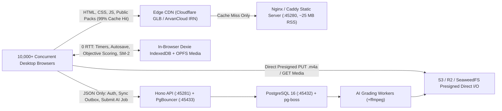
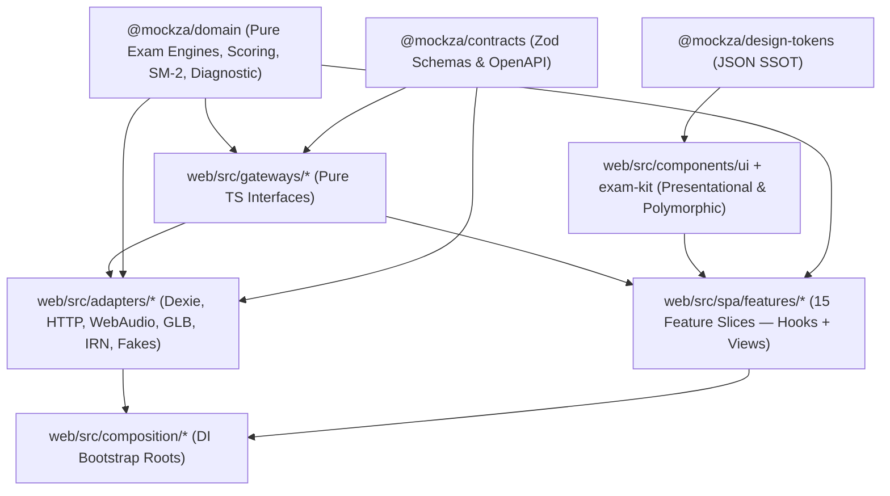

# Desktop Web Architecture & Comprehensive Implementation Plan (`v3.0`)

**Target Editions:**
- **Mockza (`GLB`)** — International Clean-Room English Edition (`mockza.com`, `en-US`, `LTR`, USD Billing)
- **Sanjia (`IRN` / سنجیا)** — Iran Domestic Persian Edition (`sanjia.ir`, `fa-IR` `RTL` Chrome + Strict `LTR` English Exam Stimuli, Jalali `شمسی` Edge Dates, Integer-Rial Billing, Zero-VPN Delivery)

**Status:** Approved Architecture & Execution Blueprint (Pre-Implementation)  
**Companion Specifications:** [PDR.md](./PDR.md) · [ADR.md](./ADR.md) · [PDR-Iran.md](./PDR-Iran.md) · [ADR-Iran.md](./ADR-Iran.md) · [design.md](./design.md) · [UI-UX-TLDR.md](./UI-UX-TLDR.md) · [RAPID_DIAGNOSTIC_PLAN.md](./RAPID_DIAGNOSTIC_PLAN.md)

---

## Table of Contents

1. [Executive Summary & Architectural Mandate](#1-executive-summary--architectural-mandate)
2. [Recommended Technology Stack & Capacity Economics](#2-recommended-technology-stack--capacity-economics)
3. [Monorepo Topology & Strict Dependency Boundaries](#3-monorepo-topology--strict-dependency-boundaries)
4. [Single Source of Truth (SSOT) & Cross-Codebase Synchronization Architecture](#4-single-source-of-truth-ssot--cross-codebase-synchronization-architecture)
   - [4.1 Design Tokens, Colors & Theme Presets SSOT (`Flutter <-> Web`)](#41-design-tokens-colors--theme-presets-ssot-flutter---web)
   - [4.2 Domain Engines, Scoring, Timers & Contracts SSOT (`Backend <-> Web <-> Flutter`)](#42-domain-engines-scoring-timers--contracts-ssot-backend---web---flutter)
   - [4.3 AI Prompts, Rubrics & Evaluation Graphs Governance (`@mockza/ai`)](#43-ai-prompts-rubrics--evaluation-graphs-governance-mockzaai)
   - [4.4 Master Cross-Codebase Synchronization Matrix & Change Runbook](#44-master-cross-codebase-synchronization-matrix--change-runbook)
5. [SOLID, DRY & Interface-Driven Frontend Engineering](#5-solid-dry--interface-driven-frontend-engineering)
   - [5.1 SOLID Principles Enforced in Code](#51-solid-principles-enforced-in-code)
   - [5.2 Segregated Gateway Interfaces (Dependency Inversion)](#52-segregated-gateway-interfaces-dependency-inversion)
   - [5.3 Open-Closed Registries & Polymorphic DRY Exam Component Kit](#53-open-closed-registries--polymorphic-dry-exam-component-kit)
6. [Dual-Edition Architecture: Mockza (`GLB`) vs. Sanjia (`IRN`)](#6-dual-edition-architecture-mockza-glb-vs-sanjia-irn)
7. [Desktop-First UX (`1280px–2560px`) & 100% Flutter v3.0 Feature Parity](#7-desktop-first-ux-1280px2560px--100-flutter-v30-feature-parity)
   - [7.1 Route & Feature Parity Matrix (All 24 Flutter Routes)](#71-route--feature-parity-matrix-all-24-flutter-routes)
   - [7.2 Desktop Breakpoints, Split-Pane Layouts & Keyboard Ergonomics](#72-desktop-breakpoints-split-pane-layouts--keyboard-ergonomics)
   - [7.3 Detailed Subsystem Specifications (Onboarding -> Simulators -> Analytics)](#73-detailed-subsystem-specifications-onboarding---simulators---analytics)
8. [SEO, GEO (Generative Engine Optimization) & Public Growth Layer](#8-seo-geo-generative-engine-optimization--public-growth-layer)
9. [Offline-First Persistence, High-Concurrency Scale (`10,000+` Users) & Security](#9-offline-first-persistence-high-concurrency-scale-10000-users--security)
10. [Phased Implementation Roadmap & Granular Task Breakdown (`W0`–`W9`)](#10-phased-implementation-roadmap--granular-task-breakdown-w0w9)
11. [Verification Gates, Playwright E2E Robot Suites & Cutover Strategy](#11-verification-gates-playwright-e2e-robot-suites--cutover-strategy)

---

## 1. Executive Summary & Architectural Mandate

### 1.1 Why Replace Flutter Web on Desktop (While Keeping Flutter for Android & iOS)

Flutter (`app/`) remains our canonical native mobile client for **Android and iOS** (60/120fps Impeller rendering, offline SQLite/Drift, hardware audio capture, App Store / Google Play / Cafe Bazaar / Myket distribution). On **desktop browsers**, however, computer-delivered IELTS, TOEFL iBT, PTE Academic, and Duolingo English Test candidates require native browser ergonomics and instant web scale that canvas-based Flutter Web works against:

| Dimension | Flutter Web (Current Interim Web Target) | Native TypeScript Desktop Web (`web/` Target) |
| :--- | :--- | :--- |
| **Initial Payload & Boot** | `~1.35 MB` gzipped `main.dart.js` + CanvasKit/skwasm runtime | **`0 KB` JS** on public/SEO pages; **`< 95 KB` gzipped** initial JS on `/app/*` simulator |
| **Build-Time RAM Footprint** | `~1.1–2.1 GB` RSS (`dart compile js`) | **`< 350 MB` RSS** (`astro build` / Vite / Rollup) — runs comfortably on `<= 8 GB` hosts |
| **Server Runtime RAM per User** | Static (`~0 MB`), but zero HTML indexability | **`0 MB` per-user VPS RAM** (`output: 'static'` immutable CDN bundle; zero SSR Node process) |
| **Reading Passage Ergonomics** | Canvas text selection; custom gesture hit-testing | **Subpixel native DOM typography**, instant native drag-selection, `Selection` API -> UTF-16 offset highlights |
| **Writing Simulator Fidelity** | Custom text-input bridge quirks with desktop IMEs | **Native `<textarea>` / controlled DOM editor**, exact exam-center `spellcheck={false}` & Grammarly suppression |
| **Theme & Preset Switching** | Full widget tree rebuild | **`0ms` CSS Custom Property flip** (`data-theme="midnight_indigo" data-mode="dark"`) |
| **Shared Logic with Backend** | Separate Dart implementation (`app/lib/core/`) | **Direct TypeScript workspace import** of `@mockza/domain` & `@mockza/contracts` (`0` duplication) |
| **SEO & AI Search (GEO)** | Opaque SPA shell (`#0C0F19` canvas) | **100% prerendered semantic HTML**, JSON-LD schemas, `/llms.txt`, and `.md` twins |

### 1.2 Non-Negotiable Engineering Commitments

1. **Dual-Edition First-Class Support:** One unified `web/` codebase compiles cleanly into two strictly isolated static bundles via `PUBLIC_EDITION=glb|irn`: **Mockza** (`glb` — international English) and **Sanjia** (`irn` — Iranian Persian `fa-IR` chrome + strict `LTR` English exam boundaries, Jalali `شمسی` dates, Rial/Shetab checkout, SMS OTP, zero-VPN delivery).
2. **Single Source of Truth (SSOT) for Theme & Visual Design:** Colors, gradients, all 4 switchable presets (*Midnight Indigo*, *Nordic Emerald*, *Editorial Amber*, *Oceanic Cobalt*), typography scales, spacing, and shape radii live in **one canonical `packages/design-tokens/tokens.json` file** that deterministically generates both Flutter's Dart tokens and Web's Tailwind v4 CSS variables.
3. **Zero Drift on Prompts, Scoring, Rubrics & Engines:** Web shares `@mockza/domain` and `@mockza/contracts` directly with `backend/`; AI prompts stay strictly centralized in `@mockza/ai` on the server; and shared cross-language golden JSON test vectors (`shared-fixtures/`) lock `TypeScript` and `Flutter Dart` offline engines into 100% mathematical parity in CI.
4. **Strict SOLID & DRY Discipline:** Interface-driven gateways (`DIP` + `ISP`), Open-Closed exam/question/theme registries (`OCP`), zero duplicated simulator shells (`DRY`), and strict downward module boundaries enforced by `./scripts/check_all.sh`.
5. **100% Flutter `v3.0` Feature Parity Optimized for Desktop (`1280×800` to `2560×1440`):** Every exam track (`IELTS Academic`, `IELTS General`, `TOEFL iBT 2026`, `PTE Academic`, `DET`), every question mechanic, Rapid Starting-Level Check, Micro-Drills, SM-2 Vocabulary, Evaluation Review, Analytics, and strict `1 Phone + 1 Desktop Web` (`appSurface: 'web_app'`) session-slot enforcement.

---

## 2. Recommended Technology Stack & Capacity Economics

### 2.1 Production Stack Selection

| Layer | Technology | Rationale |
| :--- | :--- | :--- |
| **Static Site & Build Shell** | **Astro 5 (`output: 'static'`) + Vite 6 + TypeScript 5.8 (`strict: true`)** | Generates `0 KB`-JS static HTML for SEO/GEO marketing, calculators, and rubric hubs while mounting the interactive simulator SPA cleanly at `/app/*`. |
| **Desktop Simulator UI** | **React 19 (`client:only="react"` on `/app/*`)** | Persistent SPA island under `/app/*` keeps Web Audio graphs, mic streams, and wall-clock `CountdownClockTracker` timers alive across simulator route transitions. |
| **Client Routing** | **TanStack Router (Type-Safe File/Code Routes)** | 100% compile-time typed route params, search-state (`?track=toefl_ibt&mode=exam`), route-level code-splitting per exam engine, and navigation-leave blockers during timed exams. |
| **Server State & Polling** | **TanStack Query v5** | Deduplicated caching, exponential backoff retries, background `2s` polling (`max 45s`) for async Writing/Speaking/Diagnostic AI grading jobs, and optimistic session revocation. |
| **Ephemeral Client State** | **Zustand v5 (Sliced Stores)** | Zero-boilerplate, selector-isolated micro-stores (`timerSlice`, `audioSlice`, `simulatorLayoutSlice`) so 1Hz timer ticks or 60fps mic meters never re-render passages or editors. |
| **Styling & Design System** | **Tailwind CSS v4 + Generated CSS Custom Properties + Radix UI Primitives** | Consumes `generated-tokens.css` directly; Radix provides accessible, unstyled WCAG 2.2 AA dialogs, popovers, tabs, sliders, and keyboard roving focus; `react-resizable-panels` powers desktop split panes. |
| **List & Grid Virtualization** | **`@tanstack/react-virtual`** | Keeps 320+ SM-2 vocabulary browsers, 40-item IELTS review tables, and pack catalogs at a constant `60fps` DOM node budget. |
| **Offline-First Persistence** | **Dexie.js v4 (IndexedDB) + OPFS / Cache Storage API** | Mirrors Flutter's 14-table Drift SQLite schema for offline packs, `500ms` crash-safe essay drafts, highlights, SM-2 schedule, and durable `SyncOutbox`; stores `.m4a` & `.svg` assets in Cache/OPFS with SHA-256 verification. |
| **Audio Capture & Playback** | **Native Browser `Web Audio API` (`AnalyserNode`) + `MediaRecorder` + HTML5 `Audio`** | Zero third-party wrapper bloat; 60fps `<canvas>` RMS/frequency waveform; AAC `.m4a` (`audio/mp4;codecs=mp4a.40.2`) primary recording with WebM Opus -> worker `ffmpeg` `.m4a` transcoding fallback for Linux/Firefox compatibility. |
| **Charts & Data Viz** | **Pure SVG + Lightweight Vis Primitives** | Zero-dependency crisp vector rendering for score rings (`ScoreMeter`), multi-skill radar/trend charts (`TrendChart`), and zoomable/pannable Task 1 & PTE `ExamSvgChartCard` stimuli. |
| **Static Edge Delivery** | **Nginx / Caddy (`brotli` + `gzip`) + Cloudflare CDN (`GLB`) / ArvanCloud CDN (`IRN`)** | Immutable hashed assets (`Cache-Control: public, max-age=31536000, immutable`), `0 MB` per-user origin RAM. |

### 2.2 `10,000+` Concurrent Desktop Users Capacity Model



Because Reading, Listening playback, objective scoring (`LocalObjectiveScorer`), `500ms` Writing autosave, and SM-2 flashcard scheduling execute **100% locally in the user's browser**, `10,000` simultaneous exam-takers generate **zero continuous API traffic** during active sections—hitting `/v1/*` only at pack manifest sync, presigned `.m4a` upload, attempt sync, and AI job submission/polling.

---

## 3. Monorepo Topology & Strict Dependency Boundaries

### 3.1 Target Repository Layout

We extend the existing workspace cleanly without breaking `app/` (Flutter) or `backend/` (`Containerfile`, `Makefile`, `dev_local.sh`):

```text
mockza/
├── pnpm-workspace.yaml                 # Workspace root linking packages/design-tokens, backend/*, and web
├── packages/
│   └── design-tokens/                  # @mockza/design-tokens — Canonical SSOT for Flutter + Web themes
│       ├── package.json
│       ├── tokens.schema.json          # Strict JSON Schema validating every preset, color, font & radius
│       ├── tokens.json                 # Canonical primitives + 4 presets (Dark/Light) + typography/radii/spacing
│       └── src/index.ts                # Typed token exports + CSS/Dart codegen helpers
├── shared-fixtures/                    # Cross-language golden parity vectors (executed by BOTH Vitest & flutter test)
│   ├── exam_specs_vectors.json         # Scales, steps, defaults, TOEFL /120 concordance, DET subscores
│   ├── band_conversion_vectors.json    # IELTS Academic/General 40-item & multi-exam objective tables
│   ├── objective_scorer_vectors.json   # All 9 objective question types (MCQ, TFNG, word_completion, reorder, dictation...)
│   ├── diagnostic_router_vectors.json  # Rapid check budgets (900s/90s/3x), adaptive Stage1->Stage2 routing & confidence
│   ├── sm2_scheduler_vectors.json      # Ease factor, interval clamping, lapse reset & SerialDay vectors
│   └── study_metrics_vectors.json      # Readiness, target gap, streak & skill aggregation vectors
├── backend/                            # Existing Node 24 + TypeScript backend workspace
│   ├── apps/api/                       # Hono REST/OpenAPI v1 server (+ Zarinpal/OTP routes for IRN)
│   ├── apps/worker/                    # pg-boss AI evaluation & audio normalization (+ WebM->M4A safeguard)
│   ├── packages/domain/                # @mockza/domain — Expanded pure TS engines shared 1:1 with web/
│   ├── packages/contracts/             # @mockza/contracts — Zod schemas & OpenAPI 3.1 shared 1:1 with web/
│   ├── packages/ai/                    # @mockza/ai — SINGLE home of all LLM prompts, rubrics & LangGraph flows
│   ├── packages/db/                    # @mockza/db — Drizzle schema (24 tables), migrations & clean-room seeds
│   ├── packages/storage/               # @mockza/storage — S3/R2/SeaweedFS presigning & media delivery
│   └── packages/config/                # @mockza/config — Server env & EDITION ('glb' | 'irn') validation
├── app/                                # Existing Flutter Mobile App (Android + iOS; consumes generated_tokens.dart)
│   └── lib/theme/generated_tokens.dart # Auto-generated from packages/design-tokens/tokens.json (DO NOT EDIT MANUALLY)
├── web/                                # NEW: Non-Flutter Desktop Web Application (Astro 5 Static + React 19 SPA)
│   ├── Containerfile                   # Multi-stage Node 24 builder -> Caddy/Nginx brotli/gzip static image
│   ├── astro.config.mjs                # output: 'static', sitemap, edition build hooks, zero-SSR
│   ├── package.json                    # Depends on @mockza/domain, @mockza/contracts, @mockza/design-tokens
│   ├── tsconfig.json                   # Strict TS + path aliases (@/*)
│   ├── public/                         # Fonts (Inter, Vazirmatn woff2), favicons, manifest.webmanifest, robots.txt
│   ├── src/
│   │   ├── styles/
│   │   │   ├── generated-tokens.css    # Auto-generated Tailwind v4 @theme + [data-theme][data-mode] variables
│   │   │   └── global.css              # Logical BiDi utilities, print styles, scrollbar & focus-ring rules
│   │   ├── theme/
│   │   │   ├── generated-presets.ts    # Auto-generated ThemePreset metadata catalog
│   │   │   └── theme-controller.ts     # Zero-FOUC inline boot script + runtime preset/mode switcher
│   │   ├── edition/                    # Compile-time & DI edition boundary ('glb' Mockza vs 'irn' Sanjia)
│   │   │   ├── edition-config.ts       # Typed EditionConfig interface + GLB / IRN descriptors
│   │   │   ├── bidi/                   # <LtrExamBoundary />, logical dir helpers, Persian numeral edge formatters
│   │   │   └── calendar/               # Edge-only Gregorian <-> Jalali (شمسی) formatter (canonical UTC inside)
│   │   ├── gateways/                   # Pure TypeScript interfaces ONLY (ISP + DIP; zero concrete imports)
│   │   │   ├── auth.gateway.ts         # IAuthGateway, IDeviceSlotGateway
│   │   │   ├── billing.gateway.ts      # IBillingGateway (USD Stripe/RC Web vs IRN Zarinpal/Shetab)
│   │   │   ├── audio.gateway.ts        # IAudioRecorderGateway, IAudioPlayerGateway
│   │   │   ├── storage.gateway.ts      # IOfflineAttemptStore, ISyncOutboxGateway, IVocabSrsStore
│   │   │   ├── catalog.gateway.ts      # ICatalogMediaGateway (OPFS/Cache + SHA-256 verification)
│   │   │   └── telemetry.gateway.ts    # ITelemetryGateway, IClock
│   │   ├── adapters/                   # Concrete implementations injected exclusively in composition/
│   │   │   ├── http/                   # Typed fetch client + Zod contract validation + 401 refresh / 409 slot hooks
│   │   │   ├── dexie/                  # Dexie.js v4 14-table IndexedDB store + Outbox worker
│   │   │   ├── media/                  # Web Audio API 60fps analyser, MediaRecorder, OPFS/Cache media store
│   │   │   ├── glb/                    # Google/Apple OAuth web, Stripe/RevenueCat Web checkout
│   │   │   ├── irn/                    # +98 SMS OTP adapter, Zarinpal/Zibal Rial gateway, Navia handoff builder
│   │   │   └── fakes/                  # Deterministic in-memory fakes for Vitest & Playwright offline tests
│   │   ├── composition/                # Dependency Inversion roots (ONLY folder allowed to wire adapters -> gateways)
│   │   │   ├── container.ts            # AppDependencies interface + React context hook useDeps()
│   │   │   ├── bootstrap-glb.ts        # Mockza GLB production wiring
│   │   │   ├── bootstrap-irn.ts        # Sanjia IRN production wiring
│   │   │   └── bootstrap-test.ts       # Deterministic test harness wiring
│   │   ├── i18n/                       # Compile-time typed dictionaries (en.ts, fa.ts) + BiDi interpolation guards
│   │   ├── components/
│   │   │   ├── ui/                     # Atomic token-driven primitives (Button, Card, Dialog, Pill, SplitPane, Tabs)
│   │   │   └── exam-kit/               # DRY reusable exam widgets shared across Diagnostic, Practice, Drills & Mock
│   │   ├── spa/                        # React 19 Desktop Simulator Island mounted at /app/*
│   │   │   ├── DesktopSimulatorApp.tsx # Root island (<QueryClientProvider>, <AppDependenciesProvider>, <RouterProvider>)
│   │   │   ├── router.tsx              # TanStack Router tree mapping all 24 routes + exam-lock navigation guards
│   │   │   ├── stores/                 # Zustand slices (clock, audio studio, split-pane ratio, keyboard shortcuts)
│   │   │   └── features/               # 15 isolated feature slices matching app/lib/features/* 1-for-1
│   │   ├── content/                    # Astro Content Collections for SEO/GEO exam guides, rubrics & sample bank
│   │   ├── seo/                        # JSON-LD builders, Dynamic OG SVG generator, llms.txt & .md twin emitters
│   │   └── pages/                      # Astro static routes (/, /ielts/*, /toefl/*, /pte/*, /det/*, /app/[...slug].astro)
│   └── tests/
│       ├── unit/                       # Vitest unit, gateway contract & BiDi/token parity suites
│       └── e2e/                        # Playwright Page-Object Robots (Web-E2E 1..8 across GLB + IRN + SEO)
└── scripts/
    ├── sync_design_tokens.mjs          # Generates Dart + CSS/TS tokens from packages/design-tokens/tokens.json
    ├── check_cross_parity.sh           # Runs shared-fixtures parity across @mockza/domain, @mockza/contracts & Flutter
    └── check_all.sh                    # Extended with web static boundary, BiDi, edition-isolation & token-sync gates
```

### 3.2 Strict Downward Dependency DAG (Enforced by `scripts/check_all.sh`)



**Static Architectural Invariants (Added to `scripts/check_all.sh`):**
1. `web/src/spa/features/**` and `web/src/components/**` **MUST NEVER** import `web/src/adapters/**`, `dexie`, `@mockza/db`, or `@mockza/ai`. They depend strictly on `web/src/gateways/*`, `@mockza/domain`, and `@mockza/contracts`.
2. `web/src/spa/features/*` **MUST NEVER** cross-import sibling features (`features/reading` cannot import `features/writing`); shared exam widgets live strictly in `web/src/components/exam-kit/`.
3. `PUBLIC_EDITION=glb` production bundles (`web/dist-glb/`) **MUST CONTAIN ZERO** occurrences of `zarinpal`, `zibal`, `kavenegar`, `sanjia`, `navia`, `jalaali`, or `.ir` domains (verified by automated bundle grep gate).
4. `PUBLIC_EDITION=irn` production bundles (`web/dist-irn/`) **MUST CONTAIN ZERO** occurrences of `stripe`, `revenuecat`, or Google/Apple client SDK trackers blocked in domestic networks.

---

## 4. Single Source of Truth (SSOT) & Cross-Codebase Synchronization Architecture

A core requirement of this architecture is that **themes, colors, prompts, scoring tables, timers, diagnostic routers, and API contracts never drift between Flutter (`app/`), Backend (`backend/`), and Desktop Web (`web/`)**.

```mermaid
flowchart TB
    subgraph SSOT_1["1. Visual & Theme SSOT"]
        TokensJSON["packages/design-tokens/tokens.json"]
        TokenGen["scripts/sync_design_tokens.mjs"]
        DartTokens["app/lib/theme/generated_tokens.dart (Flutter Mobile)"]
        CssTokens["web/src/styles/generated-tokens.css + generated-presets.ts (Desktop Web)"]
        TokensJSON --> TokenGen
        TokenGen --> DartTokens
        TokenGen --> CssTokens
    end

    subgraph SSOT_2["2. Domain Engines & Contracts SSOT"]
        TSDomain["backend/packages/domain + contracts (Canonical TypeScript)"]
        WebImport["web/ (Direct workspace:* import — Zero Copy)"]
        Fixtures["shared-fixtures/*.json + openapi.json"]
        DartCore["app/lib/core/* (Flutter Offline Engines)"]
        TSDomain --> WebImport
        TSDomain <-->|"Vitest Golden Check"| Fixtures
        Fixtures <-->|"flutter test Golden Check"| DartCore
    end

    subgraph SSOT_3["3. AI Prompts & Rubrics SSOT"]
        AIPackage["backend/packages/ai/src/prompts + graphs (Server-Only)"]
        Evals["backend/evals/ (±0.5 Band Calibration Gate)"]
        AIPackage --> Evals
    end
```



### 4.1 Design Tokens, Colors & Theme Presets SSOT (`Flutter <-> Web`)

Currently, palette hex codes and the 4 switchable presets live in [primitives.dart](file:///home/mahdi/projects/ideas/mockza/app/lib/theme/primitives.dart), [theme_preset.dart](file:///home/mahdi/projects/ideas/mockza/app/lib/theme/theme_preset.dart), [theme_catalog.dart](file:///home/mahdi/projects/ideas/mockza/app/lib/theme/theme_catalog.dart), [app_typography.dart](file:///home/mahdi/projects/ideas/mockza/app/lib/theme/app_typography.dart), and [app_shapes.dart](file:///home/mahdi/projects/ideas/mockza/app/lib/theme/app_shapes.dart).

We extract all raw values into **`packages/design-tokens/tokens.json`** validated by `tokens.schema.json`:

1. **Canonical Primitives & Semantic Tokens (`tokens.json`):**
   - **Core Dark Surfaces (`midnight_indigo` baseline):** `bgCanvas: #0C0F19`, `bgElevatedSurface: #111522`, `bgCard: #191D2D`, `bgSecondarySurface: #20243A`, `bgInteractiveChip: #292E47`, `strokeSubtle: #353B52`, `strokeStrong: #4B5270`, `divider: #34394E`.
   - **Core Light Surfaces:** `bgCanvas: #F5F7FB`, `bgCard: #FFFFFF`, `bgSecondarySurface: #EEF2F9`, `textPrimary: #131726`, `textSecondary: #4E5873`, `strokeSubtle: #DCE2F0`.
   - **Text & Accents:** `textPrimaryDark: #F6F8FC`, `textSecondaryDark: #B6BDCD`, `textMutedDark: #949DB2`, `accentPrimary: #9580FF`, `accentPressed: #7A65DF`, `textOnPrimary: #090B14`.
   - **Skill Semantic Accents (`Speaking`, `Listening`, `Writing`, `Reading`):** `#A8CFFF` (Sky), `#70BEFF` (Cyan), `#AC91FF` (Violet), `#66DBB5` (Mint), plus `warningAmber: #F2C16B`, `successMint: #6EE2BA`, `dangerCoral: #FF949C` and their `14%–18%` tinted badge surfaces.
   - **All 4 Open-Closed `ThemePreset` Entries (Dark + Light + Gradients):**
     - `midnight_indigo` (*Midnight Indigo* — default deep obsidian-navy + soft lavender `#9580FF`)
     - `nordic_emerald` (*Nordic Emerald* — forest slate + crisp emerald/mint primary)
     - `editorial_amber` (*Editorial Amber* — warm charcoal/ivory + editorial gold/amber primary)
     - `oceanic_cobalt` (*Oceanic Cobalt* — deep marine slate + electric cobalt/sky primary)
   - **Typography, Spacing & Radii Scales:**
     - Font families: `sansEn: "Inter, system-ui, sans-serif"`, `sansFa: "Vazirmatn, Inter, system-ui, sans-serif"`, `monoExam: "JetBrains Mono, ui-monospace, monospace"` (tabular numerals `font-variant-numeric: tabular-nums` mandatory on all timers, word counters, and score badges).
     - Type scale: `displayHero` (`72px / 1.02 / -0.025em`), `h1` (`34px / 1.15`), `h2` (`24px / 1.25`), `h3` (`18px / 1.35`), `metricValue` (`29px / 1.1`), `bodyLarge` (`16px / 1.55`), `bodyMedium` (`14px / 1.5`), `caption` (`12px / 1.35`).
     - Spacing scale: `4, 8, 12, 16, 20, 24, 28, 32, 40` (`px`).
     - Shape radii: `card: 22px`, `compact: 16px`, `input: 14px`, `pill: 999px`.
2. **Deterministic Generator (`scripts/sync_design_tokens.mjs`):**
   - **Outputs for Web:**
     - `web/src/styles/generated-tokens.css` defining `:root[data-theme="midnight_indigo"][data-mode="dark"] { --mz-bg-canvas: #0C0F19; ... }` for all `4 × 2 = 8` preset/mode combinations plus Tailwind v4 `@theme inline { --color-canvas: var(--mz-bg-canvas); ... }`.
     - `web/src/theme/generated-presets.ts` exporting `THEME_PRESETS: readonly ThemePresetMeta[]` so adding a 5th preset in `tokens.json` automatically renders a 5th swatch card in both Flutter Settings and Web Settings without touching UI code (**Open-Closed Principle**).
   - **Outputs for Flutter:**
     - `app/lib/theme/generated_tokens.dart` exporting `GeneratedPaletteTokens` and `GeneratedPresetCatalog`, wired into `PalettePrimitives` and `MzThemeCatalog` so Flutter's existing `context.colors`, `context.gradients`, and `MzThemePreset` APIs remain 100% intact.
   - **CI Drift Gate:** `./scripts/check_all.sh` runs `node scripts/sync_design_tokens.mjs --check`. Any un-synced edit to `tokens.json`, `generated_tokens.dart`, or `generated-tokens.css` fails CI immediately.

### 4.2 Domain Engines, Scoring, Timers & Contracts SSOT (`Backend <-> Web <-> Flutter`)

Because Desktop Web is written in TypeScript inside the same `pnpm` monorepo as `backend/`:

1. **Zero Duplication Between `backend/` and `web/`:**
   We promote all pure, deterministic exam engines into `backend/packages/domain/src/` (`@mockza/domain`, zero Node-only I/O dependencies so it runs identically in Node 24 and evergreen browsers):
   - `rubrics.ts` — `EXAM_SCALES`, `getExamRubricSpec`, `estimateToeflLegacy120`, `DET_SUBSCORE_KEYS` (*already in `@mockza/domain`*).
   - `diagnostic/` — `DiagnosticBudget` (`900s` total, `90s` per-stage Reading/Listening, `300s` Writing, `90s` Speaking, `3x` Extended multiplier) & `DiagnosticRouter` 2-stage adaptive routing (*already in `@mockza/domain`*).
   - **New pure modules added to `@mockza/domain/src/` (mirroring `app/lib/core/`):**
     - `exams/exam-spec.ts` — Canonical 5-track specifications (`ielts_academic`, `ielts_general`, `toefl_ibt`, `pte_academic`, `det`), default targets, `nextTargetWhenSwitchingFrom`, section timers, Writing task word-count rules (e.g., PTE Summarize Written Text `5–75w` single-sentence validator), and Speaking prep/record budgets.
     - `exams/exam-descriptor.ts` — Open-Closed `ExamDescriptor` registry (`minCalibratedObjectiveCount`: `40` for IELTS, `4` for TOEFL/PTE/DET; concordances; subscore extractors; skill labels).
     - `exams/band-conversion.ts` — Official-aligned clean-room raw-score -> scaled-score lookup tables across all 5 tracks.
     - `exams/local-objective-scorer.ts` — Pure client/server scorer for all 9 objective question types (`single_choice`, `multi_select`, `true_false_not_given`, `yes_no_not_given`, `matching`, `fill_blank`, `word_completion`, `binary_choice`, `reorder_tokens`, `dictation`) including punctuation/case normalization and calibrated band output.
     - `exams/countdown-clock-tracker.ts` — Monotonic wall-clock delta timer (`Date.now()` / `performance.now()` anchored) immune to background-tab `setInterval` throttling.
     - `exams/study-metrics-calculator.ts` — Target gap, weighted readiness score, streak calculation, and skill trend aggregation.
     - `vocab/serial-day.ts` & `vocab/sm2-scheduler.ts` — Integer `SerialDay` arithmetic and SM-2 spaced-repetition scheduler (`Again`, `Hard`, `Good`, `Easy`).
2. **Automated Cross-Language Parity Gate (`@mockza/domain` <-> `app/lib/core/`):**
   - `shared-fixtures/*.json` holds `250+` canonical input/output test vectors covering edge cases for every track, question type, adaptive diagnostic branch, SM-2 ease transition, and score scale.
   - **TypeScript Runner:** `backend/packages/domain/src/__tests__/cross-codebase-parity.test.ts` asserts `@mockza/domain` matches every vector in `shared-fixtures/*.json`.
   - **Flutter Runner:** `app/test/parity/cross_codebase_parity_test.dart` loads the exact same `../shared-fixtures/*.json` files and asserts `app/lib/core/*` produces byte-identical outputs.
   - **Contract Runner:** `pnpm --filter @mockza/contracts export:openapi` exports `openapi.json` and verifies zero uncommitted diff against DTO schemas used by both Flutter (`app/lib/data/remote/`) and Web (`web/src/adapters/http/`).

### 4.3 AI Prompts, Rubrics & Evaluation Graphs Governance (`@mockza/ai`)

**Architectural Rule:** LLM system prompts, rubric anchor descriptions, few-shot calibration examples, Whisper/ASR normalization rules, and LangGraph orchestration **NEVER live in Flutter (`app/`) or Desktop Web (`web/`)**. Both clients send raw user artifacts (essay text or `.m4a` object key + `examTrack` + `taskType` + `edition`) to `/v1/jobs/*` and render the structured `RubricResult` JSON returned by the server.

To guarantee prompt changes stay synchronized, auditable, and edition-aware across both Mockza (`glb`) and Sanjia (`irn`):

1. **Single Canonical Prompt Registry (`backend/packages/ai/src/prompts/`):**
   - [rubrics.ts](file:///home/mahdi/projects/ideas/mockza/backend/packages/ai/src/prompts/rubrics.ts) & [loader.ts](file:///home/mahdi/projects/ideas/mockza/backend/packages/ai/src/prompts/loader.ts) are organized around an explicit versioned `PROMPT_MANIFEST`:
     - `writing_rubric_v3` — Parameterized by `getExamRubricSpec(examTrack, 'writing')` (`IELTS` 4 criteria `0–9`, `TOEFL 2026` `1.0–6.0` across Build-a-Sentence / Email / Academic Discussion, `PTE` `10–90` including single-sentence `5–75w` constraint check, `DET` `10–160` + Literacy/Production subscore weighting).
     - `speaking_rubric_v3` — Parameterized by `getExamRubricSpec(examTrack, 'speaking')` + acoustic/fluency features (`wpm`, pause ratio, filler density, pronunciation intelligibility).
     - `diagnostic_rubric_v3` — Rapid Starting-Level Check short-sample calibration (`grade-diagnostic.ts`) with conservative confidence intervals (`±0.5` band / track equivalent).
     - `explain_question_v3` — Grounded objective question tutor (`explain-question.ts`) citing verified `evidenceSpans`.
   - **Edition-Aware Commentary Layer (`glb` vs `irn`):**
     - Scoring anchors, numeric criteria, and `modelRewrite` / `upgradedVocabulary` are **always evaluated on identical English rubric anchors** so a Band `7.0` or PTE `73` on Sanjia (`irn`) equals the exact same score on Mockza (`glb`).
     - Only the `localeOverlay` block changes when `edition === 'irn'`: explanatory coaching notes (`criterionFeedback`, `actionableNextSteps`, `whyWrongExplanation`, and Mistake-to-Deck `glossFa`) are emitted in **bilingual Persian (`fa-IR`) + English academic terms**, validated by Zod schema in [rubric-validation.ts](file:///home/mahdi/projects/ideas/mockza/backend/packages/ai/src/graphs/rubric-validation.ts).
2. **Prompt Change Gate:**
   - Every edit to `backend/packages/ai/src/prompts/*` or `graphs/*` MUST bump `promptVersion` in `PROMPT_MANIFEST` (persisted on `writing_submissions.prompt_version` / `speaking_submissions.prompt_version` in Postgres) and pass `pnpm --filter @mockza/evals test` (`±0.5` IELTS band / scaled-equivalent parity on golden calibration essays & audio transcripts).

### 4.4 Master Cross-Codebase Synchronization Matrix & Change Runbook

Whenever any team member or AI agent modifies a shared concern, **this table is the authoritative checklist**:

| Shared Concern | Canonical SSOT Location | Desktop Web (`web/`) Consumer | Flutter Mobile (`app/`) Consumer | Automated CI Gate Preventing Drift |
| :--- | :--- | :--- | :--- | :--- |
| **Colors, Dark/Light Palettes, 4 Theme Presets, Typography, Spacing, Radii** | `packages/design-tokens/tokens.json` | Auto-generated `web/src/styles/generated-tokens.css` & `generated-presets.ts` | Auto-generated `app/lib/theme/generated_tokens.dart` | `node scripts/sync_design_tokens.mjs --check` in `check_all.sh` |
| **Exam Scales, Steps, Defaults, TOEFL `/120`, DET 4 Subscores** | `backend/packages/domain/src/rubrics.ts` + `exams/exam-spec.ts` | Direct import `@mockza/domain` | `app/lib/core/exams/exam_spec.dart` & `exam_descriptor.dart` | `shared-fixtures/exam_specs_vectors.json` (`check_cross_parity.sh`) |
| **Raw-to-Scaled Score Conversion Tables** | `backend/packages/domain/src/exams/band-conversion.ts` | Direct import `@mockza/domain` | `app/lib/core/exams/band_conversion_table.dart` | `shared-fixtures/band_conversion_vectors.json` |
| **Local Objective Scorer (All 9 Question Mechanics)** | `backend/packages/domain/src/exams/local-objective-scorer.ts` | Direct import `@mockza/domain` | `app/lib/core/exams/local_objective_scorer.dart` | `shared-fixtures/objective_scorer_vectors.json` |
| **Rapid Diagnostic Budgets (`900s`/`90s`/`3x`) & 2-Stage Adaptive Router** | `backend/packages/domain/src/diagnostic/{budget,router}.ts` | Direct import `@mockza/domain` | `app/lib/core/diagnostic/diagnostic_{budget,router}.dart` | `shared-fixtures/diagnostic_router_vectors.json` |
| **SM-2 Spaced Repetition & `SerialDay` Math** | `backend/packages/domain/src/vocab/{sm2-scheduler,serial-day}.ts` | Direct import `@mockza/domain` | `app/lib/core/vocab/{sm2_scheduler,serial_day}.dart` | `shared-fixtures/sm2_scheduler_vectors.json` |
| **Readiness, Target Gap & Streak Metrics** | `backend/packages/domain/src/exams/study-metrics-calculator.ts` | Direct import `@mockza/domain` | `app/lib/core/exams/study_metrics_calculator.dart` | `shared-fixtures/study_metrics_vectors.json` |
| **REST DTOs, Auth/Slot Errors (`409 DEVICE_SLOT_OCCUPIED`), Job Payloads** | `backend/packages/contracts/src/schemas.ts` (`openapi.json`) | Direct import `@mockza/contracts` | `app/lib/data/remote/*` DTOs | `pnpm --filter @mockza/contracts test` + OpenAPI diff check |
| **AI Writing, Speaking, Diagnostic & Tutor Prompts** | `backend/packages/ai/src/prompts/*` & `graphs/*` | Renders server `RubricResult` JSON (no local prompts) | Renders server `RubricResult` JSON (no local prompts) | `pnpm --filter @mockza/ai test` + `pnpm --filter @mockza/evals test` |
| **Clean-Room Packs, SVG Charts & Audio `.m4a` Seed Catalog** | `backend/packages/db/src/seed.ts` + `content-pipeline/` | Synced via `/v1/catalog/manifest` into Dexie + OPFS | Synced via `/v1/catalog/manifest` into Drift + FileSystem | `pnpm --filter @mockza/content-pipeline validate` |

> **Mandatory Developer / Agent Rule ("Change One, Sync All"):**
> 1. **Theme / Visual edit?** Edit **only** `packages/design-tokens/tokens.json` -> run `pnpm tokens:sync` -> verify both `web` and `app` build cleanly.
> 2. **Scoring / Timer / Diagnostic / SM-2 / New Exam Mechanic edit?** Update `backend/packages/domain/src/*` -> add vectors to `shared-fixtures/*.json` -> update corresponding file in `app/lib/core/*` -> run `./scripts/check_cross_parity.sh` (`Vitest` + `flutter test`).
> 3. **Prompt / Rubric Criterion edit?** Update `backend/packages/ai/src/prompts/*` & `backend/packages/contracts/src/schemas.ts` -> verify both `web/src/spa/features/evaluation/` and `app/lib/features/evaluation/` render any new optional/required schema fields -> run `pnpm --filter @mockza/evals test`.

---

## 5. SOLID, DRY & Interface-Driven Frontend Engineering

### 5.1 SOLID Principles Enforced in Code

1. **Single Responsibility Principle (`SRP`):**
   - **Domain Calculators (`@mockza/domain`)** compute scores, timers, and schedules purely in memory.
   - **Gateways & Adapters (`web/src/gateways`, `web/src/adapters`)** own I/O (HTTP, IndexedDB, OPFS, Web Audio, OAuth, Billing).
   - **Application Hooks / ViewModels (`useReadingSessionController`, `useWritingSessionController`, `useDiagnosticController`)** orchestrate state transitions without rendering JSX or touching raw browser storage APIs.
   - **Presentational Components (`web/src/components/exam-kit/*`)** receive typed props and callbacks, making them trivially testable in isolation.
2. **Open-Closed Principle (`OCP`):**
   - **Exam Tracks:** Driven by `EXAM_DESCRIPTORS: Record<ExamTrack, ExamDescriptor>`. Adding a 6th exam track requires registering one descriptor entry—no `if (track === 'toefl_ibt')` branches scattered across Dashboard, Progress, Practice, or Full Mock screens.
   - **Objective Question Mechanics:** Driven by `OBJECTIVE_RENDERER_REGISTRY: Record<ObjectiveQuestionKind, QuestionRendererComponent>`. Adding a new question widget plugs into Reading, Listening, Diagnostic, Micro-Drills, and Full Mock simultaneously.
   - **Themes:** Driven by `THEME_PRESETS` generated from `tokens.json`.
3. **Liskov Substitution Principle (`LSP`):**
   - Every adapter implementing a gateway (`StripeWebBillingAdapter`, `ZarinpalWebBillingAdapter`, `FakeBillingAdapter`) returns `Promise<Result<T, GatewayError>>` (never throwing untyped exceptions) and passes a shared **Gateway Contract Test Suite** (`web/tests/unit/contracts/*.contract.test.ts`).
4. **Interface Segregation Principle (`ISP`):**
   - No monolithic `ApiService` or `AppRepository`. Capabilities are split into small, cohesive role interfaces so a Vocabulary component only receives `IVocabSrsStore` + `IClock`, never auth tokens or audio recorders.
5. **Dependency Inversion Principle (`DIP`):**
   - High-level simulator features depend strictly on abstract TypeScript interfaces in `web/src/gateways/*`. Concrete adapters (`Dexie`, `WebAudio`, `GLB` vs `IRN` auth/billing) are instantiated **exclusively** in `web/src/composition/bootstrap-{glb,irn,test}.ts`.

### 5.2 Segregated Gateway Interfaces (Dependency Inversion)

All interfaces reside in `web/src/gateways/` with **zero runtime dependencies** beyond `@mockza/domain` and `@mockza/contracts`:

```typescript
// web/src/gateways/auth.gateway.ts
export interface DeviceIdentity {
  readonly deviceInstallId: string;   // Persistent UUIDv4 stored in IndexedDB + localStorage backup
  readonly slotKind: 'desktop_web';   // Matches backend ADR-016 uq_active_user_slot
  readonly appSurface: 'web_app';     // Distinguishes native desktop web from Flutter mobile_app
  readonly deviceLabel: string;       // e.g. "Chrome 134 on Linux Desktop"
}

export interface IAuthGateway {
  getSession(): Promise<AuthSession | null>;
  onSessionChanged(listener: (session: AuthSession | null) => void): () => void;
  signInWithEmail(input: { email: string; password: string; replaceSessionId?: string }): Promise<Result<AuthSession, AuthError>>;
  signUpWithEmail(input: { email: string; password: string; displayName?: string }): Promise<Result<AuthSession, AuthError>>;
  signInWithOAuth?(input: { provider: 'google' | 'apple'; idTokenOrCode: string; replaceSessionId?: string }): Promise<Result<AuthSession, AuthError>>; // GLB
  requestSmsOtp?(input: { phoneE164: string }): Promise<Result<{ retryAfterSec: number }, AuthError>>; // IRN
  verifySmsOtp?(input: { phoneE164: string; otpCode: string; replaceSessionId?: string }): Promise<Result<AuthSession, AuthError>>; // IRN
  signOutCurrentDevice(): Promise<Result<void, AuthError>>;
}

export interface IDeviceSlotGateway {
  listActiveDevices(): Promise<Result<readonly ActiveDeviceSession[], ApiError>>;
  revokeDeviceSession(sessionId: string): Promise<Result<void, ApiError>>;
}

// web/src/gateways/billing.gateway.ts
export interface IBillingGateway {
  readonly currencyKind: 'USD' | 'IRR';
  getPlansAndEntitlement(): Promise<Result<BillingCatalogSnapshot, BillingError>>;
  startCheckout(input: {
    planId: string;
    acceptedSingleDevicePerSlotTos: true; // Mandatory ToS enforcement before checkout
    returnUrl: string;
  }): Promise<Result<{ redirectUrl: string } | { activatedSession: EntitlementSnapshot }, BillingError>>;
  verifyCallback(params: URLSearchParams): Promise<Result<EntitlementSnapshot, BillingError>>;
  openCustomerPortal?(): Promise<Result<{ portalUrl: string }, BillingError>>;
}

// web/src/gateways/audio.gateway.ts
export interface IAudioRecorderGateway {
  checkMicPermissionAndDevices(): Promise<Result<readonly AudioInputDeviceInfo[], AudioError>>;
  runPreflightLoopbackTest(durationMs: number, onLevel: (rms01: number) => void): Promise<Result<{ blobUrl: string; peakRms: number }, AudioError>>;
  startRecording(options: { deviceId?: string; maxDurationSec: number; onLevel: (rms01: number) => void }): Promise<Result<ActiveRecordingHandle, AudioError>>;
}

export interface IAudioPlayerGateway {
  loadSource(src: { mediaKey: string; fallbackUrl: string; expectedSha256?: string }): Promise<Result<AudioTrackHandle, AudioError>>;
}

// web/src/gateways/storage.gateway.ts
export interface IOfflineAttemptStore {
  saveAttemptDraft(draft: AttemptDraftRecord): Promise<void>;
  flushUrgentDraftSync(draft: AttemptDraftRecord): void; // Synchronous memory->IndexedDB/BroadcastChannel commit on pagehide
  getActiveDraft(packId: string, skill: ExamSkill): Promise<AttemptDraftRecord | null>;
  completeObjectiveAttempt(record: CompletedAttemptRecord): Promise<void>;
  listCompletedAttempts(filter?: { examTrack?: ExamTrack; skill?: ExamSkill }): Promise<readonly CompletedAttemptRecord[]>;
  savePassageAnnotations(packId: string, spans: readonly HighlightAnnotation[]): Promise<void>;
  getPassageAnnotations(packId: string): Promise<readonly HighlightAnnotation[]>;
}

export interface ISyncOutboxGateway {
  enqueue(mutation: OutboxMutation): Promise<void>;
  flushPending(): Promise<SyncFlushReport>;
  observePendingCount(listener: (count: number) => void): () => void;
}
```

### 5.3 Open-Closed Registries & Polymorphic DRY Exam Component Kit

Just as we refactored Flutter in `v3.0` so Diagnostic, Reading, Listening, Writing, Speaking, Micro-Drills, and Full Mock share polymorphic building blocks rather than duplicating UI, `web/src/components/exam-kit/` provides **one canonical desktop implementation** of each exam primitive:

| Shared Component (`web/src/components/exam-kit/`) | Reused Across Features | Desktop-Specific Capabilities |
| :--- | :--- | :--- |
| `<SimulatorWorkspaceShell />` | Diagnostic, Reading, Listening, Writing, Speaking, Micro-Drills, Full Mock | Unified distraction-free top bar (section breadcrumb, monotonic `MM:SS` clock chip, Study/Exam mode badge, keyboard shortcut legend `?`, Exit/Pause guard) + bottom navigation bar. |
| `<SplitPaneWorkspace />` | Reading, Writing, Evaluation Review, Listening (Study transcript view) | Drag-resizable horizontal split (`40%–65%` clamp, persisted per user in Dexie, double-click divider to reset `50/50`), independent smooth scroll containers. |
| `<QuestionPaletteBar />` | Diagnostic, Reading, Listening, Full Mock | Distinct visual states (**never conflated**): `current` (primary border + subtle glow), `answered` (mint check badge), `current + answered` (primary active ring + inner mint check icon — zero purple/green fill clash), `flagged` (amber bookmark dot), `unanswered` (neutral outline). |
| `<MzObjectiveAnswerInput />` | Diagnostic, Reading, Listening, Micro-Drills, Full Mock | Registry-dispatched renderer for `single_choice`, `multi_select`, `true_false_not_given`, `yes_no_not_given`, `matching`, `fill_blank`, `word_completion` (character-slot hint), `binary_choice`, and `dictation` — full `1–9` / `A–D` keyboard support. |
| `<MzSequenceOrderControl />` | PTE *Re-order Paragraphs*, TOEFL *Build a Sentence* | Supports **both** accessible 1-click sequential numbering / Up-Down keyboard reordering AND optional desktop HTML5 pointer drag-and-drop over the exact same ordered-ID array state. |
| `<PassageAnnotatorPane />` | Reading, Writing Integrated Stimuli, Evaluation Evidence Jump | Native browser text selection -> floating contextual toolbar (*Highlight Yellow/Mint/Coral*, *Add Margin Note*, *Save to SM-2 Vocab Deck*); maps DOM `Range` <-> canonical UTF-16 code-unit `[start, end)` offsets so highlights sync 1:1 with mobile Flutter! |
| `<ExamSvgChartCard />` | IELTS Academic Task 1, PTE *Describe Image*, DET *Write About the Photo* | Crisp vector rendering + desktop scroll-wheel / `+`/`-` zoom (`100%–250%`) + click-to-lightbox inspect modal without losing Writing cursor or Speaking timer. |
| `<DistractionFreeEssayEditor />` | All 11 Writing Task Types + Diagnostic Writing | Enforces Exam Mode (`spellcheck={false}`, `autoCorrect="off"`, `autoCapitalize="off"`, `data-gramm="false"`, `data-gramm_editor="false"`, `data-enable-grammarly="false"`), live word/character/sentence counters, PTE single-sentence warning badge, undo/redo stack, and `500ms` debounced Dexie autosave. |
| `<AudioStudioPlayer />` | Listening, Diagnostic Listening, Speaking *Listen & Repeat*, Dictation | Strict Exam Mode (`plays once`, seekbar locked, speed fixed `1.0x`) vs. Study Mode (`0.75x–1.5x` pitch-preserved playback, `-5s/+5s` arrow-key seek, synced clickable transcript). |
| `<WaveformMicRecorder />` | Speaking (all 5 tracks), Diagnostic Speaking, Preflight Check | Device selector dropdown, live 60fps `<canvas>` `AnalyserNode` bar meter, automatic low-gain / muted-mic warning banner, prep countdown -> auto-start recording transition, and instant local playback in Study/Preflight mode. |
| `<CompactPreflightHeader />` | Rapid Diagnostic Intro, Speaking Simulator, Full Mock | Compact zero-scroll horizontal preflight strip (inline 5-second speaker chime + live mic level meter + collapsible rules popover + Timing/Accessibility pill selector). |
| `<LtrExamBoundary />` | Wraps ALL exam stimuli, questions, editors, timers & scores | Sets `dir="ltr" lang="en" className="font-en isolate"` so English punctuation, blanks (`____`), option letters (`A.`–`D.`), and essay carets never invert inside `Sanjia` (`irn`) RTL pages. |

---

## 6. Dual-Edition Architecture: Mockza (`GLB`) vs. Sanjia (`IRN`)

Both editions are built from the same `web/` codebase using compile-time environment selection (`PUBLIC_EDITION=glb` vs. `PUBLIC_EDITION=irn`) paired with DI composition roots (`bootstrap-glb.ts` vs. `bootstrap-irn.ts`):

| Capability | Mockza (`PUBLIC_EDITION=glb`) | Sanjia (`PUBLIC_EDITION=irn` — سنجیا) |
| :--- | :--- | :--- |
| **Brand & Domains** | **Mockza** · `mockza.com` · `api.mockza.com` · `cdn.mockza.com` | **Sanjia (سنجیا)** · `sanjia.ir` · `api.sanjia.ir` · `cdn.sanjia.ir` |
| **Outer App Chrome & Typography** | English (`en-US`), `<html lang="en" dir="ltr">`, `Inter` | Persian (`fa-IR`), `<html lang="fa" dir="rtl">`, `Vazirmatn` chrome + `Inter` inside `<LtrExamBoundary>` |
| **BiDi Layout Discipline** | Logical CSS properties (`ms-*`, `me-*`, `ps-*`, `pe-*`, `border-s-*`, `text-start`) | Identical logical CSS flips sidebar/navigation/drawers to RTL automatically while `<LtrExamBoundary>` locks all English exam content to `LTR` |
| **Date & Numeral Formatting** | Gregorian (`Intl.DateTimeFormat('en-US')`), Western numerals | **Edge-only Jalali (`شمسی`)** (`1405/08/27` via `jalaali-js`) & Persian tabular numerals (`۰–۹`) in UI chrome; English numerals (`7.5`, `115/160`, `14:32`) inside `<LtrExamBoundary>`; canonical UTC ms & integer `SerialDay` in storage |
| **Authentication** | Email/Password + **Sign in with Google** + **Sign in with Apple** (+ dev sandbox toggle) | Iranian **`+98` SMS OTP** (`Kavenegar`/`Sms.ir` via `/v1/auth/otp/*`) + Email/Password (zero blocked foreign OAuth scripts) |
| **Device-Slot Enforcement** | `1 Mobile Phone + 1 Desktop Web` (`appSurface: 'web_app'`, `slotKind: 'desktop_web'`) | Identical `1 Mobile Phone + 1 Desktop Web` enforcement with Persian device-management UI |
| **Web Checkout & Currency** | USD (`$`) via **Stripe Checkout / RevenueCat Web Billing** (`Pro Monthly` / `Quarterly` / `Annual`) | Integer **Rial (`IRR`)** internally, formatted as **Toman (`تومان`)** at UI edge, via **Zarinpal / Zibal** Shetab redirect (`/v1/billing/zarinpal/{request,verify}`) |
| **AI Grading & Explanations** | 100% English rubric criteria, coaching & Mistake-to-Deck definitions | Identical English score calibration + **Persian (`fa-IR`) coaching explanations** & Persian-glossed SM-2 vocabulary cards |
| **Ecosystem Cross-Link** | None | **Navia (`navia.ir`)** "Use Verified Target Score for University/Visa Eligibility ->" deep-link handoff on Progress & Evaluation screens |
| **Network & Font Sovereignty** | Self-hosted `Inter.woff2`, Cloudflare CDN + R2 | **Zero-VPN guarantee:** self-hosted `Vazirmatn.woff2` + `Inter.woff2` (`0` requests to `fonts.googleapis.com`, `gstatic`, Firebase, or Stripe), ArvanCloud/Parspack domestic CDN & S3 |

---

## 7. Desktop-First UX (`1280px–2560px`) & 100% Flutter v3.0 Feature Parity

### 7.1 Route & Feature Parity Matrix (All 24 Flutter Routes)

Every route defined in [routes.dart](file:///home/mahdi/projects/ideas/mockza/app/lib/routing/routes.dart) maps deterministically to `web/` so deep links, user mental models, and E2E test specifications align 1:1:

| # | Flutter Route (`app/lib/routing/routes.dart`) | Desktop Web URL (`web/`) | Rendering Mode | Desktop Layout Optimization |
| :--- | :--- | :--- | :--- | :--- |
| 1 | `Routes.welcome` (`/welcome`) | `/` (+ `/app/welcome`) | Static Astro Landing + SPA Entry | Full-bleed hero, interactive live score preview, track comparison tabs, instant CTA into Rapid Check |
| 2 | `Routes.goalSetup` (`/onboarding/goal`) | `/app/onboarding/goal` | React SPA | Single-screen 2-column wizard: Track selector cards (left) + Interactive Target Score slider & Exam Date calendar (right) |
| 3 | `Routes.diagnosticIntro` (`/diagnostic/intro`) | `/app/diagnostic/intro` | React SPA | **Zero-scroll single-viewport card**: Track/duration summary (`~10–15 min`), inline 1-click Speaker + Live Mic bar, Timing mode pills (`Standard`, `Extended 3x`, `Accessible Audio`), compact collapsible rules |
| 4 | `Routes.diagnosticSession` (`/diagnostic/session`) | `/app/diagnostic/session` | React SPA | Split-pane Reading stage -> Studio Listening stage -> Side-by-side Writing sample -> Waveform Speaking sample (`900s` budget tracker, `I don't know` & `Skip skill` actions) |
| 5 | `Routes.diagnosticResult` (`/diagnostic/result`) | `/app/diagnostic/result` | React SPA | 2-column bento: Overall baseline band/score + confidence range (`±0.5`) & 4-skill radar/bars (left) + Personalized Weakest-Skill Action Plan & single-skill retake triggers (right) |
| 6 | `Routes.login` (`/auth/login`) | `/app/auth/login` | React SPA | Centered split card: value props + `1 Phone + 1 Desktop` badge (left) + Google/Apple/Email (`GLB`) or `+98` SMS OTP/Email (`IRN`) + `409 DEVICE_SLOT_OCCUPIED` session replacement modal (right) |
| 7 | `Routes.home` (`/home`) | `/app/home` | React SPA | Persistent left navigation rail + 3-column bento dashboard: Readiness Hero & Exam Switcher, Rapid Check / Next Recommended Action, 4-Skill Score Cards, Due SM-2 Deck widget, Streak & Recent Evaluations |
| 8 | `Routes.practice` (`/practice`) | `/app/practice` | React SPA | Filterable multi-column catalog grid (`Skill`, `Difficulty`, `Question Type`, `Offline Cached`, `Status`) + quick-launch Micro-Drills & Full Mock banner |
| 9 | `Routes.readingSession` (`/practice/reading/:packId`) | `/app/practice/reading/$packId` | React SPA | **Resizable Split-Pane (`55% / 45%`)**: Passage with native DOM selection highlights & margin notes on left; Focused or All-Questions pane on right + bottom `QuestionPaletteBar` |
| 10 | `Routes.listeningSession` (`/practice/listening/:packId`) | `/app/practice/listening/$packId` | React SPA | Sticky top `AudioStudioPlayer` + 2-column question workspace (optional synced transcript side-drawer in Study Mode) |
| 11 | `Routes.writingSession` (`/practice/writing/:packId`) | `/app/practice/writing/$packId` | React SPA | **Resizable Split-Pane (`45% / 55%`)**: Task prompt + zoomable `ExamSvgChartCard` / integrated reading-listening notes on left; `DistractionFreeEssayEditor` + live word/sentence meter on right |
| 12 | `Routes.speakingSession` (`/practice/speaking/:packId`) | `/app/practice/speaking/$packId` | React SPA | Cue-card / `ExamSvgChartCard` stage on left + `WaveformMicRecorder` studio console (prep ring, 60fps canvas meter, turn progress) on right |
| 13 | `Routes.microDrills` (`/practice/drills`) | `/app/practice/drills` | React SPA | Focused centered card deck for all 7 rapid 3-minute drills with keyboard-driven instant feedback & Mistake-to-Deck capture |
| 14 | `Routes.fullMock` (`/practice/full-mock`) | `/app/practice/full-mock` | React SPA | Multi-stage Exam Day Orchestrator (Preflight -> Listening -> Reading -> Writing -> Speaking / track-ordered sequence, optional inter-section break timer, consolidated mock report) |
| 15 | `Routes.evaluationPending` (`/evaluation/pending/:jobId`) | `/app/evaluation/pending/$jobId` | React SPA | Live stage stepper (*Uploading -> Transcribing -> Rubric Scoring -> Span Grounding*) with non-blocking "Continue Practicing (Notify When Ready)" toast option |
| 16 | `Routes.evaluationResult` (`/evaluation/result/:id`) | `/app/evaluation/result/$id` | React SPA | **Desktop Master-Detail Review**: Essay/Transcript with clickable color-coded inline span highlights on left; Overall Band/Score (incl. TOEFL `/120` chip & DET 4 subscores), Criterion Breakdown, Model Rewrite Diff & 1-click *Add Upgraded Vocab to SM-2* on right |
| 17 | `Routes.objectiveResult` (`/practice/objective-result/:attemptId`) | `/app/practice/objective-result/$attemptId` | React SPA | Split review: Passage/Transcript with jumped `evidenceSpans` highlighted on left; filterable item-by-item review (`Wrong Only`, `Flagged`, `All`) + *Ask AI Tutor Why* drawer on right |
| 18 | `Routes.vocabulary` (`/vocabulary`) | `/app/vocabulary` | React SPA | 2-pane deck hub: Due Today queue, Mastery breakdown (`New`, `Learning`, `Mastered`), and Virtualized 320+ Academic/Mistake-to-Deck browser with instant search & tag filters |
| 19 | `Routes.vocabReview` (`/vocabulary/review`) | `/app/vocabulary/review` | React SPA | Keyboard-first SRS studio (`Space` to reveal context sentence, `1` Again, `2` Hard, `3` Good, `4` Easy) |
| 20 | `Routes.progress` (`/progress`) | `/app/progress` | React SPA | Multi-column analytics workspace: Readiness trajectory `TrendChart`, Skill radar, TOEFL `/120` or DET 4-subscore panels, Weakness taxonomy table, and history export (+ `Navia` handoff card on `IRN`) |
| 21 | `Routes.compareAttempts` (`/progress/compare`) | `/app/progress/compare` | React SPA | True side-by-side desktop diff comparing Attempt A vs. Attempt B (band delta, criterion deltas, WPM/lexical density shift, side-by-side essay text) |
| 22 | `Routes.settings` (`/settings`) | `/app/settings` | React SPA | Categorized desktop settings: Account, **Active Devices (`1 Phone + 1 Desktop Web` with location/last-seen & 1-click Revoke)**, Exam Track & Target, **Appearance (Light/Dark + 4 ThemePreset Swatches)**, Audio Devices, Offline Storage cache manager, Privacy/Delete Account |
| 23 | `Routes.paywall` (`/paywall`) | `/app/paywall` | React SPA | Side-by-side Free vs. Pro tier matrix, Monthly/Quarterly/Annual toggle, **mandatory explicit `1 Phone + 1 Desktop Web` ToS consent checkbox**, and Stripe/RC (`GLB`) or Zarinpal Rial (`IRN`) checkout |
| 24 | *Public SEO/GEO Routes* | `/ielts`, `/toefl`, `/pte`, `/det`, `/calculators/*`, `/vocabulary-list/*`, `/guides/*` | **Static Astro HTML (`0 KB` JS)** | Editorial & programmatic hubs feeding qualified desktop learners directly into `/app/diagnostic/intro?track=...` |

### 7.2 Desktop Breakpoints, Split-Pane Layouts & Keyboard Ergonomics

Unlike mobile bottom-tab navigation, the Desktop Web Simulator uses a **responsive desktop shell** designed specifically for `1280×800` (13" laptops), `1440×900`, `1920×1080` (FHD), and `2560×1440` (QHD) viewports (while gracefully collapsing to a tablet/compact drawer below `1024px`):

- **App Shell Chrome (`/app/home`, `/app/practice`, `/app/vocabulary`, `/app/progress`, `/app/settings`):**
  - Left collapsible vertical navigation rail (`240px` expanded / `72px` icon rail) + top contextual command bar (`Exam Track Switcher`, `Sync/Offline Status Pill`, `Theme Mode/Preset Quick Toggle`, `Target Countdown Chip`).
  - Max content container width `1440px` centered on ultra-wide monitors; **full-viewport fluid width (`100vw × 100vh`, `overflow: hidden` outer frame)** inside active exam simulators so passages and essays utilize every pixel cleanly.
- **First-Class Desktop Keyboard Shortcuts (Toggleable & Shown via `?` Cheatsheet):**
  - **Simulators:** `Alt + ArrowRight` / `Alt + N` (Next Question), `Alt + ArrowLeft` / `Alt + P` (Previous Question), `Alt + F` (Flag/Bookmark Question), `1`–`4` or `A`–`D` (Select option when not focused inside a text input), `Alt + H` (Highlight current text selection in Reading).
  - **Listening (Study Mode Only):** `Space` (Play/Pause), `ArrowLeft` / `ArrowRight` (`-5s` / `+5s` seek), `[` / `]` (Cycle playback speed).
  - **SM-2 Vocabulary Review:** `Space` / `Enter` (Flip card), `1` (`Again`), `2` (`Hard`), `3` (`Good`), `4` (`Easy`).

### 7.3 Detailed Subsystem Specifications (Onboarding -> Simulators -> Analytics)

1. **Multi-Surface Auth & Strict `1 Phone + 1 Desktop Web` Session-Slot Integration (`ADR-016`):**
   - On first boot, `DeviceIdentityService` generates and persists a stable UUIDv4 `deviceInstallId` in IndexedDB (`meta` table) mirrored to `localStorage`.
   - Every `/v1/auth/{login,register,google,apple,otp/verify}` request sends `deviceInstallId`, `slotKind: 'desktop_web'`, `appSurface: 'web_app'`, and human-readable `deviceLabel` (e.g., `"Firefox on Ubuntu Linux"`).
   - Because `backend/packages/db/src/schema.ts` (`user_device_sessions`) already enforces partial unique index `uq_active_user_slot (user_id, slot_kind) WHERE revoked_at IS NULL`, signing in on a Desktop browser **coexists seamlessly** with the user's active Android/iOS phone (`slotKind: 'mobile'`), while blocking a second concurrent desktop browser with `HTTP 409 DEVICE_SLOT_OCCUPIED` (returning the conflicting desktop session's `sessionId`, `deviceLabel`, `ipCountry`/`city`, and `lastSeenAt`).
   - When `409 DEVICE_SLOT_OCCUPIED` occurs, the Web Login UI presents an inline **"Desktop Slot In Use — Sign Out Previous Computer & Continue Here?"** confirmation dialog that re-submits with `replaceSessionId` in one click.
   - If a session is revoked remotely from the user's phone, the Web HTTP interceptor catches `401 SESSION_REVOKED`, flushes non-sensitive state, halts background polling cleanly, and routes to `/app/auth/login?reason=session_revoked` with a clear banner.
   - **Dev Mode OAuth Sandbox:** When `PUBLIC_ALLOW_DEV_AUTH=true` (matching backend `ALLOW_DEV_AUTH_PROVIDERS=true`), Google and Apple sign-in buttons work out-of-the-box in local development using deterministic dev tokens until live production OAuth client IDs are dropped into `.env`.
2. **Compact Rapid Starting-Level Check (`~10–15 Min`):**
   - Replicates our streamlined single-screen preflight (`<CompactPreflightHeader />`): zero scrolling on `1280×800`+, inline speaker test chime + live mic waveform check, `Standard (900s cap)` / `Extended Untimed (3x)` / `Accessible Replayable Audio` mode selector, and `Start Check` / `Continue without Speaking` / `Do this later`.
   - Executes `DiagnosticRouter` from `@mockza/domain` directly in-browser for Stage 1 -> Stage 2 adaptive Reading & Listening routing, collects short track-authentic Writing & Speaking samples, uploads `.m4a` via presigned PUT, and polls `/v1/jobs/:id` to render calibrated overall + 4-skill baselines.
3. **All 5 Exam Tracks with Zero Compromises:**
   - **IELTS Academic & General (`0.0–9.0`, `0.5` steps):** 40-question Academic/General Reading & Listening raw-to-band tables, Academic Task 1 SVG data charts (`150w+`), General Task 1 letters (`150w+`), Task 2 essays (`250w+`), Speaking Parts 1, 2 (`1 min` prep + `2 min` talk cue card), and 3.
   - **TOEFL iBT (2026 Format, `1.0–6.0`, `0.5` steps + `/120` Concordance):** *Complete the Words* (`word_completion`), *Read in Daily Life*, *Academic Passage*, *Choose a Response*, campus/academic lectures, 3-part Writing (*Build a Sentence* via `<MzSequenceOrderControl />`, *Write an Email* `7 min`, *Academic Discussion* `10 min`), and *Listen & Repeat* + zero-prep *Take an Interview* Speaking, plus legacy `0–120` concordance badge everywhere scores appear.
   - **PTE Academic (`10–90` Integer Scale):** *Re-order Paragraphs* (`<MzSequenceOrderControl />`), *Write from Dictation* (`dictation`), *Summarize Written Text* (`10 min`, strict `5–75` words **single-sentence** live validator), *Write Essay* (`20 min`, `200–300w`), and *Describe Image* (`25s` prep -> `40s` record with `<ExamSvgChartCard />` + `'Skip Prep & Start Recording'`).
   - **Duolingo English Test / DET (`10–160` in `5`-pt steps + 4 Subscores):** *Read & Select* (`binary_choice`), *Read & Complete* (`word_completion`), *Listen & Type* (`dictation`), *Write About the Photo* (`1 min` with SVG scene), *Interactive Writing* (2-step chained prompt), *Writing Sample* (`3–5 min`), zero-prep *Interactive Speaking* (`'Start Recording Answer'`), and dedicated **Literacy / Comprehension / Conversation / Production** subscore cards on Home, Evaluation Result, and Progress.
4. **Crash-Safe Writing & Codec-Safe Speaking:**
   - **Writing:** Every keystroke updates in-memory state immediately (`< 2ms` INP) and triggers a `500ms` debounced write to Dexie `attempt_drafts`. Additionally, `visibilitychange` (`hidden`) and `pagehide` listeners synchronously commit the latest buffer so closing a laptop lid or refreshing mid-essay loses **zero characters**.
   - **Speaking:** Capability-probes `MediaRecorder.isTypeSupported`:
     1. Safari / macOS / supported Chrome: `audio/mp4;codecs=mp4a.40.2` (`.m4a` native).
     2. Linux / Firefox / Chromium fallback: `audio/webm;codecs=opus` uploaded with explicit content-type metadata; `backend/apps/worker` (`Containerfile` already bundles `ffmpeg`) normalizes non-M4A uploads to `16 kHz` mono AAC `.m4a` before acoustic feature extraction and Whisper ASR so every desktop OS/browser works 100% reliably.

---

## 8. SEO, GEO (Generative Engine Optimization) & Public Growth Layer

Because `web/` uses **Astro 5 (`output: 'static'`)**, all public routes outside `/app/*` compile at build time into **pure semantic HTML + CSS (`0 KB` framework JS)** with sub-`100ms` TTFB from Cloudflare (`mockza.com`) or ArvanCloud (`sanjia.ir`):

### 8.1 Search Engine Optimization (SEO) Architecture

1. **Programmatic & Editorial Hub Hierarchy (`GLB` in `en-US`, `IRN` in `fa-IR`):**
   - `/` — Flagship landing page (5-exam overview, live interactive UI preview, pricing transparency, FAQ).
   - `/ielts-academic`, `/ielts-general`, `/toefl-ibt`, `/pte-academic`, `/duolingo-english-test` — Dedicated exam pillars with official timing breakdowns, 2026 format updates, and instant `"Take Free 10-Min Starting Check"` deep links (`/app/diagnostic/intro?track=toefl_ibt`).
   - `/calculators/ielts-band-calculator`, `/calculators/toefl-6-to-120-converter`, `/calculators/pte-to-ielts-concordance`, `/calculators/det-subscore-estimator` — Tiny progressive-enhancement islands (`< 4 KB` JS) powered directly by `@mockza/domain` conversion tables (high-intent organic search magnets!).
   - `/writing-samples/[track]/[slug]` & `/speaking-topics/[track]/[slug]` — Clean-room sample responses with band-by-band rubric annotations generated from verified seed content.
   - `/vocabulary/[track]/[category]` — Static academic collocation & paraphrase reference pages generated from the `320+` clean-room vocabulary catalog (`GLB` English definitions; `IRN` Persian bilingual academic glosses).
2. **Technical SEO Guarantees:**
   - Strict canonical `<link rel="canonical">`, `sitemap-index.xml` + per-section sitemaps, build-time SVG -> PNG OpenGraph social cards (`1200×630`), semantic `<article>` / `<section>` / `<nav>` landmarks, and rich **JSON-LD Structured Data** (`SoftwareApplication`, `Course`, `Quiz`, `FAQPage`, `BreadcrumbList`) validated at build time.
   - **Core Web Vitals Hard Budgets (CI Lighthouse Gate):** `LCP <= 1.2s`, `INP <= 50ms`, `CLS = 0.00` (pre-sized `@font-face` `size-adjust` metrics for `Inter` and `Vazirmatn`), Accessibility `100/100`, SEO `100/100`.

### 8.2 Generative Engine Optimization (GEO — ChatGPT, Perplexity, Claude, Gemini Citations)

To ensure AI answer engines accurately cite **Mockza** (globally) and **Sanjia / سنجیا** (for Persian queries like *"بهترین شبیه‌ساز آیلتس و تافل ۲۰۲۶ بدون فیلترشکن"*):

1. **Build-Time `/llms.txt` & `/llms-full.txt` Generation:**
   - Follows the `llmstxt.org` specification: `/llms.txt` provides a concise, structured index of exam tracks, scoring scales (`IELTS 0–9`, `TOEFL 2026 1.0–6.0`, `PTE 10–90`, `DET 10–160`), pricing, and canonical guide URLs; `/llms-full.txt` compiles complete clean-room rubric guides and concordance tables in clean Markdown.
2. **Markdown Content Twins (`/*.md`):**
   - Every public guide and calculator page exposes a clean Markdown twin (e.g., `/toefl-ibt.md`, `/calculators/toefl-6-to-120-converter.md`) with zero HTML boilerplate for low-token LLM retrieval.
3. **Explicit AI Crawler Policy (`robots.txt`) & Answer-First Formatting:**
   - `robots.txt` explicitly `Allow:`s search/citation bots (`OAI-SearchBot`, `ChatGPT-User`, `PerplexityBot`, `ClaudeBot`, `GoogleOther`, `Applebot`) on public routes while `Disallow: /app/` keeps private simulator states out of indexes.
   - Every guide opens with a structured `<aside aria-label="Key Facts">` summary table and crisp definition lists so RAG pipelines extract self-contained, citable facts.

---

## 9. Offline-First Persistence, High-Concurrency Scale (`10,000+` Users) & Security

### 9.1 Browser Storage Architecture (Dexie.js v4 + OPFS/Cache)

`web/src/adapters/dexie/mockza-db.ts` mirrors Flutter's 14-table Drift SQLite v5 schema (`ADR-004`) inside IndexedDB:

| Dexie Table | Primary Key & Indexes | Purpose |
| :--- | :--- | :--- |
| `localPreferences` | `key` | Active `examTrack`, `targetScore`, `examDateUtcMs`, `themePresetId`, `themeMode`, split-pane ratios |
| `catalogPacks` | `id, [examTrack+skill], version, isCachedOffline` | Downloaded clean-room exam pack metadata & JSON stimuli |
| `attemptDrafts` | `[packId+skill], updatedAtMs` | Crash-safe `500ms` Writing text, current question index, monotonic remaining clock, flagged IDs |
| `completedAttempts` | `id, [examTrack+skill], completedAtMs, syncStatus` | Local objective & synced AI attempt history feeding Home & Progress |
| `passageAnnotations` | `packId` | UTF-16 `[start, end)` highlight spans + user margin notes |
| `evaluationResults` | `id, submissionId, examTrack, skill, createdAtMs` | Cached structured AI rubric feedback, span highlights & model rewrites |
| `diagnosticSessions` | `id, examTrack, status, updatedAtMs` | Rapid Starting-Level Check in-progress & completed baselines |
| `vocabCards` | `id, examTrack, sourceKind, *tags` | Seeded `320+` academic cards + user Mistake-to-Deck cards |
| `vocabSrsStates` | `cardId, dueSerialDay, state` | SM-2 `easeFactor`, `intervalDays`, `repetitions`, `dueSerialDay` |
| `vocabReviewLogs` | `++id, cardId, reviewedAtMs, syncStatus` | Review audit trail for streak & retention charts |
| `microDrillHistory` | `++id, drillId, examTrack, completedAtMs` | 3-minute drill completion & accuracy history |
| `syncOutbox` | `++seq, idempotencyKey, entityKind, nextRetryAtMs` | Durable FIFO mutation queue flushed when online with idempotency keys |
| `mediaCacheIndex` | `mediaKey, sha256, byteSize, lastAccessedMs` | LRU index tracking `.m4a` & `.svg` blobs stored in OPFS / Cache Storage (`250 MB` soft quota) |
| `deviceMeta` | `key` | Persistent `deviceInstallId` (`desktop_web` slot identity) |

### 9.2 Security, Privacy & Exam-Integrity Hardening

- **Strict Content-Security-Policy (CSP):** Zero `unsafe-eval`; locked `connect-src` (`api.mockza.com` + S3/R2 presigned host on `GLB`; `api.sanjia.ir` + domestic S3 + `zarinpal.com` on `IRN`); SVG stimuli rendered through sanitized `<svg>` / `` sandboxes (`DOMPurify` SVG profile) preventing stored/pack XSS.
- **Token Security:** Short-lived JWT access tokens kept in memory + rotated refresh token via `HttpOnly; Secure; SameSite=Strict` cookie (with existing bearer fallback for local dev ports `:45280`/`:45281`).
- **30-Day Audio Ephemerality Parity:** Identical to Flutter (`ADR-008`), local OPFS `.m4a` recordings older than `30 days` are garbage-collected automatically on boot, matching the backend worker's S3 purge policy.

---

## 10. Phased Implementation Roadmap & Granular Task Breakdown (`W0`–`W9`)

> **Low-RAM Execution Rule (`<= 8 GB` Host):** Never run `flutter build`, `astro build`, and `playwright` simultaneously. All scripts execute sequentially and keep peak Node RSS `< 512 MB`.

### Phase `W0` — Monorepo Workspace, Design Tokens SSOT & Cross-Codebase Parity Foundation

- **`W0.1` Hoist/Link Workspace & Package Skeletons:** — **DONE** (2026-11-18)
  - Create root `pnpm-workspace.yaml` linking `packages/design-tokens`, `backend/apps/*`, `backend/packages/*`, `backend/evals`, `backend/content-pipeline`, and `web` (keeping `backend/pnpm-lock.yaml` / `Containerfile` build contexts compatible).
- **`W0.2` Author Canonical `packages/design-tokens/tokens.json` & Schema:** — **DONE** (2026-11-18)
  - Extract every color hex, surface elevation, skill accent, gradient, typography scale (`Inter` + `Vazirmatn`), spacing, and radius from `app/lib/theme/*.dart` + `docs/design.md`, including all 4 `ThemePreset` definitions (*Midnight Indigo*, *Nordic Emerald*, *Editorial Amber*, *Oceanic Cobalt*) in Dark & Light modes.
- **`W0.3` Build `scripts/sync_design_tokens.mjs` + Wire Flutter & Web:** — **DONE** (2026-11-18)
  - Generate `app/lib/theme/generated_tokens.dart` (refactor `primitives.dart` & `theme_catalog.dart` to read generated constants with zero visual diff) and `web/src/styles/generated-tokens.css` + `web/src/theme/generated-presets.ts`.
  - Verify `flutter test test/theme/` passes 100%.
- **`W0.4` Consolidate Pure TypeScript Engines in `@mockza/domain`:** — **DONE** (2026-11-18)
  - Port/consolidate `exam-spec.ts`, `exam-descriptor.ts`, `band-conversion.ts`, `local-objective-scorer.ts`, `countdown-clock-tracker.ts`, `study-metrics-calculator.ts`, `serial-day.ts`, and `sm2-scheduler.ts` into `backend/packages/domain/src/`.
- **`W0.5` Create `shared-fixtures/*.json` & `scripts/check_cross_parity.sh`:** — **DONE** (2026-11-18)
  - Author golden JSON test vectors for all 5 exam tracks, 9 objective item types, adaptive diagnostic routing, SM-2, and study metrics.
  - Add Vitest suite (`backend/packages/domain/src/__tests__/cross-codebase-parity.test.ts`) and Flutter suite (`app/test/parity/cross_codebase_parity_test.dart`) and wire both into `scripts/check_all.sh`.

### Phase `W1` — Astro 5 + React 19 Shell, SOLID Gateways, Dexie DB & Dual-Edition (`GLB` / `IRN`) Core

- **`W1.1` Scaffold `web/` (Astro 5 Static + React 19 `/app/*` Island + Tailwind CSS v4):** — **DONE** (2026-11-18)
  - Configure `astro.config.mjs` (`output: 'static'`), self-hosted `Inter` + `Vazirmatn` `.woff2` fonts, inline zero-FOUC theme/preset boot script, and TanStack Router skeleton covering all 24 routes.
- **`W1.2` Define Segregated Gateway Interfaces (`web/src/gateways/*`):** — **DONE** (2026-11-18)
  - Write `IAuthGateway`, `IDeviceSlotGateway`, `IBillingGateway`, `IAudioRecorderGateway`, `IAudioPlayerGateway`, `IOfflineAttemptStore`, `ISyncOutboxGateway`, `ICatalogMediaGateway`, `IVocabSrsStore`, `ITelemetryGateway`, and `IClock` using typed `Result<T, E>` unions.
- **`W1.3` Implement Dexie.js v4 Offline Store, Outbox & OPFS Media Cache (`web/src/adapters/dexie/` & `media/`):** — **DONE** (2026-11-18)
  - Implement all 14 IndexedDB tables, SHA-256 verified OPFS/Cache media loader, `pagehide`/`visibilitychange` synchronous draft flush, and online/offline FIFO outbox sync worker.
- **`W1.4` Implement Dual-Edition BiDi, i18n & Jalali Edge Layer (`web/src/edition/` & `i18n/`):** — **DONE** (2026-11-18)
  - Build `<LtrExamBoundary />`, logical RTL/LTR layout primitives, typed `en` + `fa` dictionaries, Persian numeral formatter, and edge-only `jalaali-js` date formatter/picker (`IRN`) with unit tests proving canonical UTC/SerialDay storage invariance.
- **`W1.5` Implement DI Composition Roots & Gateway Contract Tests:** — **DONE** (2026-11-18)
  - Wire `bootstrap-glb.ts`, `bootstrap-irn.ts`, and `bootstrap-test.ts`; run shared LSP contract tests across real and fake adapters; add static boundary rules (`features` never import `adapters`, `GLB`/`IRN` bundle isolation) to `scripts/check_all.sh`.

### Phase `W2` — Auth, Strict `1 Phone + 1 Desktop Web` Device Slots & Dual-Edition Billing

- **`W2.1` Backend IRN Extensions (Cleanly Gated by `EDITION=irn`):** — **DONE** (2026-11-18)
  - Add `/v1/auth/otp/{request,verify}` (pluggable `SmsGateway`: dev console/sandbox + `Kavenegar`/`Sms.ir`) and `/v1/billing/zarinpal/{request,verify}` (integer `IRR` ledger + Shetab callback verification) in `backend/apps/api/`, plus `irn` Persian coaching overlay in `backend/packages/ai/src/prompts/rubrics.ts`.
  - Add `ffmpeg` WebM/Opus -> `16 kHz` mono `.m4a` normalization guard in `backend/apps/worker/` so non-Safari desktop browser recordings grade identically to mobile `.m4a` uploads.
- **`W2.2` Desktop Auth UI & `409 DEVICE_SLOT_OCCUPIED` Takeover Flow (`/app/auth/login`):** — **DONE** (2026-11-18)
  - Implement Email/Password + Google + Apple (`GLB`, including `ALLOW_DEV_AUTH_PROVIDERS` 1-click dev mode) and `+98` SMS OTP + Email (`IRN`), sending `slotKind: 'desktop_web'` & `appSurface: 'web_app'`.
  - Build the `409 DEVICE_SLOT_OCCUPIED` resolution dialog (*"Sign out previous desktop browser & continue here"*) and `401 SESSION_REVOKED` banner.
- **`W2.3` Settings Active Devices Manager & Paywall Checkout (`/app/settings`, `/app/paywall`):** — **DONE** (2026-11-18)
  - Build Active Devices panel showing both `Mobile Phone` and `Desktop Web` slots (device name, location, current-device badge, remote revoke button).
  - Build Paywall with mandatory `1 Phone + 1 Desktop Web` ToS consent checkbox and `IBillingGateway` adapters (`Stripe/RevenueCat Web` for `GLB`; `Zarinpal` integer-Rial/Toman display for `IRN`).

### Phase `W3` — DRY Polymorphic Exam Component Kit (`web/src/components/exam-kit/`)

- **`W3.1` Workspace Chrome & Split-Pane Engine:** — **DONE** (2026-11-18)
  - Build `<SimulatorWorkspaceShell />`, `<SplitPaneWorkspace />` (`react-resizable-panels` with Dexie ratio persistence), `<QuestionPaletteBar />` (verified distinct `current`, `answered`, `current+answered`, `flagged` visual states), and `<CompactPreflightHeader />`.
- **`W3.2` Polymorphic Question Inputs & SVG Stimulus Viewer:** — **DONE** (2026-11-18)
  - Build `<MzObjectiveAnswerInput />` (all 9 question mechanics + keyboard shortcuts), `<MzSequenceOrderControl />` (click + keyboard + drag reorder), and `<ExamSvgChartCard />` (zoom/pan + lightbox).
- **`W3.3` Native DOM Passage Annotator, Essay Editor & Web Audio Studio:** — **DONE** (2026-11-18)
  - Build `<PassageAnnotatorPane />` (DOM Selection <-> UTF-16 code-unit offset mapper + highlight/note/vocab popover), `<DistractionFreeEssayEditor />` (Exam Mode spellcheck/Grammarly lock + word/sentence rules), `<AudioStudioPlayer />`, and `<WaveformMicRecorder />` (60fps `<canvas>` `AnalyserNode` meter).

### Phase `W4` — Onboarding, Home Bento Dashboard & Rapid Starting-Level Check

- **`W4.1` Onboarding Wizard (`/app/welcome`, `/app/onboarding/goal`):** — **DONE** (2026-11-18)
  - 5-track selection (`IELTS Academic`, `IELTS General`, `TOEFL iBT 2026`, `PTE Academic`, `DET`), dynamic scale-clamped target slider, Gregorian (`GLB`) / Jalali (`IRN`) exam date picker, and direct launch into Rapid Check.
- **`W4.2` Rapid ~10–15 Min Starting-Level Check (`/app/diagnostic/{intro,session,result}`):** — **DONE** (2026-11-18)
  - Zero-scroll preflight intro, 2-stage adaptive Reading & Listening (`DiagnosticRouter`), short Writing & Speaking capture, `Standard` / `Extended 3x` / `Accessible Audio` modes, confidence-interval baseline report, and single-skill retake.
- **`W4.3` Desktop Home Bento Dashboard (`/app/home`):** — **DONE** (2026-11-18)
  - Persistent left rail, instant track switcher (`nextTargetWhenSwitchingFrom` safe target migration), Readiness Hero, 4-Skill calibration cards (plus TOEFL `/120` concordance & DET 4 subscores), Due SM-2 widget, and recommended next drill/pack.

### Phase `W5` — 4-Skill Desktop Simulators, Micro-Drills & Full Mock Orchestrator

- **`W5.1` Desktop Split-Pane Reading Simulator (`/app/practice/reading/$packId`):** — **DONE** (2026-11-18)
  - Side-by-side passage + Focused/All-Questions toggle, UTF-16 highlights & notes, Exam timer auto-submit, instant `LocalObjectiveScorer` evaluation, and `/app/practice/objective-result/$attemptId` with jumped `evidenceSpans` + AI Tutor drawer.
- **`W5.2` Desktop Studio Listening Simulator (`/app/practice/listening/$packId`):** — **DONE** (2026-11-18)
  - Pre-buffered OPFS `.m4a` playback, strict one-play Exam lock vs. Study speed/seek/clickable transcript, dictation & multi-track items, and objective review.
- **`W5.3` Desktop Split-Pane Writing Simulator (`/app/practice/writing/$packId`):** — **DONE** (2026-11-18)
  - All 11 task types across the 5 tracks (IELTS Charts/Letters/Essays, TOEFL Build-a-Sentence/Email/Discussion, PTE Single-Sentence Summary/Essay, DET Photo/Interactive/Sample), `500ms` + `pagehide` Dexie autosave, quota check, and async job submission.
- **`W5.4` Desktop Waveform Speaking Simulator (`/app/practice/speaking/$packId`):** — **DONE** (2026-11-18)
  - Track-accurate prep/record state machine (`Skip Prep & Start Recording` when `prep > 0` vs. immediate `Start Recording Answer` on zero-prep TOEFL Interview / DET), live waveform, multi-turn presigned upload, and async job submission.
- **`W5.5` Practice Catalog, 7 Micro-Drills & Full Mock Orchestrator (`/app/practice`, `/app/practice/drills`, `/app/practice/full-mock`):** — **DONE** (2026-11-18)
  - Multi-filter desktop pack catalog with 1-click offline pack pre-download, keyboard-fast 3-minute Micro-Drills, and full multi-section timed Mock Day orchestrator with inter-section break screen.

### Phase `W6` — AI Evaluation Master-Detail Review, SM-2 Vocabulary & Progress Analytics

- **`W6.1` Async Grading Progress & Master-Detail Evaluation Review (`/app/evaluation/{pending,result}/...`):** — **DONE** (2026-11-18)
  - Non-blocking background polling toast + split-pane Evaluation Review: inline clickable error/upgrade spans on left; criterion scores, TOEFL `/120` concordance, DET 4 subscores, Model Rewrite diff, and 1-click *Add Upgraded Vocab to SM-2* on right.
- **`W6.2` Virtualized SM-2 Vocabulary Hub & Keyboard Flashcard Studio (`/app/vocabulary`, `/app/vocabulary/review`):** — **DONE** (2026-11-18)
  - `@tanstack/react-virtual` browser over `320+` seeded + Mistake-to-Deck cards (`GLB` English / `IRN` Persian-glossed) and `Space`/`1–4` keyboard SRS review session.
- **`W6.3` Progress Analytics, Attempt Diff & Navia Handoff (`/app/progress`, `/app/progress/compare`):** — **DONE** (2026-11-18)
  - Multi-skill `TrendChart`, target readiness gap, weakness breakdown, side-by-side Attempt A vs. B diff view, and `Navia` (`navia.ir`) verified score handoff card in `IRN`.

### Phase `W7` — Static SEO + GEO Public Growth Layer (`mockza.com` & `sanjia.ir`)

- **`W7.1` Public Landing & 5 Exam Pillar Pages (`0 KB` JS Static HTML):** — **DONE** (2026-11-18)
  - Build localized `GLB` (`en-US`) and `IRN` (`fa-IR` RTL) landing pages and exam hubs (`/ielts-academic`, `/ielts-general`, `/toefl-ibt`, `/pte-academic`, `/duolingo-english-test`).
- **`W7.2` Interactive Score Calculators, Sample Bank & Public Vocab Pages:** — **DONE** (2026-11-18)
  - Build band/concordance calculators backed by `@mockza/domain`, sample annotated essays, and static vocabulary reference pages with direct CTAs into `/app/*`.
- **`W7.3` JSON-LD, Sitemaps, Dynamic OG Cards & GEO (`/llms.txt`, `/llms-full.txt`, `*.md`):** — **DONE** (2026-11-18)
  - Add Astro build integrations emitting validated JSON-LD schemas, XML sitemaps, `robots.txt` AI crawler rules, `/llms.txt`, `/llms-full.txt`, and Markdown content twins.

### Phase `W8` — Playwright E2E Robot Suites, Performance/Load Auditing & Static Container Delivery

- **`W8.1` Playwright Page-Object Robot Suites (`Web-E2E 1`–`Web-E2E 8`):** — **DONE** (2026-11-18)
  - Mirror all 7 Flutter E2E journeys on Desktop viewports (`1440×900` & `1280×800`) plus `Web-E2E 8` testing `Sanjia` (`IRN`) RTL chrome + `<LtrExamBoundary>` invariants, Jalali dates, SMS OTP, Zarinpal sandbox callback, and SEO/GEO endpoints.
- **`W8.2` Containerization, Caddy/Nginx Static Compression & `k6` Load Proof:** — **DONE** (2026-11-18)
  - Create `web/Containerfile` (builds `dist-glb` or `dist-irn` with pre-compressed `.br` and `.gz` assets), update `scripts/serve_web_static.mjs` & `compose.yaml`, verify Lighthouse (`>= 98` Performance, `100` SEO/A11y), and run `k6` concurrency validation.

### Phase `W9` — Zero-Downtime Cutover & Coexistence Operations

- **`W9.1` Staged Cutover on `:45280` / Production Edge:**
  - Point `:45280` (`mockza.mehtea.ir` / `mockza.com` / `sanjia.ir`) to `web/dist` (`~25 MB` static server RSS), keeping `app/` purely dedicated to Android (`.aab`/`.apk`) and iOS (`.ipa`) builds while running `./scripts/check_all.sh all` and `./scripts/check_cross_parity.sh` on every commit.

---

## 11. Verification Gates, Playwright E2E Robot Suites & Cutover Strategy

### 11.1 Mandatory Automated CI Gates (`./scripts/check_all.sh` + `./scripts/run_e2e.sh`)

Every phase is gated by deterministic, automated checks:

1. **Design Token SSOT Gate:** `node scripts/sync_design_tokens.mjs --check` (`0` diff between `tokens.json`, Flutter `generated_tokens.dart`, and Web `generated-tokens.css`).
2. **Cross-Codebase Engine Parity Gate:** `./scripts/check_cross_parity.sh` runs `shared-fixtures/*.json` against both `@mockza/domain` (Vitest) and `app/lib/core/` (`flutter test`) + verifies `openapi.json` schema lockstep.
3. **Static Architecture & SOLID Boundary Gate:** TypeScript `tsc --noEmit`, ESLint boundary rules (`features` -> `gateways` only; zero cross-feature imports), `flutter analyze --fatal-infos`, and `GLB`/`IRN` bundle grep isolation checks.
4. **Playwright Desktop E2E Matrix (`web/tests/e2e/`):**
   - `Web-E2E 1`: Onboarding -> Rapid ~10–15 Min 4-Skill Starting-Level Check -> Calibrated Home Baseline.
   - `Web-E2E 2`: Split-Pane Reading (DOM highlight + note + Mistake-to-Deck) & Studio Listening -> Local Objective Scoring & Evidence Jump.
   - `Web-E2E 3`: Split-Pane Writing (`500ms` crash-safe reload recovery + Exam spellcheck lock) & Waveform Speaking -> Async AI Rubric Span Review.
   - `Web-E2E 4`: Full Timed Multi-Section Mock Exam + Keyboard-Driven SM-2 Vocabulary Review + Attempt Comparison Diff.
   - `Web-E2E 5`: Offline Airplane-Mode Objective Completion & Essay Draft -> Reconnect Outbox Sync.
   - `Web-E2E 6`: `1 Phone + 1 Desktop Web` Coexistence (`mobile` + `desktop_web` simultaneous OK; 2nd `desktop_web` -> `409 DEVICE_SLOT_OCCUPIED` -> 1-click replacement -> Settings revocation).
   - `Web-E2E 7`: Multi-Exam Desktop Flows across **TOEFL iBT 2026** (`/120` concordance, *Build a Sentence*), **PTE Academic** (*Re-order Paragraphs*, single-sentence *Summarize Written Text*, *Describe Image* SVG), and **DET** (4 subscores, *Read & Select*, zero-prep *Interactive Speaking*).
   - `Web-E2E 8`: **Sanjia (`IRN`) & SEO/GEO Gate** — Verifies `fa-IR` `RTL` outer chrome, `computedStyle.direction === 'ltr'` inside every `<LtrExamBoundary>`, Jalali `شمسی` edge rendering, `+98` OTP & Zarinpal sandbox flow, plus valid JSON-LD, `sitemap.xml`, and `/llms.txt` on static public routes.
