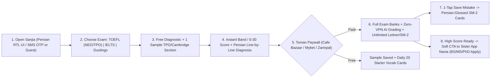

# Sanjia (Iran Edition) — Product Design & Requirements (PDR-Iran)

> **Executive Thesis:** The **Iran Domestic Edition (`IRN`)** is a Persian-first, mobile-native All-4-Skill exam simulator & AI coach tailored specifically for Iranian applicants preparing for **TOEFL iBT (TPO, NEO & New Academic Discussion formats)**, **IELTS (Cambridge / Actual series)**, and the **Duolingo English Test (DET)**. Engineered as a **strictly isolated build flavor & domestic distribution track** (Cafe Bazaar, Myket, Web/iOS PWA + Zarinpal Shetab checkout) separate from Global [PDR.md](file:///home/mahdi/projects/ideas/mockza/PDR.md), it competes directly with *Testinno* (`testinno.ir`) and *TestHelper* (`testhelper.com`) while creating a built-in cross-funnel with **Navia (`ناویا`)** for BS/MS/PhD admissions.

---

## 1. Document Control & Edition Identity

| Field | Specification |
| :--- | :--- |
| **Recommended Brand Name** | **`Sanjia` (`سنجیا`)** *(Top `-ia` pick pairing natively with `Navia` / `ناویا`; see Section 2 for verified alternatives)* |
| **Edition & Versioning Code** | **Iran Domestic Edition (`IRN`)** — Canonical Version `1.0.0+20001.irn` *(Catalog Prefix: `IRN-*`; isolated from Global `GLB-*` in [PDR.md](file:///home/mahdi/projects/ideas/mockza/PDR.md))* |
| **Primary Interface Language** | **Persian (`fa-IR`, RTL)** navigation, coaching, explanations & Jalali dates + **Strict LTR (`en`)** exam stimulus isolation |
| **Target Channels** | **Android:** Cafe Bazaar (`کافه‌بازار`), Myket (`مایکت`), Direct APK; **iOS & Desktop:** Responsive Flutter Web/PWA (`app.<brand>.ir`) + optional domestic iOS distribution |
| **Target Exams** | **TOEFL iBT** (`TPO` + `NEO TOEFL` + Academic Discussion), **IELTS Academic & General** (`Cambridge`/`Actual`), **Duolingo English Test (`DET`)** |
| **Payment Methods** | Domestic Iranian Rial/Toman via **Cafe Bazaar Pay / Myket IAB** & **Zarinpal / Zibal Web Checkout** (zero Visa/Mastercard required) |
| **Network Posture** | **Zero-VPN Domestic Access** via Iranian edge relay & domestic CDN audio cache |
| **Status** | Draft v1.0 (Iran Edition Complete Specification) |

---

## 2. Brand Naming Research & Recommendation (Paired With `Navia`)

Your sister product **`Navia` (`ناویا`)** handles AI-guided university applications (BS/MS/PhD). To maximize studio brand synergy against **`Testino` (`تستینو`)** and **`TestHelper` (`تست‌هلپر`)**, every candidate below was checked via web search across Iranian `.ir` platforms, Cafe Bazaar/Myket, and international EdTech apps:

### Top Recommended Names

| Rank | Brand Name | Persian | Meaning / Brand Story | Verification Status (Web / Iran Search) | Fit With **`Navia`** |
| :--- | :--- | :--- | :--- | :--- | :--- |
| **#1 (Best `-ia`)** | **`Sanjia`** | **سنجیا** | Rooted in Persian **سنجش (`Sanjesh` = evaluation / scoring)** + `-ia`. Instant phonetic twin to `Navia`. | **Clean in EdTech & Exam Prep** (only unrelated industrial machinery site `sanjiamachine` seen). | **10/10** — *"از سنجیا به ناویا"*: evaluate & pass your exam -> apply to your dream university. |
| **#2 (`-ia` Global Sibling)** | **`Mockia`** | **ماکیا** | Derived from **"آزمون ماک" (`Mock`)** + `-ia`. Clean sibling to international `Mockza`. | **Clean** — zero active Iranian IELTS/TOEFL mock platform found under `Mockia` / `ماکیا`. | **9/10** — instantly communicates "Mock Exam" to any Iranian IELTS/TOEFL taker. |
| **#3 (`-ia` 5-Letter Twin)** | **`Zavia`** | **زاویا** | 5-letter geometric twin to `Navia`; echoes **زاویه (`Zavieh` = angle)** -> covering all 4 skill angles. | **Clean in Iran EdTech** (no prominent Iranian IELTS `.ir` app under `Zavia` / `زاویا`). | **9/10** — sleek, minimal, premium AI startup tone (`ناویا` & `زاویا`). |
| **#4 (`-ia` SEO Keyword)** | **`Testria`** | **تستریا** | Leads directly with `"Test"` against *Testinno* & *TestHelper*, differentiated by `-ia`. | **Low collision** (minor unrelated dev-testing references internationally; clean on `.ir` stores). | **8/10** — good search recall, slightly less poetic than `Sanjia`/`Zavia`. |
| **#5 (Best Non-`-ia`)** | **`Bandino`** | **بندینو** | Directly signals IELTS Band score + modern consumer app feel. | **Clean** — search confirmed no active Iranian `بندینو` / `Bandino` IELTS/TOEFL platform. | **7.5/10** — catchy, but echoes *Testinno*'s `-ino` pattern instead of owning your `-ia` house brand. |

*(Action before domain purchase: verify exact `.ir` registry status on `nic.ir` and Cafe Bazaar package ID availability before locking branding.)*

### Names Explicitly Rejected (Collision Found in Web Checks)
* `Azmoonia` (`azmoonia.ir` active on Myket/Cafe Bazaar), `MockYar` (`mockyar.ir` active IELTS mock site), `Bandivo` / `Bandia` (`bandivo.ir` active IELTS AI platform), `Nomra` (`nomra.ir` Iranian LMS), `Azmia` (`Azmya` Education LMS exists), `Gradia` (`gradia-edu.com` exists), `Mockino` (`mockino.com` exists), `Certia` (confusable with major Iranian brand `Cerita / سریتا`), `Darsia` (close to `darsita.ir`).

---

## 3. Canonical Multi-Edition Versioning Schema (`GLB` vs. `IRN`)

To strictly differentiate international clean-room builds ([PDR.md](file:///home/mahdi/projects/ideas/mockza/PDR.md)) from the Iranian domestic build—across App Stores, developer consoles, BFF endpoints, crash dumps, and content CDN packs—Mockza enforces a **3-Layer Versioning Schema**:

| Layer | International Clean-Room (`Mockza`) | Iran Domestic (`Sanjia`) | Purpose & Hard Rule |
| :--- | :--- | :--- | :--- |
| **Edition Code (`EDITION`)** | **`glb`** (`GLB`) | **`irn`** (`IRN`) | Immutable compile-time constant (`main_global.dart` vs `main_iran.dart`) |
| **App Bundle / Package ID** | `com.mockza.app` | `ir.sanjia.app` *(never Apple/Play global)* | Prevents store signature or review linking across accounts |
| **Store Manifest Version** | `1.0.0` + build `10001+` | `1.0.0` + build `20001+` | Disjoint positive integer build codes guarantee zero collision in crash symbol archives (`build/symbols/`) |
| **Canonical Full Version String** | **`1.0.0+10001.glb`** | **`1.0.0+20001.irn`** | Shown in Settings/Support & sent in `X-App-Version` + `X-Edition` API headers |
| **Content Catalog ID Schema** | `GLB-<EXAM>-MOCKZA_ORIG-v<X>.<Y>` *(e.g. `GLB-IELTS_AC-MOCKZA_ORIG-v1.0`)* | `IRN-<EXAM>-<SERIES>-v<X>.<Y>` *(e.g. `IRN-TOEFL-TPO_074-v1.0`, `IRN-TOEFL-NEO_012-v1.2`, `IRN-IELTS-CAM_19_T1-v1.0`, `IRN-DET-MOCK_05-v1.0`)* | BFF strictly blocks `glb` clients from listing or fetching `IRN-*` endpoints (`403 EDITION_FORBIDDEN`) |
| **AI Rubric Schema Version** | `glb_ielts_en_v1.0` *(English feedback)* | `irn_toefl_fa_v1.0`, `irn_ielts_fa_v1.0`, `irn_det_fa_v1.0` *(Persian examiner commentary + English rubric)* | Preserves historical score comparability across prompt upgrades |

---

## 4. Stakeholder Q&A Matrix (Iran-Specific Decisions)

| # | Stakeholder Question | Strategy & Rationale |
| :--- | :--- | :--- |
| **Q1** | **How must the Iran edition remain isolated from Global `Mockza`?** | **Complete infrastructure separation.** Global `Mockza` (`com.mockza.app`) uses clean-room content, RevenueCat USD billing, and official Apple/Google Play accounts. `Sanjia` (`ir.sanjia.app`) uses separate git/CI release configs, separate signing keystores, separate CDN buckets, and ships **exclusively** through **Cafe Bazaar, Myket, Direct APK, and Web/iOS PWA**—never uploaded to official Apple App Store or Google Play Console. |
| **Q2** | **How do Iranian iPhone users access and pay if Apple App Store doesn't support Shetab/Zarinpal?** | Deploy the exact same Flutter codebase to **Flutter Web / Responsive PWA (`app.sanjia.ir`)** alongside Android APK (`Cafe Bazaar` / `Myket`). Iranian iOS users add the PWA to Home Screen (like Iranian fintech/bank web-apps) and pay seamlessly in **Toman via Zarinpal / Zibal**, unlocking the exact same account across Android and Web via **SMS OTP (`تایید موبایل`)**. *(Optional later: domestic iOS store wrappers if ROI justifies).* |
| **Q3** | **Will Iranian users need a VPN to use AI Speaking/Writing grading or TPO audio?** | **No — Zero-VPN UX is a massive competitive moat.** All client requests resolve to a domestic Iranian edge domain (`api.sanjia.ir` + domestic S3 CDN for Listening `.m4a` packs). Our backend relay securely proxies AI grading upstream so Iranian 4G/fiber users never fail uploads due to blocked foreign IPs or VPN disconnections. |
| **Q4** | **How do we compete cleanly against *Testino* (`تستینو`) and *TestHelper` (`تست‌هلپر`)?** | Both competitors focus heavily on desktop browser TPO/IELTS packs, rely on clunky mobile wrappers or split vocabulary into external tools (*Tik8* / manual Leitner), and often charge per-mock or opaque bundle prices. **`Sanjia` wins via:** (1) True 60–120fps native mobile UI (Android + iOS PWA); (2) **Instant Persian + English AI feedback** diagnosing exact rubric blockers; (3) Built-in **1-Tap Mistake-to-Deck Leitner/SM-2 flashcards** replacing separate vocab apps; (4) **Lower friction Duolingo English Test (`DET`) + NEO TOEFL support** in one mobile app; (5) Seamless cross-funnel from **`Navia`**. |
| **Q5** | **How do we protect gross margins when Toman weakens against USD AI API costs?** | AI inference is priced in **USD**, while subscribers pay in **Toman**. Mitigate FX squeeze with three controls: (1) Zero-COGS Reading, Listening & Leitner/SM-2 Vocab absorb 60%+ of study sessions; (2) Daily/Monthly fair-use caps on Speaking/Writing AI calls; (3) **Monthly FX-indexed Toman tier review** + keeping **Contribution Margin ≥ 65% in USD-equivalent** after PSP (~1–2% Zarinpal or ~15–30% Bazaar) + AI COGS. |
| **Q6** | **Why prioritize `TOEFL (NEO + TPO)` + `IELTS` + `DET` together?** | Iranian **BS/MS/PhD (`اپلای`)** students—your exact **`Navia`** audience—split mainly across **IELTS Academic**, **TOEFL iBT (especially `NEO` & latest Academic Discussion format)**, and increasingly **Duolingo English Test (`DET`)** because official DET can be taken remotely at home/neighbor countries at lower exam cost than traveling for IELTS/TOEFL. Having all three in one mobile hub makes `Sanjia` the default daily companion for every `Navia` user! |

---

## 5. Competitive Landscape (Iran Domestic)

| Competitor | Observed Focus & Strengths | Known Mobile / UX Gaps | `Sanjia` Advantage |
| :--- | :--- | :--- | :--- |
| **`Testinno` (`تستینو`)** | Strong brand in Iran (`testinno.ir`), IELTS/TOEFL/GRE TPO mocks, analytics & AI writing/speaking tools, Leitner box | Primarily desktop-web mindset for realistic TOEFL/IELTS sessions; mobile ergonomics vary across screens | Native Flutter UX + offline cached commute Listening/Reading + unified 1-tap Mistake-to-Deck SM-2 from every graded attempt + direct **`Navia`** ecosystem integration |
| **`TestHelper` (`تست‌هلپر`)** | Deep TOEFL (`TPO` + Academic Discussion + Build-a-Sentence), IELTS, PTE, DET, *Tik8* vocab tracking, Android app | Fragmented feature modules / Web-heavy desktop style; older UX flow | Clean Persian-first BiDi UI (zero broken punctuation/RTL bugs), instant offline Reading/Listening scoring + bilingual Persian examiner coaching |
| **`MockYar` (`ماک‌یار`) / Telegram Channels** | Free/cheap PDFs & desktop Cambridge simulators | Zero AI Speaking/Writing diagnosis, zero mobile Leitner sync, messy Telegram file hunting | All 4 skills + structured **Mistake-to-Deck Vocab** + Speaking recorder + NEO/DET drills in one clean app |

---

## 6. Target Personas & `Navia` Cross-Funnel

| Persona | Profile & Exam Choice | Core Need | `Sanjia <-> Navia` Loop |
| :--- | :--- | :--- | :--- |
| **1. `Navia` MS/PhD Applicant** | Engineering / CS / Basic Science undergrad or grad applying abroad; targets **TOEFL 95–105+ (`NEO`/`TPO`)** or **IELTS 7.0+**. | Needs updated 2024–2026 **Academic Discussion** & **TPO Speaking** simulations + fast Persian grammar/rubric coaching at night without VPN issues. | **Inbound:** `Navia` recommends *Sanjia* during Admission Readiness Checklist. **Outbound:** High scores in *Sanjia* unlock *Navia* SOP/CV/Professor-Email workflows. |
| **2. Budget / Remote DET Candidate** | Applicant avoiding travel cost to Istanbul/Dubai/Yerevan by taking **Duolingo English Test (`DET 120+`)**. | Desperately lacks realistic timed **DET micro-task drills** (*Read & Complete*, *Listen & Type*, *Write About Photo*, *Interactive Reading*). | High-conversion underserved niche inside Iran with low ad competition on Instagram/Telegram! |
| **3. IELTS Immigration / Work Applicant** | Medical, tech, or skilled worker prepping **Cambridge Reading/Listening** on Tehran metro + **AI Speaking/Writing** at home. | Needs offline metro Reading/Listening + 1-tap flashcard capture for forgotten academic words with **Persian translations**. | Pays Monthly or Quarterly Toman plans; strong organic referrals in work/migration Telegram groups. |

---

## 7. Scope & Functional Requirements (Iran Edition Extensions)

In addition to the 4-Skill Core (`FR-001`..`FR-037`) in [PDR.md](file:///home/mahdi/projects/ideas/mockza/PDR.md), the Iran Edition adds:

### 7.1 Persian-First BiDi UX & Jalali Experience (`IRN-FR-001` .. `IRN-FR-005`)
* **`IRN-FR-001` Persian Main UI + Isolated English Stimulus:** Navigation tabs, onboarding, streak banners, AI commentary, and error explanations render in clean **Persian (`RTL`)** using `Vazirmatn` typography—while all English exam prompts, Reading passages, Writing editors, timers, and decimal scores render inside **strict `LTR` directional boundaries** so punctuation (`?`, `.`, parentheses) never mirrors.
* **`IRN-FR-002` Jalali (`شمسی`) Exam Calendar:** Users select their official IELTS/TOEFL/DET test date using a Jalali picker (`e.g. ۲۵ آذر ۱۴۰۵`), while backend storage stays canonical UTC/serial day.
* **`IRN-FR-003` Bilingual AI Coaching:** Speaking & Writing feedback displays official English academic rubric anchors + **natural Persian explanations** (*«در پاراگراف دوم به‌جای تکرار very important از pivotal یا paramount استفاده کنید تا نمره Lexical به ۷.۵ برسد»*) + Band/Score +1.5 English model rewrite.
* **`IRN-FR-004` Persian-Glossed Mistake-to-Deck Flashcards:** 1-tap saved vocabulary cards automatically include **concise Persian meaning + synonym pair + example sentence from their own essay/passage** (`جعبه لایتنر / SM-2 هوشمند`).
* **`IRN-FR-005` SMS OTP Cross-Device Auth:** Fast Iranian mobile-number OTP (`کد تایید پیامکی`) linking subscriptions smoothly across Cafe Bazaar/Myket Android and iOS Safari PWA.

### 7.2 Iran Exam Catalog Support (`IRN-FR-006` .. `IRN-FR-012`)
* **`IRN-FR-006` TOEFL iBT Classic (`TPO`) & Modern (`NEO` / Shortened Format):**
  * Reading (adaptive/timed academic passages + vocabulary-in-context + summary drag-and-drop questions),
  * Listening (campus conversations & academic lectures with note-taking scratchpad & synced transcript review),
  * Speaking (All 4 modern TOEFL tasks: Task 1 Independent `15s prep / 45s speak` + Tasks 2–4 Integrated Read-Listen-Speak timed state machines),
  * Writing (**Integrated Reading+Listening->Essay** `20 min` + **Writing for an Academic Discussion** `10 min` post/reply simulation!), scaled `0–30` per skill (`0–120` total + `1.0–6.0` CEFR bridge).
* **`IRN-FR-007` IELTS Academic & General Training (`Cambridge` & Actual Catalog Schema):** Full 4-skill timed simulator supporting Academic + General Task 1 letter prompts and Reading section layouts.
* **`IRN-FR-008` Duolingo English Test (`DET`) Adaptive-Style Trainer:** Sub-task sprint runner covering *Read and Complete* (C-test missing letter tiles), *Listen and Type* (word-by-word fuzzy/exact evaluation), *Read Aloud* (AI Speaking pronunciation check), *Write About the Photo* (`1 min`), *Interactive Reading*, and *Speak About the Topic* (`1–3 min`), mapped to `10–160` + 4 sub-scores.
* **`IRN-FR-009` Founder-Managed Content Pack Loader:** Internal JSON/media manifest schema enabling the founder to ingest licensed/curated `TPO`, `NEO`, `Cambridge`, and `DET` packs cleanly into the isolated Iranian CDN bucket without hardcoding large binaries in the APK.

### 7.3 Dual User Flow (Global Clean-Room vs. Iran Domestic)

---

## 8. KPIs, Pricing Strategy (Toman) & FX-Safe Economics

*(Note: Toman figures below are **planning estimates** indexed carefully to USD AI API exchange costs; review monthly before adjusting SKU prices.)*

### 8.1 Toman Monetization Matrix *(Planning Structure)*

| Plan (`طرح اشتراک`) | Suggested Toman Tier *(Estimate — Index Monthly to USD)* | Target Persona | Payment Channel | AI Fair-Use Cap |
| :--- | :--- | :--- | :--- | :--- |
| **رایگان (`Free Starter`)** | **0 تومان** | All new installs | Instant start | **1 AI Speaking OR Writing Diagnostic** + **1 sample Reading & Listening** + **20 Vocab/day** |
| **فشرده هفتگی (`Cram 7-Day`)** | **~149,000 – 199,000 تومان / هفته** | Urgent Crammers (`۱۰ روز مانده به آزمون`) | Zarinpal / Bazaar / Myket | **8 Speaking + 8 Writing AI evals/day**; full Reading/Listening/DET/Vocab unlocked |
| **حرفه‌ای ماهانه (`Monthly Pro`)** | **~349,000 – 490,000 تومان / ماه** | Main retakers & *Navia* applicants | Zarinpal (lowest ~1–2% PSP fee!) / Bazaar | **8 Speaking + 8 Writing AI evals/day** (`120/mo` max AI ceiling) |
| **پکیج ۳ ماهه اپلای (`Apply Quarterly`)** | **~790,000 – 1,090,000 تومان / ۳ ماه** | BS/MS/PhD cohort + *Navia* bundle promo | Zarinpal Web Checkout (zero 30% app-store cut) | Full 4-skill + optional **Navia Bundle Discount Code** |

> **Channel Margin Insight:** Routing Web/PWA and Direct APK upgrades through **Zarinpal/Zibal (~1–2% fee)** instead of domestic app-store IAP (~15–30% Bazaar/Myket fee) preserves ~15–28% extra Toman margin to cover USD-denominated AI inference!

### 8.2 Iran Edition KPI Targets

| Pillar | KPI | Day-30 Target | Day-90 Target | Red Alert |
| :--- | :--- | :--- | :--- | :--- |
| **Acquisition & Funnel** | `Navia -> Sanjia` Cross-Referral % | ≥ 20% of active `Navia` MAU try diagnostic | ≥ 30% cross-install rate | < 8% |
| **Activation** | SMS OTP + First Diagnostic Completion % | ≥ 45% | ≥ 58% | < 28% |
| **Zero-VPN Reliability** | Domestic AI Grading Success Rate (without VPN) | ≥ 98.5% | ≥ 99.5% | < 95% (domestic relay issue) |
| **Monetization** | Install -> Paid Toman Conversion % | ≥ 3.5% | ≥ 5.5% | < 1.8% |
| **FX Margin Safety** | **USD-Adjusted Blended Gross Margin %** | **≥ 70%** *(after PSP + USD AI COGS)* | **≥ 75%** | **< 55%** (raise Toman price or tighten daily AI cap!) |
| **Engagement** | Multi-Skill + Leitner Retention (`D7`) | ≥ 20% | ≥ 28% | < 12% |

---

## 9. Iran Operations, Store Launch & Isolation Risk Register

### Launch & Compliance Checklist (Iran Domestic)
* [ ] Register separate domestic package (`ir.sanjia.app`) and domestic domain (`sanjia.ir` / `app.sanjia.ir`); confirm **zero shared signing keys, repos/CDN URLs, or bundle IDs** with Global `Mockza`.
* [ ] Obtain **eNamad (`اینماد`)** + activate **Zarinpal / Zibal** merchant gateway for PWA/Web checkout (needed for direct Shetab payments).
* [ ] Create **Cafe Bazaar Developer** & **Myket Developer** accounts (`پرداخت درون‌برنامه‌ای پولکی / مایکت`).
* [ ] Verify zero-VPN connectivity across Iranian mobile carriers (`MCI / همراه اول`, `Irancell / ایرانسل`, `TCI / مخابرات`) for both domestic CDN audio and AI grading relay.
* [ ] Verify BiDi RTL+LTR rendering across small Android screens (360dp width) and iOS Safari PWA.

### Risk Register

| Risk | Likelihood | Impact | Mitigation |
| :--- | :--- | :--- | :--- |
| **Cross-Contamination With Global `Mockza` Apple/Play Account** | Medium *(if sloppy)* | **Fatal to Global Portfolio** | Compile-time `glb` vs `irn` flavors, separate accounts/keystores/domains, CI check banning `irn` files/keys inside `glb` builds. |
| **USD/IRR Exchange Rate Spike Erodes AI Margin** | High *(Macro)* | High | Keep zero-COGS Reading/Listening/DET/Vocab central; maintain strict `8+8/day` (`120/mo`) AI cap; auto-alert founder when AI COGS > 25% of net Toman revenue. |
| **Domestic Edge Relay / Sanctioned Host Blocking** | Medium | High | Host BFF entry edge & `.m4a` audio on reliable Iranian cloud + multi-region upstream fallback so end users never need VPNs. |
| **Broken English Punctuation Inside Persian RTL Screens** | High *(Default)* | Medium *(UX)* | Enforce mandatory `LtrExamBoundary` widget wrapper (`ADR-Iran.md`) around all English exam prompts, editors, and timers. |
