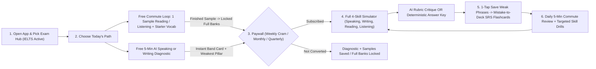

# Mockza — Product Design & Requirements (PDR)

> **Executive Thesis:** Mockza is a consolidated, AI-native **All-4-Skill High-Stakes English Exam Simulator Hub** (`Listening`, `Reading`, `Writing`, `Speaking` + `Contextual Exam Vocabulary`) spanning `IELTS`, `PTE Academic`, `TOEFL iBT`, and `Duolingo English Test`. Designed for iOS-first release followed by Android, it pairs **100% original blueprint-calibrated Reading/Listening mocks & Mistake-to-Deck Spaced Repetition** (zero-COGS daily habit + complete-app appeal) with **AI-graded Speaking & Writing rubric evaluation** (the high-urgency paid differentiator)—targeting **\$350–\$1,000/month net** as App #1 toward a **\$1,000+/month** indie portfolio.

---

## 1. Document Control & Product Identity

| Field | Specification |
| :--- | :--- |
| **Product Name** | `Mockza` *(verified low-collision brand; 6 chars preserves maximum ASO keyword budget)* |
| **Edition & Versioning Code** | **Global Edition (`GLB`)** — Canonical Version `1.0.0+10001.glb` *(Catalog Prefix: `GLB-*`; see [PDR-Iran.md](file:///home/mahdi/projects/ideas/mockza/PDR-Iran.md) for the separated Iran Domestic Edition `IRN`)* |
| **Primary App Store Title** | `Mockza: IELTS, PTE, TOEFL Prep` *(30 / 30 chars max)* |
| **iOS Subtitle (Default)** | `AI English Speaking & Writing` *(29 / 30 chars max; zero keyword overlap; `listening`, `reading`, `vocabulary` targeted in Keywords)* |
| **Release Strategy** | One unified multi-exam hub app *(satisfies Apple Guideline 4.3 anti-spam policy)* |
| **Launch Sequence** | **Phase 1 (v1.0):** iOS App Store first + Google Play 12×14 closed testing track; **Phase 2:** Production Play Store + Exam Hub expansion |
| **MVP Focus (All 4 Angles)** | **IELTS Academic 4-Skill Core:** AI Speaking (Parts 1–3) + AI Writing (Tasks 1–2) + Original Reading Passages + Multi-Accent Neural TTS Listening + Mistake-to-Deck Vocabulary |
| **Content IP Posture** | **100% Clean-Room Original / Commercial-Permissive Content** *(official test books used solely as structural benchmarks, never copied)* |
| **Target Unit Economics** | ≥ 80% blended gross margin per active subscriber after 15% store fee and AI inference COGS |
| **Status** | Draft v2.0 (All-4-Skill + Vocab + IP-Clean Update) — Ready for Stakeholder Sign-Off & Scaffold |

---

## 2. Stakeholder Q&A Matrix (Anticipating Every Key Founder Question)

| # | Stakeholder Question | Verified Answer & Product Strategy |
| :--- | :--- | :--- |
| **Q1** | **Why will users pay Mockza \$5.99–\$14.99/mo when ChatGPT Voice and free Reading PDFs exist?** | Generic AI chatbots lack strict exam timers, realistic multi-part cue cards, calibrated rubric band limits, and Listening/Reading sync. Meanwhile, free Telegram/YouTube Cambridge PDFs are over-memorized and disconnected from personalized weak-area tracking. Users pay for **an authentic all-4-skill exam simulator + accurate criterion diagnosis + personalized rewrites + mistake flashcards in one focused mobile flow**. |
| **Q2** | **Why launch iOS first if Android has high test-taker volume in India/MENA/SEA?** | Three verified platform facts drive iOS-first sequencing: (1) iOS drives ~75–77% of new consumer subscription launches with higher Revenue Per Install and lower involuntary churn (~14% vs. ~31% on Google Play); (2) Google Play personal developer accounts created on/after Nov 13, 2023 must pass a **≥12 active opted-in testers × 14 consecutive days** closed-testing gate per app before production; (3) launching iOS first validates willingness-to-pay rapidly while Android runs its 14-day closed test in parallel. |
| **Q3** | **Why keep IELTS, PTE, TOEFL, and DET inside one app (`Mockza`) instead of 4 standalone apps?** | **Apple App Store Guideline 4.3 (Spam)** rejects separate apps sharing the same codebase/template. A unified hub consolidates Store reviews/authority, supports cross-exam expansion via schema packs, and keeps developer account risk near zero. |
| **Q4** | **Why include Reading, Listening, and Vocabulary in v1.0 instead of only Speaking & Writing?** | Including all 4 skills removes the *"half an app"* Store review/conversion objection, lowers **blended AI COGS** (Reading, Listening, and Vocab score locally for ~\$0 marginal API cost), and improves **D7/D30 retention** because commute users can complete 5-minute Listening/Reading/Vocab sprints even when they cannot speak aloud. |
| **Q5** | **How do we source Reading & Listening mocks legally without getting banned for copying official IELTS books?** | **Zero copyrighted Cambridge IELTS, British Council, ETS, or Pearson text/audio enters Mockza.** Official exams are studied *only* as structural blueprints (passage word count, CEFR C1–C2 density, TFNG/Matching logic, Listening speaker distractors). Mockza ships **100% original passages, vetted answer keys, and pre-generated multi-accent neural TTS `.m4a` dialogues** (plus optional Public Domain / `CC BY 4.0` attributed texts, strictly banning `CC BY-NC`). Bonus: students get **fresh unseen tests** rather than old PDFs they memorized. |
| **Q6** | **Why won't Vocabulary turn Mockza into a bloated generic flashcard / Duolingo clone?** | Mockza restricts Vocabulary strictly to high-ROI exam score lifts: (1) **Mistake-to-Deck 1-Tap Capture** extracts Band-upgrade words/collocations from the user's *own* graded essays, speech transcripts, and Reading highlights; (2) **~300–500 Curated IELTS Paraphrase & Academic Collocation cards** train synonym recognition directly used in Reading/Listening traps. |
| **Q7** | **What prevents heavy Speaking/Writing users from making our AI API bills unprofitable?** | Layered cost controls: (1) Zero-COGS Reading, Listening & Vocab absorb 50%+ of total study sessions; (2) Single-pass Gemini Flash multimodal audio keeps a 2-min Speaking clip ~**\$0.003–\$0.015** and Writing ~**\$0.002–\$0.005** (published-pricing estimate); (3) Serverless BFF enforces **10 Speaking + 10 Writing evaluations/day** (`150/mo` cap); (4) No Lifetime unlimited-AI tier. |
| **Q8** | **How do we prevent Apple/Google trademark rejections?** | Never use `"Official"` anywhere in metadata or UI. Avoid placing `"Duolingo"` directly in the 30-character App Title (`Mockza: IELTS, PTE, TOEFL Prep` uses brand-first naming). Display an explicit non-affiliation disclaimer on onboarding, exam selection, and Settings. |
| **Q9** | **What stops free users from taking the free Reading/Listening/Vocab + Diagnostic without paying?** | The **Free Starter Hook** lets users experience quality risk-free (1 AI Speaking/Writing diagnostic + 1 sample Reading passage + 1 sample Listening section + 20 starter Vocab cards) without paying any ongoing AI bill—while locking **full exam banks, unlimited AI Speaking/Writing grading, personalized Band +1.5 rewrites, "Ask AI Why" Reading explanations, and unlimited Mistake-to-Deck SRS** behind Mockza Pro. |
| **Q10** | **Should we offer a "Pass / Band 7+ Guarantee" like *Pocket Prep*?** | **No for v1.0.** Official test-day performance depends on proctored conditions outside our visibility, making refunds easy to abuse. Build credibility instead via **verified rubric breakdown + realistic unseen Band-calibrated mocks**. |
| **Q11** | **Won't users churn after passing their exam in 4–8 weeks?** | Yes—exam prep has natural graduation churn (and AI apps overall experience ~30–36% faster churn alongside ~41% higher initial revenue per user). Mockza matches natural prep timelines with **\$5.99/wk Cram Pass**, **\$14.99/mo Pro**, and **\$29.99/3-mo Prep** so unit payback completes immediately on Day 1–7. |
| **Q12** | **How accurate is AI band scoring & deterministic Reading/Listening grading?** | Reading and Listening use exact deterministic answer keys + accepted spelling/number normalization (`color`/`colour`, `1998`/`nineteen ninety-eight`). Speaking & Writing use rubric-anchored JSON prompts benchmarked against official public Band exemplars (`≥ 80% within ±0.5 band` target) labeled honestly as *"Estimated Practice Band"*. |
| **Q13** | **How do we keep Listening audio packs from bloating app download size past Store cellular limits?** | Bundle **only 1 sample Listening clip (~1 MB)** inside the initial app binary (`<= 45 MB` total app size). Serve full original Listening `.m4a` packs lazily from object storage CDN with **1-tap offline caching** on device. |
| **Q14** | **What if a student's connection drops after recording Speaking or during an offline subway Reading session?** | **Local-first resilience:** Reading, cached Listening, Vocabulary SRS, and essay typing run **100% offline**; Writing drafts autosave every 500ms; Speaking `.m4a` clips save to private disk first in a `pending_upload` queue with idempotent 1-tap retry so user effort and daily quota are never wasted. |
| **Q15** | **At what exact numbers do we scale, iterate, or kill Mockza?** | Explicit Week-4 / Week-8 Stage Gates in Section 5.4: if Install-to-Paid reaches ≥ 3.5% with Gross Margin ≥ 75% -> scale content packs & PTE v1.1; if < 1.5% conversion and < \$75/mo net MRR after 2 paywall/onboarding iterations -> sunset new investment and reuse shared template for App #2. |

---

## 3. Target Market, Personas & Jobs-to-Be-Done

| Persona | Profile & Context | Core Pain / Anxiety | Job-to-Be-Done (JTBD) | Preferred Plan |
| :--- | :--- | :--- | :--- | :--- |
| **1. The Deadline Crammer** | Student with official IELTS/TOEFL booked in **7–21 days**. | Needs rapid full-4-skill dress rehearsals at midnight without booking tutors or searching broken PDF links. | *"Simulate all 4 exam sections under strict real timers and pinpoint what separates me from Band 7.0."* | **\$5.99 / week** Cram Pass |
| **2. The Plateau Retaker** | Scored Overall 6.5 but stuck at **6.0 Writing/Speaking** or misses `True/False/Not Given` traps in Reading. Retake fee ~\$215–\$280. | Repeats the same grammar/lexical/paraphrase errors without noticing *why*. | *"Show me every mistake costing me 0.5 band and convert those corrections into daily flashcards until I pass."* | **\$14.99 / month** Pro or **\$29.99 / 3-mo** |
| **3. The Commuting Professional** | Nurse, engineer, or applicant prepping 15–20 min/day on transit for immigration (**IELTS / PTE**). | Cannot talk out loud on the subway/bus; wants quiet Listening, Reading, and Vocab practice at work/commute and Speaking at home. | *"Let me practice Listening, Reading & Vocabulary on my morning commute, and run Speaking/Writing AI mocks at night."* | **\$29.99 / 3-month** Exam Prep |

### Explicit Non-Personas (Out of Scope)
* Casual hobbyist language learners looking for gamified travel phrases (*Duolingo*).
* Homework cheating / auto-essay generation seekers.

---

## 4. Competitive Landscape & Positioning

| Alternative | Verified Benchmark / Model | Strengths | Mockza's Unfair Advantage |
| :--- | :--- | :--- | :--- |
| **Official Prep Portals** (*IELTS Ready*, *DET*, *ETS*) | *DET* ~\$40M–\$45M/yr exam scale; official test sites | Authoritative format | Clunky mobile experience, no integrated Mistake-to-Deck SRS vocabulary, scarce itemized AI Speaking/Writing line edits |
| **Multi-Exam Leaders** (*Pocket Prep*, *Zutobi*) | *Zutobi*: ~\$500k–\$600k/mo est.; *Pocket Prep*: \$15k–\$130k+/mo (\$17.99/mo, \$44.99/3mo, \$109.99/yr) | Proven single-hub subscription packaging | Focused on static MCQ banks; lack authentic audio Speaking + timed Essay AI grading + synced paraphrase SRS |
| **Recycled PDF / Clone Apps** | Dozens of low-rated store clones with scraped Cambridge 1–19 PDFs | Huge raw volume | High DMCA takedown risk, broken audio links, stale tests users already saw, zero adaptive AI coaching |
| **Generic Chatbots** (*ChatGPT Voice*) | Free / \$20/mo generic chat | Open conversation | No timers, no 40-question Reading/Listening simulator, inflated band scoring, zero Vocab SRS memory |

---

## 5. Goals, North-Star Metric & Complete KPI Framework

### 5.1 Business & Portfolio Goals
1. **Launch Readiness:** Ship Mockza v1.0 (iOS App Store — all 4 IELTS skills + Mistake-to-Deck Vocab) within 3–4 weeks while starting Android 12×14 closed testing simultaneously.
2. **Validation Milestone (Day 30 Post-Launch):** **≥ \$150/mo net MRR** (~12–25 active subscribers), **≥ 80% blended gross margin**, and clean Store/IP standing.
3. **Portfolio Contribution Target (Day 90 Post-Launch):** **\$350–\$1,000/mo net MRR** (~30–80 active subscribers across Cram/Monthly/Quarterly plans), validating sustainable payback prior to shipping App #2.

### 5.2 North-Star Metrics
* **Product North-Star:** **Multi-Skill Weekly Engagement — ≥ 4 scored sessions across ≥ 2 skills per active paid user/week** (proves the 4-angle habit loop sticks!).
* **Commercial North-Star:** **Gross-Margin-Adjusted Net MRR** (`Store Payout - AI API COGS - Media Egress`).

### 5.3 Complete KPI Dictionary & Targets

| Pillar | KPI Name | Formula / Definition | Instrumentation Event / Source | Day-30 Target | Day-90 Target | Red-Alert Threshold |
| :--- | :--- | :--- | :--- | :--- | :--- | :--- |
| **Acquisition & ASO** | Store Product Page -> Install % | `Installs / Product Page Views` | App Store Connect / Play Console | ≥ 26% | ≥ 34% | < 15% (revise screenshots/subtitle) |
| **Acquisition** | Organic Installs / Day | Organic store search + short-form video installs | App Store Connect Analytics | ≥ 12/day | ≥ 35/day | < 5/day post-ASO polish |
| **Activation** | Onboarding Completion % | `Exam & Target Set / App First Open` | `onboarding_completed` | ≥ 80% | ≥ 85% | < 65% |
| **Activation** | **First Value Completion %** | `(Diagnostic AI Mock OR Sample Reading/Listening) / First Open` | `diagnostic_completed` / `sample_completed` | ≥ 55% | ≥ 65% | < 35% |
| **Activation** | Time to First Scored Output | Median minutes from first open to first scored Speaking/Writing/Reading result | Session timestamp delta | ≤ 5.5 min | ≤ 4.5 min | > 9 min |
| **Engagement (4-Angle)** | **Multi-Skill Breadth %** | `% weekly active users practicing >= 2 distinct skills (e.g., Reading + Writing)` | Skill attempt logs | ≥ 50% | ≥ 65% | < 30% (skills siloed/unseen) |
| **Engagement (Vocab)** | **Vocab Capture & Review Rate** | `% scored sessions producing >= 1 saved Mistake-to-Deck card` + weekly SRS reviews | `vocab_card_saved`, `vocab_review_completed` | ≥ 25% capture | ≥ 35% capture | < 10% (UI buried) |
| **Monetization** | **Paywall View -> Paid Conversion %** | `First Paid Sub / Unique Installs` *(benchmark: ~2.1% freemium vs ~10.7% hard paywall)* | RevenueCat + `purchase_succeeded` | ≥ 4.0% | ≥ 6.0% | < 2.0% |
| **Monetization** | Refund Rate | `Refunded Tx / Total Paid Tx` | App Store Connect / RevenueCat | ≤ 4.0% | ≤ 2.5% | > 6.0% |
| **Retention** | Day-1 / Day-7 Retention | Users active on D1 / D7 post-install *(boosted by commute Reading/Listening/Vocab)* | `app_opened` | D1 ≥ 38%, D7 ≥ 18% | D1 ≥ 45%, D7 ≥ 24% | D7 < 10% |
| **Retention** | Monthly Sub Renewal (M1 -> M2) | `% Monthly subscribers renewing Month 2` | RevenueCat Cohort | ≥ 45% | ≥ 55% | < 30% |
| **Unit Economics** | **Blended AI COGS / Active Paid User / Mo** | `Total AI Spend / Active Paid Users` *(lowered by \$0-COGS Reading/Listening/Vocab)* | BFF usage ledger | ≤ \$1.00 | ≤ \$0.85 | > \$2.20 |
| **Unit Economics** | **Blended Gross Margin %** | `(Net Store Payout - AI COGS) / Net Store Payout` | Accounting sheet | ≥ 80% | ≥ 84% | < 70% |
| **Quality & Content** | Content Quality & IP Gate | `100% original/verified provenance audit` + `< 2% user-flagged ambiguous keys` | `bff/content-pipeline` QA + feedback flags | 0 IP issues, < 2% flags | 0 IP issues, < 1% flags | Any IP flag OR > 4% dispute rate |
| **Quality & SLA** | Speaking/Writing Grading P95 | 95th percentile `submit -> scored JSON` latency | BFF timing logs | ≤ 10s | ≤ 8s | > 18s |
| **Quality & SLA** | Crash-Free Sessions % | `1 - (Crash Sessions / Total Sessions)` | Crash log / App Store | ≥ 99.5% | ≥ 99.8% | < 99.0% |

### 5.4 Explicit Go / Iterate / Pivot / Kill Checkpoints

| Checkpoint | Condition Observed | Decision |
| :--- | :--- | :--- |
| **Week 2** | Crash-free < 99% OR Grading P95 > 18s OR Listening pack cache fails offline | **HALT Promotion / Fix Engineering** — fix pipeline/audio stability before driving installs. |
| **Week 4** | First-value completion ≥ 50% AND Install-to-Paid ≥ 3.5% AND Gross Margin ≥ 78% | **GO / SCALE** — expand original Reading/Listening OTA bank (+8 packs/mo), deploy localized metadata, build PTE v1.1. |
| **Week 4** | High engagement on free Reading/Vocab BUT Install-to-Paid < 2.0% | **TIGHTEN PAYWALL** — require AI Diagnostic + paywall earlier; limit free Reading/Listening to 1 sample section (prevent free-forever freeloading); lead with \$5.99/wk Cram Pass. |
| **Week 8** | Install-to-Paid < 1.5% AND Net MRR < \$75/mo after 2 onboarding/pricing experiments | **PIVOT OR EXTRACT** — freeze new exam packs on Mockza, reuse shared Flutter/Drift/RevenueCat skeleton for App #2 (*CurbQuiz* / *CueBrake*). |

---

## 6. Phased Product Scope & Feature Roadmap

### Phase 1: MVP v1.0 (3–4 Weeks — Complete 4-Skill IELTS Academic Core + Mistake-to-Deck Vocab)
* **Unified 4-Angle Home Hub:** Clean dashboard displaying all 4 exam modules (**Listening**, **Reading**, **Writing**, **Speaking**) + **Today's Vocab Queue** + **Exam Countdown** (`IELTS Academic` live; `PTE` / `TOEFL` / `DET` roadmap badges).
* **Free Risk-Free Starter Sample (Bounded \$0-Cost Retention + Diagnostic Hook):**
  * **1 AI Diagnostic** (user chooses Speaking mini-mock OR Writing Task-2 mini-mock)
  * **1 Complete Original Reading Passage** (bundled offline, 13–14 Qs)
  * **1 Complete Original Listening Section** (bundled offline starter track, 10 Qs)
  * **20 Daily Starter Vocab Reviews** (curated IELTS Paraphrase cards)
* **Speaking Simulator (Paid Full Bank):** Parts 1, 2 (60s prep + notes + 120s auto-stop recorder), and 3 + pre-flight mic check + local audio persistence & retry queue + AI rubric Band score + audio self-playback + synced transcript.
* **Writing Simulator (Paid Full Bank):** Task 1 (zoomable original SVG/chart/table prompts, ≥ 150w, 20m timer) + Task 2 (argument essay, ≥ 250w, 40m timer) + strict no-autocorrect exam toggle + 500ms autosave + AI Band breakdown + Band +1.5 personalized rewrite.
* **Reading Simulator (Lean Launch Bank: 6–10 Curated Original Academic Passages):**
  * Split-pane / quick-toggle layout (scroll passage independently of questions on small phones; split view on tablets).
  * User highlight colors + margin notes persisted locally.
  * Deterministic auto-scorer supporting IELTS core question types: `True/False/Not Given`, `Yes/No/Not Given`, `MCQ`, `Matching Headings`, `Summary/Sentence Gap Fill` (case/punctuation/UK-US spelling variant tolerance + Band `0–40 -> 0.0–9.0` estimator).
  * Per-question pre-authored explanation highlighting exact passage evidence sentence (+ optional paid **"Ask AI Why?"** deep follow-up).
* **Listening Simulator (Lean Launch Bank: 4–8 Original Sections across Parts 1–4):**
  * Multi-accent neural TTS `.m4a` dialogues/monologues (British, Australian, North American voices) hosted on CDN with 1-tap offline download & verification.
  * **Strict Exam Mode** (plays once linearly, scrub/pause locked during test audio just like official IELTS) vs **Study Mode** (`0.85x / 1.0x / 1.25x` playback speed, timestamp jump, interactive transcript with distractor flags highlighted).
* **Contextual Exam Vocabulary (`Mistake-to-Deck` + High-Yield Paraphrase Packs):**
  * **1-Tap Save to Deck** on every upgraded phrase inside AI Writing/Speaking rewrites and Reading tap-to-inspect vocabulary items.
  * On-device **SM-2 Spaced Repetition** daily review session (`Again / Hard / Good / Easy`) stored in `drift` SQLite.
  * Seeded **300–500 IELTS High-Yield Paraphrase Pairs & Academic Collocations**.
* **Monetization:** RevenueCat hard/diagnostic paywall (`\$5.99/wk`, `\$14.99/mo`, `\$29.99/3mo`, zero ads) + Restore Purchases.

### Phase 2: Fast-Follow v1.1 (Weeks 5–8)
* **OTA Exam Bank Expansion:** Stream 4–8 new original Reading/Listening/Writing/Speaking packs per month via BFF JSON + CDN audio without App Store binary updates.
* **PTE Academic 4-Skill Pack (`10–90` GSE scale)** + **Azure Speech Pronunciation Assessment** toggle for strict phoneme/word stress feedback (PTE Read Aloud + IELTS Pronunciation drills).
* **Multi-Language Explanation Layer:** Native-language coaching notes (Arabic, Persian, Hindi, Mandarin, Turkish, Spanish) + optional Sign in with Apple / Google cross-device sync.

### Phase 3: Hub Expansion v1.2+ (Months 3–6)
* **TOEFL iBT** & **Duolingo English Test (DET)** complete schemas + **IELTS General Training** Reading/Letter packs + **Google Play Production Release** once the 12×14 closed testing gate clears.

### Explicitly Out of Scope (v1.0)
* Human 1-on-1 live tutoring marketplace.
* Scraping/bundling copyrighted Cambridge, ETS, or Pearson books/MP3s.
* Public social feeds, user-to-user messaging, or desktop web portals.

---

## 7. Core User Journeys & Functional Requirements

### 7.1 Dual-Loop User & Revenue Architecture

### 7.2 Functional Requirements Specification (`FR-001` .. `FR-037`)

#### Onboarding, Hub & Identity (`FR-001` .. `FR-004`)
* **`FR-001` Consolidated Exam Hub:** Users pick their target exam (`IELTS Academic` live; `PTE`, `TOEFL`, `DET` roadmap cards with waitlist demand tracking).
* **`FR-002` Goal & Exam Date Calibration:** Users set target Band (`5.5–9.0`) and optional exam date driving a live countdown card on Home.
* **`FR-003` Non-Affiliation & Provenance Disclosure:** Present clear independent-simulator disclaimer on onboarding, exam selection, and Settings.
* **`FR-004` Zero-Friction Anonymous Launch:** Launch straight into practicing via persistent anonymous `UUID` mapped to RevenueCat `appUserId`; optional Apple/Google account linking in Settings.

#### Free Tier & Paywall Engine (`FR-005` .. `FR-008`)
* **`FR-005` Bounded Zero-COGS Starter Access:** Unsubscribed installs can complete **1 AI Diagnostic** (Speaking or Writing), **1 bundled Reading passage**, **1 bundled Listening section**, and **20 Vocab reviews/day**—proving product quality across all 4 angles without uncapped AI spend.
* **`FR-006` Aha-Moment Conversion Gate:** Immediately after scoring the diagnostic or tapping locked passages/packs/unlimited Vocab capture, display RevenueCat Paywall (`Weekly Cram`, `Monthly`, `Quarterly`).
* **`FR-007` Instant Entitlement Reactivity:** Purchasing or restoring via StoreKit/Play Billing updates `isEntitled` across all 4 modules immediately with no restart required.
* **`FR-008` Transparent Quota Meter:** Show remaining daily Speaking/Writing AI fair-use evaluations (`e.g., 8/10 remaining today`) inside Settings and prior to high-cost full mock submission.

#### Speaking Simulator Engine (`FR-009` .. `FR-014`)
* **`FR-009` Pre-Flight Mic Verification:** Confirm OS microphone permission + 2s live decibel bar before entering timed Speaking mode.
* **`FR-010` Part 1 & Part 3 Interview Loop:** Examiner audio prompts with optional *Strict Audio-Only* vs *Study Subtitle* toggle.
* **`FR-011` Part 2 Cue Card Machine:** Strict **60s prep timer + scratchpad notes**, chime transition, and **120s auto-stop recording** (`early finish` unlocked after 60s).
* **`FR-012` Active-Session Back Guard:** Intercept accidental back/swipe exit via confirmation dialog (`PopScope`), preserving work cleanly.
* **`FR-013` Durable On-Device Audio Capture:** Record `16 kHz` mono `.m4a` to app-private disk before attempting upload.
* **`FR-014` Offline / Timeout Upload Queue:** Preserve failed/offline Speaking clips as `pending_upload` with 1-tap idempotent retry (zero re-recording, zero double quota deduction).

#### Writing Simulator Engine (`FR-015` .. `FR-019`)
* **`FR-015` Task 1 & Task 2 Simulators:** Task 1 (original zoomable vector/SVG chart/diagram, `≥ 150w`, `20m` countdown) and Task 2 (argument essay, `≥ 250w`, `40m` countdown), plus untimed Study mode.
* **`FR-016` Live Word Counter:** Smooth instant word counter (`words / targetWords`) without keyboard lag.
* **`FR-017` Strict Autocorrect Lock:** Disable OS autocorrect/spellcheck by default in *Exam Mode* (toggleable in *Study Mode*).
* **`FR-018` 500ms Zero-Loss Autosave:** Persist draft edits every 500ms and on app backgrounding (`inactive`/`paused`) into SQLite.
* **`FR-019` Expiry Summary Lock:** Freeze text editor at `00:00` countdown and present final word-count summary for submission or review.

#### AI Examiner Feedback & Drills (`FR-020` .. `FR-024`)
* **`FR-020` Criterion Band Breakdown:** Display Overall Band + 4 rubric bars with colorblind-safe badges + numeric scores.
* **`FR-021` Span-Anchored Inline Critique:** Annotate specific weak grammar/lexical spans with crisp why-explanations.
* **`FR-022` Band +1.5 Personalized Rewrite:** Rewrite user's essay/speech preserving *their own arguments* at +1.5 band target.
* **`FR-023` Audio Self-Replay & Filler Flags:** Synced playback of user's `.m4a` speech clip alongside transcript and hesitation flags.
* **`FR-024` Weakest-Pillar Micro-Drills:** 1-tap 3-minute drill targeting the user's lowest scoring criterion.

#### Reading Simulator Engine (`FR-025` .. `FR-029`)
* **`FR-025` Responsive Split/Tabbed Exam View:** Display passage and question pane smoothly side-by-side on wide screens or quick-switch/collapsible split-sheet on phones while preserving scroll positions in both panes.
* **`FR-026` Persistent Passage Highlighter & Notes:** Allow students to highlight key passage sentences (yellow/green/pink) and attach short notes, stored locally in SQLite so highlights survive switching questions or reopening review.
* **`FR-027` IELTS Question-Type Support:** Deterministically support `True / False / Not Given`, `Yes / No / Not Given`, `Multiple Choice`, `Matching Headings / Information`, and `Gap Fill / Short Answer` (`NO MORE THAN X WORDS AND/OR A NUMBER`).
* **`FR-028` Normalized Deterministic Grading & Band Mapping:** Normalize case, trimming, punctuation, common hyphenation, British/American spelling variants (`organisation`/`organization`), and schema-declared accepted synonyms; compute section accuracy + estimated Reading Band (`0–40` scale) **100% offline**.
* **`FR-029` Evidence Highlight & "Ask AI Why?" Explainer:** On review screen, tapping any question auto-scrolls/flashes the exact supporting passage sentence + static explanation (`$0` cost), with an optional Pro **"Ask AI Deeper Why?"** button for tricky `False vs Not Given` doubts.

#### Listening Simulator Engine (`FR-030` .. `FR-033`)
* **`FR-030` Pre-Bundled Starter + Lazy CDN Pack Cache:** Bundle 1 starter Listening section locally (`~1 MB`) so new users try Listening offline immediately; download full paid packs on demand with progress bar and offline SHA-256 verification.
* **`FR-031` Exam Mode vs Study Mode Playback:** *Exam Mode* plays section audio **once linearly** (no scrubbing/rewinding/pausing beyond official intro prompts) with timed reading windows before questions begin; *Study Mode* unlocks `0.85x / 1.0x / 1.25x` playback speed, replay, and jump-to-question timestamps.
* **`FR-032` Multi-Accent Naturalism:** Audio tracks feature distinct speaker profiles (UK, Australian, North American, New Zealand voices) and scripted self-correction distractors mimicking official exam pacing.
* **`FR-033` Interactive Review Transcript & Distractor Callouts:** After submission, view synced transcript highlighting the exact moment a speaker changed dates/prices/names alongside deterministic answer grading (`<= 3` words/numbers rules verified).

#### Contextual Exam Vocabulary Engine (`FR-034` .. `FR-037`)
* **`FR-034` 1-Tap Mistake-to-Deck Capture:** Inside AI Writing rewrites, Speaking feedback, and Reading passages, tapping any flagged upgrade word or unfamiliar term lets the user save a structured flashcard (`word/collocation`, `example sentence from their own context`, `paraphrase synonyms`, `source attempt/passage link`).
* **`FR-035` On-Device Spaced Repetition (SM-2):** Schedule daily review queues (`Due Today`) completely offline using canonical integer-day intervals (`Again / Hard / Good / Easy`).
* **`FR-036` High-Yield Starter Paraphrase & Collocation Packs:** Include ~300–500 curated exam-focused cards organized by IELTS topic (`Environment`, `Education`, `Technology`, `Urbanization`, `Academic Linking`, `Reading Synonym Traps`).
* **`FR-037` Free vs Pro Vocab Quota:** Free tier supports reviewing Starter Packs up to **20 cards/day**; Pro unlocks unlimited **Mistake-to-Deck** captures and full review queues.

---

## 8. Exam Domain Specs, Scoring & Content Provenance

### 8.1 Four-Skill Reference Matrix (IELTS Academic MVP Live)

| Skill | Official Blueprint Mocked | Scale & Scoring Rule | Key Question / Task Mechanics |
| :--- | :--- | :--- | :--- |
| **Listening** | **~30 min audio** across **4 sections (40 Qs)**: Section 1 everyday dialogue, 2 everyday monologue, 3 academic discussion, 4 academic lecture | Raw `0–40` mapped to Band `0.0–9.0` *(e.g. ~30/40 ≈ Band 7.0)*; **deterministic local scorer** | Form/note/table completion, MCQ, Map/diagram labeling, Matching, Strict word limits (`NO MORE THAN TWO WORDS`) |
| **Reading** | **60 min**, **3 academic passages (40 Qs total)**, ~750–900 words each, progressive difficulty | Raw `0–40` mapped to Academic Band `0.0–9.0` *(e.g. ~30/40 ≈ Band 7.0)*; **deterministic local scorer** | `TFNG` / `YNNG`, `Matching Headings`, `Summary Completion`, `MCQ`, `Short Answer` |
| **Writing** | **60 min**: **Task 1** (`≥ 150w`, 20m chart/table/process/map); **Task 2** (`≥ 250w`, 40m argument/discussion essay, **2× weight**) | Band `0.0–9.0` (`0.5` steps); **AI rubric grader** across 4 official descriptors | Task Achievement/Response, Coherence & Cohesion, Lexical Resource, Grammatical Range & Accuracy |
| **Speaking** | **11–14 min**: **Part 1** interview (4–5m), **Part 2** cue card (1m prep + 2m speak), **Part 3** abstract follow-up (4–5m) | Band `0.0–9.0` (`0.5` steps); **AI multimodal grader** across 4 official descriptors | Fluency & Coherence, Lexical Resource, Grammatical Range & Accuracy, Pronunciation |

*Hub Expansion Ready (Phase 2–3):* **PTE Academic (`10–90` GSE)**, **TOEFL iBT (`1.0–6.0` / `0–120`)**, **Duolingo English Test (`10–160`)**.

> **Mandatory Legal Disclaimer:** *"Mockza provides independent AI-simulated practice and original test-format materials for educational use. Mockza is not affiliated with, endorsed by, or an official preparation product of British Council, IDP IELTS, Cambridge University Press, Pearson (PTE), ETS (TOEFL), or Duolingo."*

### 8.2 Clean-Room Content Provenance & IP Compliance Policy (Non-Negotiable)
To protect developer accounts from DMCA takedowns and IP termination:
1. **Strict Prohibition on Official Assets:** Never scrape, scan, transcribe, OCR, or bundle text, charts, questions, or `.mp3` recordings from Cambridge IELTS books, British Council portals, ETS guides, or Pearson handbooks.
2. **Permitted Sourcing Pipeline:**
   * **Original Generation + Structural Blueprinting:** Use official books *solely* to derive abstract metrics (word counts, CEFR readability, question distribution, speaker distractor patterns). Generate 100% original passages, SVG charts, scripts, and explanations via Mockza's internal authoring pipeline.
   * **Audited Open Texts (Optional):** Public Domain works or verified `CC BY 4.0` texts with mandatory attribution metadata—**never** `CC BY-NC` (non-commercial) materials.
   * **Listening Audio Synthesis:** Render 100% original scripts into multi-speaker, multi-accent `.m4a` tracks via licensed neural TTS voices.
3. **Mandatory Provenance Tagging & QA Gate:** Every Reading/Listening item schema carries `contentOrigin` (`"mockza_original_v1"` | `"public_domain"` | `"cc_by_4_attributed"`), `authoringPipelineVersion`, `licenseAttribution`, and `humanQaReviewed: true` before publishing to BFF/CDN. Any `True/False/Not Given` item requires a verified single supporting/contradicting passage span (or explicit absence proof for `Not Given`).

---

## 9. Non-Functional Requirements (`NFR-001` .. `NFR-012`)

* **`NFR-001` Cold-Start Performance:** First usable UI frame renders in **< 1.0s**; local SQLite DB + settings load cleanly without splash blockage.
* **`NFR-002` Grading Latency:** Reading/Listening score instantaneously offline (**< 100ms**); AI Writing **≤ 6s P50 / ≤ 10s P95**; AI Speaking **≤ 8s P50 / ≤ 12s P95**.
* **`NFR-003` Rendering Fluidity:** 60–120fps scrolling inside 900-word highlighted Reading passages, live essay word counters, and audio waveforms under Flutter Impeller.
* **`NFR-004` Offline & Crash Safety:** Reading passages, cached Listening tracks, Vocabulary SRS reviews, and essay typing run **100% offline**; drafts autosave every 500ms; Speaking recordings save to disk before upload.
* **`NFR-005` API & Key Security:** Zero external AI/Speech API keys embedded in mobile binaries; all AI traffic routes through authenticated BFF proxy.
* **`NFR-006` Privacy Transparency:** Disclose mic/essay transmission prior to first AI submission; automatic server-side audio purge (`≤ 30 days`) + 1-tap in-app **"Delete All My Data & Audio"** action.
* **`NFR-007` Store Privacy Declarations:** Maintain accurate `PrivacyInfo.xcprivacy` and Play Data Safety declarations synchronized with every dependency change.
* **`NFR-008` Accessibility:** Support Dynamic Type up to **2.0× scale** without text clipping/overflow (including inside Reading split-panes & Vocab cards), VoiceOver/TalkBack labels on timers & playback controls, colorblind-safe highlights/badges, and reduced-motion respect.
* **`NFR-009` RTL & Localization Readiness:** ARB l10n (`lib/l10n/`) + directional spacing (`EdgeInsetsDirectional`) ready for Arabic/Persian learners (`v1.1`).
* **`NFR-010` Binary Size Budget:** Keep initial store download **≤ 45 MB** compressed by keeping full Listening audio packs on CDN rather than bundling megabytes of MP3s inside `assets/`.
* **`NFR-011` Content Provenance Integrity:** Automated pre-publish validation ensures zero missing attribution metadata, verified SHA-256 audio checksums, and zero unreviewed `TFNG` keys.
* **`NFR-012` Vocabulary Retention Integrity:** Spaced-repetition due dates track **local serial calendar days** (immune to timezone/DST shifts).

---

## 10. Monetization, Pricing & Unit-Economics Safeguards

### 10.1 Packaging & Pricing Matrix

| Tier / SKU | Store Price | Net Payout *(15% Small Business Fee)* | Access Included | Fair-Use / Cost Guardrail |
| :--- | :--- | :--- | :--- | :--- |
| **Free Starter** | \$0.00 | \$0.00 | **1 Rapid 4-Skill Baseline Check bundle (1 short Writing + 1 short Speaking)** + **1 standalone AI Speaking OR Writing Diagnostic** + **1 bundled Reading** + **1 bundled Listening** + **20 Vocab cards/day** | Device-attested 1-time baseline check + 1-time full diagnostic; Reading/Listening/Vocab starter runs offline at **\$0** API burn |
| **Weekly Cram Pass** | **\$5.99 / week** | ~**\$5.09 / week** | All 4 skills unlocked (full Reading & Listening banks, unlimited Mistake-to-Deck Vocab, AI Speaking & Writing + rewrites) | Max **10 Speaking + 10 Writing AI evals/day** (`70+70/wk`) |
| **Monthly Pro** *(Hero)* | **\$14.99 / month** | ~**\$12.74 / month** | Full 4-skill bank + OTA new packs + deep Ask AI Why + unlimited SRS Vocabulary | Max **10 Speaking + 10 Writing AI evals/day** (`150/mo`) |
| **Quarterly Prep** | **\$29.99 / 3 months** | ~**\$25.49 / 3 months** | Full Pro access for 90-day prep cycles (33% savings vs monthly) | Same daily fair-use limits |

### 10.2 Blended Unit Economics Stress Test *(Planning Estimates)*
* **Zero-COGS Sessions (Reading, Listening, Vocab SRS):** \$0.00 AI inference + tiny CDN audio cache transfer (only once per downloaded pack, cached on device thereafter).
* **AI Session COGS (Gemini Flash Published-Rate Estimates):** Writing Task ~**\$0.002–\$0.005**; Full 3-Part Speaking ~**\$0.015–\$0.045**; optional Ask-AI-Why Reading micro-note ~**\$0.001** (globally cacheable per `questionId`!).
* **Monthly Pro Subscriber Margin (`\$14.99` -> `\$12.74` net payout):**
  * *Typical 4-Skill Learner (10 Reading + 10 Listening + 150 Vocab cards + 8 Speaking + 8 Writing/mo):* AI COGS ≈ **\$0.20–\$0.45** -> **Contribution Profit ≈ \$12.30+ (~96.5% margin on store payout)**.
  * *Extreme Heavy AI Crammer (100 Speaking + 100 Writing/mo):* AI COGS ≈ **\$2.00–\$5.00** -> **Contribution Profit ≈ \$7.74–\$10.74 (~60–84% margin)** — strictly positive even at ceiling!

---

## 11. ASO, Compliance & Store Launch Operations

### 11.1 Verified ASO Metadata (Character-Count Audited)
* **Apple Title (30 / 30):** `Mockza: IELTS, PTE, TOEFL Prep`
* **Apple Subtitle Variant A (29 / 30, recommended):** `AI English Speaking & Writing`
* **Apple Subtitle Variant B (29 / 30, A/B test):** `Reading, Listening & Speaking` *(moves `writing` into Keywords)*
* **Apple Keywords (93 / 100, zero overlap with Title & Variant A):** `exam,simulator,reading,listening,vocabulary,band,score,rubric,essay,fluency,academic,practice`
* **Google Play Title (30 / 30):** `Mockza: IELTS, PTE, TOEFL Prep`
* **Google Play Short Description (73 / 80):** `Practice all 4 IELTS skills with AI Speaking/Writing scores & mock exams.`

### 11.2 Screenshot Conversion Storyboard (5 Frames)
1. **Frame 1:** *"Master All 4 IELTS Skills & Hit Band 7.5+"* — Hero 4-skill dashboard + Speaking Cue Card & Band `7.5` badge.
2. **Frame 2:** *"AI Speaking & Writing Examiner in 8 Seconds"* — Annotated essay errors + Band +1.5 personalized rewrite.
3. **Frame 3:** *"Unseen Timed Reading & Accent Listening"* — Split Reading passage highlighter + Multi-accent Listening transcript check.
4. **Frame 4:** *"Turn Mistakes Into Daily Flashcards"* — 1-tap Mistake-to-Deck capture + Spaced Repetition streak card.
5. **Frame 5:** *"One Consolidated Exam Hub (Offline Ready)"* — IELTS, PTE, TOEFL roadmap + explicit non-affiliation trust badge.

### 11.3 Pre-Submission Launch Checklist
* [ ] Enroll in **Apple App Store Small Business Program** (15% fee under \$1M/yr).
* [ ] Activate **Paid Applications Agreement** + tax/banking on Day 1.
* [ ] Attach v1.0 In-App Purchases cleanly to **first Apple App Review submission** (**Guideline 2.1(b)**; verify `items == 2`).
* [ ] Complete **IP Clean-Room Audit Log** verifying 100% original Reading passages, neural TTS Listening scripts/audio, and commercial-safe attribution metadata.
* [ ] Reconcile `PrivacyInfo.xcprivacy`, Play Data Safety, in-app **Delete My Data**, and non-affiliation disclaimers.
* [ ] Start **Google Play 12 testers × 14 consecutive days** closed test immediately upon Android build readiness (unless using an Organization account with D-U-N-S).

---

## 12. Risk Register & Mitigation Matrix

| Risk | Likelihood | Impact | Preventive Control & Mitigation |
| :--- | :--- | :--- | :--- |
| **Copyright / DMCA Strike on Reading/Listening Content** | High *(if copied)* -> Near-Zero *(clean-room)* | Critical *(Account Ban)* | Strict ban on official Cambridge/ETS/Pearson text or audio; enforce `mockza_original_v1` / verified license provenance metadata before BFF publishing. |
| **Ambiguous `True/False/Not Given` Answer Keys** | Medium | High *(Refunds / 1-Star Reviews)* | Mandatory human/benchmark verification tying every `True/False` item to an exact sentence citation and every `Not Given` item to explicit omission proof; quick in-app *"Flag Question"* feedback loop. |
| **Apple Guideline 4.3 (Spam) or Trademark Rejection** | Medium | High | Consolidated 4-skill multi-exam hub; brand-first title; zero `"Official"` / `"Duolingo"` in App Title; visible non-affiliation disclaimer. |
| **AI Inference Cost Squeeze** | Low–Medium | Critical | Zero-COGS Reading/Listening/Vocab absorb majority of study volume; BFF enforces auth + RevenueCat entitlement + daily/monthly fair-use caps. |
| **Heavy Audio Pack Bloat / Broken Offline Downloads** | Medium | Medium | Bundle only 1 starter audio track; stream/download additional `.m4a` packs lazily with atomic `.tmp -> SHA-256 verify -> rename` disk caching. |
| **Post-Exam Natural Churn** | High | Medium | Embrace timeline via Weekly Cram (`\$5.99/wk`) + Quarterly (`\$29.99/3mo`) pricing for Day-1 payback; maximize word-of-mouth referrals. |
