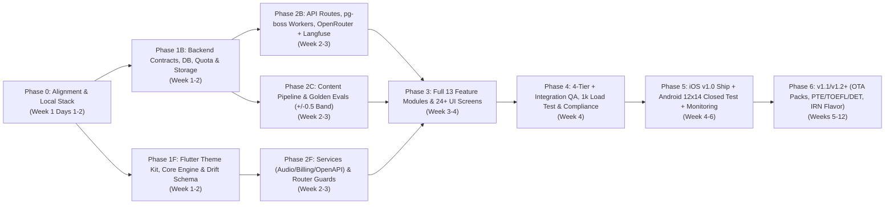

# Mockza — Master Engineering & Product Implementation Plan

> **Scope:** Full end-to-end execution plan for **Mockza** across **Flutter Client (`app/`)**, **TypeScript Async Backend (`backend/`)**, **Clean-Room Content & AI Evals (`content-pipeline/`, `evals/`)**, **Testing & CI/CD**, and **Store Launch (`v1.0` GLB MVP -> `v1.1+` Expansion)**.
>
> **Authoritative Source Specs:**
> - Product & Unit Economics: [PDR.md](./PDR.md) | [UI-UX-TLDR.md](./UI-UX-TLDR.md)
> - Architecture Decisions: [ADR.md](./ADR.md) | [proposed_backend.md](./proposed_backend.md)
> - UI Design System & Concepts: [design.md](./design.md) | [ui_designs/README.txt](./ui_designs/README.txt) (`01`–`24` screens)
> - Future Domestic Flavor Boundary: [ADR-Iran.md](./ADR-Iran.md) | [PDR-Iran.md](./PDR-Iran.md)

---

## 1. Current Baseline Audit & Known Misalignments to Resolve First

Before implementing features, every team/agent must understand **what already exists in the monorepo** versus **what is currently stubbed or misaligned** against `PDR.md`, `ADR.md`, and `design.md`.

### 1.1 Inventory: What Exists vs. What Must Be Completed

| Area | Already in Repository Baseline | Remaining Work to Reach v1.0 Production |
| :--- | :--- | :--- |
| **Root & Gates** | [compose.yaml](../compose.yaml), [Makefile](../Makefile), [.env.example](../.env.example), [scripts/check_all.sh](../scripts/check_all.sh), [.github/workflows/ci.yml](../.github/workflows/ci.yml) (containerized), `.flutter-version` (`3.47.9`), `.dockerignore`/`.containerignore`, `README.md` | Expand `ci.yml` with OpenAPI Dart parity gate, `content-pipeline` IP checks, Android `.aab` & macOS `.ipa` release jobs + symbol archiving. |
| **Container Runtime Stack** | [app/Containerfile](../app/Containerfile) + [app/nginx.conf](../app/nginx.conf) (`3.47.9` Web `:45280`), [backend/Containerfile](../backend/Containerfile) (`api :45281`, `worker`, `migrator`, `cli`, `toolchain`), PostgreSQL 16 (`:45432`), PgBouncer (`:45433`), SeaweedFS (`:45833/:45933`), Docker & Podman compatible | Provision remote production R2/CDN buckets, TLS ingress/reverse proxy, Prometheus/Langfuse alerting, and `k6` 1k-user benchmark script. |
| **Flutter Architecture** | Single-package Feature-First MVVM (`app/lib/core`, `data`, `services`, `routing`, `theme`, `l10n`, `features/*`), Riverpod 3.x composition root ([bootstrap.dart](../app/lib/bootstrap.dart), [providers.dart](../app/lib/providers.dart)), `very_good_analysis` `11.0.0` | Wire `CrashLog` file sink at boot, `WidgetsBindingObserver` lifecycle autosave/day-rollover flush, deferred post-frame `warmUp()`, and real platform service overrides. |
| **Flutter Theme & UI Kit** | Skeleton tokens ([primitives.dart](../app/lib/theme/primitives.dart), [app_colors.dart](../app/lib/theme/app_colors.dart)) & basic shell ([app_scaffold_shell.dart](../app/lib/theme/components/app_scaffold_shell.dart)) | **Replace placeholder Tailwind colors** with canonical `design.md` Dark (`#0C0F19`, `#111522`, `#191D2D`, `#9580FF`, `#70BEFF`, `#AC91FF`, `#66DBB5`, `#F2C16B`, `#FF949C`) + Light theme, `Inter` tabular typography scale, custom gradient `"M"` SVG mark, **Lucide** icon family, and all 30+ `design.md` Sec. 5 components. |
| **Flutter Local DB (`drift`)** | 7 tables (`UserProfiles`, `ExamPacks`, `ExamAttempts`, `AudioRecordings`, `VocabCards`, `DailyStudyLogs`, `OutboxSyncQueue`), 4 DAOs, 5 repos, Web preview stub ([connection_web.dart](../app/lib/data/db/connection_web.dart)) | Add `WritingDrafts`, `ReadingAnnotations`, `VocabReviewLogs`; migrate `easeFactor` (`Real`) -> `easeFactorMilli` (`Int` `>= 1300`); enforce relative disk paths, `WAL` + `synchronous = FULL` + `busy_timeout = 5000` pragmas; implement keyset cursor pagination, `OutboxSyncQueue` processor, and bundled starter seeds (`300–500` vocab cards + sample Reading/Listening packs). |
| **Flutter Routing & Features** | `GoRouter` with 4-tab `StatefulShellRoute`, top-level stub routes, 13 placeholder feature modules + `9/9` unit/widget tests | Refactor to `ADR-005` path-param routes, add `redirect` onboarding guard + `PopScope` active-test exit guards, and build all **24+ production screens** matching [ui_designs/00_Contact_Sheet.jpg](./ui_designs/00_Contact_Sheet.jpg) + `Settings` + `Paywall` + `Full Mock`. |
| **Backend Contracts & DB** | `pnpm` workspace (`tsc -> dist/` + `--conditions=development` dev scripts), `@hono/zod-openapi`, Drizzle 5-table schema + initial SQL migration (`0000_wakeful_proudstar.sql`), compiled `migrate.ts` & `init-buckets.ts`, pure rubric/quota helpers, PgBouncer + SeaweedFS `compose.yaml` (`7/7` Vitest tests) | Add `users`/`account_links`, atomic `quota_reservations` & monthly ledger, `ai_question_explanations` cache, `catalog_packs` provenance table, forward-only follow-up SQL migrations, extended `EvaluationOutputSchema` (`transcriptSegments`, `inlineEdits`, `modelRewrite`, `vocabUpgrades`), OpenAPI -> Dart client generation. |
| **Backend API & Workers** | Route/middleware skeletons returning stub JSON in `apps/api`; `pg-boss` boot loop in `apps/worker`; placeholder `6.5` graphs in `packages/ai` | Replace all API stubs with DB-backed queries, HMAC RevenueCat webhook + REST fallback, App Attest/Play Integrity verification, S3 `presign` + `HeadObject` checks, real OpenRouter multimodal/text LangGraph pipelines with Zod repair loops, `ffmpeg` WAV fallback, Langfuse PII masking, and 30-day audio purge cron. |

### 1.2 Critical Spec Discrepancies to Fix Immediately in Phase 0

| # | Current Code Value | Authoritative Spec Value | Fix Location |
| :--- | :--- | :--- | :--- |
| **D1** | `quota.ts`: `FREE_DAILY_SPEAKING_QUOTA = 2`, `PRO_DAILY_SPEAKING_QUOTA = 30` | `PDR.md Sec. 10` & `proposed_backend.md Sec. 2`: **Free = 1 lifetime AI diagnostic** (Speaking OR Writing), **Pro = 10 Speaking + 10 Writing/day & 150/month cap** | [backend/packages/domain/src/quota.ts](../backend/packages/domain/src/quota.ts), [backend/apps/api/src/middleware/quota.ts](../backend/apps/api/src/middleware/quota.ts) |
| **D2** | *(Baseline Fixed in Env/Storage)* `MAX_AUDIO_MB=5`, `AUDIO_TTL_DAYS<=30`, `PG_PGBOUNCER`, and `S3_PUBLIC_ENDPOINT` + `createPublicSigningS3Client` are now wired | Still add remaining `ADR-007` env tuning (`PG_POOL_MAX`, `WORKER_CONCURRENCY`, `OPENROUTER_NO_RETENTION`, `REVENUECAT_API_KEY`, `SSE_ENABLED`) + wire DB queries via `createDbClient` | [backend/packages/config/src/env.ts](../backend/packages/config/src/env.ts), [backend/packages/storage/src/s3-client.ts](../backend/packages/storage/src/s3-client.ts) |
| **D3** | `app_colors.dart` / `primitives.dart`: Tailwind palette (`#0B1220`, `#10B981`, `#4F46E5`) | `design.md Sec. 2 & 12`: Canonical palette (`#0C0F19`, `#191D2D`, `#9580FF`, `#70BEFF`, `#AC91FF`, `#66DBB5`, `#F2C16B`, `#FF949C`) + Material/Lucide consistency | [app/lib/theme/primitives.dart](../app/lib/theme/primitives.dart), [app/lib/theme/app_colors.dart](../app/lib/theme/app_colors.dart) |
| **D4** | `routes.dart`: static `/practice/speaking` & `/attempts/:attemptId` | `ADR-005`: `/practice/setup/:skill`, `/speaking/:examId`, `/writing/:taskId`, `/reading/:packId`, `/listening/:packId`, `/micro-drill/:drillId`, `/results/:attemptId`, `/vocabulary/review`, `/vocabulary/:wordId`, `/progress/skill/:skill`, `/progress/attempts` | [app/lib/routing/routes.dart](../app/lib/routing/routes.dart), [app/lib/routing/app_router.dart](../app/lib/routing/app_router.dart) |
| **D5** | `core_tables.dart`: `VocabCards.easeFactor` (`RealColumn`) & missing `WritingDrafts` / `ReadingAnnotations` | `ADR-006` / `ADR-013`: integer `easeFactorMilli` (`2500`, floor `1300`), UTC/serial calendar days, `WritingDrafts`, `ReadingAnnotations`, `VocabReviewLogs` | [app/lib/data/db/tables/core_tables.dart](../app/lib/data/db/tables/core_tables.dart) |

---

## 2. Master Phase Sequencing & Parallel Workstreams

### Non-Negotiable Cross-Team Engineering Contracts
1. **Static Boundary Gate (`./scripts/check_all.sh`):** Must stay green after every task — pure `lib/core/` (zero Flutter/IO/`DateTime.now()`), `drift` confined to `lib/data/`, raw theme constants confined to `lib/theme/`, `MethodChannel` confined to `lib/services/native/`, zero sibling imports between `lib/features/*`, Biome + strict TypeScript across `backend/`.
2. **File & Function Complexity Budgets (`ADR-002`):** Dart files `<= 300` lines, widget `build()` `<= 80` lines, methods `<= 30` lines, positional params `<= 3`.
3. **Zero Silent Work Loss (`PDR NFR-004`):** Writing autosaves every `500ms` + on lifecycle background; Speaking saves `.m4a` locally with `pending_upload` status before presigned PUT; Reading/Listening/Vocab execute 100% offline.
4. **Concurrency & Cost Protection (`PDR Sec. 5.3 & 10`):** Target **1,000 concurrent active users** safely behind PgBouncer connection pooling, `202 Accepted` async jobs, jittered exponential backoff polling/SSE, Cloudflare R2 CDN pack offloading (zero API byte streaming), and atomic Postgres quota reserve/refund.

---

## 3. PART I — Backend Plan (`backend/`)

### Epic B1: Environment, Container-First Infra & PostgreSQL / Drizzle Storage Layer
**Goal:** Operate every backend, database, queue, storage, and Web service inside pinned multi-stage containers (`Containerfile`/`compose.yaml`) with durable Postgres 16 + PgBouncer + SeaweedFS/R2 persistence, non-colliding host ports, and 8 GiB RAM safety.

- **B1.1 Fix & Harden Config Schema (`backend/packages/config/src/env.ts`)**
  - *(Baseline Done)* `PG_PGBOUNCER` (`default('false')`), `S3_PUBLIC_ENDPOINT`, `AUDIO_TTL_DAYS` (`max(30).default(30)`), and `MAX_AUDIO_MB` (`default(5)`) are enforced and covered by [env.test.ts](../backend/packages/config/src/__tests__/env.test.ts).
  - *(Remaining)* Add `PG_POOL_MAX` (`default(20)`), `WORKER_CONCURRENCY` (`default(15)`), `OPENROUTER_NO_RETENTION` (`default(true)`), `REVENUECAT_API_KEY`, `APPLE_CLIENT_ID`, `GOOGLE_CLIENT_ID`, `SSE_ENABLED` (`default(false)`).
- **B1.2 Complete PostgreSQL 16 Schema (`backend/packages/db/src/schema.ts`)**
  - Extend `devices`: add `appVersion`, `linkedUserId`, `freeDiagnosticUsed` (`boolean().default(false)`), `lastAttestedAt`.
  - Add `users` & `accountLinks`: `userId` PK, `provider` (`apple` | `google`), `providerSubject` (unique), linked `deviceId` array / FK so reinstalling or signing in restores Pro & quota history.
  - Extend `entitlements`: add `originalAppUserId`, `productId` (`mockza_cram_weekly`, `mockza_pro_monthly`, `mockza_quarterly`), `graceUntil`, `lastVerifiedAt`.
  - Replace/expand `usageCounters` with **`quotaReservations` & `monthlyQuotaCounters`**:
    - `quotaReservations`: `reservationId` PK, `attemptId` unique, `accountKey`, `skill` (`speaking` | `writing`), `utcDay`, `utcMonth`, `status` (`reserved` | `committed` | `refunded`), `isDiagnostic`, `createdAt`, `updatedAt`.
    - `dailyQuotaUsage` & `monthlyQuotaUsage`: atomic upsert increment/decrement inside Serializable/Row-Locked transactions.
  - Extend `evaluationJobs`: `idempotencyKey` (`attemptId`), `accountKey`, `packId`, `examId`, `taskType`, `status` (`queued` | `processing_audio` | `evaluating` | `completed` | `failed`), `stageDetail`, `inputJson` (masked or hash reference), `resultJson`, `latencyMs`, `tokenUsageJson`, `estimatedCostUsdMicros`, `attemptsCount`, composite indexes `(accountKey, createdAt)` and `(status, updatedAt)`.
  - Add `aiQuestionExplanations`: composite PK `(questionId, packVersion)` caching `explanationJson` for Pro *"Ask AI Why?"* so identical Reading/Listening questions incur only 1 LLM call globally.
  - Add `catalogPacks`: `packId` PK, `edition` (`glb` | `irn`), `examId`, `skill`, `version`, `sha256`, `byteLength`, `cdnRelativePath`, `contentOrigin`, `humanQaReviewed`, `isFreeSample`, `isPublished`, `publishedAt`.
  - Add `webhookEvents` (`eventId` PK for RevenueCat deduplication) and `questionFlags` (user ambiguity feedback `questionId`, `packId`, `reason`, `note`, `deviceId`).
- **B1.3 Drizzle Migrations, Compiled Workspaces & Connection Pooling (`backend/packages/db/`)**
  - *(Baseline Done)* Generated `0000_wakeful_proudstar.sql` (`drizzle.config.ts`), added compiled `migrate.ts` (`drizzle-orm/postgres-js/migrator`), configured `tsconfig.build.json` + `"development"`/`"default": "./dist/index.js"` conditional exports across all 10 workspaces, and added `DbClientOptions { max, prepare }` to [client.ts](../backend/packages/db/src/client.ts).
  - *(Remaining)* Wire route handlers & worker DB access to pass `prepare: !env.PG_PGBOUNCER`, add idle/connect timeouts + `checkDbHealth()`, generate forward-only `0001+` migrations as B1.2 tables land, and write DB integration tests covering FK cascades, `(attemptId)` idempotency, and concurrent quota locks.
- **B1.4 Container-First Compose Stack & S3 Bucket Initialization ([compose.yaml](../compose.yaml), [backend/Containerfile](../backend/Containerfile))**
  - *(Baseline Done)* Unified `name: mockza` stack runs `postgres:16-alpine` (`127.0.0.1:45432`), `edoburu/pgbouncer:v1.24.1-p1` (`127.0.0.1:45433`, transaction pooling -> `postgres:5432`), `chrislusf/seaweedfs:3.79` (`127.0.0.1:45833/:45933`), one-shot `s3-init` (`mockza-audio-private` via compiled [init-buckets.ts](../backend/packages/storage/src/init-buckets.ts)), one-shot `migrate`, slim non-root `api` (`0.0.0.0:45281`, pooled via PgBouncer), `worker` (+ `ffmpeg`, direct `postgres:5432` for `pg-boss` `LISTEN/NOTIFY`), and `web` (`0.0.0.0:45280`, unprivileged `nginx:1.27-alpine`), with `mem_limit`/`cpus` bounds and `Makefile` sequential builds (`make build up`).
  - *(Remaining)* Extend `s3-init` (`S3_EXTRA_BUCKETS=mockza-packs-public`) + S3 CORS rules for browser/mobile `PUT`/`GET` pack uploads and test physical LAN device upload via host IP `S3_PUBLIC_ENDPOINT`.

### Epic B2: Shared Domain Rules, Zod Contracts & OpenAPI Dart Codegen
**Goal:** Establish a single source of truth shared between `apps/api`, `apps/worker`, tests, and the Flutter app.

- **B2.1 Align Domain Quota & Band Rules (`backend/packages/domain/`)**
  - Update `quota.ts`: implement exact `PDR.md Sec. 10` matrix:
    - Free tier: `1` lifetime diagnostic across (`speaking` OR `writing`), `20` vocab reviews/day (enforced locally + tracked).
    - Pro tiers: `10` Speaking + `10` Writing per UTC day, and **`150` total AI evaluations per calendar month** (`resetAt` ISO timestamps calculated explicitly).
    - Pure helper `evaluateQuotaEligibility(...)` returning structured allowance & remaining counts.
  - Update `rubrics.ts`: add IELTS Task 2 2× overall writing weighting helper (`(task1 + 2 * task2) / 3` rounded to `0.5`), criterion validation rules for `TA/TR/CC/LR/GRA` (Writing) and `FC/LR/GRA/PR` (Speaking), and multi-exam scale metadata (`ielts_0_9`, future `pte_10_90`, `toefl_0_120`, `det_10_160`).
  - Expand `errors.ts`: standardize machine-readable error codes (`VALIDATION_ERROR`, `UNAUTHORIZED`, `ATTESTATION_REQUIRED`, `EDITION_FORBIDDEN`, `ENTITLEMENT_REQUIRED`, `QUOTA_EXCEEDED`, `ATTEMPT_CONFLICT`, `UPLOAD_NOT_FOUND`, `UPLOAD_TOO_LARGE`, `MODEL_UNAVAILABLE`, `NOT_FOUND`, `INTERNAL_ERROR`).
- **B2.2 Expand Zod Contracts (`backend/packages/contracts/src/schemas.ts`)**
  - Auth: `AnonymousAuthRequestSchema` / `AnonymousAuthResponseSchema` (`deviceId`, `accessToken`, `expiresAt`), `LinkAccountRequestSchema` (`provider`: `apple` | `google`, `idToken`) / `LinkAccountResponseSchema`.
  - Uploads: `PresignUploadRequestSchema` (`attemptId`, `partIndex`, `byteLength <= 5MB`, `contentType: 'audio/mp4'`, optional `sha256Base64`), `PresignUploadResponseSchema`.
  - Evaluate Writing: include `examId` (`ielts_academic` | `ielts_general`), `taskType`, `promptTitle`, `promptBody`, `essayText`, `durationSeconds`, `wordCount`.
  - Evaluate Speaking: include `examId`, `partSequence` (`part1` | `part2` | `part3` | `full` | `diagnostic`), `turns[]` (`partIndex`, `promptText`, `objectKey`, `durationMs`).
  - Full `EvaluationOutputSchema`:
    - `attemptId`, `overallBand`, `isEstimated: true`, `criteria[4]` (`code`, `label`, `band`, `evidenceExcerpt`, `feedbackNote`)
    - `transcriptSegments[]` (Speaking: `segmentId`, `partIndex`, `startMs`, `endMs`, `text`, `annotations[]`: type `pause` | `filler` | `grammar` | `phrasing`, `suggestion`, `rationale`)
    - `inlineEdits[]` (Writing: `editId`, `startOffset`, `endOffset`, `originalText`, `suggestedText`, `criterionCode`, `rationale`)
    - `modelRewrite`: `{ targetBandDelta: 1.5, title, rewrittenText, preservedIdeasNote }`
    - `vocabUpgrades[]`: `{ id, term, ipa, definition, contextSentence, paraphrases[], bandRationale }`
    - `recommendedDrill`: `{ drillType, weakestCriterionCode, title, durationMinutes: 3 }`
    - `modelId`, `rubricVersion`.
  - Question Explainer: `ExplainQuestionRequestSchema` (`packId`, `packVersion`, `questionId`, `skill`, `questionType`, `userAnswer`), `ExplainQuestionResponseSchema` (`cached`, `explanation`, `evidenceQuote`, `whyWrongOptions[]`).
  - Jobs, Quota, Catalog, Flags, Telemetry: `JobStatusResponseSchema` (with `stage`: `queued` | `transcoding` | `evaluating` | `repairing` | `completed` | `failed`, optional `result`, `quotaRefunded`), `QuotaStatusResponseSchema`, `CatalogManifestResponseSchema`, `FlagQuestionRequestSchema`, `TelemetryBatchRequestSchema`.
- **B2.3 OpenAPI Export & Dart Client Generation (`packages/contracts/src/export-openapi.ts`)**
  - Write OpenAPI 3.1 JSON artifact (`backend/packages/contracts/dist/openapi.json` or committed spec) during build.
  - Configure Dart client generator (e.g., `openapi-generator-cli` `dart-dio` or custom typed mapper script) generating files exclusively into `app/lib/services/network/generated/`, plus a CI parity check comparing `export-openapi.ts` output against committed spec.

### Epic B3: Object Storage (`packages/storage`) & Clean-Room Content CLI (`content-pipeline`)
- **B3.1 Fix & Harden S3 Operations (`backend/packages/storage/`)**
  - Update `s3-client.ts`: build dual clients when needed (`internalClient` using `S3_ENDPOINT` for workers + `signingClient` using `S3_PUBLIC_ENDPOINT` for presigning client URLs).
  - Update `presign.ts`: lock key format `users/${deviceId}/clips/${attemptId}/part-${partIndex}.m4a`, enforce exact `ContentType: 'audio/mp4'` & `ContentLength`, short `300s` expiry.
  - Add `verify.ts`: `verifyUploadedAudioObject(objectKey, expectedDeviceId, maxBytes)` via `HeadObject` before worker enqueue so spoofed keys or `0`-byte/oversized objects are rejected with `400/404`.
  - Complete `purge.ts`: batch paginated `ListObjectsV2` / DB query for `audio_assets WHERE expires_at <= now() AND purged_at IS NULL` + `DeleteObjects` in chunks of 1,000 + DB `purgedAt` mark + instant user-scoped purge `deleteAllUserAudio(deviceId)` for `DELETE /v1/account`.
- **B3.2 Build Clean-Room Content Authoring & Packaging CLI (`backend/content-pipeline/`)**
  - Define full pack schemas for Reading (`passages[]`, paragraph IDs, word counts `750–900`, `questions[]` with `questionType`, `maxWords`, `acceptedVariants[]`, `evidenceSpan: { paragraphIndex, startOffset, endOffset, exactQuote }` or explicit `notGivenOmissionReason`), Listening (`sections[]`, speaker accents `UK|AU|US|NZ`, script dialogue turns, distractor markers `[timestampMs, correctionType]`, `.m4a` ref), Writing (`task1` SVG diagram string + rubric topic + `task2`), Speaking (`part1..3` sets + follow-ups), and Vocab starter cards.
  - Implement strict pre-publish validator: reject if `humanQaReviewed !== true`, reject unsupported `contentOrigin` (ban `CC BY-NC` / Cambridge / ETS strings via blocklist heuristic), verify UTF-16 `evidenceSpan` substring exact match against passage text, compute SHA-256 of JSON & audio `.m4a`, and check total Reading/Listening question counts & band table coverage.
  - Implement multi-speaker TTS `.m4a` packaging script (generating scripted multi-accent `16 kHz`/`44.1 kHz` normalized `.m4a` tracks + distractor timestamp map) and R2/SeaweedFS catalog uploader that upserts `catalog_packs` and invalidates CDN manifest cleanly.

### Epic B4: Hono API Routes & Security Middleware (`backend/apps/api`)
- **B4.1 Cryptographic Session Auth & Account Linking (`middleware/auth.ts`, `routes/auth.ts`)**
  - Upgrade `POST /v1/auth/anonymous` to upsert `devices`, sign a verifiable JWT (`HS256`/`EdDSA` with `deviceId`, `edition`, `exp`) using `env.JWT_SECRET` rather than echoing raw UUID as bearer token.
  - Implement `requireDeviceAuthMiddleware` to verify JWT signature, expiry, `edition === env.EDITION`, and load active account key (`linkedUserId ?? deviceId`).
  - Add `POST /v1/auth/link`: verify Sign in with Apple (`JWKS` verification against `https://appleid.apple.com/auth/keys`) or Google ID Token, create/merge `users` + `account_links`, transfer entitlements & attempt ownership safely inside a DB transaction, issue refreshed token.
- **B4.2 App Attestation & Rate-Limiting (`middleware/attest.ts`, new `middleware/rate-limit.ts`)**
  - Implement iOS App Attest assertion / challenge (`GET /v1/auth/challenge`) and Android Play Integrity verdict verification in `middleware/attest.ts` (enforced on `/v1/auth/*` and `/v1/evaluate/*` when `APP_ATTEST_ENFORCED=true`; cleanly bypassed with explicit structured warning only in dev/test).
  - Add lightweight sliding-window IP/device rate limiting (`429`) on auth/upload/flag routes to protect against burst abuse at 1k users.
- **B4.3 Atomic Quota Reservation & Refund (`middleware/quota.ts` + DB service)**
  - Replace hardcoded `usedToday: 0` with an atomic PostgreSQL transaction:
    1. Resolve current entitlement (`entitlements.isPro && (!expiresAt || expiresAt > now())`); if expired/missing and header `X-Check-Billing-Fallback: true`, query RevenueCat REST API (`GET /v1/subscribers/:appUserId`) once and sync Postgres (`ADR-010`).
    2. Enforce entitlement tier: free users blocked (`402 ENTITLEMENT_REQUIRED`) once `freeDiagnosticUsed === true`.
    3. Pro users checked against daily (`10 Speaking` / `10 Writing`) + monthly (`150` combined) limits inside `SELECT ... FOR UPDATE` / atomic conditional `UPDATE`.
    4. Insert `quota_reservations(status='reserved')` keyed by `attemptId` **before** enqueueing to `pg-boss`; return existing `jobId` idempotently (`202`) if `attemptId` already submitted!
- **B4.4 Real Route Implementations (`apps/api/src/routes/`)**
  - `POST /v1/uploads/presign`: enforce Pro or unused Free Diagnostic, call `createAudioPresignUrl` with `S3_PUBLIC_ENDPOINT`, insert pending `audio_assets` row with `expiresAt = now() + AUDIO_TTL_DAYS`, return presigned URL.
  - `POST /v1/evaluate/writing` & `POST /v1/evaluate/speaking`: validate request + `Idempotency-Key`, verify S3 `.m4a` existence/size for Speaking (`HeadObject`), atomically reserve quota + insert `evaluation_jobs(status='queued')` + enqueue `pg-boss` job with `singletonKey: attemptId`, return `202 Accepted`. Rollback reservation cleanly if enqueue throws.
  - `POST /v1/evaluate/explain-question`: verify Pro entitlement; query `ai_question_explanations` cache by `(questionId, packVersion)` -> if hit, return `200 OK` immediately (`0` quota burn, `$0` LLM); if miss, enqueue/deduplicate `explain.question` job and return `202`.
  - `GET /v1/jobs/:jobId` (and optional `GET /v1/jobs/:jobId/events` SSE): authorize `accountKey`, return live stage, latency, or completed validated `EvaluationOutputSchema` JSON, or structured failure + `quotaRefunded: true`.
  - `GET /v1/quota/me`: return exact daily Speaking used/limit, daily Writing used/limit, monthly used/limit, free diagnostic status, and reset UTC timestamps.
  - `GET /v1/catalog/manifest`: query published `catalog_packs WHERE edition = env.EDITION`, compute ETag, emit cache headers (`Cache-Control: public, max-age=300`) pointing exclusively to R2/SeaweedFS CDN URLs.
  - `POST /v1/webhooks/revenuecat`: verify HMAC/Bearer secret, deduplicate via `webhook_events.eventId`, map `INITIAL_PURCHASE` / `RENEWAL` / `CANCELLATION` / `EXPIRATION` / `BILLING_ISSUE` / `TRANSFER` to `entitlements` table atomically.
  - `DELETE /v1/account`: inside transaction delete user/device/attempts/drafts/entitlements/usage records, purge all S3 objects under `speaking/<deviceId>/`, call RevenueCat subscriber delete/cleanup if configured, emit audit count, return `200`.
  - `POST /v1/feedback/question-flag` & `POST /v1/events`: store question dispute reports & batched client KPI telemetry.
- **B4.5 Graceful Shutdown & Health Checks (`apps/api/src/server.ts`)**
  - Add `/v1/health/ready` verifying Postgres connectivity (`SELECT 1`) + S3 reachability; handle `SIGINT`/`SIGTERM` closing HTTP connections + `pg-boss` producer + Postgres pool cleanly within shutdown timeout.

### Epic B5: `pg-boss` Workers, LangGraph AI Pipelines & Evals (`apps/worker`, `packages/ai`, `evals`)
- **B5.1 Production `pg-boss` Worker Pool (`apps/worker/src/index.ts`)**
  - Configure `pg-boss` with `useListenNotify: true`, schema partition/autovacuum migration tuning, per-queue worker concurrency (`teamSize`/`batchSize` capped `10–15` per container to bound V8 memory & audio buffers), `retryLimit: 3`, exponential backoff, and heartbeat extension for longer audio jobs.
  - Wrap job handlers with explicit DB stage transitions (`queued` -> `processing_audio` -> `evaluating` -> `completed` | `failed`) + **automatic transactional quota refund (`status = 'refunded'`)** when a job exhausts all retries!
  - Register scheduled cron job `maintenance.purge-audio` (hourly) invoking `purge.ts` for expired `audio_assets` (`<= 30 days`).
- **B5.2 OpenRouter No-Retention Client & Model Registry (`packages/ai/src/models/`)**
  - Pin strict production models in `models/registry.ts` with **no fallback models** (resolving `proposed_backend.md` Sec. 6):
    - **Audio / Speaking:** **`google/gemini-3.1-flash-lite`** (`supportsAudioInput: true`, native `.m4a`, `input_audio` part placed **before** text prompt).
    - **Text-Only (Writing, `explain-question`, Text Drills):** **`deepseek/deepseek-v4.1-flash-1017`**.
    - Store explicit capability metadata per model (`id`, `supportsAudioInput`, `acceptedAudioFormats: ('m4a')[]`, `supportsStructuredJsonSchema`, `inputCostPer1M`, `outputCostPer1M`, `calibrated`).
  - Build OpenRouter HTTP / LangChain adapter passing **`provider: { data_collection: 'deny' }` (no-retention / no-training routing)** and explicit timeout/abort budgets (`25s` per attempt; retries exhausted -> `failed` + automatic quota refund).
- **B5.3 Audio Preparation & Silence Trimming (`packages/ai/src/audio/processor.ts`)**
  - Stream `.m4a` object from S3 (enforcing byte limit `<= MAX_AUDIO_MB` before buffering), optionally trim leading/trailing silence (`16 kHz` mono `32 kbps` AAC via `ffmpeg` when beneficial) to reduce billed audio tokens, and encode to base64 for OpenRouter `input_audio`.
  - Send `.m4a` directly to `google/gemini-3.1-flash-lite` with zero WAV transcode; keep `ffmpeg` in `worker` solely for silence trimming or normalizing malformed client audio streams.
- **B5.4 LangGraph Grading Flows (`packages/ai/src/graphs/`)**
  - `grade-writing.ts` (uses **`deepseek/deepseek-v4.1-flash-1017`**): StateGraph (`prepare_prompt` -> `invoke_model` -> `zod_validate` -> `repair_json_if_needed` (max 1–2 repair passes) -> `compute_server_band` -> `validate_evidence_offsets`) producing complete criterion scores, verbatim span offsets for `inlineEdits[]`, `+1.5` personalized rewrite keeping user's own arguments, and `vocabUpgrades[]`.
  - `grade-speaking.ts` (uses **`google/gemini-3.1-flash-lite`** with **`[input_audio, text]`** message ordering): StateGraph (`fetch_and_encode_audio` -> `invoke_multimodal_audio_model` -> `zod_validate` -> `repair_json_if_needed` -> `compute_server_band`) producing verbatim `transcriptSegments[]` with timestamps + hesitation/filler/grammar annotations (`pause`, `filler`, `grammar`, `phrasing`), spoken model answer, `vocabUpgrades[]`, and recommended `3-min` micro-drill.
  - `explain-question.ts` (uses **`deepseek/deepseek-v4.1-flash-1017`**): lightweight graph producing crisp rationale + cited passage evidence sentence + why each distractor option is incorrect, stored into `ai_question_explanations`.
  - Enforce server-side `computeOverallBandFromCriteria` (`@mockza/domain`) so the model never hallucinates arithmetic averages!
  - Configure `langgraph.json` strictly for `langgraphjs dev` inspection during prompt engineering (`NODE_ENV=development` only).
- **B5.5 Langfuse Cloud Tracing & Strict PII Masking (`packages/ai/src/observability/langfuse.ts`)**
  - Wire `@langfuse/langchain` (`CallbackHandler`) + `@langfuse/otel` with configurable EU/US `LANGFUSE_HOST`.
  - Implement pre-export **masking filter** scrubbing emails, device UUIDs, phone numbers, raw base64 audio bytes, and truncating/anonymizing student essay/transcript text before spans leave the worker (`ADR-011`).
  - Record model ID, `rubricVersion`, token counts, latency breakdown, repair count, and estimated USD cost per trace.
- **B5.6 Calibration Benchmarks (`backend/evals/`)**
  - Assemble **40+ annotated golden IELTS samples** across Band `4.5–8.5` (Writing Task 1 Academic charts, Task 2 essays, Speaking Parts 1–3 synthetic/licensed voice samples) stored in `evals/datasets/`.
  - Implement `evals/src/run-evals.ts` calling the exact LangGraph graphs via OpenRouter (or recorded fixtures in CI), pushing Langfuse experiment scores and asserting:
    - `>= 80%` of outputs within **`±0.5` band** of human rubric anchor,
    - `100%` valid Zod schema compliance & non-empty cited `evidenceExcerpt`s,
    - P95 latency `<= 10s` Writing / `<= 12s` Speaking and cost within unit-economics budget (`PDR Sec. 10.2`).

---

## 4. PART II — Flutter App Plan (`app/`)

### Epic F1: Universal Design System & Reusable Component Kit (`app/lib/theme/`)
**Goal:** Replace placeholder styling with the exact calm academic visual grammar in [design.md](./design.md) & [ui_designs/](./ui_designs/Screens/), enforcing strict raw-value containment (`./scripts/check_all.sh` Gate 7).

- **F1.1 Canonical Dark & Light Color Tokens ([primitives.dart](../app/lib/theme/primitives.dart), [app_colors.dart](../app/lib/theme/app_colors.dart))**
  - Migrate exact CSS variables from `design.md Sec. 12`:
    - Dark: `bg #0C0F19`, `bgRaised #111522`, `surface #191D2D`, `surfaceAlt #20243A`, `surfaceHover #292E47`, `border #353B52`, `borderStrong #4B5270`, `text #F6F8FC`, `textSecondary #B6BDCD`, `textTertiary #949DB2`, `accent #9580FF`, `accentPressed #7A65DF`, `accentContrast #090B14`, `focus #A8CFFF`, `blue #70BEFF` (Speaking/Listening), `violet #AC91FF` (Writing), `mint #66DBB5` (Reading), `amber #F2C16B` (Vocab/Warning), `success #6EE2BA`, `danger #FF949C`, `track #34394E` + `*Bg` semantic fills (`#15362F`, `#3C301B`, `#3B2029`).
    - Gradients (`AppGradients` `ThemeExtension`): `primaryButton` (`110deg #6B8CFF -> #8D70F7`), `scoreFill` (`#6CCEFF -> #917AFB`), `heroCard` (`#222840 -> #1C2036 -> #28234C`), `actionCard` (`#252841 -> #211F38`). Enforced limit: max 1 hero card + 1 primary CTA gradient per viewport.
    - Light: exact `design.md Sec. 12` `[data-theme="light"]` palette (`#F7F8FC`, `#FFFFFF`, `#F0F2FA`, `#5E4CCF`, `#1968BD`, `#6049BA`, `#147E62`, `#956116`, `#B22A44`).
- **F1.2 Typography, Shapes, Motion & Icons ([app_typography.dart](../app/lib/theme/app_typography.dart), [app_shapes.dart](../app/lib/theme/app_shapes.dart), [app_motion.dart](../app/lib/theme/app_motion.dart))**
  - Bundle `Inter` font weights (`400`, `500`, `600`, `700`) or clean platform fallback with `FontFeature.tabularFigures()` on scores/timers and exact type scale (`72/0.95` Hero, `34/1.12` Headline, `24/1.18` Section, `18/1.30` Card Title, `29/1.12` Card Score, `16/1.50` Body, `14/1.45` Secondary, `12/1.45` Caption; `1.65–1.85` reading/writing line height).
  - Align spacing scale (`4, 8, 12, 16, 20, 24, 28, 32, 40`), radii (`10, 14, 18, 22, 26, 999`), `48×48` tap target minimum (`44×44` floor), `76px` bottom nav height, and `680px` max content width on tablets.
  - Add a Lucide Flutter icon package (e.g., `lucide_icons_flutter`) + custom vector `"M"` gradient wordmark SVG (`flutter_svg` or `CustomPainter` token) replacing mixed Material icons (`design.md Sec. 3`).
  - Ensure `AppMotion` checks `MediaQuery.disableAnimationsOf(context)` (`prefers-reduced-motion`) to collapse transitions cleanly.
- **F1.3 Core & Composite Component Library (`app/lib/theme/components/`)**
  - Implement/upgrade every reusable widget listed in `design.md Sec. 5` using small `const` classes:
    - *Primitives & Navigation:* `MzScaffold` (`standard`/`immersive`/`onboarding`), `BrandHeader` (M mark + exam switcher pill + settings button), `SectionHeader`, `MzCard` (`default`/`hero`/`action`/`interactive`), `IconWell`, `MzChip`, `PrimaryButton` / `SecondaryButton` / `MzIconButton`, `MzBottomSheet`, `StatusBanner`, `EmptyState`, `MzSkeleton`, `MzToast`, `MzFormField`, `MzTabBar`.
    - *Progress & Metrics:* `MetricHero` (`value`/`notYetEstimated`/`pending`/`offline`/`stale` + target tick), `SkillMetricCard`, `ScoreMeter` (scale-aware `min..max` + target line), `RecommendationCard`, `StudyWeekStrip` & `WeekDayTile`, `TrendChart` (accessible `CustomPainter` with screen-reader data table fallback), `AttemptListRow`, `CompareAttempts`.
    - *Practice, Reading & Vocabulary:* `TaskCard`, `TimerBar` (prep/response/exam/study states), `AudioLevelMeter` (waveform + mic states), `AudioPlayerBar` (Exam linear lock vs Study speed/seek), `TranscriptSegment` (pause/filler/grammar icons + underline, never hue alone), `AnnotatedText` (essay inline span highlighter + tap sheet), `EvidenceLink`, `VocabFlipCard`.

### Epic F2: Pure Dart Core Domain & Exam Spec Engine (`app/lib/core/`)
- **F2.1 Multi-Exam `ExamSpec` & Catalog Models (`app/lib/core/exams/`)**
  - Expand `ExamSpec` to define exam scales (`IELTS 0.0–9.0`, `PTE 10–90`, `TOEFL 0–120`, `DET 10–160`), labels (`Band` vs `Score`), section structures, strict Exam Mode rules vs Study Mode rules, and micro-drill definitions.
  - Add complete schemas for:
    - `ListeningPackSpec` (4 sections, accent metadata `UK|AU|US|NZ`, pre-audio reading seconds, segment timestamps, distractor highlights, `QuestionSpec`),
    - `ReadingPackSpec` (3 passages, ~750–900 words parsed into paragraphs, `TFNG` | `YNNG` | `MCQ` | `MatchingHeadings` | `SummaryGapFill`, `evidenceSpan`),
    - `WritingTaskSpec` (`task1Academic` w/ SVG diagram string + zoom caption, `task1General`, `task2Essay`, word minimums, timer seconds),
    - `SpeakingSessionSpec` (`part1` questions, `part2` cue card + bullet points, `part3` follow-up prompts, prep/speak durations),
    - `MicroDrillSpec` (`weaknessCode`, 5 quick-fire questions/rewrites, 180s timer).
- **F2.2 Harden `LocalObjectiveScorer` & `BandConversionTable`**
  - Verify normalization handles UK/US spelling pairs (`organisation`/`organization`, `colour`/`color`), numeric word equivalents (`2` <-> `two`, `1998`), apostrophes/hyphens, and strict `maxWords` cap (`"NO MORE THAN TWO WORDS AND/OR A NUMBER"` rejects `> maxWords` accurately).
  - Verify `BandConversionTable` supports both **IELTS Academic** (`<=40 -> 0.0..9.0`) and **IELTS General Training** Reading conversion differences cleanly (`ADR-008`).
- **F2.3 Enriched Domain Models & `Sm2Scheduler` Alignment (`app/lib/core/models/`, `core/vocab/`)**
  - Expand `WritingEvaluationResult` & `SpeakingEvaluationResult` (`criteria[]`, `transcriptSegments[]`, `inlineEdits[]`, `modelRewrite`, `vocabUpgrades[]`, `recommendedDrill`, `modelId`, `rubricVersion`, `isEstimated`).
  - Refactor `Sm2Scheduler` (`sm2_scheduler.dart`) & `VocabCard` model to use **`int easeFactorMilli`** (`initial = 2500`, `floor = 1300`) and **`int dueDaySerial`** + computed preview intervals (`Again 1m` / next session, `Hard`, `Good`, `Easy`) so `17_Vocabulary_Flashcard_Review.png` displays real dynamic intervals (`1m`, `6m`, `1d`, `4d`, etc.) deterministically.
  - Add pure helper `StudyMetricsCalculator` deriving Estimated Overall Band, per-skill averages, 30-day delta (`+0.5 this month` ONLY when sample size & history justify it per `design.md` rule #6), target percentage, and 7-day `StudyWeekStrip` completion state from database streams (never hardcoded).

### Epic F3: Drift Local Persistence, Single Write Path & Offline Sync (`app/lib/data/`)
- **F3.1 Schema Upgrade (`app/lib/data/db/tables/core_tables.dart` & `app_database.dart`)**
  - Add tables with `isStrict`:
    - `WritingDrafts` (`attemptId` PK FK cascade, `packId`, `taskType`, `draftText`, `wordCount`, `timerRemainingSec`, `updatedAtUtcMs`),
    - `ReadingAnnotations` (`annotationId` PK, `packId`, `passageIndex`, `startOffset`, `endOffset`, `colorCode` `'yellow'|'green'|'pink'`, `noteText`, `isDeleted`, `AuditColumns`),
    - `VocabReviewLogs` (`logId` PK, `cardId` FK cascade, `rating`, `reviewedDaySerial`, `reviewedAtUtcMs`).
  - Update `VocabCards`: migrate `easeFactor` -> `easeFactorMilli` (`IntColumn`), add `contextSentence`, `paraphraseHintsJson`, `usageNote`, `sourceSkill`, `sourceAttemptId`, `sourceRefLabel`, `dueDaySerial` (replacing ambiguous naming if needed).
  - Update `UserProfiles`: add `examId` (`ielts_academic`, `ielts_general`, etc.), `targetDateSerial` (nullable int), `onboardingCompleted` (`Bool`), `freeDiagnosticUsed` (`Bool`), `themeMode` (`system|dark|light`), `linkedEmail` (nullable), `appUserId`.
  - Update `ExamAttempts`: store `examId`, `startedAtUtcMs`, `completedAtUtcMs`, `durationSeconds`, `usedStudyMode`, add SQLite `CHECK` constraints + indexes for keyset cursor pagination `(updatedAt, attemptId)`.
  - Run `dart run build_runner build --delete-conflicting-outputs` and implement `MigrationStrategy.onUpgrade` cleanly (v1 -> v2).
- **F3.2 Pragmas, Relative Paths & Native Connection (`app/lib/data/db/connection_native.dart`)**
  - Pass `setup: (rawDb) { rawDb.execute('PRAGMA journal_mode = WAL;'); rawDb.execute('PRAGMA synchronous = FULL;'); rawDb.execute('PRAGMA foreign_keys = ON;'); rawDb.execute('PRAGMA busy_timeout = 5000;'); }` on every native database open (`ADR-006`).
  - Create helper `AppStoragePaths` in `data/` resolving `getApplicationSupportDirectory()` lazily at runtime while verifying every persisted string in `AudioRecordings.localFilePath` and `ExamPacks.localPath` is strictly relative (guard against iOS container UUID path rotation).
- **F3.3 Repositories, Seed Content & Offline Sync Outbox (`app/lib/data/repositories/`)**
  - Implement keyset-cursor pagination (`AttemptRepository.fetchHistoryPage({cursor, skillFilter, timeframeFilter, searchQuery, sortOrder, limit = 20})`).
  - Implement transactional methods: `WritingRepository/AttemptRepository.saveDraft500ms(...)`, `AttemptRepository.finalizeSpeakingAttemptWithAudio(...)` (atomic `.m4a` path + `pending_upload`), `AttemptRepository.enqueueAndPollRemoteGrading(...)`, `VocabRepository.captureCardFromFeedbackOrReading(...)` (`dueDaySerial = today`), `CatalogRepository.upsertDownloadedPack(...)`, `ReadingAnnotationRepository` (save/delete UTF-16 highlights + margin notes), `ProfileRepository.wipeAllLocalData(...)`.
  - Create `app/assets/seed/` containing the **1 bundled sample Reading JSON**, **1 bundled sample Listening JSON + starter `.m4a` (`<= 1.5 MB`)**, **Speaking Part 1–3 starter prompts**, **Writing Task 1 SVG + Task 2 starter prompts**, and **300–500 curated IELTS Vocab Paraphrase & Collocation cards** loaded atomically on first DB creation (`onCreate` / seed version check).
  - Build `OutboxSyncRunner` reading `OutboxSyncQueue` on connectivity restoration / app resume / manual retry button, ensuring 1-tap retry reuses client `attemptId` without losing work or double-charging quota.

### Epic F4: Native Gateways, Networking, Audio, Billing & Lifecycle (`app/lib/services/`)
- **F4.1 CrashLog, Lifecycle Flush & App Composition (`bootstrap.dart`, `app.dart`, `crash_log.dart`)**
  - Implement ring-buffered size-bounded log file in `appSupport/logs/crash.log` inside `CrashLog.open()` (called synchronously/early before `FlutterError.onError` and `PlatformDispatcher.instance.onError` per `ADR-004`).
  - Implement single `WidgetsBindingObserver` inside `App`: flush active writing draft / reading highlight buffer on `AppLifecycleState.inactive` & `paused`; re-evaluate `clockProvider` serial day on `resumed` (triggering Vocab due-queue refresh cleanly).
  - Defer heavy SDK initialization (`Purchases.configure`, `SecureIdentityService.bootstrapIfNeeded`, `OutboxSyncRunner.processPending`, optional cached CDN manifest check) into `WidgetsBinding.instance.addPostFrameCallback((_) => warmUp())` so cold start renders frame 1 `< 1.0s` (`NFR-001`).
- **F4.2 OpenAPI Client, Auth & App Attestation (`app/lib/services/network/`)**
  - *(Baseline Done)* `EditionConfig` reads `MOCKZA_API_BASE_URL` / `MOCKZA_CDN_BASE_URL` via `String.fromEnvironment`, allowing `app/Containerfile` Web builds to use same-origin Nginx reverse proxying (`/v1/`, `/openapi.json` -> `http://api:8787`) while native flavors default to HTTPS API endpoints.
  - Integrate generated OpenAPI Dart DTOs strictly inside `services/` mappers (never leaking DTO types above `services/` into `core/`, `data/`, or `features/`!).
  - Update `dio_client.dart` with `X-Edition`, `X-App-Version`, bearer token attachment + automatic anonymous auth refresh (`POST /v1/auth/anonymous`), attestation header interceptor (App Attest on iOS / Play Integrity on Android via quarantined `services/native/`), and structured mapping of backend error codes (`QUOTA_EXCEEDED`, `ENTITLEMENT_REQUIRED`, `EDITION_FORBIDDEN`, `ATTEMPT_CONFLICT`, etc.) into sealed `Failure` variants.
  - Extend `GradingGateway` (`enqueueSpeakingEvaluation`, `pollSpeakingResult` / SSE stream, `explainQuestion`, `fetchQuotaStatus`, `flagQuestion`) and implement real JSON deserializers replacing current `return const Ok(null)` stubs in [grading_gateway.dart](../app/lib/services/grading_gateway.dart).
- **F4.3 Upstream Audio Recorder (`audio_recorder_gateway.dart`) & Downstream Player (`audio_player_gateway.dart`)**
  - Recorder (`record` package): configure `AudioEncoder.aacLc`, `sampleRate: 16000`, `numChannels: 1`, `bitRate: 40000`, request/check OS mic permission cleanly, stream real RMS amplitude (`getAmplitude()`) for the pre-flight meter & live speaking waveform, verify file `> 0 bytes` & `<= 5 MB` before S3 `PUT` (streaming upload via presigned URL with progress callback). Include Web/desktop mock/MediaRecorder graceful fallback for Web preview.
  - Player (`just_audio`): support two strict policies (`ExamPlaybackMode` locking seek/pause/speed/replay vs `StudyPlaybackMode` allowing `0.85x`/`1.0x`/`1.25x`, scrubbing, replay) plus user self-recording playback synced to `TranscriptSegment` timestamps on `EvaluationReviewScreen`.
- **F4.4 Atomic CDN Pack Downloader (`asset_download_gateway.dart`)**
  - Implement streaming download to `<packId>.tmp`, verify byte-for-byte **SHA-256 checksum** (`package:crypto`) against manifest before atomic `rename` into `appSupport/mockza_packs/<packId>/`, emit `DownloadProgress`, remove stale corrupted `.tmp` files, return `DownloadIntegrityFailure` on hash mismatch.
- **F4.5 Monetization (`billing_gateway.dart`) & Telemetry (`telemetry_gateway.dart`)**
  - Implement `RevenueCatBillingGateway`: `fetchOfferings()` (mapping `mockza_cram_weekly`, `mockza_pro_monthly`, `mockza_quarterly` localized store prices without hardcoded strings), `purchasePackage(...)` updating DB entitlement + `isEntitledProvider` only after verified customer info, `restorePurchases()`, `logIn(userId)` / `logOut()` on account link/delete, offline cached entitlement grace check via `clockProvider`.
  - Implement `TelemetryGateway` logging all `PDR Sec. 5.3` events (`app_opened`, `onboarding_completed`, `diagnostic_completed`, `sample_completed`, `listening_pack_downloaded`, `vocab_card_saved`, `vocab_review_completed`, `paywall_viewed`, `purchase_succeeded`, `evaluation_submitted`) cleanly (no PII, batch POST to backend or privacy-safe analytics SDK).

### Epic F5: Routing, Navigation Shell & Active Session Protection (`app/lib/routing/`)
- **F5.1 Parameterized Routes & Pure Guards (`routes.dart`, `app_router.dart`)**
  - Align routes to `ADR-005`:
    - Shell branches (`StatefulShellRoute.indexedStack`): `/home`, `/practice`, `/vocabulary`, `/progress`
    - Pushed (`parentNavigatorKey: rootNavigatorKey` — hides bottom tabs): `/onboarding`, `/settings`, `/paywall`, `/practice/setup/:skill`, `/practice/full-mock/:mockId`, `/speaking/:examId`, `/writing/:taskId`, `/reading/:packId`, `/listening/:packId`, `/micro-drill/:drillId`, `/results/:attemptId`, `/vocabulary/review`, `/vocabulary/:wordId`, `/progress/skill/:skill`, `/progress/attempts`.
  - Add Riverpod `refreshListenable` pure `redirect`: if onboarding not completed and route is not `/onboarding`, redirect to `/onboarding`.
  - Provide styled 404/recovery `errorBuilder` screen linking safely back to `/home`.
- **F5.2 Active-Session `PopScope` & Tablet Responsiveness**
  - Wrap `SpeakingSimScreen`, `WritingSimScreen`, `ReadingSimScreen`, `ListeningSimScreen`, `MicroDrillsScreen`, and `FullMockScreen` in `PopScope(canPop: false, onPopInvokedWithResult: ...)` triggering a calm exit-confirmation sheet (*Save draft & exit* vs *Keep practicing* vs *Discard attempt*).
  - Verify adaptive shell (`AppScaffoldShell`): `76px` `NavigationBar` with Lucide outline glyphs on widths `< 600dp`; centered `680px` content container or clean `NavigationRail` on tablets.

### Epic F6: All 13 Feature Modules & 24+ UI Screens (`app/lib/features/*/`)
Implement every screen below strictly with dumb `ConsumerWidget` views, 1:1 Riverpod `Notifier` (`void` intent methods), empty/loading/offline/retry states, `textScaler = 2.0` overflow safety, and complete ARB localization strings in [app/lib/l10n/app_en.arb](../app/lib/l10n/app_en.arb):

1. **`onboarding` (`23_Onboarding_Welcome_Exam_Selection.png`, `24_Onboarding_Goal_Setup.png`)**
   - Step 1: `Welcome to Mockza` brand hero, 3 feature chips (`Realistic Practice`, `AI Feedback`, `Track Progress`), `Choose Your Exam` 2×2 card grid (`IELTS Academic / General Training` live + `PTE`, `TOEFL iBT`, `DET` roadmap cards with waitlist demand opt-in), `Continue ->`, `Skip` link, non-affiliation legal note.
   - Step 2: `Set Your Goal` stepper (`5.5`–`9.0` slider + `-`/`+` buttons), optional `Exam Date` toggle + platform date picker, live `Your Study Plan` preview card (`Target Band`, `~X Weeks Left`, `Personalized Practice & Tips`), and `Start Free Diagnostic ->` CTA (routes to Practice Setup or Home depending on choice).
2. **`home` (`01_Home_Dashboard.png`)**
   - `BrandHeader` with exam switcher bottom sheet (`IELTS Academic` / `General Training`) & settings gear.
   - Dynamic `ContextIntro` (*Keep improving.*, real countdown or "Set exam date", `Target X.X` pill).
   - `MetricHero`: live Estimated Overall Band (or honest `"Not yet estimated"` + Diagnostic CTA if 0 attempts), computed delta pill, scaled progress bar with target tick.
   - 2×2 `SkillMetricGrid` (`Speaking`, `Writing`, `Reading`, `Listening` — tapping opens `/progress/skill/:skill`).
   - Single `RecommendationCard`: surfaces pending offline retry attempt first if any exists, otherwise lowest/missing skill 3-min micro-drill or next sample pack.
   - `StudyWeekStrip`: 7 real local calendar day tiles + `X/7 days studied`.
3. **`practice_hub` (`02_Practice_Hub.png`, `03_Practice_Test_Setup.png`, Full Mock Flow)**
   - Hub (`02`): `Study Mode` vs `Exam Mode` segmented selector; 2×2 skill tiles with current band + sample/Pro badge + offline readiness; `Full Mock Exam` card (`All 4 skills · Official format · Timed`); `More practice` cards (`By Task Type`, `Micro-Drills`, `Past Attempts`).
   - Test Setup (`03`): Skill/exam selector sheet (`Change`), Mode card, `Task details` pills (`Part/Section`, `Duration`, `Questions`), `What to expect` timeline bullets, live **`Pre-test check`** (`Microphone Ready / Permission needed`, `Pack Downloaded ✓ / Online AI available`), sticky `Start Test ->` CTA + quota indicator.
   - Full Mock Orchestrator (`/practice/full-mock/:mockId`): Chained `Listening -> Reading -> Writing -> Speaking` stage header (`Task X of 4`), break/save-between-sections option, unified end summary.
4. **`speaking_sim` (`04_Practice_Speaking_Initial.png`, `05_Practice_Speaking_Minimal.png`)**
   - Pre-flight 2s live mic decibel check (`AudioLevelMeter`) + AI privacy transmission disclosure prior to first recording (`NFR-006`).
   - Active workspace (`04`/`05`): Step breadcrumbs (`Read -> Prepare -> Speak`), Part 1/2/3 prompt card + bullet points, expandable `Your notes` scratchpad in Part 2, circular countdown dial (`60s` prep -> audible chime -> `120s` recording w/ hard stop & early finish unlocked >= 60s), `Replay prompt`, optional `Show captions` (Study Mode only), `AudioLevelMeter` live waveform, `Pause` (Study Mode only).
   - Post-stop flow: save `.m4a` to `AudioRecordings` (`pending_upload`), run 4-step visible state bar (`Saved locally ✓ -> Uploading -> Evaluating speech & grammar -> Ready`), surface `Retry upload` inline without quota burn if offline/timed out.
5. **`writing_sim` (`06_Practice_Writing_Essay.png`, `07_Practice_Writing_Chart.png`)**
   - Task 2 Essay (`06`) & Task 1 Chart/Table/Diagram (`07` w/ interactive SVG renderer + `Enlarge` full-screen pinch-zoom sheet).
   - Editor controls: `autocorrect: false, enableSuggestions: false` in Exam Mode (`FR-017`); live debounced word counter (`current / 150 or 250`); sticky `500ms` autosave badge (`Saved locally ✓` / `Saving...`); hard lock overlay when countdown hits `00:00` offering `Submit for AI Evaluation` (`POST /v1/evaluate/writing`) or `Save Locally`.
6. **`reading_sim` (`08_Practice_Reading_Passage.png`, `09_Practice_Reading_Questions.png`)**
   - Phone layout: top `Passage | Questions` segmented bar preserving separate `ScrollController` offsets; Tablet layout (`>= 600dp`): independent side-by-side split pane (`design.md` CSS `.mz-reading-layout`).
   - Passage (`08`): font-size adjuster (`Aa`), interactive `SelectableText`/custom span renderer supporting `yellow`/`green`/`pink` highlights + attached margin notes (`ReadingAnnotations`) + context menu **`Save to Vocabulary`**!
   - Questions (`09`): progress bar (`Question X of 13`, `23%`), dedicated inputs per `QuestionType` (`TFNG`/`YNNG` chips, `MCQ` tiles, `Matching` selector, `Summary/GapFill` text field with word-limit helper badge), `< Previous` / `Passages` navigator sheet / `Next Question ->`, instant **offline `< 100ms`** submission grading (`LocalObjectiveScorer`) straight into review mode with clickable `EvidenceLink` anchors jumping directly to the cited passage sentence + optional Pro `Ask AI Why?` sheet.
7. **`listening_sim` (`10_Practice_Listening_Initial.png`, `11_Practice_Listening_Minimal.png`)**
   - Pack readiness gate: download CDN audio pack with progress bar (`SHA-256 verify`) + `Offline Cached ✓` state (1 starter pack already bundled offline).
   - Active workspace: compact `AudioPlayerBar` + exam countdown; **Exam Mode** enforces single-play linear progression (hides pause/rewind/scrub/speed); **Study Mode** reveals `0.85x / 1.0x / 1.25x` speed + seekbar + synced transcript post-answer.
   - Dual presentation options implemented smoothly: grouped section question list (`10`) + focused single-question stepper (`11`) + `All Questions` bottom grid jumper + review screen with distractor self-correction highlights (`TranscriptSegment`).
8. **`evaluation_review` (`12_Practice_Results_Writing.png`, `13_Practice_Results_Speaking_Option_A.png`, `14_Practice_Results_Speaking_Option_B.png`)**
   - Overall Estimated Band (`Hero`) + 4 criterion progress bars (colorblind-safe icons + band values).
   - Segmented tabs (`13`): `Mistakes & Rewrites` | `Attempt Comparison` | `Details` (synced transcript playback for Speaking highlighting `[2.1s pause]`, fillers, grammar, phrasing with **icons/underlines** not color alone; expandable inline error diff cards for Writing; **`Save` 1-tap Mistake-to-Deck** button on every upgrade phrase calling `vocabRepositoryProvider.captureCard(...)` + haptic toast; `+1.5 Band Personalized Rewrite` card; `CompareAttempts` `Attempt 1 vs Attempt 2` delta chart (`12`, `14`); `Retry Same Prompt` & `3-min Micro-Drill` trigger).
9. **`micro_drills` (`15_Practice_Micro_Drill.png`)**
   - Focused 3-minute session (`Exercise X of 5`, `02:45` timer, weakest criterion badge like `COHERENCE & COHESION`), interactive cloze/rewrite/TFNG cards, immediate explanatory feedback per exercise, streak & skill log credit on completion.
10. **`vocabulary` (`16_Vocabulary_Dashboard.png`, `17_Vocabulary_Flashcard_Review.png`, `18_Vocabulary_Saved_Words.png`, `19_Vocabulary_Details.png`)**
    - Dashboard (`16`): `Due today` hero card (`> Start Review` CTA; Free tier capped at 20 starter reviews/day with Pro prompt on cap), `Your progress` 2×2 grid (`Total saved`, `Mastered`, `Learning`, `Due today` derived directly from `VocabDao`), `Recent saves` list.
    - Flashcard Review (`17`): Pushed fullscreen route (`Card X of Y`), front side (headword, IPA, speaker pronunciation TTS button, cloze sentence from user's own attempt/passage, source tag), tap-to-flip back side (meaning, academic synonym chips, example sentence, provenance link), bottom 4 SM-2 buttons (**Again | Hard | Good | Easy**) displaying exact dynamically calculated next intervals (`1m / 1d / 4d / ...`).
    - Saved Words & Phrases (`18`): Search bar + skill/topic filter chips (`All`, `Reading`, `Writing`, `Speaking`, `Listening`) + sort dropdown (`Recent`, `Due`, `Mastery`).
    - Vocabulary Details (`19`): Complete breakdown (`Definition`, `Academic Synonyms`, `Example Sentence`, `Usage Note`, `Source Context` linking back to source attempt/passage) + `+ Add to Review` (resets `dueDaySerial` to today).
11. **`progress` (`20_Progress_Dashboard.png`, `21_Progress_Skill_Analytics.png`, `22_Progress_Attempt_History.png`)**
    - Sub-tab segmented switcher (`Overview`, `Skill Analytics`, `Attempts`, `Activity`) + timeframe selector (`7D | 30D | 90D | ALL`).
    - Overview (`20`): Overall Estimated Score + target progress ring (`X% to target`) + `Attempts / Streak / Practice Time` stats + interactive `Score Trend` chart (`TrendChart`) + `Skill Performance` bars + `Study Activity`.
    - Skill Analytics (`21`): Skill selector pills (`Speaking | Writing | Reading | Listening`), 4 criterion bars, `Strengths` & `Weaknesses` synthesized from real AI feedback history, `AI Insights & Next Steps` drill CTA.
    - Attempt History (`22`): Search + filter + sort bar over keyset-paginated `ExamAttempts`, surfacing `pending_upload` / `failed` Speaking or Writing entries at top with 1-tap `Retry`, `Load More` cursor button, and `30-Day Activity` chart.
12. **`settings`** (gear button destination)
    - Target exam, target band score, target exam date calibration; Dark/Light/System theme selector; Account identity (`Anonymous ID` + optional Sign in with Apple / Google linking & RevenueCat transfer); Pro status + Restore Purchases + Manage Subscription + live Daily/Monthly AI Quota display (`GET /v1/quota/me`); Downloaded offline pack manager (bytes used, delete cached `.m4a`); **Independent-simulator Non-Affiliation Disclaimer**, AI privacy & 30-day audio retention link, destructive **`Delete All My Data & Audio`** flow (`DELETE /v1/account` + SQLite wipe + secure storage wipe + reset to onboarding); canonical footer (`Mockza 1.0.0+10001.glb`).
13. **`paywall`** (modal/pushed screen)
    - Displays active RevenueCat offerings (`Weekly Cram` \$5.99/wk, `Monthly Pro` \$14.99/mo Hero, `Quarterly Prep` \$29.99/3mo), transparent fair-use allowance (`10 Speaking + 10 Writing/day`, `150/mo`, unlimited Mistake-to-Deck, full offline packs, Ask AI Why), **Restore Purchases** button, clear Free Starter summary, terms/privacy links, zero deceptive countdown clocks.

---

## 5. PART III — Cross-Cutting Content, QA, Security & Release Operations

### Epic X1: Clean-Room Content Creation & Verification (`PDR Sec. 8.2`, `NFR-011`)
- **X1.1 Author & Verify v1.0 Bundled Starter Assets (`app/assets/seed/`)**
  - Author 1 original IELTS Academic Reading passage (`~820 words`, 13 questions across `TFNG`, `Matching Headings`, `MCQ`, `Gap Fill`) with line-by-line human QA verifying exact passage evidence spans (`0` ambiguous keys).
  - Script & render 1 original Section 1 Listening track (`10 Qs`, multi-speaker neural TTS `.m4a` `~1.0–1.5 MB`) including scripted self-correction distractors + timestamps.
  - Author & review **300–500 IELTS Paraphrase Pairs & Academic Collocations** across key IELTS topics (`Environment`, `Education`, `Technology`, `Urbanization`, `Academic Linking`, `Reading Synonym Traps`) with IPA + example sentences.
  - Author initial bundled Speaking Part 1–3 prompts & Writing Task 1 (clean-room SVG bar/line/table charts) + Task 2 prompts.
- **X1.2 Author & Publish Launch CDN Pack Bank (`backend/content-pipeline/` -> R2/SeaweedFS)**
  - Produce **6–10 original Academic Reading packs** and **4–8 multi-accent Listening packs (`UK`, `AU`, `US`, `NZ`)** + full Writing/Speaking prompt bank + 3-min Micro-Drill packs.
  - Run `content-pipeline` CLI: assert zero Cambridge/ETS/Pearson overlaps, `humanQaReviewed: true`, verified `TFNG/YNNG` evidence offsets, SHA-256 digests, and push manifest + files to object storage.

### Epic X2: 4-Tier Testing, Integration, Accessibility & Load QA (`ADR-012`)
- **X2.1 App 4-Tier Headless Suite (`app/test/`)**
  - *Tier 1 (`test/core/`):* Exhaustive tests for `LocalObjectiveScorer` (UK/US spellings, word limits, numbers, blank trim), `BandConversionTable` (Academic vs General), `Sm2Scheduler` (`integer` ease bounds, `Again/Hard/Good/Easy` across DST boundaries with `Clock.fixed`), sealed `Result` exhaustive switches, `StudyMetricsCalculator`.
  - *Tier 2 (`test/data/`):* `NativeDatabase.memory()` tests covering schema v1->v2 migration, `PRAGMA foreign_keys = ON`, `WritingDrafts` 500ms overwrite, `ReadingAnnotations` offsets, `VocabRepository` capture + SM-2 review log transaction, keyset cursor pagination across 100+ synthetic attempts, `OutboxSyncQueue` ordering.
  - *Tier 3 (`test/features/`):* `ProviderContainer.test` suites for every single Notifier using bare-`implements` `FakeX` doubles (`FakeGradingGateway`, `FakeAudioRecorderGateway`, `FakeAudioPlayerGateway`, `FakeBillingGateway`, `FakeAssetDownloadGateway`) explicitly testing: offline failures, `QuotaFailure` (`429`), `EntitlementRequired`, SHA-256 `DownloadIntegrityFailure`, and retry queue preservation.
  - *Tier 4 (`test/features/*_widget_test.dart`, `test/a11y/`):* Golden/layout smoke tests across `360×640` compact phone, `393×852` reference phone, and `1024×1366` tablet in **Dark & Light modes**, **`textScaler = TextScaler.linear(2.0)`** (`0` overflow errors), `PopScope` exit confirmation on every simulator, WCAG AA contrast audit, and VoiceOver/TalkBack semantics labels (`flutter_test` `SemanticsHandle`).
- **X2.2 Backend Integration & 1k-User Load Testing (`backend/`)**
  - Expand `Vitest` suite with disposable Docker Postgres 16 + SeaweedFS integration tests:
    - Auth minting + Apple/Google linking,
    - Atomic quota reserve/commit/refund under parallel `Promise.all` race conditions (`10` slots claimed by `20` concurrent calls -> exactly `10` succeed),
    - RevenueCat HMAC verification + lazy REST fallback when webhook lags,
    - `POST /v1/evaluate/speaking` idempotency (`Idempotency-Key`) + `pg-boss` worker execution with mocked OpenRouter returning Zod-repaired payloads,
    - `DELETE /v1/account` erasing DB rows and S3 audio objects completely.
  - Expand `compose.yaml` `--profile loadtest` (`grafana/k6`) benchmark beyond `/v1/health` & `/openapi.json` smoke checks to simulate **1,000 concurrent virtual users** polling `GET /v1/jobs/:id`, reading `/v1/catalog/manifest`, and bursting `POST /v1/evaluate/*` to validate PgBouncer pooling, Hono P95 < `100ms`, and SeaweedFS/R2 zero-API-load delivery.
- **X2.3 Real Hardware Verification Gate (`app/integration_test/`)**
  - Physical iOS & Android checks before release: mic permissions + denied state -> App Settings deep link, background call/screen-lock interruption mid-Writing and mid-Speaking, `just_audio` background audio focus + Exam linear lock, StoreKit Sandbox / Play License Tester purchases & restores, compressed release binary audit (`<= 45 MB`).

### Epic X3: CI/CD, Deployment, Compliance & Store Launch
- **X3.1 Container-First CI & Release Delivery ([.github/workflows/ci.yml](../.github/workflows/ci.yml) + `release.yml`)**
  - PR checks (Linux, containerized via `Containerfile`s): `./scripts/check_all.sh all`, `backend/Containerfile` (`toolchain`: `biome check .`, `tsc --noEmit`, `vitest run` -> builds `api`, `worker`, `migrator`, `cli`), and `app/Containerfile` (`checker`: `dart format --set-exit-if-changed`, `flutter analyze --fatal-infos`, `flutter test --test-randomize-ordering-seed random` -> builds `web-runtime` Nginx image). Extend with OpenAPI spec diff (`packages/contracts` vs `app/lib/services/network/generated/`) and `content-pipeline` provenance CI gate.
  - Release jobs: Android `.aab` (`flutter build appbundle --flavor global -t lib/main_global.dart --build-name=1.0.0 --build-number=10001 --obfuscate --split-debug-info=build/symbols/1.0.0+10001.glb`); **macOS Cloud Runner** `.ipa` (`flutter build ipa --flavor global -t lib/main_global.dart ... --obfuscate --split-debug-info=...`) archiving iOS dSYMs + Android mapping files cleanly.
- **X3.2 Production Infrastructure (`glb` Deployment)**
  - Provision PostgreSQL 16 + PgBouncer, stateless Node container(s) running `apps/api`, horizontally scaled `apps/worker` container(s) with `ffmpeg` installed, Cloudflare R2 bucket (`mockza-audio-private` w/ 30-day lifecycle fallback + `mockza-packs-public` behind Cloudflare CDN), OpenRouter production key (no-retention routing policy), Langfuse Cloud (explicit region), and RevenueCat webhook secrets.
  - Configure structured telemetry dashboards & alerts: Grading P95 > 12s, OpenRouter error spike / refund rate > 2%, daily AI spend anomaly, `pg-boss` queue depth > 50, crash-free < 99.5%.
- **X3.3 App Store & Google Play Compliance (`PDR Sec. 11`)**
  - Complete `ios/Runner/PrivacyInfo.xcprivacy` (declaring `UserDefaults` / file timestamps / disk space / collected pseudonymous device ID + audio/text data usage) and Google Play Data Safety form (explicitly covering encrypted audio/text transmission to OpenRouter + masked traces to Langfuse Cloud).
  - Enroll in Apple Small Business Program (15% fee), configure store IAP SKUs (`mockza_cram_weekly`, `mockza_pro_monthly`, `mockza_quarterly`) **attached directly to v1.0 binary review (`Guideline 2.1(b)`)**.
  - Publish ASO-audited listings (`Mockza: IELTS, PTE, TOEFL Prep`, `AI English Speaking & Writing`, 5 screenshot frames covering all 4 skills + Mistake-to-Deck).
  - Submit iOS v1.0 production + start **Google Play `>= 12 testers × 14 consecutive days`** closed testing track simultaneously.
- **X3.4 Post-Launch Go / Iterate / Kill Checkpoints (`PDR Sec. 5.4`)**
  - **Week 2 Stability Gate:** Freeze marketing if crash-free `< 99%`, P95 grading `> 18s`, or offline audio cache fails.
  - **Week 4 Conversion Gate:** Proceed to Phase 6 scale only if first-value completion `>= 50%`, Install-to-Paid `>= 3.5%`, and Blended Gross Margin `>= 78%`; otherwise tighten paywall after free sample.
  - **Week 8 Portfolio Gate:** If Install-to-Paid `< 1.5%` & net MRR `< \$75/mo` after 2 paywall/onboarding iterations, freeze Mockza pack spend and extract core template for App #2.

### Epic X4: Phase 6 Fast-Follow Roadmap (`v1.1` & `v1.2+` — Post-Week 4 Scale)
- **X4.1 OTA Pack Expansion & Native-Language Feedback (`v1.1`, Weeks 5–8):** Stream 4–8 new clean-room Reading/Listening/Writing/Speaking packs/month via CDN + add optional native-language critique glosses (`ar`, `fa`, `hi`, `zh`, `tr`, `es`) mapped through ARB files + rubric prompt flags.
- **X4.2 PTE Academic (`10–90` GSE) & Phoneme Assessment (`v1.1`):** Enable PTE task schemas (`Read Aloud`, `Describe Image`, `Summarize Written Text`, `Write Essay`) + secondary Azure Speech Pronunciation Assessment hook in `apps/worker`.
- **X4.3 TOEFL iBT & Duolingo English Test (`v1.2+`, Months 3–6):** Activate `IntegratedSequenceSpec` (`Read -> Listen -> Prep -> Record`), `AcademicDiscussionSpec`, `DetMicroTaskSpec` (`C-Test`, `Listen & Type`), IELTS General Training letter packs, and Google Play production graduation once the 14-day closed test finishes.
- **X4.4 Isolated Iran Domestic Edition (`irn` — [ADR-Iran.md](./ADR-Iran.md)):** Build completely separate `irn` infrastructure (`EDITION=irn`, SeaweedFS S3, Zero-VPN edge relay, Zarinpal/Bazaar/Myket adapters in `lib/services/`, `LtrExamBoundary` + Jalali UI edge formatting over shared `lib/core/` + `lib/data/`) with strict CI check ensuring zero `irn` code or payment SDKs ship inside Global (`glb`) binaries.

---

## 6. Recommended 4-Week MVP Execution Schedule

| Sprint / Week | Backend Track | Flutter Client Track | Exit Gate / Deliverable |
| :--- | :--- | :--- | :--- |
| **Week 1: Core Foundations & Visual Kit** | **B1** (Container-First `compose.yaml`/PgBouncer/`Containerfile` baseline ready; finish B1.2 full Drizzle tables + B1.1/B1.3 health/CORS), **B2** (aligned `1` free / `10+10/day` / `150/mo` quotas, expanded Zod schemas + OpenAPI export) | **F1** (`design.md` Dark/Light `AppColors`, `Inter` typography, Lucide + `"M"` SVG, all 30+ reusable `theme/components/`), **F3.1–3.2** (expanded Drift v2 schema, WAL/FULL pragmas, relative paths) | `check_all.sh`, `make check-backend`, and `make check-flutter` pass; OpenAPI Dart DTOs generate cleanly; all UI kit primitives pass golden & `2.0x` textScaler widget tests. |
| **Week 2: Async Pipeline, Services & Core Simulators** | **B3** (`S3_PUBLIC_ENDPOINT` presign, `HeadObject`, `content-pipeline` IP validator), **B4** (JWT auth, Apple/Google link, atomic quota reserve/refund, RevenueCat webhook + REST fallback), **B5.1–5.5** (`pg-boss` + OpenRouter no-retention LangGraph + `ffmpeg` + masked Langfuse) | **F2** (complete `ExamSpec`, `LocalObjectiveScorer` UK/US/word-limit audit, `easeFactorMilli` SM-2), **F3.3** (seed pack + cursor history + Outbox), **F4** (`CrashLog`, lifecycle flush, recorder `.m4a`, `just_audio` Exam/Study, SHA-256 downloader, RevenueCat), **F5** (`GoRouter` path params + `PopScope`) | Full local Docker e2e loop works (`flutter app` -> `apps/api` -> SeaweedFS `.m4a` -> `apps/worker` -> OpenRouter -> `EvaluationReview`); backend quota concurrency tests green. |
| **Week 3: Content Packs, All 24+ UI Screens & Evals** | **B5.6** (40+ golden Speaking/Writing calibration evals hitting `>= 80% within ±0.5 band`), **X1** (bundled Reading/Listening/`300–500` Vocab seeds + initial 6–10 Reading & 4–8 Listening CDN packs authored & verified) | **F6.1–F6.13** (Build all 13 feature modules matching `01`–`24` UI designs + `FullMock` + `Settings` + `Paywall`, wired end-to-end to Drift streams, offline retry outbox, 1-tap Mistake-to-Deck vocab capture, Reading highlights, synced speech transcript) | Every UI route works offline/online cleanly in Light & Dark modes; golden rubric benchmark passes `±0.5` band & latency targets. |
| **Week 4: Verification, 1k Load Test & Store Submission** | **X2.2** (1k concurrent user load test behind PgBouncer, 30-day purge cron soak test), **X3.2** (Provision R2/CDN, Postgres, PgBouncer, API, Worker, Langfuse alerts) | **X2.1** (Full Tier 1–4 Flutter tests), **X2.3** (Physical iOS & Android mic/audio/IAP sandbox pass, `<= 45 MB` binary check), **X3.1 / X3.3** (`PrivacyInfo.xcprivacy`, ASO metadata, IAP attachment Guideline 2.1(b), iOS submit + Android 12×14 closed testing launch) | Green CI across `check_all.sh`, `flutter analyze --fatal-infos`, `flutter test`, `biome`, `tsc`, `vitest`; v1.0 submitted to App Store Connect & Play Console closed track. |

---

## 7. Final Definition of Done (Verification Checklist)

Run before tagging `1.0.0+10001.glb`:
1. `./scripts/check_all.sh all` exits `0` (zero architecture boundary leaks or committed `.env` files across Flutter & Backend).
2. `make check-flutter` (`app/Containerfile` `checker` target: `dart format`, `flutter analyze --fatal-infos`, `flutter test --test-randomize-ordering-seed random`) passes `100%` (Tier 1–4 + `2.0x` font scaling + dark/light + `PopScope`) and `make build-web` produces clean Nginx `web-runtime`.
3. `make check-backend` (`backend/Containerfile` `toolchain` target: `biome check .`, `tsc --noEmit`, `vitest run`) + Docker Compose integration tests pass `100%` across compiled `api`/`worker`/`migrator`/`cli` targets.
4. `docker compose --profile tools run --rm content-validate` validates `100%` of bundled and CDN packs (`humanQaReviewed === true`, exact `TFNG`/`YNNG` spans, valid SHA-256).
5. `docker compose --profile tools run --rm evals` benchmark confirms `>= 80%` band alignment within `±0.5` on Speaking & Writing golden sets.
6. `docker compose --profile loadtest up --abort-on-container-exit k6` (`1,000` concurrent VUs against `api` + `pg-boss` + `pgbouncer` + CDN) passes with zero quota double-spend and API P95 `< 100ms` (excluding async LLM worker runtime).
7. Physical iOS & Android release builds pass audio recording, offline Reading/Listening/Vocab, RevenueCat purchase/restore, `DELETE /v1/account`, and `<= 45 MB` bundle check.
