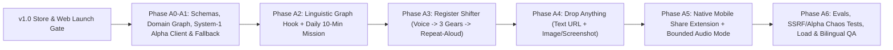
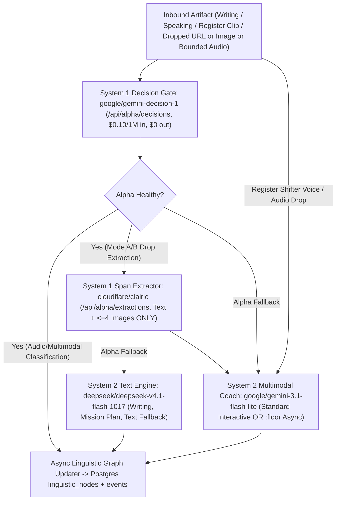

# Mockza & Sanjia — Closed-Loop Linguistic Engine: Architecture & Implementation Plan (`advanced_plan.md`)

> **Document Purpose:** Unified Product Requirements Addendum, Architecture Decision Records (`ADR-ADV-001` – `ADR-ADV-009`), Canonical Schemas/Contracts, Dual-Edition (`Mockza GLB` & `Sanjia IRN`) Governance, and Phased Implementation Plan (`Phase A0` – `Phase A6`) to evolve Mockza/Sanjia from a transactional exam simulator into a **Closed-Loop Linguistic Engine** without losing store focus, unit-economics margins, or `check_all.sh` architectural purity.
>
> **Planning Baseline:** Repository `main` (`b2f3f0d`, Editorial Green design system & redesigned Web/Flutter baseline) | Flutter `3.47.9` (`schemaVersion: 5`, `14` Drift tables) | Backend (`26` Postgres Drizzle tables, `10` pnpm workspaces) | Web (`Astro 5` + `React 19` + `Dexie v1` `14` tables)
>
> **Companion Specifications:** [PDR.md](./PDR.md) · [ADR.md](./ADR.md) · [PDR-Iran.md](./PDR-Iran.md) · [ADR-Iran.md](./ADR-Iran.md) · [DESKTOP_WEB_PLAN.md](./DESKTOP_WEB_PLAN.md) · [PLAN.md](./PLAN.md) · [WEB_FLUTTER_REDESIGN_IMPLEMENTATION_PLAN.md](./WEB_FLUTTER_REDESIGN_IMPLEMENTATION_PLAN.md) · [READING_LISTENING_IMPLEMENTATION_BACKLOG.md](./READING_LISTENING_IMPLEMENTATION_BACKLOG.md)

---

## Table of Contents

1. [Executive Thesis & Launch Sequencing](#1-executive-thesis--launch-sequencing)
2. [Product Requirements Addendum (PDR-ADV)](#2-product-requirements-addendum-pdr-adv)
   - [2.1 Pillar 1: Persistent Linguistic Graph & Daily 10-Minute Mission](#21-pillar-1-persistent-linguistic-graph--daily-10-minute-mission)
   - [2.2 Pillar 2: Register Shifter (3-Gear Transfer & Repeat-Aloud)](#22-pillar-2-register-shifter-3-gear-transfer--repeat-aloud)
   - [2.3 Pillar 3: Bounded "Drop Anything" Personal Content Ingestion](#23-pillar-3-bounded-drop-anything-personal-content-ingestion)
   - [2.4 Functional & Non-Functional Requirements (`AFR-001`..`AFR-018`, `ANFR-001`..`ANFR-008`)](#24-functional--non-functional-requirements)
   - [2.5 Quota Integration & Unit-Economics Protection (`GLB` USD & `IRN` IRR)](#25-quota-integration--unit-economics-protection)
3. [Architecture Decision Records (`ADR-ADV-001` – `ADR-ADV-009`)](#3-architecture-decision-records-adr-adv-001--adr-adv-009)
4. [Canonical Data Models, AI Routing, API Contracts & UI Surfaces](#4-canonical-data-models-ai-routing-api-contracts--ui-surfaces)
   - [4.1 PostgreSQL Drizzle Extensions (`26 -> 30` Tables)](#41-postgresql-drizzle-extensions-26---30-tables)
   - [4.2 Offline Client Mirrors: Drift `schemaVersion 6` & Dexie `version(2)`](#42-offline-client-mirrors-drift-schemaversion-6--dexie-version2)
   - [4.3 Shared Pure Domain Engines (`@mockza/domain`, `app/lib/core/`, `shared-fixtures/`)](#43-shared-pure-domain-engines)
   - [4.4 Dual-System OpenRouter Routing, Alpha Client & LangGraph Pipelines](#44-dual-system-openrouter-routing-alpha-client--langgraph-pipelines)
   - [4.5 REST / OpenAPI `/v1/*` Surface](#45-rest--openapi-v1-surface)
   - [4.6 Flutter Mobile & Desktop Web UI / Navigation Blueprint](#46-flutter-mobile--desktop-web-ui--navigation-blueprint)
5. [Dual-Edition Matrix: Mockza (`GLB`) vs. Sanjia (`IRN`)](#5-dual-edition-matrix-mockza-glb-vs-sanjia-irn)
6. [Phased Implementation Plan (`Phase A0` – `Phase A6`)](#6-phased-implementation-plan-phase-a0--phase-a6)
7. [Verification, Safety, Eval & Low-RAM Gate Matrix](#7-verification-safety-eval--low-ram-gate-matrix)

---

## 1. Executive Thesis & Strategic Release Order

Mockza/Sanjia already solves realistic 5-track test simulation (`IELTS Ac/GT`, `TOEFL iBT 2026`, `PTE Academic`, `DET`), offline objective scoring, asynchronous rubric grading, and Mistake-to-Deck SM-2 flashcards. However, pure exam-prep tools face **4–8 week graduation churn**: once learners sit their exam, the product stops feeling relevant in daily academic or workplace life.

This specification adds **three tightly coupled capabilities** powered by a **Dual-System AI Architecture (`System 1` classifier/extractor + `System 2` generative coach)** while preserving Mockza's core discipline:

1. **Persistent Linguistic Graph & Daily 10-Minute Mission (`Pillar 1`):** Move beyond isolated scores (`Band 6.5`) to tracking concrete recurring bottlenecks (e.g., *avoids conditionals under time pressure*, *overuses basic evaluative adjectives like good/bad*, *drops third-person/plural `-s`*, *confuses tense sequence*) alongside authentic learner interests (e.g., *AI podcasts*, *football*, *medical biotech*). A proactive LangGraph planner combines active graph weaknesses with due `SM-2` cards to synthesize **one focused 10-minute daily mission** that reinforces real-world transfer.
2. **Register Shifter (`Pillar 2` — Product Signature):** Learners record a `<= 45s` (default `30s`) casual spoken reflection about their day, an article, or a film. Mockza returns an interactive **3-Gear Register Ladder** (**Casual** ↔ **Workplace Pro** ↔ **Academic / Target Exam Band**), explains concisely *why* each clause upgraded, optionally captures new phrases into SM-2, and **requires speaking a selected target line aloud** so grammatical/lexical structures become muscle memory.
3. **Bounded "Drop Anything" Personal Ingestion (`Pillar 3`):** Learners feed real-world material from Android/iOS OS Share Sheets or Desktop Web via **strictly delimited input modes**—no unbounded video scraping:
   - **Mode A — URL of Text Content** (news/blog/essay `https://` URL -> SSRF-safe server fetch & boilerplate strip, or direct pasted text snippet)
   - **Mode B — URL or Upload of Image / Screenshot** (book page, menu, presentation slide, infographic, subtitle screenshot, meme — up to `4` PNG/JPEG/WebP images, `<= 5 MB` compressed)
   - **Mode C — Bounded Optional Audio URL or Upload** (feature-flagged voice memo or short audio clip URL/`file`, strict `<= 5 MB` and `<= 180s` limit; zero video/YouTube/HLS streams)
   - Output: `3–5` level-matched natural idioms/collocations/structures, a customized **2-minute micro-drill** (shadowing / paraphrasing / comprehension), direct **1-tap SM-2 card export**, and automatic Linguistic Graph topic + gap updates.

### Strategic Release Rule (Do Not Block v1.0 Store Launch)

Per [PDR.md](./PDR.md) Sec. 6 and [POST_LAUNCH_GATES.md](./compliance/POST_LAUNCH_GATES.md), all work in this plan ships behind additive feature flags (`ENABLE_LINGUISTIC_GRAPH`, `ENABLE_REGISTER_SHIFTER`, `ENABLE_DROP_ANYTHING_TEXT_IMAGE`, `ENABLE_DROP_ANYTHING_AUDIO`) so `v1.0` production store keys, Google Play `12x14` testing, and `Sanjia` Zero-VPN launch are **never delayed** while these `v3.1+` / post-launch retention pillars land in clean increments:



---

## 2. Product Requirements Addendum (`PDR-ADV`)

### 2.1 Pillar 1: Persistent Linguistic Graph & Daily 10-Minute Mission

* **Behavioral Loop:** After every committed Writing, Speaking, Diagnostic, Register Shifter, or Drop Anything activity (and optionally tagged Reading/Listening misses), an asynchronous hook updates the learner's **Linguistic Graph** (`bottleneck` nodes, `target_structure` nodes, and `interest_topic` nodes) with timestamped evidence counts and confidence scores rather than replacing raw scores.
* **Proactive Daily Mission Synthesis (Idle-Cost Safe):**
  * Contains at most **3 micro-blocks inside a 10-minute target (`600s`)**:
    1. **Warm Recall (`~2 min`)**: `3–5` due `SM-2` cards prioritized by overlap with active graph bottlenecks or favorite topics.
    2. **Targeted Micro-Prompt (`~4 min`)**: One personalized speaking or short-writing prompt combining the learner's favorite topic (`e.g., AI engineering` or `football tactics`) with **2 forced target structures/lexemes** drawn directly from due `SM-2` cards + active graph bottlenecks.
    3. **Verification & Feedback (`~4 min`)**: System 1 + concise coaching verifies whether the forced structures were produced accurately and updates mastery edges cleanly.
  * **Cost Guardrail:** Missions are **NEVER generated via nightly cron across dormant accounts**. A `daily_mission` is generated lazily when an entitled/active learner visits Home/Practice on a new `SerialDay` (or pre-warmed only for users active within the trailing `7` days when enabled), capped at **1 active mission per UTC/local serial day**.
* **Multi-Track Scale Isolation:** Spoken/written outputs stay scoped to `ExamTrack`; linguistic habits (e.g., *missing third-person singular*, *vague modifiers*, *clause subordination avoidance*) transfer across tracks cleanly while displayed score anchors obey `ExamDescriptor`.

### 2.2 Pillar 2: Register Shifter (3-Gear Transfer & Repeat-Aloud)

* **Input:** `5s–45s` casual English `.m4a` voice clip (`<= 5 MB`), either free-form (*"Talk about something you read, watched, or dealt with today"*) or prompted from a top graph interest. Supports desktop browser WebM/Opus -> server `ffmpeg` `.m4a` normalization (`ADR-007` / `W2.1`).
* **Output — Interactive 3-Gear Register Ladder:**
  * **Gear 0 — Polished Casual (Native Everyday):** Fixes slips cleanly while keeping warm spoken idiom and natural contractions.
  * **Gear 1 — Workplace Professional:** Crisp clarity for standups, client calls, interviews, and concise Slack/email tone.
  * **Gear 2 — Academic / Target Band (`IELTS 8.5` / `TOEFL 5.5` / `PTE 84` / `DET 145` calibrated to user's `ExamTrack`):** Nominalization, hedging, subordination, and precise lexical collocations while preserving the learner's original meaning.
* **Coaching Rationale & Lexical Cards:**
  * Highlights up to `4` concrete shifts across gears (e.g., `"pretty good -> remarkably impactful"` / `"because of -> owing to"`), explaining *why* the shift changes pragmatic register (`GLB` in concise English; `IRN` in **bilingual Persian explanation + `LtrExamBoundary` English phrases**).
  * One-tap **Save to SM-2 Deck** on any shifted expression (`sourceKind: 'register_shifter'`).
* **Mandatory Muscle-Memory Loop (Repeat-Aloud Verification):**
  * Learner selects Gear 1 or Gear 2, optionally plays a synthesized reference model clip (or clean TTS/cached clip), and records **one short repeat/shadowing turn (`3s–20s`)**.
  * System 1 (`google/gemini-decision-1` on native audio) verifies whether the target phrases/register markers were actually articulated (`produced_target_phrases`, `hesitation_severity`, `clarity_score`) at near-zero token cost and increments node mastery in the Linguistic Graph! *(Graceful accessibility bypass: "Skip Speaking / Text Self-Check" remains available for muted/public-transit or speech-accessibility modes, tagged distinctly as non-spoken practice.)*

### 2.3 Pillar 3: Bounded "Drop Anything" Personal Content Ingestion

To satisfy personal-interest immersion without scraping copyrighted video platforms or triggering unbounded token/bandwidth bills, **Drop Anything** enforces explicit input boundaries:

| Allowed Input Mode | Transport Surfaces | Hard Size / Duration Limits | Rejected Inputs (Explicit Fail-Fast Error) | Primary Extraction / Analysis Engine |
| :--- | :--- | :--- | :--- | :--- |
| **Mode A1: Text URL** | Flutter Android/iOS OS Share Sheet (`Share to Mockza/Sanjia`), Web `/app/drop` paste bar | HTML download `<= 1.5 MB`; extracted clean article body `<= 15,000` chars (`~3,000` words); max `3` HTTP redirects; `8s` fetch timeout | YouTube/Vimeo/TikTok/Reels watch URLs, login/paywall HTTP `401/403`, raw binaries, localhost/RFC1918 IPs | Server SSRF-safe HTML readability cleaner -> `gemini-decision-1` gate -> `cloudflare/clairic` (spans + phrases) -> System 2 drill |
| **Mode A2: Raw Text Snippet** | OS Share Sheet text selection, Web paste area | `40` to `15,000` UTF-16 chars | Non-English gibberish / < 40 chars | Same as Mode A1 without HTTP fetch |
| **Mode B: Image / Screenshot (URL or Upload)** | OS Share Sheet image(s), Camera/Gallery picker, Desktop Web drag-drop / clipboard `Ctrl+V` / direct public `https://` image URL | `1` to `4` images max; `<= 5 MB` per file (client auto-resized `<= 1600px` max edge); `image/png`, `image/jpeg`, `image/webp` | GIF/SVG/HTML disguised MIME types, private network URLs | S3 `mockza-audio-private` (temp prefix `drops/`) -> `cloudflare/clairic` `assets` + `gemini-3.1-flash-lite` fallback |
| **Mode C (Optional / Gated): Audio URL or Upload** | Audio file share/picker or direct public `https://` `.m4a`/`.mp3`/`.wav`/`.ogg` URL (`ENABLE_DROP_ANYTHING_AUDIO=true`) | `<= 5 MB` compressed download/upload; `<= 180s` decoded audio duration enforced by `ffprobe`/`ffmpeg` | HLS/DASH `.m3u8`/`.mpd`, YouTube/Spotify links, files `> 5 MB` or `> 180s` | `ffmpeg` `16kHz` mono `.m4a` normalize -> `gemini-decision-1` gate -> `gemini-3.1-flash-lite` transcript/phrases/drill |

* **Extracted Deliverable per Drop (`2-Minute Micro-Drill`):**
  1. Auto-detected **CEFR Tier + Domain Topic** (stored as `interest_topic` weight in Linguistic Graph).
  2. **`3–5` Extracted Expressions / Structures** matched to the user's current estimated ability (plus `target` Band boost), grounded to verbatim source spans (`clairic` `[start, end]` mapped to UTF-16 when Mode A text).
  3. **2-Minute Generated Micro-Drill (`2–4` interactive steps):** 1 comprehension/context check, 1 cloze/paraphrase upgrade item, and 1 optional 15s spoken shadowing/retell turn using at least `2` of the extracted idioms.
  4. **1-Tap SM-2 Capture:** Every extracted phrase or missed drill item commits cleanly into `VocabCards` with user-private provenance (`sourceKind: 'drop_anything'`, `sourceRefLabel: <article title/domain>`).

### 2.4 Functional & Non-Functional Requirements

* **`AFR-001` Linguistic Graph Persistence & Explainability:** Store observable bottlenecks, mastered target structures, and topic affinities cleanly in `linguistic_nodes` and immutable evidence events; expose a calm, transparent **"My Language Patterns"** breakdown inside Progress (`/app/progress/graph` & `/progress/graph`) showing *observed evidence count* and *recent examples*, never opaque magic scores.
* **`AFR-002` Daily 10-Min Mission:** Present at most one actionable daily mission card directly inside Home's priority slot (right below any unfinished active exam draft, preserving `WEB_FLUTTER_REDESIGN_IMPLEMENTATION_PLAN.md` resume priority) with `Start 10-Min Mission` CTA and explicit time estimate.
* **`AFR-003` Register Shifter Flow:** Record/upload casual `.m4a` -> async `202` job -> render 3 interactive gear tabs/slider (`Casual`, `Workplace`, `Academic`), highlighted diff phrases, `why` cards (`fa-IR` overlay in `IRN`), SM-2 capture buttons, and Repeat-Aloud mic verifier.
* **`AFR-004` OS Share Sheet + Web Drop Entry:** Android (`ACTION_SEND` text/url/image/audio), iOS (`NSE` Share Extension passing payload over App Group to Flutter `services/native/`), and Web `/app/drop` (URL field, text box, drag/paste dropzone, bounded audio uploader).
* **`AFR-005` Private Content Quarantine:** User-dropped articles/images/audio belong strictly to `ownerAccountKey` (`403`/`404` across accounts, never published to `/v1/catalog/manifest` or Astro public routes).
* **`AFR-006` Dual-Edition Language/BiDi Compliance:** `IRN` localizes Mission UI, Register Shifter gear labels/explanations, and Drop Anything glosses in Persian RTL (`Vazirmatn`) while isolating **all** English sentences, idioms, articles, and target badges inside `LtrExamBoundary`.
* **`AFR-007` Complete Data Deletion:** Extending `DELETE /v1/account`, erase `linguistic_nodes`, `linguistic_evidence_events`, `daily_missions`, `dropped_contents`, `register_shifter_runs`, plus associated temporary S3 media keys atomically.
* **`ANFR-001` Alpha Model Resilience:** Any `/api/alpha/*` HTTP `429`/`5xx`/timeout/malformed payload or open circuit breaker falls back transparently to pinned GA models (`gemini-3.1-flash-lite` / `deepseek-v4.1-flash-1017`) with zero user-facing failure.
* **`ANFR-002` SSRF & Zero-VPN Fetching:** All URL fetches run server-side with private-IP/DNS-rebinding blocklists (`dns.lookup` verification prior to socket connect), `Content-Type` sniffing, byte limits, and `IRN` domestic relay execution.
* **`ANFR-003` Interactive Latency Targets:** Register Shifter runs on standard-priority `google/gemini-3.1-flash-lite` targeting P95 `<= 10s`; background Graph extraction and Daily Mission planning use `:floor`/Flex-compatible worker queues (`P95 <= 35s`).
* **`ANFR-004` Offline Execution After Sync:** Once a Daily Mission, Register Shifter card set, or Drop Anything 2-min drill is fetched, flashcards, reading/cloze items, and queued `.m4a` repeat-aloud clips run offline and sync via `OutboxSyncQueue` / `syncOutbox`.

### 2.5 Quota Integration & Unit-Economics Protection

Extending `backend/packages/domain/src/quota.ts` and `PDR.md` Sec. 10 without breaking the `>= 80%` `GLB` gross margin (`<= $1.00/paid user/mo` blended AI COGS) or `>= 70%` `IRN` USD-adjusted contribution margin (`PDR-Iran.md` Sec. 8):

| Operation | Free Starter Allowance | Pro (`GLB` / `IRN`) Allowance | Monthly Ceiling Weight | Expected Blended COGS / Call |
| :--- | :--- | :--- | :--- | :--- |
| **Linguistic Graph Update** *(triggered by graded Writing/Speaking/Shifter/Drop)* | Automatic on free diagnostic/drop | Automatic on every graded submission | `0` user quota consumed (covered by parent eval) | `~$0.00015` (`gemini-decision-1` `$0.10/1M in`, `$0 out`) |
| **Daily 10-Min Mission Generation** *(lazy `<= 1/day`)* | `1` starter mission (after diagnostic/onboarding) | `1` personalized mission per active serial day (`<= 30/mo`) | `0` daily Speaking/Writing burn | `~$0.0004` (`DeepSeek` / `:floor` Flex) |
| **Register Shifter (`Casual -> Work -> Academic`)** | `1` lifetime free trial *(bundled or toggleable via Remote/Env flag)* | Draws from existing **`10/day` Speaking** pool (capped max `5` Shifters/day in `GLB`/`IRN`) | `1` unit toward `150/mo` (`GLB`) / `120/mo` (`IRN`) ceiling | `~$0.0018` (`3.1-flash-lite` + `decision-1` repeat check) |
| **Drop Anything (Text URL / Text / Image)** | `1` lifetime free sample drop | Dedicated **`5` drops/day** (`GLB` & `IRN`) | `1` unit toward `150/mo` (`GLB`) / `120/mo` (`IRN`) ceiling | `~$0.0008` (`decision-1` + `clairic` + compact drill) |
| **Drop Anything (Bounded Audio `<= 180s`)** | Locked (`Pro` only) | Consumes `1` Drop slot **AND** `1` Speaking slot (`max 3/day` when enabled) | `1` unit toward `150/mo` (`GLB`) / `120/mo` (`IRN`) ceiling | `~$0.0028` (`decision-1` + `3.1-flash-lite` audio) |

* **Why margins hold easily:** Assuming a hyper-active Pro subscriber runs `1` Daily Mission, `2` Register Shifters, and `2` Drops every day for `30` days (`~120` heavy actions + `30` missions), estimated total monthly AI COGS stays under **`$0.22/user/mo`**, well within the `<= $1.00/paid user/mo` `PDR.md` target even with fallback retries!

---

## 3. Architecture Decision Records (`ADR-ADV-001` – `ADR-ADV-009`)

### `ADR-ADV-001`: Persistent Linguistic Graph & Mission Storage Topology
* **Context:** Mockza currently has `26` PostgreSQL Drizzle tables (`backend/packages/db/src/schema.ts`), `14` Drift SQLite tables (`app/lib/data/db/app_database.dart`, `schemaVersion: 5`), and `14` Dexie v4 tables (`web/src/adapters/dexie/mockza-db.ts`, `version(1)`). We need durable Linguistic Graph state, daily missions, and user-dropped/register-shifted items across server and offline clients without bloating `AppDatabase` migrations.
* **Decision:**
  * Add **`4` focused PostgreSQL tables** (bringing Drizzle schema from `26` to `30` tables):
    1. `linguistic_nodes` — Unique `(account_key, edition, node_kind, canonical_key)` storing `node_kind` (`'bottleneck' | 'target_structure' | 'interest_topic'`), `mastery_score_milli` (`0..1000`), `severity_or_affinity_milli` (`0..1000`), `evidence_count`, `first_seen_day_serial`, `last_seen_day_serial`, `last_example_en`, `coach_note_en`, `coach_note_fa`.
    2. `linguistic_evidence_events` — Append-only bounded evidence log linked cleanly to source attempts/shifters/drops (`cascade delete` on account deletion, pruned per user to latest `500` events).
    3. `daily_missions` — Unique `(account_key, edition, mission_day_serial)` holding the `3`-step structured mission JSON (`warmupCardIds`, `targetStructures`, `focusTopic`, `promptText`, `promptFa`, `status`: `'ready' | 'in_progress' | 'completed' | 'skipped'`, `completionSummaryJson`).
    4. `dropped_contents` — Private user-scoped ingestion records (`drop_id`, `account_key`, `edition`, `input_kind`: `'text_url' | 'text' | 'image' | 'audio'`, `source_ref_hash`, `title`, `topic_tag`, `cefr_estimate`, `extracted_items_json`, `drill_payload_json`, `media_object_key`, `expires_at`, `created_at`).
    5. *(Note on Register Shifter runs: persisted inside `evaluation_jobs` with `taskType = 'register_shifter'` / optional lightweight `register_shifter_runs` view or reuses `evaluation_jobs` + `audio_assets` with dedicated structured `resultJson` so zero redundant attempt/job machinery is rebuilt! Adding just those `4` core tables keeps Postgres normalized, auditable, and strictly quota-bound.)*
  * Upgrade **Drift (`app/`) to `schemaVersion => 6`** and **Dexie (`web/`) to `version(2)`** adding `3` matching client tables (`LinguisticNodes` / `linguisticNodes`, `DailyMissions` / `dailyMissions`, `DroppedContents` / `droppedContents`), while storing `RegisterShifter` runs inside existing `ExamAttempts` / `evaluationResults` (`skill: 'speaking'`, `taskType: 'register_shifter'`) for offline replay & SM-2 provenance.

### `ADR-ADV-002`: Dual-System OpenRouter Routing (`System 1` Alpha + `System 2` GA) & Fallback Policy
* **Context:** `backend/packages/ai/src/models/registry.ts` currently states *"STRICTLY LOCKED with ZERO fallback models"* for calibrated IELTS Writing/Speaking grading (`deepseek-v4.1-flash-1017` and `google/gemini-3.1-flash-lite`). Meanwhile, OpenRouter launched two zero-output-token **System 1 alpha endpoints**: `google/gemini-decision-1` (`/api/alpha/decisions`, `$0.10/1M input`, `$0 output`, audio/video/image/text) and `cloudflare/clairic` (`/api/alpha/extractions`, `$0.10/1M input`, `$0 output`, text + up to 4 images, **no audio**). Because alpha endpoints carry stability risk (single-provider Cloudflare uptime, alpha contract evolution), relying on them without fallback would break UX.
* **Decision:**
  * Keep **official exam rubric grading** (`grade-writing`, `grade-speaking`, `grade-diagnostic`) strictly on calibrated GA System 2 models (`deepseek-v4.1-flash-1017` and `google/gemini-3.1-flash-lite`) gated by `backend/evals/`. `gemini-decision-1` NEVER independently overrides official rubric bands.
  * Introduce **`OpenRouterAlphaClient`** inside `backend/packages/ai/src/models/openrouter-alpha.ts` targeting `OPENROUTER_ALPHA_BASE_URL` (`https://openrouter.ai/api/alpha`), completely decoupled from `/v1/chat/completions`, with Zod response validation (`DecisionResponseSchema`, `ExtractionResponseSchema`) and strict time budgets (`4s` System 1 timeout).
  * Wrap both System 1 models in an explicit **Alpha Circuit Breaker + GA Fallback Policy**:
    * `google/gemini-decision-1` fails (HTTP `4xx/5xx`, timeout, malformed payload, or tripped breaker `5 failures / 60s -> open 120s`) -> fall back cleanly to **`google/gemini-3.1-flash-lite`** (if audio/image/multimodal) or **`deepseek/deepseek-v4.1-flash-1017`** (if text-only) using strict Zod structured output returning equivalent boolean/choice/score maps.
    * `cloudflare/clairic` fails or is skipped (audio or alpha outage) -> fall back to **`deepseek/deepseek-v4.1-flash-1017`** (for Mode A text) or **`google/gemini-3.1-flash-lite`** (for Mode B image/screenshot).
  * Preserve `provider: { data_collection: 'deny' }` on GA endpoints and inspect OpenRouter `:floor` / Flex service-tier modifiers (`google/gemini-3.1-flash-lite:floor`) **only** for background async `pg-boss` pipelines (`Daily Mission synthesis`, background `Drop Anything` deep enrichment), keeping **standard-priority routing** for interactive user waits (`Register Shifter`).
  * **Important `clairic` Boundary:** Do **NOT** use `clairic` at runtime for existing static Reading/Listening mock pack `evidenceSpans`; those remain `100%` pre-authored and SHA-verified via `backend/content-pipeline` at zero runtime cost.

### `ADR-ADV-003`: LangGraph Flows & `pg-boss` Execution Fences
* **Context:** Every asynchronous AI flow in Mockza guarantees durability via `job_dispatch_outbox`, `pg-boss`, worker `execution_generation` + `claim_token` lease fencing (`ADR-007`), and transactional `quota_reservations` commit/refund.
* **Decision:**
  * Author 4 composable LangGraph flows under `backend/packages/ai/src/graphs/`:
    1. `update-linguistic-graph.ts` — Invoked as a post-commit hook/background job after `grade-writing`, `grade-speaking`, `shift-register`, and `ingest-drop`. Runs `gemini-decision-1` (`<= 12` structured binary/choice/score probes in 1 forward pass) + deterministic exponential-moving decay merger -> upserts `linguistic_nodes`.
    2. `plan-daily-mission.ts` — Reads top `2` active bottlenecks + top `2` interest topics + top `5` due `VocabCards` -> generates a concise, level-matched `10-min` mission payload -> validates required structure targets -> persists `daily_missions`.
    3. `shift-register.ts` — Audio -> `gemini-3.1-flash-lite` `[input_audio, text]` graph (`transcript`, `gear0`, `gear1`, `gear2`, `shiftNotes[]`, `repeatTarget`, optional `irn` Persian rationales) -> Zod validate & repair (max 1 retry) -> on Repeat-Aloud turn, runs `gemini-decision-1` audio check returning target-phrase completion & intelligibility signal.
    4. `ingest-dropped-content.ts` — Safety & level probe (`gemini-decision-1`) -> entity/collocation extraction (`clairic` for text/image; `flash-lite` for audio) -> UTF-16 span alignment -> 2-minute drill generator (`flash-lite` / `deepseek`) -> Zod verification.
  * Reuse `evaluation_jobs` + `quota_reservations` + `pg-boss` lease fencing for `shift-register` and `ingest-drop` (`202 Accepted` + polling `GET /v1/jobs/:jobId`), guaranteeing zero quota leakage on crashes or upstream errors.

### `ADR-ADV-004`: Bounded "Drop Anything" SSRF Firewall, Media Caps & Private Copyright Quarantine
* **Context:** Accepting arbitrary URLs and images introduces SSRF, DNS rebinding, giant response DoS, malicious MIME polyglots, YouTube scraping/ToS issues, and copyright leakage into Mockza's clean-room public catalog (`PDR.md` Sec. 8.2).
* **Decision:**
  * **Mandatory Safe Fetcher (`backend/packages/storage/src/safe-url-fetch.ts`):**
    * Allow only `https:` (or `http:` only in non-prod local dev test harness) on ports `80`/`443`.
    * Resolve DNS via `dns.lookup({ all: true })` and reject loopback (`127.0.0.0/8`, `::1`), RFC1918 (`10/8`, `172.16/12`, `192.168/16`), link-local (`169.254/16`, cloud metadata), and CGNAT (`100.64/10`), connecting to the validated IP directly with `Host` header (blocking DNS rebinding) and checking every HTTP redirect manually (`maxRedirects = 3`).
    * Reject known video/streaming hosts and MIME types (`youtube.com`, `youtu.be`, `vimeo.com`, `tiktok.com`, `instagram.com`, `.m3u8`, `.mpd`, `video/*`) with typed error `UNSUPPORTED_DROP_SOURCE` (`422`) and friendly guidance (*"Share the article URL, text excerpt, or a screenshot instead"*).
  * **Strict File / Media Limits:**
    * Images: magic-byte sniff (`PNG`/`JPEG`/`WebP` only), max `4` images, max `5 MB` each; decoded & re-encoded/stripped of EXIF metadata before forwarding base64 assets to `clairic`/`flash-lite`.
    * Audio (Mode C, feature-flagged): magic-byte + `ffprobe` validation enforcing `duration <= 180s` and size `<= 5 MB`, normalized via `ffmpeg` to `16 kHz` mono AAC `.m4a` prior to inference (`30-day` purge TTL via `AUDIO_TTL_DAYS`).
  * **Copyright Quarantine:** Stored strictly inside `dropped_contents` keyed by `accountKey`; `content-pipeline` and `/v1/catalog/manifest` never read `dropped_contents`; optional source text is truncated/redacted before Langfuse span export (`ADR-011`).

### `ADR-ADV-005`: Register Shifter 3-Gear Calibration & Acoustic Muscle-Memory Loop
* **Context:** Generic AI paraphrasers rewrite into robotic prose unrelated to exam scoring or spoken fluency.
* **Decision:** Anchor Gear 2 (*Academic / Exam Target*) dynamically to `@mockza/domain` `getExamRubricSpec(examTrack, 'speaking')` and learner target score (e.g., `IELTS Band 7.5–8.5`, `TOEFL 5.0–6.0`, `PTE 75+`, `DET 135+`) while keeping **lexical/structural authenticity** (realistic cohesive devices, precise collocations, complex clauses) and capping sentence rewrite length so it remains speakable aloud in `1` breath (`<= 35` words per target drill sentence).

### `ADR-ADV-006`: Cross-Codebase SSOT (`@mockza/domain`, `app/lib/core/`, `shared-fixtures/`)
* **Context:** Per `DESKTOP_WEB_PLAN.md` Sec. 4.4 and `scripts/check_cross_parity.sh`, any deterministic state/scoring/SM-2 rules shared across Backend, Desktop Web, and Flutter must remain mathematically identical.
* **Decision:**
  * Place pure graph decay math, mission completion progression rules, Register Shifter client-side validation constraints (min/max audio duration `5s..45s`, word-count caps), and Drop Anything input validators (`15,000` UTF-16 char cap, URL/video-host pre-flight check, `4`-image / `5 MB` guard) in **both** `backend/packages/domain/src/advanced/` and `app/lib/core/advanced/` backed by new `shared-fixtures/linguistic_graph_vectors.json` and `shared-fixtures/drop_bounds_vectors.json` run in `./scripts/check_cross_parity.sh`.

### `ADR-ADV-007`: Dual-Client UI, OS Share Sheet & `check_all.sh` Compliance
* **Context:** `scripts/check_all.sh` strictly blocks: (1) cross-feature imports in `app/lib/features/*`, (2) `MethodChannel` / `PlatformDispatcher` outside `app/lib/services/native/` and `bootstrap.dart`, (3) raw color/size literals outside `app/lib/theme/`, (4) `DateTime.now()` outside injected clocks, (5) adapter/Dexie imports in `web/src/spa/{features,routes}` or `web/src/components`, and (6) physical LTR classes (`ml-`, `EdgeInsets.only(left:...)`).
* **Decision:**
  * **Tokens & Editorial Green Consistency:** Add zero hardcoded colors! Expose semantic linguistic chips/badges cleanly through `packages/design-tokens/tokens.json` -> `pnpm tokens:sync` (`flutter` + `web` CSS vars), harmonizing with the `editorial_green` warm-paper/forest-green palette (`#264E3B`, `#745A30`, `#983D37`) and all existing 4 presets (`midnight_indigo`, `nordic_emerald`, `editorial_amber`, `oceanic_cobalt`).
  * **Flutter Feature Isolation:** Create 3 vertical features under `app/lib/features/` (`linguistic_mission/`, `register_shifter/`, `drop_anything/`). Shared UI widgets (`RegisterGearLadderCard`, `TargetStructureChips`, `BottleneckBadge`, `MissionProgressCard`) live exclusively under `app/lib/theme/components/`. Native Android `ACTION_SEND` Intent receiver and iOS Share Extension (`App Group`) bridge live **strictly** under `app/lib/services/native/share_intent_bridge.dart` and expose typed `Stream<InboundSharePayload>` into `AppRouter` `/drop/inbox` redirect.
  * **Web Modularity:** Create gateway interfaces `ILinguisticGateway` (`web/src/gateways/linguistic.gateway.ts`) and concrete `HttpLinguisticAdapter` + `Dexie` v2 offline persistence under `web/src/adapters/`, wired solely in `web/src/composition/bootstrap-{glb,irn,test}.ts`. Keep Home card priority clean: active unfinished simulator draft -> today's Daily Mission -> diagnostic/recommended practice.

### `ADR-ADV-008`: Dual-Edition (`Mockza GLB` vs. `Sanjia IRN`) Governance
* **Decision:**
  * Every new endpoint, Postgres table, cache row, and AI prompt carries explicit `edition` (`'glb' | 'irn'`) isolation (`403 EDITION_FORBIDDEN` on mismatch).
  * `IRN` (`Sanjia`) renders Persian RTL `Vazirmatn` labels, Register Shifter coaching rationales (`whyFa`), Daily Mission instructions (`promptFa`), and SM-2 Persian glosses (`glossFa`) while locking **all** English shifted sentences, extracted idioms, article snippets, and target badges inside `LtrExamBoundary`.
  * **Zero-VPN Guarantee (`IRN`):** `Drop Anything` URL mode executes server-side inside `IRN`'s domestic backend (`api.sanjia.ir`) + domestic SeaweedFS object storage (`0` direct browser/mobile requests to OpenRouter, `fonts.gstatic.com`, `fonts.googleapis.com`, Stripe, or foreign trackers). Notice `scripts/check_all.sh` continues verifying `dist-glb` has zero `.ir`/Sanjia strings and `dist-irn` has zero foreign SDK leaks.

### `ADR-ADV-009`: Explicit Scope Exclusions & Deferrals (`v4+` Gate)
* **Rejected / Deferred for this Milestone:**
  1. **Duo Voice Rooms (2–3 user async chat/audio rooms + Shadow Coach):** Excluded to avoid violating `PDR.md` Sec. 3 (*no social feeds/peer chat*), strict `1 Phone + 1 Desktop Web` concurrency model, and App Store UGC moderation/reporting/blocking requirements before PMF.
  2. **Realtime Camera + Live Duplex Voice Scenarios:** Excluded because Mockza uses `pg-boss` async job queues (`P95` batch cost `~$0.002`) rather than WebRTC/Live streaming APIs, which would violate `>= 80%` margin targets and add camera permissions to `PrivacyInfo.xcprivacy`.
  3. **Video / YouTube / Full-Podcast Scraping inside Drop Anything:** Excluded from Mode A/C due to brittle anti-bot scrapers, long-video token explosion, and Iran YouTube filtering violating Sanjia's Zero-VPN promise.

---

## 4. Canonical Data Models, AI Routing, API Contracts & UI Surfaces

### 4.1 PostgreSQL Drizzle Extensions (`26 -> 30` Tables)

All additions append cleanly in `backend/packages/db/src/schema.ts` with forward-only Drizzle migrations (`0002+`) and foreign/indexed `accountKey` cascading cleanly on `DELETE /v1/account`:

```typescript
// Conceptual schema extensions inside backend/packages/db/src/schema.ts

// 27. linguistic_nodes
// PK: nodeId (uuid) | Unique index: (accountKey, edition, nodeKind, canonicalKey)
// nodeKind: 'bottleneck' | 'target_structure' | 'interest_topic'
// canonicalKey: e.g. 'grammar:conditional_avoidance', 'lexis:evaluative_overuse_good_bad',
//               'morphology:plural_s_omission', 'topic:artificial_intelligence'
// Columns: accountKey, edition, nodeKind, canonicalKey, displayLabelEn, displayLabelFa,
//          masteryScoreMilli (0..1000), signalWeightMilli (0..1000), evidenceCount,
//          lastSeenDaySerial (int), lastExampleEn, coachNoteEn, coachNoteFa, updatedAt

// 28. linguistic_evidence_events
// PK: eventId (uuid) | Index: (accountKey, edition, createdAt DESC)
// Columns: accountKey, edition, nodeId (FK -> linguistic_nodes.nodeId onDelete cascade),
//          sourceKind ('writing' | 'speaking' | 'diagnostic' | 'register_shifter' | 'drop_anything' | 'mission'),
//          sourceRefId, observedPolarity ('gap_observed' | 'target_used' | 'interest_matched'),
//          excerptText (truncated <= 240 chars, PII scrubbed), createdAt

// 29. daily_missions
// PK: missionId (uuid) | Unique index: (accountKey, edition, missionDaySerial)
// Columns: accountKey, edition, examTrack, missionDaySerial (int UTC day),
//          status ('ready' | 'in_progress' | 'completed' | 'skipped'),
//          targetNodeKeysJson, dueCardIdsJson, focusTopic,
//          missionPayloadJson (3 blocks: warmup, productivePrompt + 2 forced targets, verificationSpec),
//          evaluationResultJson, modelId, promptVersion, completedAt, createdAt

// 30. dropped_contents
// PK: dropId (uuid) | Index: (accountKey, edition, createdAt DESC), (expiresAt)
// Columns: accountKey, edition, inputKind ('text_url' | 'text' | 'image' | 'audio'),
//          sourceDomainOrLabel, title, cefrEstimate, detectedTopicsJson,
//          extractedPhrasesJson (3-5 items w/ UTF-16 span, definitionEn, glossFa, example),
//          drillPayloadJson (2-min micro-drill steps), mediaObjectKeysJson,
//          mediaPurgedAt, expiresAt (now + AUDIO_TTL_DAYS for uploaded media), createdAt
```

* **Register Shifter Persistence:** Uses existing `evaluationJobs` (`taskType: 'register_shifter'`, `packId: 'register_shifter_v1'`, `inputJson: { originalAudioKey, targetTrack, promptContext }`, `resultJson: RegisterShifterResult`) plus `audioAssets` (`AUDIO_TTL_DAYS` purge + `DELETE /v1/account` wipe), requiring **zero extra job table**.

### 4.2 Offline Client Mirrors: Drift `schemaVersion 6` & Dexie `version(2)`

Keep strict parity (`14 -> 17` tables) across Flutter `app/lib/data/db/` and Web `web/src/adapters/dexie/mockza-db.ts`:

* **Flutter (`app/lib/data/db/`):**
  * Bump `schemaVersion => 6` in `app/lib/data/db/app_database.dart` with explicit `if (from < 6)` `MigrationStrategy` test coverage.
  * Add `isStrict => true` tables in `app/lib/data/db/tables/core_tables.dart`:
    1. `LinguisticNodes` (`nodeId` PK, `edition`, `nodeKind`, `canonicalKey`, `displayLabelEn`, `displayLabelFa`, `masteryScoreMilli`, `signalWeightMilli`, `evidenceCount`, `lastSeenDaySerial`, `lastExampleEn`, `coachNoteEn`, `coachNoteFa`, `updatedAtUtcMs`)
    2. `DailyMissions` (`missionId` PK, `missionDaySerial` unique per track, `examTrack`, `status`, `focusTopic`, `missionPayloadJson`, `resultJson`, `updatedAtUtcMs`)
    3. `DroppedContents` (`dropId` PK, `inputKind`, `title`, `sourceLabel`, `cefrEstimate`, `extractedPhrasesJson`, `drillPayloadJson`, `localPreviewPath` *(strictly relative!)*, `completedAtUtcMs`, `createdAtUtcMs`)
* **Desktop Web (`web/src/adapters/dexie/mockza-db.ts`):**
  * Bump `MockzaDexieDb` to `this.version(2).stores({ ...existing14, linguisticNodes: 'nodeId, [edition+nodeKind], canonicalKey, lastSeenDaySerial', dailyMissions: 'missionId, [missionDaySerial+edition], status', droppedContents: 'dropId, inputKind, createdAtMs, completedAtMs' })`.
  * Register new `OutboxMutation` actions (`'mission.complete'`, `'shifter.repeat_check'`, `'drop.drill_complete'`) inside `dexie-outbox.adapter.ts` & `OutboxSyncService`.

### 4.3 Shared Pure Domain Engines

Add pure, zero-I/O modules to **both** `backend/packages/domain/src/advanced/` and `app/lib/core/advanced/` verified against two new golden vector suites in `shared-fixtures/`:

1. **`linguistic-graph-math.ts` / `linguistic_graph_math.dart`:**
   - Deterministic mastery decay & EMA updates (`computeNextMasteryMilli(currentMilli, polarity, evidenceCount)` clamping strictly `[0, 1000]`).
   - Deterministic bottleneck ranking (`rankTopMissionTargets(nodes, dueCards, currentDaySerial)`) so local clients can immediately preview priority focus tags offline even before server re-synthesis.
   - Normalized `Utf16SpanMapper` converting byte/code-point intervals returned by extraction APIs cleanly into safe `[startUtf16, endUtf16)` bounds.
2. **`drop-input-policy.ts` / `drop_input_policy.dart`:**
   - Pure client/server validation parity: rejects blocked video/stream domains before uploading/submitting (`youtube.com`, `youtu.be`, `tiktok.com`, `vimeo.com`), enforces `40..15,000` UTF-16 chars, `1..4` images `<= 5 MB`, audio `<= 5 MB` & `<= 180s`, and checks Register Shifter clip durations (`5s..45s`).
3. **`quota.ts` / `quota_rules.dart` extension:**
   - Extends `evaluateQuotaEligibility` to include skill/feature channels `'speaking' | 'writing' | 'register_shifter' | 'drop_text_image' | 'drop_audio'` preserving existing `10 + 10/day` and `150/mo` Pro invariants + `5/day` Drop cap.

### 4.4 Dual-System OpenRouter Routing, Alpha Client & LangGraph Pipelines



* **OpenRouter Client Extensions (`backend/packages/ai/src/models/`):**
  * Update `registry.ts`: Keep `writingPrimary: 'deepseek/deepseek-v4.1-flash-1017'` and `speakingAudioPrimary: 'google/gemini-3.1-flash-lite'`. Add `system1Decision: 'google/gemini-decision-1'`, `system1Extractor: 'cloudflare/clairic'`, `missionPlanner: 'deepseek/deepseek-v4.1-flash-1017'`, and explicit `fallbacks` map **exclusively for alpha System 1 routes**.
  * Add `openrouter-alpha.ts`: Clean `fetch` client calling `POST https://openrouter.ai/api/alpha/decisions` and `POST https://openrouter.ai/api/alpha/extractions` (separate from `/v1/chat/completions`), parameterized with a sliding-window `CircuitBreaker` (`5` transient failures or schema errors within `60s` opens for `120s` and swaps directly to GA fallback).
  * Expose `flex?: boolean` / `:floor` model slug option on `OpenRouterClient` **strictly** for background `pg-boss` queues (`plan-daily-mission`, deferred graph batch updates), never for foreground interactive features like Register Shifter.
* **4 New LangGraph Flows (`backend/packages/ai/src/graphs/`):**
  1. `update-linguistic-graph.ts`: Packs `state` (essay, transcript, or drop text + top due SM-2 headwords) and calls `gemini-decision-1` (`noul` probes for conditional avoidance, basic modifier overuse, plural/tense slips, target-word transfer + `choice` for `interest_topic` + `score` `1..5` fluency/complexity), falls back to DeepSeek/Flash-Lite JSON schema if alpha circuit opens, and writes normalized delta signals.
  2. `plan-daily-mission.ts`: Reads user's top `2` unresolved bottlenecks, top `2` personal interests, active `ExamTrack`, edition (`glb` vs `irn`), and up to `5` due `vocabDeckCards`; outputs a compact `3`-step `10`-minute mission with **2 explicit forced target structures** (`targetStructures[]` in `en`, coaching prompt in `en` for `GLB` or `fa-IR` bilingual with `en` exam prompt for `IRN`).
  3. `shift-register.ts`: `fetch_and_encode_audio` -> `invoke_flash_lite_audio` (`[input_audio, prompt]`) -> Zod validate/repair -> returns verbatim `sourceTranscript`, `gears: { casual, workplace, academic }`, `shiftHighlights[]` (up to `4` phrase upgrades with `whyEn` / `whyFa`), and `repeatAloudTarget`. Sub-flow `verifyRepeatAloud()` uses `gemini-decision-1` on the user's repeat `.m4a` (`noul`: `target_phrases_used`, `meaning_preserved`; `score`: `fluency_intelligibility_1_to_5`).
  4. `ingest-dropped-content.ts`:
     * Mode A/B -> `gemini-decision-1` preflight (`is_safe_educational`, `is_mostly_english`, `cefr_level`, `topic_cluster`) -> `cloudflare/clairic` (`/api/alpha/extractions`) pulling `expressions` (`type: 'list'`, `items: 'text'`, spans) & `summary_topic` -> if Mode A text, verifies `[start, end]` spans against UTF-16 source text -> System 2 (`deepseek` for text, `flash-lite` for image) generates learner-level glosses (`whyEn`/`glossFa`) + `2`-minute drill (`1` comprehension MCQ, `1` paraphrase cloze, `1` shadowing phrase).
     * Mode C (Audio `<= 180s`) -> skips `clairic` directly -> `ffmpeg` `16 kHz` mono `.m4a` -> `gemini-decision-1` safety/CEFR preflight -> `google/gemini-3.1-flash-lite` audio prompt extracts transcript slice + `3–5` idioms + `2`-min shadowing/comprehension drill.

### 4.5 REST / OpenAPI `/v1/*` Surface

Add routes inside `backend/apps/api/src/routes/` (auto-exported cleanly to `openapi.json` and Dart OpenAPI mappers):

* **Linguistic Graph & Daily Mission:**
  * `GET /v1/graph/me` — Returns current `bottlenecks[]`, `targetStructures[]`, `interestTopics[]`, total evidence counts, and edition-matched coach notes.
  * `PATCH /v1/graph/interests` — Allows learner to pin/mute `interest_topic` preferences manually (e.g., *"Add Software Architecture, Mute Sports"*).
  * `GET /v1/missions/today` — Returns today's (`UTC SerialDay`) mission if cached, or lazily enqueues/synthesizes one (`202` + `jobId` or `200` if already generated). No spend if user never opens the tab.
  * `POST /v1/missions/:missionId/complete` — Submits mission prompt response (essay text or uploaded repeat/speaking `.m4a`), checks forced target usage via `gemini-decision-1`, commits `completed` state, and triggers `update-linguistic-graph`.
* **Register Shifter:**
  * `POST /v1/register-shifter/shift` — Accepts `objectKey` (presigned `.m4a` via existing `POST /v1/uploads/presign`), `examTrack`, optional `topicHint`; checks auth + edition + quota -> enqueues `pg-boss` job -> `202 Accepted` (`jobId` polled via existing `GET /v1/jobs/:jobId`).
  * `POST /v1/register-shifter/:runId/verify-repeat` — Accepts repeat-aloud `objectKey` (`<= 20s` clip) + selected `gearLevel` (`1 | 2`) -> fast `gemini-decision-1` verification (zero output tokens) -> returns `{ matchedTargets[], fluencyScore1To5, graphUpdated: true }`.
* **Drop Anything (Bounded):**
  * `POST /v1/drop/presign-media` — Issues short-lived `300s` presigned PUT URL(s) under `users/${deviceId}/drops/${dropId}/...` enforcing exact `ContentType` (`image/png|jpeg|webp` or `audio/mp4|mpeg|wav|ogg`) and byte limits (`<= 5 MB`).
  * `POST /v1/drop/ingest` — Discriminated payload (`text_url` | `text` | `image` | `audio`); enforces quota + static domain blocklist + `Idempotency-Key` -> enqueues `pg-boss` `ingest-dropped-content` -> `202 Accepted` (`jobId`).
  * `GET /v1/drop/history` & `GET /v1/drop/:dropId` — Keyset-paginated personal drop archive scoped strictly to `accountKey` + `edition`.

### 4.6 Flutter Mobile & Desktop Web UI / Navigation Blueprint

* **Home Dashboard Integration (Respecting Redesign Priority):**
  * Maintains `WEB_FLUTTER_REDESIGN_IMPLEMENTATION_PLAN.md` layout hierarchy: *(1) Active resumable draft if present -> (2) Today's 10-Min Daily Mission Card (with 2 visible Target Structures & focus topic badge) -> (3) Quick Launch Actions (`Register Shifter 30s` & `Drop Anything`) -> (4) Progress & Streaks*.
* **New Parameterized Routes:**
  * **Flutter (`app/lib/routing/routes.dart`):**
    * `AppRoutes.dailyMission` -> `/mission/:missionId`
    * `AppRoutes.registerShifter` -> `/register-shifter` (and `/register-shifter/:runId`)
    * `AppRoutes.dropIngest` -> `/drop` (plus `/drop/drill/:dropId`)
    * `AppRoutes.linguisticGraph` -> `/progress/graph`
  * **Desktop Web (`web/src/spa/router.tsx`):**
    * `/app/mission/$missionId`
    * `/app/register-shifter` and `/app/register-shifter/$runId`
    * `/app/drop` and `/app/drop/drill/$dropId`
    * `/app/progress/graph`
* **Flutter Native OS Share Sheet (`ADR-ADV-007`):**
  * **Android:** Add `ACTION_SEND` & `ACTION_SEND_MULTIPLE` intent-filters (`text/plain`, `image/*`, optional `audio/*`) on `MainActivity` inside `app/android/app/src/main/AndroidManifest.xml`, handled cleanly through a quarantined channel inside `app/lib/services/native/share_intent_bridge.dart`.
  * **iOS:** Add lightweight **iOS Share Extension target (`MockzaShareExtension` / `SanjiaShareExtension`)** sharing an isolated App Group (`group.com.mockza.app` vs `group.ir.sanjia.app` — strictly edition-isolated per `ADR-014`!), writing a temporary bounded payload JSON/resized image into App Group container and deep-linking `mockza://drop` (or `sanjia://drop`) cleanly into `GoRouter`.

---

## 5. Dual-Edition Matrix: Mockza (`GLB`) vs. Sanjia (`IRN`)

Every capability in `advanced_plan.md` builds from one shared codebase (`PUBLIC_EDITION=glb|irn` & `main_global.dart|main_iran.dart`) while preserving strict compile-time, visual, network, and financial isolation:

| Dimension | **Mockza (`GLB` — Global Clean-Room)** | **Sanjia (`IRN` / سنجیا — Iran Domestic)** |
| :--- | :--- | :--- |
| **Bundle / Domain / App Group** | `com.mockza.app` · `mockza.com` · `group.com.mockza.app` (`+10001.glb`) | `ir.sanjia.app` · `sanjia.ir` · `group.ir.sanjia.app` (`+20001.irn`) |
| **Language & BiDi Chrome** | English `en-US` `LTR` everywhere; `Inter` + `Instrument Serif` editorial typography | Persian `fa-IR` `RTL` navigation, Mission headings, Register rationale (`whyFa`), and Drop glosses (`Vazirmatn`); **every English sample, shifted gear sentence, target badge & article excerpt wrapped strictly in `<LtrExamBoundary>`** |
| **Calendar Presentation** | Gregorian (`Intl` / UTC serial day) | Canonical UTC `SerialDay` in Drift/Dexie/Postgres; **edge-only Jalali (`شمسی`) dates** in Mission history & Linguistic Graph timeline |
| **Register Shifter Pragmatics** | Academic IELTS/TOEFL/PTE/DET focus + Western workplace standup/client clarity | Same Academic calibration + **Persian examiner explanation** (*why conversational phrasing drops speaking band and how Gear 2 raises Grammatical/Lexical score*) |
| **Drop Anything URL Fetching** | Direct SSRF-safe server fetch (`api.mockza.com` / workers) -> R2 storage | **100% Zero-VPN server fetch via domestic `IRN` relay (`api.sanjia.ir`)** + domestic SeaweedFS bucket. Clear Persian fallback banner (*«این لینک در دسترس نبود؛ متن را پیست کنید یا اسکرین‌شات بفرستید»*) for geo-blocked foreign domains |
| **Ecosystem Integration** | RevenueCat / Stripe USD plans; StoreKit & Play Billing | Zarinpal / Zibal Toman plans + Cafe Bazaar / Myket IAB; **Navia (`ناویا`) handoff enrichment** noting workplace/academic readiness alongside official target scores |
| **AI Privacy & Compliance** | `PrivacyInfo.xcprivacy` + Play Data Safety declarations covering dropped images/text & Register Shifter audio; `DELETE /v1/account` + `30-day` TTL | Domestic self-hosted Langfuse/observability masking (`0` calls to foreign Google Analytics/Firebase/fonts); `DELETE /v1/account` + `30-day` TTL |
| **Leakage CI Guard** | `check_all.sh` asserts `dist-glb` contains zero `sanjia`, `zarinpal`, `navia`, `jalaali`, or `.ir` symbols | `check_all.sh` asserts `dist-irn` contains zero `stripe`, `revenuecat`, or blocked foreign OAuth scripts |

---

## 6. Phased Implementation Plan (`Phase A0` – `Phase A6`)

> **Low-RAM Host Rule:** Never run `flutter build`, `astro build`, Docker builds, and Playwright simultaneously on `<= 8 GiB` RAM hosts (`scripts/check_all.sh` enforces `>= 500 MiB` preflight). Execute verification sequentially (`--concurrency=1` for Flutter, `--maxWorkers=1` for Vitest).

### Phase `A0`: Foundational Contracts, Design Tokens & Cross-Language Parity (`Weeks 1`)
1. **Design Token Additions (`packages/design-tokens/tokens.json`):** Add semantic token slots for Register Gear levels (`gearCasual`, `gearWork`, `gearAcademic`) and Linguistic Graph status badges (`gapObserved`, `structureMastered`, `interestTag`) across all presets (`editorial_green`, `midnight_indigo`, `nordic_emerald`, `editorial_amber`, `oceanic_cobalt` Light & Dark). Run `pnpm tokens:sync` -> commit updated `generated_tokens.dart` & `generated-tokens.css`.
2. **Domain Engines & Shared Fixtures:** Implement `linguistic-graph-math.ts/.dart`, `drop-input-policy.ts/.dart`, and `quota.ts` channel weights across `backend/packages/domain/` and `app/lib/core/advanced/`. Author `shared-fixtures/linguistic_graph_vectors.json` & `drop_bounds_vectors.json`.
3. **Database Migrations (`Postgres` + `Drift v6` + `Dexie v2`):**
   - Add `linguistic_nodes`, `linguistic_evidence_events`, `daily_missions`, `dropped_contents` in `backend/packages/db/src/schema.ts` + forward-only Drizzle SQL migration.
   - Add `LinguisticNodes`, `DailyMissions`, `DroppedContents` in `app/lib/data/db/` (`schemaVersion => 6` + migration tests) and `web/src/adapters/dexie/mockza-db.ts` (`version(2)`).
4. **Zod Contracts & OpenAPI:** Extend `backend/packages/contracts/src/schemas.ts`, regenerate `openapi.json` + Dart mappers cleanly.

* **Exit Gate:** `./scripts/check_all.sh all` and `./scripts/check_cross_parity.sh` pass `100%`; Postgres + Drift `v5->v6` + Dexie `v1->v2` upgrade tests green on populated DB fixtures.

### Phase `A1`: Dual-System OpenRouter AI Layer & SSRF/Media Plumbing (`Weeks 1–2`)
1. **Alpha Client + Circuit Breaker (`backend/packages/ai/src/models/openrouter-alpha.ts`):**
   - Implement `callDecisionsApi` (`/api/alpha/decisions` -> `google/gemini-decision-1`) and `callExtractionsApi` (`/api/alpha/extractions` -> `cloudflare/clairic`) with `4s` abort budget, Zod parsing, latency/cost instrumentation, and automatic fallback to `gemini-3.1-flash-lite` / `deepseek-v4.1-flash-1017` when circuit opens.
   - Extend `OpenRouterClient` to allow `flex`/`:floor` suffix on background async jobs only.
2. **Safe URL & Media Pipeline (`backend/packages/storage/src/`):**
   - Implement `safe-url-fetch.ts` (DNS pinning, RFC1918/loopback/CGNAT block, video-host blocklist, `1.5 MB` cap, HTML clean-text extractor).
   - Extend `packages/ai/src/audio/processor.ts` (`ffprobe` `<= 180s` enforcement, `16 kHz` mono AAC `.m4a` normalization, EXIF strip & resize helper for Mode B images).
   - Extend `purge.ts` + `DELETE /v1/account` handler to sweep `drops/*` and `register_shifter/*` S3 keys alongside speaking clips.
3. **Observability & Env (`backend/packages/config/src/env.ts`):**
   - Add `OPENROUTER_ALPHA_BASE_URL`, feature flags (`ENABLE_LINGUISTIC_GRAPH`, `ENABLE_REGISTER_SHIFTER`, `ENABLE_DROP_ANYTHING_TEXT_IMAGE`, `ENABLE_DROP_ANYTHING_AUDIO`), and ensure `observability/langfuse.ts` masks all dropped URLs/texts/images/register audio payloads.

* **Exit Gate:** Backend unit/integration Vitest suite verifies SSRF rejection (`127.0.0.1`, `169.254.169.254`, DNS rebind mock, YouTube block), alpha `5xx` circuit-breaker fallback, audio `> 180s` rejection, and `DELETE /v1/account` total cleanup.

### Phase `A2`: Linguistic Graph + Daily 10-Minute Mission (`Weeks 2–3`)
1. **Backend Graphs & Routes:**
   - Implement `update-linguistic-graph.ts` and `plan-daily-mission.ts` in `backend/packages/ai/src/graphs/` + bilingual `GLB`/`IRN` prompt overlays in `prompts/`.
   - Hook graph extraction into existing `grade-writing` & `grade-speaking` workers cleanly (non-blocking post-score update; never slows down or fails user's exam score!).
   - Expose `GET /v1/graph/me`, `PATCH /v1/graph/interests`, `GET /v1/missions/today`, and `POST /v1/missions/:missionId/complete`.
2. **Flutter & Web Implementations:**
   - Add `ILinguisticGateway` (`web/src/gateways/`) + `HttpLinguisticAdapter` + `FakeLinguisticAdapter` + Dexie offline storage; wire in `bootstrap-{glb,irn,test}.ts`.
   - Add Home **Daily 10-Min Mission** card (below resumable active exam drafts), `/mission/:missionId` 3-step runner (`Warm SM-2 -> Targeted Prompt w/ 2 Forced Structures -> Feedback`), and `/progress/graph` visual pattern explorer (with Persian RTL + `LtrExamBoundary` + Jalali edge formatting in `IRN`).

* **Exit Gate:** Flag `ENABLE_LINGUISTIC_GRAPH=true` staged E2E proves: Writing/Speaking completion -> graph bottleneck + interest node updated -> lazy `GET /v1/missions/today` creates personalized 3-step mission -> mission completion marks forced targets in graph.

### Phase `A3`: Register Shifter — Mockza Signature Feature (`Weeks 3–4`)
1. **Backend Flow:**
   - Implement `shift-register.ts` (`google/gemini-3.1-flash-lite` `[input_audio, text]` standard tier + `verifyRepeatAloud()` using `gemini-decision-1` + fallback) and wire `POST /v1/register-shifter/shift`, `POST /v1/register-shifter/:runId/verify-repeat`, and quota checks (`1` unit Speaking pool, max `5` shifters/day).
2. **Flutter & Web Workspace (`/register-shifter` & `/app/register-shifter`):**
   - Reuse existing `WaveformMicRecorder` / `MicPreflightCard` / `AudioLevelMeter` (`<= 45s` casual clip).
   - Interactive **3-Gear Ladder Control** (`Casual <-> Workplace Pro <-> Academic Band X`) built in `app/lib/theme/components/` and `web/src/components/exam-kit/` for clean cross-mode reuse, with diff chips, bilingual coaching drawer, `1`-tap **Save to SM-2 Deck**, and inline **Repeat-Aloud Transfer Bar** + accessibility fallback.

* **Exit Gate:** Complete voice clip -> 3-gear response (`P95 <= 10s` warm) -> save idiom to SM-2 -> repeat aloud -> `gemini-decision-1` verifies target phrase usage -> Linguistic Graph updates cleanly across both `GLB` and `IRN` UIs.

### Phase `A4`: Bounded "Drop Anything" Core — Text URL, Raw Text & Image/Screenshot (`Weeks 4–5`)
1. **Backend Flow:**
   - Implement `ingest-dropped-content.ts` (`gemini-decision-1` preflight -> `cloudflare/clairic` text/image span extraction + UTF-16 offset normalization -> System 2 2-min drill builder -> alpha fallbacks).
   - Wire `POST /v1/drop/presign-media`, `POST /v1/drop/ingest`, `GET /v1/drop/history`, `GET /v1/drop/:dropId` with quota enforcement (`5/day` Pro, `1` free starter) and SSRF checks.
2. **Web Drop Hub (`/app/drop` & `/app/drop/drill/$dropId`):**
   - Clean multi-tab composer: **Article URL** (`https://`), **Paste Text** (`<= 15k` chars), **Screenshot / Image** (`Ctrl+V` clipboard paste, file dropzone, or public image URL; client-side canvas downscaling `<= 1600px` PNG/WebP).
   - **2-Minute Micro-Drill Studio:** Renders extracted expressions anchored inside `<LtrExamBoundary>` (with original excerpt highlights for Mode A text), interactive comprehension + paraphrase drill, optional shadowing step, and `1`-tap SM-2 export.
3. **Flutter In-App Composer (`/drop`):** Feature-isolated MVVM view supporting gallery/camera photo picker, URL/text paste, and matching 2-min drill runner.

* **Exit Gate:** SSRF safety gate green; Mode A URL + Mode A text + Mode B screenshot (up to 4 images) generate valid micro-drills in `GLB` & `IRN`; `IRN` unreachable-URL UX falls back cleanly to Paste Text / Screenshot without hanging.

### Phase `A5`: Native Mobile Share Sheet + Optional Bounded Audio Drop (`Weeks 5–6`)
1. **Flutter OS Share Sheet Integration:**
   - **Android:** Configure `AndroidManifest.xml` `ACTION_SEND` / `ACTION_SEND_MULTIPLE` filters (`text/plain`, `image/*`, bounded `audio/*`).
   - **iOS:** Configure Xcode Share Extension (`MockzaShareExtension` / `SanjiaShareExtension`) + App Group payload handoff; update `app/ios/Runner/PrivacyInfo.xcprivacy` and `docs/compliance/google_play_data_safety.md`.
   - Implement quarantined `app/lib/services/native/share_intent_bridge.dart` routing incoming OS shares directly into `/drop` pre-populated with shared URL/text/image.
2. **Bounded Audio Ingestion (`ENABLE_DROP_ANYTHING_AUDIO`, Mode C):**
   - Enable `<= 5 MB` / `<= 180s` audio file upload or direct audio URL on Web & Mobile (`ffprobe` + `ffmpeg` server guard), routing strictly through `gemini-decision-1` + `gemini-3.1-flash-lite` (bypassing `clairic`).

* **Exit Gate:** Physical Android & iOS share test from Chrome/Safari/Photos launches Mockza/Sanjia into `/drop` cleanly; audio clip `> 180s` fails deterministically with `DROP_AUDIO_TOO_LONG` (`422`) without charging quota.

### Phase `A6`: Evals, Chaos Testing, E2E Robots & Rollout Gates (`Weeks 6–7`)
1. **Calibration & Prompt Evals (`backend/evals/`):**
   - Add golden evaluation fixtures for **Register Shifter** (`>= 20` casual clips across CEFR `A2–C1`, verifying meaning preservation + register separation across Gears 0/1/2 + `IRN` Persian quality), **Drop Anything** (`20` real articles, screenshots, and bounded audio clips verifying span accuracy & non-hallucinated idioms), and **Linguistic Graph** bottleneck precision vs human linguists.
2. **E2E Robot Suites (Flutter + Playwright):**
   - Add Flutter `E2E 8` (`test/e2e/advanced_closed_loop_e2e_test.dart`): Mocked graph update -> Daily 10-Min Mission -> Register Shifter -> Drop Anything offline drill -> SM-2 review -> `DELETE /v1/account`.
   - Add Playwright `Web-E2E 9` (`GLB` Desktop Mission/Shifter/Drop keyboard + clipboard flows) & `Web-E2E 10` (`Sanjia IRN` RTL chrome + `LtrExamBoundary` + Jalali dates + Zero-VPN blocked URL recovery).
3. **Alpha Chaos & Load Proof (`k6`):**
   - Simulate `500–1,000` concurrent VUs hitting `GET /v1/missions/today` and `POST /v1/drop/ingest` under forced `50%` failure injection on `/api/alpha/*` verifying seamless GA fallback, zero quota double-spend, and `Hono P95 < 100ms`.

---

## 7. Verification, Safety, Eval & Low-RAM Gate Matrix

Run sequentially before enabling any `ENABLE_*` production flag across `Mockza` (`GLB`) or `Sanjia` (`IRN`):

| Verification Gate | Exact Command / Mechanism | Pass Criteria |
| :--- | :--- | :--- |
| **Static Boundaries, BiDi, Tokens & Leak Isolation** | `./scripts/check_all.sh all` | Exit `0`; zero cross-feature Dart imports, zero `MethodChannel` outside `services/native/`, zero physical LTR styles, zero `dist-glb` / `dist-irn` cross-edition leaks |
| **Token & Domain Parity** | `pnpm tokens:check && ./scripts/check_cross_parity.sh` | `0` diffs between `tokens.json`, `generated_tokens.dart`, `generated-tokens.css`, `openapi.json`, and `shared-fixtures/*.json` |
| **Backend Tests & Security** | `pnpm --filter @mockza/api test && pnpm --filter @mockza/worker test && pnpm --filter @mockza/ai test` | `100%` pass including SSRF private-IP blocklist, `180s` audio limit, alpha circuit-breaker fallback, quota reserve/refund race tests, and full erasure |
| **AI Calibration & Hallucination Gate** | `pnpm --filter @mockza/evals test` | `>= 85%` human-reviewed suitability on Register Shifter gears & Drop micro-drills; `0` invalid `evidenceSpans`; `0` private user content in Langfuse traces |
| **Flutter Matrix (Low-RAM)** | `cd app && dart format --output=none --set-exit-if-changed lib test && flutter analyze --no-pub --fatal-infos && flutter test --no-pub --concurrency=1` | `100%` pass including `Schema v5 -> v6` upgrade migration, `textScaler = 2.0` overflow checks, and `E2E 8` |
| **Web Budgets & Playwright E2E** | `MOCKZA_LIVE_API=1 pnpm --dir web test:e2e && node scripts/check_web_budget.mjs` | Zero SEO public bundle bloat (`<= 8 KiB` index / `0 KB` exam guides), initial `/app/*` budget preserved via lazy routes for `/drop` & `/register-shifter`, `Web-E2E 1–10` green |
| **Store Compliance & Privacy** | Manual + checklist audit of [google_play_data_safety.md](./compliance/google_play_data_safety.md) & `PrivacyInfo.xcprivacy` | Accurate disclosure of OS Share payload handling, temporary image/audio S3 processing (`AUDIO_TTL_DAYS`), and zero cross-account content sharing |
